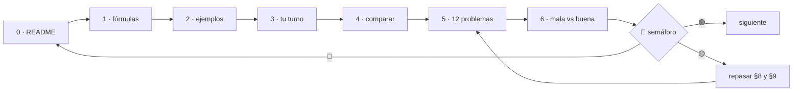

# Cómo estudiar este repo

🏠 [Volver al inicio](README.md) · ➡️ [Empezar: Lección 00](lecciones/00-que-es-ejecutar-un-programa/)

> Lectura de 5 minutos: por dónde empezar, en qué orden abrir cada archivo y cuándo pasar a la siguiente lección.

---

## 1. El orden general
1. **Fase 0** — las 18 lecciones de [`lecciones/`](lecciones/README.md), de la **00 a la 17**, en orden.
2. **Fase 1** — los 13 capítulos de [`fase-1/capitulos/`](fase-1/capitulos/README.md), del **1 al 13**.

Cada lección dice arriba **"Orden de estudio: N de 18"** y **"Antes necesitas: …"**.

## 2. Qué hay dentro de cada lección (y en qué orden se abre)

| Paso | Archivo | Para qué sirve |
|:-:|---|---|
| **0** | `README.md` | **Empieza aquí.** El *formulario*: teoría, fórmulas, errores, ejemplos, problemas y claves. |
| **1** | `paso1-formulas.php` | Las fórmulas de las tablas, **ejecutables**. |
| **2** | `paso2-ejemplos-resueltos.php` | Los ejemplos resueltos del README, paso a paso. |
| **3** | `paso3-tu-turno.php` | **Te toca a ti:** completas los huecos `// TODO`. |
| **4** | `paso4-tu-turno-solucion.php` | La solución de referencia, para comparar. |
| **5** | `paso5-solucionario/` | Las soluciones de los 12 problemas. **Ábrelo después de intentarlos.** |
| **6** | `paso6-ejercicios/` | Refuerzo: solución **mala** vs **buena**. |
| 🧪 | `Paso3TuTurnoTest.php` | *(desde la Lección 08)* el test que tu `paso3` debe pasar. Empieza en **rojo**. |

## 3. El ciclo de una lección


En 🟢 pasas a la siguiente; en 🟡 repasas errores y ejemplos; en 🔴 repites la lección.

## 4. El semáforo 🚦
| Indicador | Criterio |
|:-:|---|
| 🟢 **Sigue** | `paso3` da la salida esperada (o tests en verde) **y** ≥ 9/12 problemas **y** las preguntas sin mirar |
| 🟡 **Repasa** | 6–8 problemas |
| 🔴 **Repite** | menos de 6 |

## 5. Cómo ejecutar los archivos
Desde la raíz del repo:
```bash
composer install                                             # solo la primera vez
php lecciones/05-arrays/paso1-formulas.php                    # ejecutar un paso
vendor/bin/phpunit lecciones/08-modulos-y-phpunit            # tests (desde la 08)
```
> Corre PHPUnit **una lección a la vez**. Hasta que completes tus `// TODO`, los tests de `paso3`
> salen en **rojo a propósito**.

```bash
git diff --no-index lecciones/05-arrays/paso3-tu-turno.php lecciones/05-arrays/paso4-tu-turno-solucion.php
```

## 6. Cómo marcar tu avance
En [`progreso/fase-0-php.md`](progreso/fase-0-php.md), sección **"Mi avance"**, cambias ⬜ por ✅
y anotas el color del semáforo. Luego haces commit:
```bash
git add progreso/fase-0-php.md
git commit -m "avance: lección 05 en verde"
```

## 7. Si te trabas
1. Vuelve a la **tabla de fórmulas** (§5/§6): cada `// TODO` dice qué fórmula usar.
2. Lee los **errores frecuentes** (§8).
3. Repite el **ejemplo resuelto** más parecido (§9).
4. Solo después, mira la solución (`paso4` o `paso5-solucionario`).

---

🏠 [Volver al inicio](README.md) · ➡️ [Empezar: Lección 00](lecciones/00-que-es-ejecutar-un-programa/)
