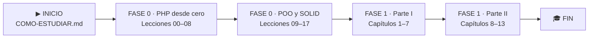

# Aprendiendo DDD con PHP y Laravel

Aprendizaje guiado **desde cero en PHP** hasta los patrones de arquitectura
(DDD, TDD, arquitectura dirigida por eventos) del libro
*Architecture Patterns with Python* de Harry Percival y Bob Gregory
([Cosmic Python](https://www.cosmicpython.com/)), llevando sus ejemplos de
**Python + Flask a PHP + Laravel**.

> Es el gemelo en PHP de
> [`aprendiendo-ddd-con-python-y-fastapi`](https://github.com/BenjaminGhiggo/aprendiendo-ddd-con-python-y-fastapi)
> y [`aprendiendo-ddd-con-typescript-y-nestjs`](https://github.com/BenjaminGhiggo/aprendiendo-ddd-con-typescript-y-nestjs).
> Las lecciones **00–17 tienen la misma numeración** en los tres, para compararlas.

---

## ▶ EMPIEZA AQUÍ

1. Lee **[Cómo estudiar este repo](COMO-ESTUDIAR.md)** (5 min).
2. Abre la **[Lección 00 · ¿Qué es ejecutar un programa?](lecciones/00-que-es-ejecutar-un-programa/)** y sigue su **Ruta de estudio**.
3. Al terminar cada lección, mira su **semáforo 🚦** y marca tu avance en **[progreso/](progreso/)**.
4. Sigue el **[índice de lecciones](lecciones/README.md)** y luego los **[capítulos del libro](fase-1/capitulos/README.md)**.

## 🗺️ Mapa de ruta


**Cómo leerlo:** se avanza de izquierda a derecha, sin saltar etapas. La Fase 0 enseña el PHP
que el libro da por sabido; la Fase 1 sigue el libro capítulo a capítulo con Laravel, construyendo
un único proyecto (*allocation*: asignar pedidos a lotes de stock).

| Etapa | Qué aprendes | Dónde | Tiempo aprox. |
|---|---|---|:-:|
| **Fase 0 · PHP** | ejecutar, variables, if, bucles, funciones, arrays, clases, excepciones, Composer, PHPUnit | [`lecciones/00–08`](lecciones/README.md) | ≈ 17 h |
| **Fase 0 · POO y SOLID** | encapsulación, herencia, polimorfismo, abstracción, SRP–DIP | [`lecciones/09–17`](lecciones/README.md) | ≈ 16 h |
| **Fase 1 · Parte I** | modelo de dominio, Repository (Eloquent), Service Layer + Laravel, Unit of Work, Aggregates | [`fase-1/capitulos/01–07`](fase-1/capitulos/README.md) | — |
| **Fase 1 · Parte II** | eventos, message bus, comandos, microservicios, CQRS, Dependency Injection | [`fase-1/capitulos/08–13`](fase-1/capitulos/README.md) | — |

---

## 📂 Cómo está organizado

```
aprendiendo-ddd-con-php-y-laravel/
├── README.md               ← estás aquí (EMPIEZA AQUÍ + mapa de ruta)
├── COMO-ESTUDIAR.md        ← cómo usar cada lección, paso a paso
├── METODOLOGIA.md          ← las reglas del aprendizaje (+ cómo se traduce Python → PHP)
├── CLAUDE.md               ← instrucciones para el asistente
├── lecciones/              ← FASE 0: 18 lecciones (00–17), cada una un "formulario"
├── fase-1/capitulos/       ← FASE 1: los 13 capítulos del libro con Laravel (en construcción)
├── progreso/               ← checklist de avance (lo marcas tú)
├── docs/fuente/            ← el libro: .md citable, .pdf e imágenes
├── composer.json           ← dependencias (Composer) y scripts
└── phpunit.xml             ← configuración de los tests
```

## 🧪 Comandos básicos

```bash
composer install                                           # instala todo (una vez)
php lecciones/05-arrays/paso1-formulas.php                  # ejecutar un archivo
vendor/bin/phpunit lecciones/08-modulos-y-phpunit          # tests de una lección (desde la 08)
```
> Los tests se corren **por lección**: los de `paso3` empiezan en **rojo a propósito** hasta
> que completas tus `// TODO`.

## Herramientas
- **PHP 8.3** y **Composer**
- **PHPUnit 11** para las pruebas
- **Laravel** + **Eloquent** para la Fase 1

## Licencia de la fuente
El contenido del libro se usa bajo licencia **Creative Commons CC BY-NC-ND**
(ver `METODOLOGIA.md`). Atribución a Harry Percival y Bob Gregory, O'Reilly 2020.
