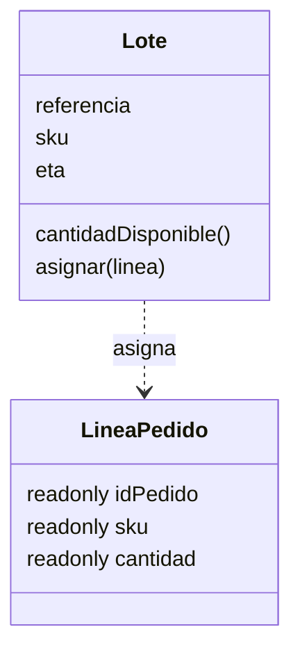
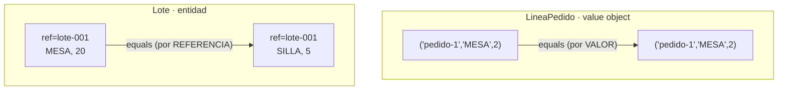
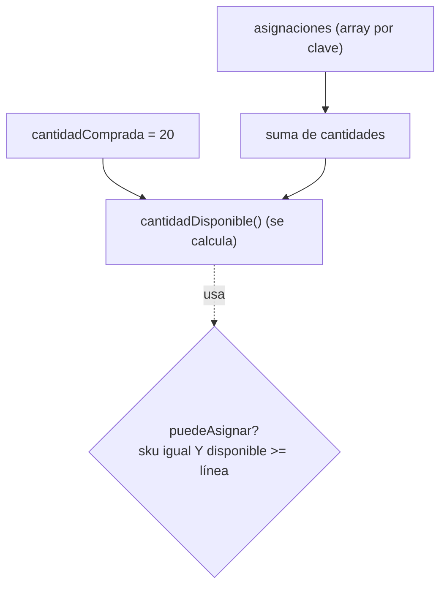
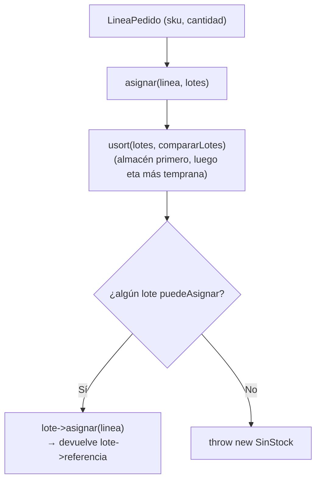

# Capítulo 1 — Domain Modeling

> Fase 1 · el libro. Capítulo autocontenido: la clase (aquí), el código en
> [`proyecto/`](proyecto/) y los ejercicios en [`ejercicios/`](ejercicios/).

⬅️ [Fase 0 · Índice de lecciones](../../../lecciones/README.md) · 🏠 [Índice de capítulos](../README.md) · ➡️ [Capítulo 2 · Repository Pattern](../02-repository-pattern/)

Avanza en **micro-pasos** (estructura 0–9). Correr las pruebas del capítulo:
```bash
vendor/bin/phpunit fase-1/capitulos/01-domain-modeling/proyecto
```

> 🌍 **Traducción (§3.10).** El libro está en Python (`Batch`, `OrderLine`, `allocate`); aquí usamos
> los mismos conceptos en PHP y español (`Lote`, `LineaPedido`, `asignar`), citando el original.
> Este capítulo es **PHP puro**: todavía no hay Laravel ni base de datos; eso llega cuando el
> proyecto empiece a doler (caps. 2 y 4).

---

## Micro-paso 1 — El primer test (TDD) y el modelo mínimo

### 0. 🧭 La pregunta
> *"El negocio vende muebles. Me piden asignar una línea de pedido a un lote de stock y que la
> cantidad disponible del lote baje. ¿Cómo lo modelo y cómo sé que funciona, sin tocar aún base
> de datos ni web?"*

### 1. Objetivo
Escribir el primer test (§3.3) y el modelo de dominio mínimo: un *value object* y una entidad.

### 2. Cita de la fuente
> *"batch = Batch("batch-001", "SMALL-TABLE", qty=20, eta=date.today()); line =
> OrderLine('order-ref', "SMALL-TABLE", 2); batch.allocate(line); assert
> batch.available_quantity == 18"* — Cap. 1, *Unit Testing Domain Models*
>
> *"the names of the classes and variables ... are taken from the business jargon."* — íd.

**Equivalente en PHP** (PHPUnit en vez de pytest):
```php
$lote = new Lote('lote-001', 'MESA-PEQUEÑA', 20, $hoy);
$lote->asignar(new LineaPedido('pedido-ref', 'MESA-PEQUEÑA', 2));
$this->assertSame(18, $lote->cantidadDisponible());
```

### 3. El dolor / necesidad
No hay nada aún; en vez de adivinar, se escribe primero la prueba que describe el comportamiento,
en el idioma del negocio.

### 4. Explicación paso a paso (TDD: rojo → verde)
1. Escribo el test en `proyecto/ModeloTest.php`.
2. Lo corro sin implementar → error "Class 'Lote' not found" (🔴 rojo).
3. Escribo `proyecto/modelo.php`:
   - `LineaPedido` = *value object* (`public readonly`, inmutable, solo datos).
   - `Lote` = *entidad* (identidad por `referencia`; estado `cantidadDisponible()` que cambia).
4. Lo corro → `OK (1 test)` (🟢 verde).

### 5. Diagrama (Mermaid)

`LineaPedido` es inmutable (solo datos). `Lote` tiene identidad y un estado que cambia al
`asignar`. Es una versión simplificada de la Figura 1-3 (la viste en la Lección 06).

### 6. Árbol de archivos
```
proyecto/
├── modelo.php          # LineaPedido (value object) + Lote (entidad)
└── ModeloTest.php      # el primer test
```

### 7. Tu turno
Asignar dos líneas distintas al mismo lote y verificar que la cantidad baja las dos veces.

### 8. Comprobación
```bash
vendor/bin/phpunit fase-1/capitulos/01-domain-modeling/proyecto   # (al final: OK, 13 tests)
```

### 9. Preguntas de recuerdo
1. ¿Diferencia entre `LineaPedido` (value object) y `Lote` (entidad)?
2. ¿Qué es el ciclo rojo → verde de TDD?
3. ¿Por qué los nombres vienen del lenguaje del negocio?

---

## Micro-paso 2 — Value objects vs. entidades (igualdad)

### 0. 🧭 La pregunta
> *"¿Dos `LineaPedido` con los mismos datos son 'la misma'? ¿Y dos lotes con la misma referencia
> pero distinto stock?"*

### 1. Objetivo
Distinguir igualdad por **valor** (value object) e igualdad por **identidad** (entidad).

### 2. Cita de la fuente
> *"A value object is any domain object that is uniquely identified by the data it holds."*
>
> *"We use the term entity to describe a domain object that has long-lived identity ...
> still recognizably the same thing. Batches ... are entities."* — Cap. 1.

**Equivalente en PHP (§3.10):** en Python los `@dataclass(frozen=True)` se comparan por valor
"gratis"; en PHP `==` compara propiedades y `===` compara identidad de instancia, así que para ser
claros **cada value object define su propio `equals()`**.
```php
final class LineaPedido {
    public function __construct(
        public readonly string $idPedido,
        public readonly string $sku,
        public readonly int $cantidad,
    ) {}
    public function equals(LineaPedido $otra): bool {       // igualdad por VALOR
        return $this->idPedido === $otra->idPedido && $this->sku === $otra->sku && $this->cantidad === $otra->cantidad;
    }
}
```

### 3. El dolor / necesidad
El negocio compara líneas por sus datos y lotes por su referencia. Hay que escribir ese `equals()`.

### 4. Explicación paso a paso (TDD)
1. Test de igualdad de `LineaPedido` → 🔴. Implemento `equals()` (compara los tres datos) → 🟢.
2. Test de igualdad de `Lote` → 🔴. Implemento `Lote::equals()`: compara **solo** `referencia` → 🟢.

### 5. Diagrama (Mermaid)

Value object: iguales si **todos** los datos coinciden. Entidad: iguales si comparten referencia.

### 6. Árbol de archivos
```
proyecto/
├── modelo.php          # LineaPedido::equals() y Lote::equals()
└── ModeloTest.php      # + tests de igualdad
```

### 7. Tu turno
Comprobar que dos lotes con referencias distintas NO son iguales.

### 8. Comprobación
```bash
vendor/bin/phpunit fase-1/capitulos/01-domain-modeling/proyecto
```

### 9. Preguntas de recuerdo
1. ¿Por qué en PHP un value object conviene que tenga `equals()`?
2. ¿Qué compara el `equals()` de `Lote`?
3. ¿Un lote sigue siendo el mismo si cambia su stock? ¿Por qué?

---

## Micro-paso 3 — El modelo registra sus asignaciones

### 0. 🧭 La pregunta
> *"Me piden reglas reales: no asignar si no alcanza, ni si el sku no coincide, no descontar dos
> veces la misma línea, y poder desasignar. ¿Cuánto queda disponible de verdad?"*

### 1. Objetivo
Que el `Lote` recuerde sus líneas asignadas y calcule la disponibilidad, con `puedeAsignar`,
`asignar`, `desasignar`.

### 2. Cita de la fuente
> *"available_quantity is now a calculated property: purchased quantity minus allocated
> quantity."* / *"can_allocate ... self.sku == line.sku and self.available_quantity >= line.qty"* — Cap. 1.

**Equivalente en PHP (§3.10):** el libro guarda las líneas en un `set()`, que deduplica por valor.
PHP no tiene un set de objetos por valor; usamos un **array indexado por la clave del value object**:
```php
/** @var array<string, LineaPedido> */
private array $asignaciones = [];

public function asignar(LineaPedido $linea): void {
    if ($this->puedeAsignar($linea)) {
        $this->asignaciones[$linea->clave()] = $linea;   // misma clave => NO duplica
    }
}
public function cantidadDisponible(): int {              // se calcula con un foreach
    $asignado = 0;
    foreach ($this->asignaciones as $l) { $asignado += $l->cantidad; }
    return $this->cantidadComprada - $asignado;
}
```

### 3. El dolor / necesidad
Un `cantidadDisponible` restado a mano no sabe si una línea ya estaba asignada. El lote debe
**guardar** el conjunto de líneas y **calcular** la disponibilidad.

### 4. Explicación paso a paso (TDD)
1. Tests del libro (puedeAsignar por cantidad/sku, idempotencia, desasignar) → 6 en rojo.
2. Refactor de `Lote`: `cantidadComprada` (fija) + `asignaciones` (array por clave);
   `asignar` añade solo si `puedeAsignar`; `cantidadDisponible()` y `puedeAsignar()` se calculan.
3. Verde: 9 tests.

### 5. Diagrama (Mermaid)

`cantidadDisponible()` se calcula (comprada − asignada); nunca es un dato suelto que pueda quedar mal.

### 6. Árbol de archivos
```
proyecto/
├── modelo.php          # Lote con asignaciones (array), cantidadDisponible(), puedeAsignar
└── ModeloTest.php      # 9 tests
```

### 7. Tu turno
Test: asignar y luego desasignar la misma línea devuelve la cantidad a 20.

### 8. Comprobación
```bash
vendor/bin/phpunit fase-1/capitulos/01-domain-modeling/proyecto
```

### 9. Preguntas de recuerdo
1. ¿Por qué `cantidadDisponible()` se calcula en vez de guardarse?
2. ¿Por qué un array indexado por `clave()` y no uno cualquiera?
3. ¿Qué comprueba `puedeAsignar`?

---

## Micro-paso 4 — Servicio de dominio `asignar` + excepción `SinStock`

### 0. 🧭 La pregunta
> *"Asignar una línea contra el conjunto de lotes, eligiendo bien (almacén primero, luego el que
> llega antes). ¿Y si ningún lote puede? Eso es estar 'sin stock'."*

### 1. Objetivo
Un servicio de dominio `asignar` (función), ordenar lotes con un comparador, y la excepción `SinStock`.

### 2. Cita de la fuente
> *"just make it a function."* / *"batch = next(b for b in sorted(batches) if b.can_allocate(line))"*
> / *"class OutOfStock(Exception): pass ... raise OutOfStock(...)"* — Cap. 1.

**Equivalente en PHP (§3.10):** `sorted(batches)` con `__gt__` → `usort($lotes, 'compararLotes')`;
`class OutOfStock(Exception)` → `class SinStock extends \Exception`.
```php
function compararLotes(Lote $a, Lote $b): int {
    if ($a->eta === null) return -1;          // lote en almacén (sin eta) va primero
    if ($b->eta === null) return 1;
    return $a->eta <=> $b->eta;               // entre lotes con eta, el más temprano primero
}
function asignar(LineaPedido $linea, array $lotes): string {
    $ordenados = $lotes; usort($ordenados, 'compararLotes');
    foreach ($ordenados as $lote) {
        if ($lote->puedeAsignar($linea)) { $lote->asignar($linea); return $lote->referencia; }
    }
    throw new SinStock("Sin stock para el sku {$linea->sku}");
}
```

### 3. El dolor / necesidad
Elegir entre varios lotes no es de un solo lote (por eso es una **función**); hay que ordenarlos;
y "no hay stock" merece una excepción con nombre del negocio.

### 4. Explicación paso a paso (TDD)
1. 4 tests del libro (prefiere almacén, prefiere temprano, devuelve referencia, SinStock) → rojo.
2. Implemento `compararLotes`, `class SinStock extends \Exception` y la función `asignar`
   (un `foreach` sobre los lotes ordenados; si ninguno puede, `throw new SinStock`).
3. Verde: 13 tests.

### 5. Diagrama (Mermaid — reproduce la Figura 1-4)


### 6. Árbol de archivos
```
proyecto/
├── modelo.php          # + compararLotes, SinStock, función asignar()
└── ModeloTest.php      # 13 tests
```

### 7. Tu turno
Test: asignar la misma línea a dos lotes solo la asigna a uno.

### 8. Comprobación
```bash
vendor/bin/phpunit fase-1/capitulos/01-domain-modeling/proyecto   # OK (13 tests)
```

### 9. Preguntas de recuerdo
1. ¿Por qué `asignar` es una función y no un método?
2. ¿Qué hace `compararLotes` al usar `usort`?
3. ¿Por qué traducir "ningún lote sirve" a una excepción `SinStock`?

---

> **Capítulo 1 completo.** El modelo de dominio (`LineaPedido`, `Lote`, `asignar`, `SinStock`)
> está construido con TDD, sin base de datos ni web. Siguiente: **Capítulo 2 — Repository Pattern**
> (ahí aparece Eloquent).

⬅️ [Fase 0 · Índice de lecciones](../../../lecciones/README.md) · 🏠 [Índice de capítulos](../README.md) · ➡️ [Capítulo 2 · Repository Pattern](../02-repository-pattern/)
