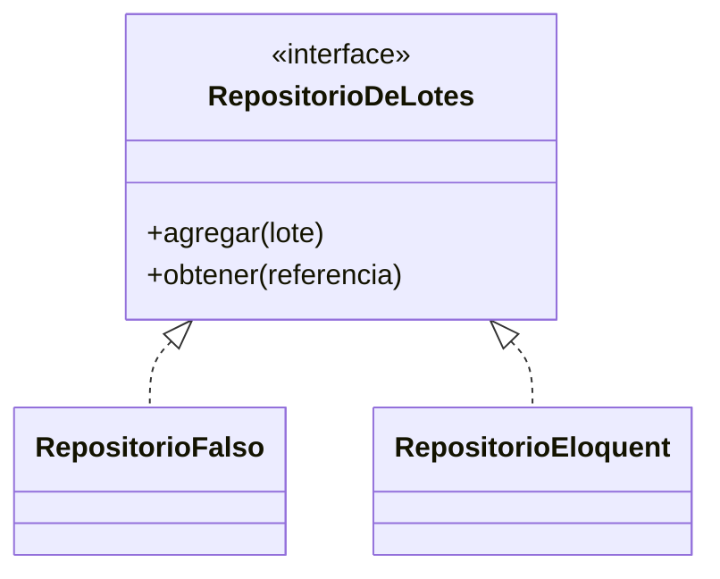
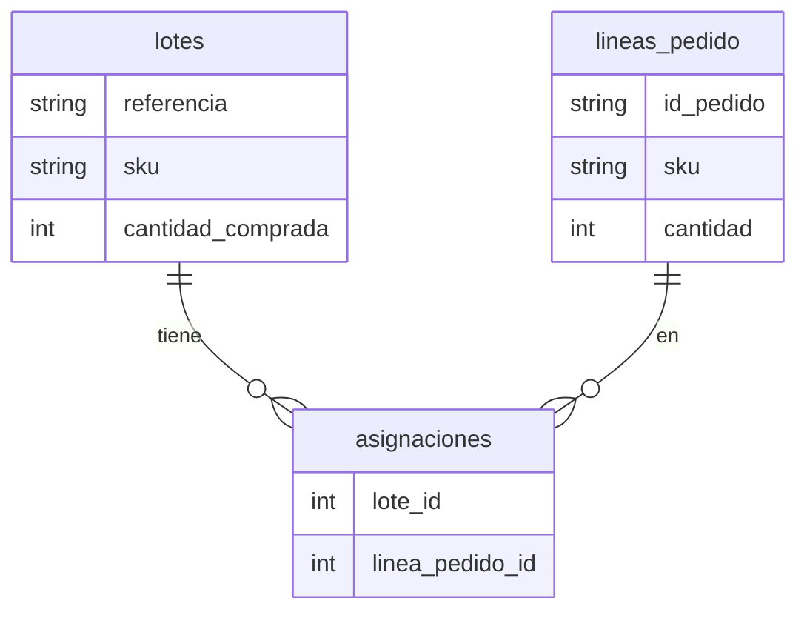
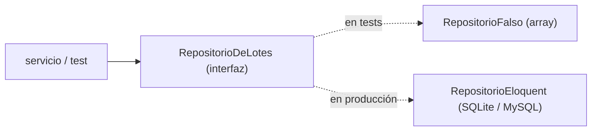

# Capítulo 2 — Repository Pattern (con Eloquent)

> Fase 1 · el libro. Capítulo autocontenido: la clase (aquí), el código en [`proyecto/`](proyecto/)
> y los ejercicios en [`ejercicios/`](ejercicios/).

⬅️ [Capítulo 1 · Domain Modeling](../01-domain-modeling/) · 🏠 [Índice de capítulos](../README.md) · ➡️ [Capítulo 3 · Coupling and Abstractions](../03-coupling-y-abstracciones/)

Correr las pruebas:
```bash
vendor/bin/phpunit fase-1/capitulos/02-repository-pattern/proyecto
```

> ⚠️ **Diferencia clave con el libro (§3.10).** El libro usa **Data Mapper** (SQLAlchemy): el
> modelo de dominio es una clase **pura** y el ORM la mapea aparte ("el ORM depende del modelo").
> **Eloquent es Active Record**: el modelo **hereda de `Model`** y la lógica de dominio vive
> **dentro** del modelo. Es lo idiomático en Laravel (y lo que elegimos), pero no deja el dominio
> puro. Donde el libro dice "mantén el modelo sin saber del ORM", aquí el modelo **es** el ORM; lo
> que sí conservamos es el **Repository** (una interfaz) para no esparcir consultas por todo el código.

---

## Micro-paso 1 — El Repository Pattern (interfaz + falso)

### 0. 🧭 La pregunta
> *"Mi modelo vive en memoria. Me piden persistirlo, pero sin llenar el resto del código de
> consultas a la base de datos. ¿Cómo lo abstraigo?"*

### 1. Objetivo
Definir una **interfaz** `RepositorioDeLotes` (el contrato) y un `RepositorioFalso` en memoria
para los tests.

### 2. Cita de la fuente
> *"The simplest repository has just two methods: add() ... and get() ..."* — Cap. 2.

**Equivalente en PHP:**
```php
interface RepositorioDeLotes {
    public function agregar(Lote $lote): void;
    public function obtener(string $referencia): ?Lote;
}
```

### 3. El dolor / necesidad
Si cada servicio hace sus propias consultas, el dominio queda atado a la base de datos y los tests
necesitan una BD. Una interfaz permite un **doble falso** en memoria.

### 4. Explicación paso a paso (TDD)
1. Test: `RepositorioFalso` agrega un lote y lo obtiene por referencia → 🔴.
2. Implemento la interfaz `RepositorioDeLotes` y `RepositorioFalso` (un array en memoria) → 🟢.

### 5. Diagrama (Mermaid)

El dominio depende de la **interfaz**; en los tests se usa el falso, en producción el de Eloquent.

### 6. Árbol de archivos
```
proyecto/
├── modelo.php          # Lote y LineaPedido (modelos Eloquent)
├── repositorio.php     # interfaz + RepositorioFalso + RepositorioEloquent
└── RepositorioTest.php
```

### 7. Tu turno
Test: el repositorio falso devuelve `null` si la referencia no existe.

### 8. Comprobación
```bash
vendor/bin/phpunit fase-1/capitulos/02-repository-pattern/proyecto
```

### 9. Preguntas de recuerdo
1. ¿Qué dos métodos tiene el repositorio?
2. ¿Para qué sirve el `RepositorioFalso`?
3. ¿Por qué el dominio depende de la interfaz y no de Eloquent?

---

## Micro-paso 2 — El modelo con Eloquent (Active Record)

### 0. 🧭 La pregunta
> *"Quiero guardar el `Lote` en una base de datos real. En Laravel, ¿cómo hago que una clase sepa
> guardarse y cargarse?"*

### 2. Cita de la fuente
> *"The ORM imports (or "depends on" or "knows about") the domain model, and not the other
> way around."* — Cap. 2.

**Equivalente en PHP (§3.10 — aquí difiere):** en el libro el ORM depende del modelo (Data Mapper).
En Laravel es al revés: el modelo **hereda de `Model`** (Active Record). Lo anotamos y seguimos con
lo idiomático de Laravel:
```php
final class Lote extends Model {
    protected $table = 'lotes';
    public $timestamps = false;
    protected $guarded = [];
    public function asignaciones(): BelongsToMany {
        return $this->belongsToMany(LineaPedido::class, 'asignaciones', 'lote_id', 'linea_pedido_id');
    }
}
```

### 3. El dolor / necesidad
El modelo del cap. 1 no sabe persistirse. Con Eloquent, extenderlo de `Model` le da `save()`,
`find()`, relaciones y consultas.

### 4. Explicación paso a paso (TDD)
1. `BaseDeDatosTestCase` arranca Eloquent (Capsule) con SQLite en memoria y crea el esquema.
2. `Lote` y `LineaPedido` extienden `Model`; las asignaciones son `belongsToMany` por la tabla
   pivote `asignaciones`.
3. Las reglas de dominio (`asignar`, `puedeAsignar`, `cantidadDisponible`) viven en el modelo.
4. 🟢: el lote se guarda y se carga **con sus asignaciones**.

### 5. Diagrama (Mermaid)

La tabla pivote `asignaciones` relaciona lotes y líneas (muchos-a-muchos), como el `set()` del libro.

### 6. Árbol de archivos
```
proyecto/
├── modelo.php                # Lote y LineaPedido extends Model; asignaciones belongsToMany
├── BaseDeDatosTestCase.php   # arranca Capsule + crea el esquema (SQLite :memory:)
└── ModeloTest.php
```

### 7. Tu turno
Test: cargar un lote recién guardado y comprobar su sku.

### 8. Comprobación
```bash
vendor/bin/phpunit fase-1/capitulos/02-repository-pattern/proyecto
```

### 9. Preguntas de recuerdo
1. ¿En qué se diferencia Active Record (Eloquent) del Data Mapper del libro?
2. ¿Cómo se guardan las asignaciones (qué tabla)?
3. ¿Por qué `cantidadDisponible()` consulta la relación fresca cada vez?

---

## Micro-paso 3 — El repositorio de Eloquent (adaptador)

### 0. 🧭 La pregunta
> *"Ya tengo el contrato y el falso. Me piden el repositorio de verdad que hable con la base de
> datos a través de Eloquent."*

### 2. Cita de la fuente
> *"class SqlAlchemyRepository(AbstractRepository): ... def add(self, batch): self.session.add(batch);
> def get(self, reference): return self.session.query(model.Batch).filter_by(reference=reference).one()"* — Cap. 2.

**Equivalente en PHP:**
```php
final class RepositorioEloquent implements RepositorioDeLotes {
    public function agregar(Lote $lote): void { $lote->save(); }
    public function obtener(string $referencia): ?Lote {
        return Lote::where('referencia', $referencia)->with('asignaciones')->first();
    }
}
```

### 3. El dolor / necesidad
El falso no persiste nada. El `RepositorioEloquent` implementa la **misma interfaz**, así el servicio
no nota la diferencia (puerto/adaptador).

### 4. Explicación paso a paso (TDD)
1. Test: `RepositorioEloquent` guarda un lote y lo recupera (con SQLite en memoria) → 🔴.
2. Implemento `RepositorioEloquent` (usa `save()` y `where()->first()`) → 🟢. Con Active Record es
   más corto que en el libro, porque el modelo ya sabe guardarse.

### 5. Diagrama (Mermaid)

Mismo enchufe (la interfaz), dos adaptadores. Cambiar de uno a otro no toca el dominio.

### 6. Árbol de archivos
```
proyecto/
├── modelo.php
├── repositorio.php     # + RepositorioEloquent
├── BaseDeDatosTestCase.php
├── ModeloTest.php
└── RepositorioTest.php
```

### 7. Tu turno
Test: guardar un lote con una asignación y comprobar que al cargarlo `cantidadDisponible()` baja.

### 8. Comprobación
```bash
vendor/bin/phpunit fase-1/capitulos/02-repository-pattern/proyecto   # OK (15 tests)
```

### 9. Preguntas de recuerdo
1. ¿Qué hace `RepositorioEloquent::obtener`?
2. ¿Por qué el falso y el de Eloquent implementan la misma interfaz?
3. ¿Por qué con Active Record el repositorio queda más fino que en el libro?

---

> **Capítulo 2 completo.** Siguiente: **Capítulo 3 — Coupling and Abstractions**.

⬅️ [Capítulo 1 · Domain Modeling](../01-domain-modeling/) · 🏠 [Índice de capítulos](../README.md) · ➡️ [Capítulo 3 · Coupling and Abstractions](../03-coupling-y-abstracciones/)
