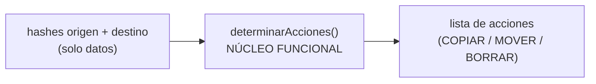
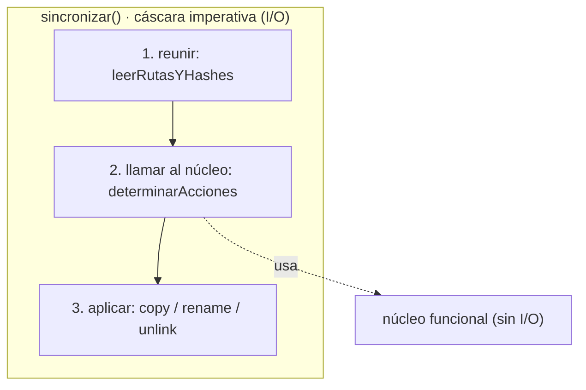

# Capítulo 3 — Coupling and Abstractions

> Fase 1 · el libro. Capítulo autocontenido: la clase (aquí), el código en [`proyecto/`](proyecto/)
> y los ejercicios en [`ejercicios/`](ejercicios/).

⬅️ [Capítulo 2 · Repository Pattern](../02-repository-pattern/) · 🏠 [Índice de capítulos](../README.md) · ➡️ [Capítulo 4 · Service Layer + API (Laravel)](../04-service-layer-laravel/)

Correr las pruebas:
```bash
vendor/bin/phpunit fase-1/capitulos/03-coupling-y-abstracciones/proyecto
```

> Este capítulo es un **interludio**: un ejemplo aparte (sincronizar dos carpetas) para enseñar a
> **separar la lógica del I/O**. El código del cap. 2 viaja como snapshot, pero la novedad es
> `sincronizador.php`.

---

## Micro-paso 1 — Núcleo funcional (`determinarAcciones`)

### 0. 🧭 La pregunta
> *"Una función que sincroniza dos carpetas mezcla la lógica (qué copiar/mover/borrar) con el I/O
> (leer y escribir archivos). Así es casi imposible de probar. ¿Cómo la separo?"*

### 1. Objetivo
Extraer un **núcleo funcional** que **solo decide** (a partir de datos) qué acciones hacer, sin
tocar el disco.

### 2. Cita de la fuente
> *"our domain logic ... is tightly coupled to the I/O code."* — Cap. 3.

**Equivalente en PHP:** una función pura que recibe dos arrays `hash => nombre` y devuelve una lista
de acciones; no lee ni escribe archivos.
```php
function determinarAcciones(array $hashesOrigen, array $hashesDestino, string $origen, string $destino): array {
    $acciones = [];
    foreach ($hashesOrigen as $hash => $nombre) {
        if (!array_key_exists($hash, $hashesDestino)) { $acciones[] = ['COPIAR', "$origen/$nombre", "$destino/$nombre"]; }
        elseif ($hashesDestino[$hash] !== $nombre)    { $acciones[] = ['MOVER', "$destino/{$hashesDestino[$hash]}", "$destino/$nombre"]; }
    }
    foreach ($hashesDestino as $hash => $nombre) {
        if (!array_key_exists($hash, $hashesOrigen)) { $acciones[] = ['BORRAR', "$destino/$nombre"]; }
    }
    return $acciones;
}
```

### 3. El dolor / necesidad
Probar algo que lee el disco exige crear archivos de verdad en cada test: lento y frágil. Si la
lógica es una función de **datos → datos**, se prueba con un array de entrada y se compara la salida.

### 4. Explicación paso a paso (TDD)
1. 3 tests del núcleo (copiar lo nuevo, mover lo renombrado, borrar lo que sobra) → 🔴.
2. Implemento `determinarAcciones` (solo recorre los dos arrays y arma la lista) → 🟢. Sin I/O.

### 5. Diagrama (Mermaid)

Entra datos, sale datos. Ni una llamada al disco: trivial de probar.

### 6. Árbol de archivos
```
proyecto/
├── sincronizador.php         # determinarAcciones (núcleo)
└── SincronizadorTest.php     # tests del núcleo (solo datos)
```

### 7. Tu turno
Test: si origen y destino son iguales, no hay ninguna acción.

### 8. Comprobación
```bash
vendor/bin/phpunit fase-1/capitulos/03-coupling-y-abstracciones/proyecto
```

### 9. Preguntas de recuerdo
1. ¿Qué recibe y qué devuelve `determinarAcciones`?
2. ¿Por qué un núcleo sin I/O es fácil de probar?
3. ¿Qué tres acciones puede decidir?

---

## Micro-paso 2 — Cáscara imperativa (`sincronizar`) + edge-to-edge

### 0. 🧭 La pregunta
> *"Ya tengo la lógica aislada. ¿Cómo la conecto al disco real y compruebo que de verdad copia y
> borra archivos?"*

### 1. Objetivo
Una **cáscara imperativa** que reúne los datos (I/O), llama al núcleo y aplica las acciones (I/O);
y tests **edge-to-edge** con carpetas temporales reales.

### 2. Cita de la fuente
> *"our top-level function will contain almost no logic at all; it's just an imperative series of
> steps: gather inputs, call our logic, apply outputs."* — Cap. 3.

**Equivalente en PHP:**
```php
function sincronizar(string $origen, string $destino): void {
    $hashesOrigen = leerRutasYHashes($origen);          // I/O: reunir
    $hashesDestino = leerRutasYHashes($destino);
    $acciones = determinarAcciones($hashesOrigen, $hashesDestino, $origen, $destino); // lógica
    foreach ($acciones as $a) {                          // I/O: aplicar
        if ($a[0] === 'COPIAR') { copy($a[1], $a[2]); }
        elseif ($a[0] === 'MOVER') { rename($a[1], $a[2]); }
        elseif ($a[0] === 'BORRAR') { unlink($a[1]); }
    }
}
```

### 3. El dolor / necesidad
El núcleo no toca el disco; alguien tiene que leerlo y escribirlo. Esa parte se concentra en una
cáscara fina, con **todo el I/O junto** y **ninguna lógica**.

### 4. Explicación paso a paso (TDD)
1. 2 tests edge-to-edge (con `sys_get_temp_dir()`): sincronizar copia un archivo nuevo; borra uno
   que sobra en destino → 🔴.
2. Implemento `leerRutasYHashes` (con `scandir` + `hash_file`) y `sincronizar` → 🟢.

### 5. Diagrama (Mermaid)

La cáscara solo orquesta: reunir → decidir (núcleo) → aplicar. Toda la lógica está en el núcleo.

### 6. Árbol de archivos
```
proyecto/
├── sincronizador.php         # + leerRutasYHashes, sincronizar (cáscara)
└── SincronizadorTest.php     # + 2 tests edge-to-edge con carpetas temporales
```

### 7. Tu turno
Test: si un archivo se renombra en origen, en destino se mueve (no se copia de nuevo).

### 8. Comprobación
```bash
vendor/bin/phpunit fase-1/capitulos/03-coupling-y-abstracciones/proyecto   # OK (20 tests)
```

### 9. Preguntas de recuerdo
1. ¿Qué tres pasos tiene la cáscara imperativa?
2. ¿Dónde vive el I/O y dónde la lógica?
3. ¿Qué es un test edge-to-edge?

---

> **Capítulo 3 completo.** Siguiente: **Capítulo 4 — Service Layer + API (Laravel)**.

⬅️ [Capítulo 2 · Repository Pattern](../02-repository-pattern/) · 🏠 [Índice de capítulos](../README.md) · ➡️ [Capítulo 4 · Service Layer + API (Laravel)](../04-service-layer-laravel/)
