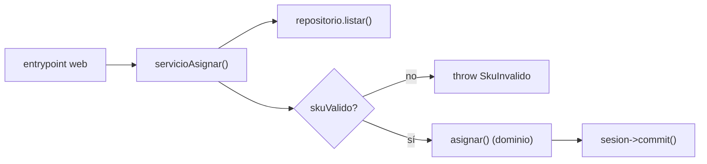
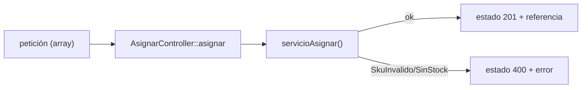

# Capítulo 4 — Service Layer + API (Laravel)

> Fase 1 · el libro. Capítulo autocontenido: la clase (aquí), el código en [`proyecto/`](proyecto/)
> y los ejercicios en [`ejercicios/`](ejercicios/).

⬅️ [Capítulo 3 · Coupling y Abstracciones](../03-coupling-y-abstracciones/) · 🏠 [Índice de capítulos](../README.md) · ➡️ [Capítulo 5 · TDD en marchas](../05-tdd-marchas/)

Avanza en **micro-pasos** (estructura 0–9). Correr las pruebas:
```bash
vendor/bin/phpunit fase-1/capitulos/04-service-layer-laravel/proyecto
```

> 🌍 **Traducción (§3.10).** El libro usa **Flask**; aquí **Laravel** (regla 4). El libro usa
> SQLAlchemy (Data Mapper); nosotros **Eloquent** (Active Record), así que el modelo de dominio
> sigue siendo PHP puro (`modelo.php`) y unas clases `*Row` de Eloquent guardan en la BD; el
> `RepositorioEloquent` traduce entre ambos mundos. En una app Laravel típica se suele usar el
> modelo Eloquent directamente como dominio; aquí separamos para mantener el dominio puro como el libro.

---

## Micro-paso 1 — La capa de servicios (`servicioAsignar`)

### 0. 🧭 La pregunta
> *"Ya tengo el modelo y un repositorio. Pero ¿quién coordina el caso de uso completo —traer los
> lotes, validar el sku, asignar y confirmar— sin meter esa orquestación en el modelo ni en la web?"*

### 1. Objetivo
Una **capa de servicios** (`servicioAsignar`) que orquesta el caso de uso, sin lógica de negocio
(esa vive en el modelo).

### 2. Cita de la fuente
> *"def allocate(line: OrderLine, repo: AbstractRepository, session) -> str: batches = repo.list()
> if not is_valid_sku(line.sku, batches): raise InvalidSku(f'Invalid sku {line.sku}') batchref =
> model.allocate(line, batches) session.commit() return batchref"* — Cap. 4.

**Equivalente en PHP:**
```php
function servicioAsignar(LineaPedido $linea, RepositorioDeLotes $repo, Sesion $sesion): string {
    $lotes = $repo->listar();                          // 1. traer
    if (!skuValido($linea->sku, $lotes)) {             // 2. validar
        throw new SkuInvalido("Sku inválido {$linea->sku}");
    }
    $referencia = asignar($linea, $lotes);             // 3. llamar al dominio
    $sesion->commit();                                 // 4. confirmar
    return $referencia;
}
```

### 3. El dolor / necesidad
Si la validación y la coordinación se meten en el endpoint web, no se pueden probar sin HTTP; si
se meten en el modelo, lo ensucian. La capa de servicios es el punto intermedio.

### 4. Explicación paso a paso (TDD)
1. Tests de servicio con `RepositorioFalso` (sin BD): devuelve la referencia, lanza `SkuInvalido`,
   hace commit → rojo.
2. Implemento `servicioAsignar` (traer, validar, asignar, confirmar) y `SkuInvalido`.
3. Verde: 3 tests de servicio.

### 5. Diagrama (Mermaid)

El servicio **coordina**; la regla de negocio vive en `asignar()` del dominio.

### 6. Árbol de archivos
```
proyecto/
├── modelo.php          # dominio puro (del cap. 1)
├── repositorio.php     # interfaz + RepositorioFalso + RepositorioEloquent (+ clases *Row)
├── servicios.php       # servicioAsignar, SkuInvalido, Sesion/SesionFalsa
└── ServiciosTest.php   # 3 tests con RepositorioFalso
```

### 7. Tu turno
Un test: asignar dos líneas distintas de lotes distintos devuelve cada referencia correcta.

### 8. Comprobación
```bash
vendor/bin/phpunit fase-1/capitulos/04-service-layer-laravel/proyecto
```

### 9. Preguntas de recuerdo
1. ¿Qué hace la capa de servicios que no hace el modelo?
2. ¿Por qué los tests de servicio usan `RepositorioFalso`?
3. ¿Qué pasos orquesta `servicioAsignar`?

---

## Micro-paso 2 — El entrypoint web (controlador Laravel)

### 0. 🧭 La pregunta
> *"¿Cómo expongo esto por la web sin que el controlador acumule lógica? Quiero un endpoint 'fino'."*

### 1. Objetivo
Un controlador **fino** que traduce la petición y delega en la capa de servicios.

### 2. Cita de la fuente
> *"We show how this layer makes it easy to build thin entrypoints to our system, whether it's a
> Flask API or a CLI."* — Preface. (Aquí Laravel en vez de Flask.)

**Equivalente en PHP/Laravel:** en una app real sería `Route::post('/asignar', AsignarController::class)`
con un `Illuminate\Http\Request`. Aquí el controlador recibe un array y se prueba llamando al método
directamente (sin levantar un servidor):
```php
final class AsignarController {
    public function __construct(private RepositorioDeLotes $repo, private Sesion $sesion) {}
    public function asignar(array $peticion): array {
        $linea = new LineaPedido($peticion['id_pedido'], $peticion['sku'], $peticion['cantidad']);
        try {
            $referencia = servicioAsignar($linea, $this->repo, $this->sesion);
        } catch (SkuInvalido | SinStock $e) {
            return ['estado' => 400, 'cuerpo' => ['error' => $e->getMessage()]]; // como abort(400)
        }
        return ['estado' => 201, 'cuerpo' => ['referencia' => $referencia]];
    }
}
```

### 3. El dolor / necesidad
Un controlador con lógica es difícil de probar y se repite. Fino = solo traduce HTTP y delega.

### 4. Explicación paso a paso (TDD)
1. Tests del controlador (201 con referencia; 400 si el sku no existe) → rojo.
2. Implemento `AsignarController`: arma la línea, llama al servicio, traduce la excepción a 400.
3. Verde. El repositorio y la sesión llegan por el **constructor** (el contenedor de Laravel los
   inyectará automáticamente — cap. 13).

### 5. Diagrama (Mermaid)


### 6. Árbol de archivos
```
proyecto/
├── AsignarController.php        # el entrypoint web fino
├── AsignarControllerTest.php    # 2 tests (201 y 400)
└── RepositorioEloquentTest.php  # integración con SQLite en memoria
```

### 7. Tu turno
Un test: pedir más stock del que hay devuelve estado 400.

### 8. Comprobación
```bash
vendor/bin/phpunit fase-1/capitulos/04-service-layer-laravel/proyecto   # OK (20 tests)
```

### 9. Preguntas de recuerdo
1. ¿Qué significa que un controlador sea "fino"?
2. ¿Cómo traduce el controlador una `SkuInvalido` a una respuesta?
3. ¿Quién inyectará el repositorio en una app Laravel real?

---

> **Capítulo 4 completo.** Hay una capa de servicios y un entrypoint fino. Siguiente:
> **Capítulo 5 — TDD en marchas** (desacoplar los tests de servicio con primitivos).

⬅️ [Capítulo 3 · Coupling y Abstracciones](../03-coupling-y-abstracciones/) · 🏠 [Índice de capítulos](../README.md) · ➡️ [Capítulo 5 · TDD en marchas](../05-tdd-marchas/)
