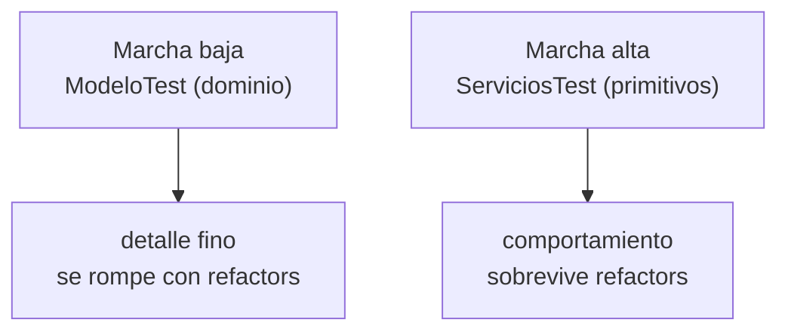

# Capítulo 5 — TDD en marcha alta y baja

> Fase 1 · el libro. Capítulo autocontenido: la clase (aquí), el código en [`proyecto/`](proyecto/)
> y los ejercicios en [`ejercicios/`](ejercicios/).

⬅️ [Capítulo 4 · Service Layer + API (Laravel)](../04-service-layer-laravel/) · 🏠 [Índice de capítulos](../README.md) · ➡️ [Capítulo 6 · Unit of Work](../06-unit-of-work/)

Avanza en **micro-pasos** (estructura 0–9). Correr las pruebas:
```bash
vendor/bin/phpunit fase-1/capitulos/05-tdd-marchas/proyecto
```

> 🌍 **Traducción (§3.10).** El libro usa Flask + pytest; aquí Laravel + PHPUnit. Este capítulo casi
> no cambia el código: cambia **cómo probamos**.

---

## Micro-paso 1 — Desacoplar los tests de servicio con primitivos

### 0. 🧭 La pregunta
> *"Mis tests de servicio arman objetos `Lote` y `LineaPedido` del dominio. Si mañana cambio esos
> constructores, se rompen muchos tests. ¿Cómo desacoplo los tests de servicio del modelo?"*

### 1. Objetivo
Que la capa de servicios reciba **primitivos** (`string`/`int`), no objetos de dominio, para que sus
tests no dependan de cómo se construye el modelo.

### 2. Cita de la fuente
> *"To have a service layer that's fully decoupled from the domain, we need to rewrite its API to
> work in terms of primitives."* — Cap. 5.

**Equivalente en PHP:** antes el servicio recibía un `LineaPedido`; ahora recibe `($idPedido, $sku,
$cantidad)` y arma la línea por dentro. Además `agregarLote` crea el lote desde primitivos.
```php
function servicioAsignar(string $idPedido, string $sku, int $cantidad, RepositorioDeLotes $repo, Sesion $sesion): string {
    $linea = new LineaPedido($idPedido, $sku, $cantidad);   // el servicio ARMA la línea
    // ... traer, validar, asignar, confirmar ...
}
function agregarLote(string $referencia, string $sku, int $cantidad, ?DateTimeImmutable $eta, RepositorioDeLotes $repo, Sesion $sesion): void {
    $repo->agregar(new Lote($referencia, $sku, $cantidad, $eta));
    $sesion->commit();
}
```

### 3. El dolor / necesidad
Si los tests de servicio construyen `new Lote(...)` y `new LineaPedido(...)`, quedan **acoplados** al
dominio: un cambio en esos constructores rompe tests que no son del dominio.

### 4. Explicación paso a paso (TDD)
1. Reescribo `servicioAsignar` para recibir primitivos y añado `agregarLote`.
2. Los tests de servicio ahora usan **solo** strings/ints: `agregarLote('lote-1', 'LAMPARA', 100, ...)`
   y `servicioAsignar('o1', 'LAMPARA', 10, ...)`. No arman objetos de dominio.
3. Verde: 3 tests de servicio desacoplados.

### 5. Diagrama (Mermaid)

El test no sabe nada de `LineaPedido`; habla con el servicio en primitivos.

### 6. Árbol de archivos
```
proyecto/
├── modelo.php          # sin cambios
├── repositorio.php     # sin cambios
├── servicios.php       # servicioAsignar(primitivos) + agregarLote(primitivos)
└── ServiciosTest.php   # tests con solo primitivos
```

### 7. Tu turno
Un test de servicio que agregue dos lotes y asigne; todo con primitivos.

### 8. Comprobación
```bash
vendor/bin/phpunit fase-1/capitulos/05-tdd-marchas/proyecto
```

### 9. Preguntas de recuerdo
1. ¿Por qué pasar primitivos desacopla los tests de servicio?
2. ¿Qué hace ahora `agregarLote`?
3. ¿Quién arma el `LineaPedido` ahora?

---

## Micro-paso 2 — Marcha alta / baja (elegir el nivel del test)

### 0. 🧭 La pregunta
> *"Tengo tests del dominio (muy detallados) y tests del servicio (menos acoplados). ¿Cuál escribo
> para cada cosa? ¿Cuándo 'bajo de marcha' al dominio y cuándo 'subo' al servicio?"*

### 1. Objetivo
Entender la metáfora de las **marchas**: marcha baja (tests de dominio, detallados) para explorar un
problema nuevo; marcha alta (tests de servicio, con primitivos) cuando el diseño ya está asentado.

### 2. Cita de la fuente
> *"When starting a journey, the bicycle needs to be in a low gear so that it can overcome inertia.
> Once we're off and running, we can go faster and more efficiently by changing into a high gear"* — Cap. 5.

**Equivalente en PHP:** los tests de dominio (`ModeloTest`) prueban `Lote`/`asignar` con todo detalle
(marcha baja); los tests de servicio (`ServiciosTest`) prueban el caso de uso con primitivos (marcha
alta). Mientras el comportamiento no cambie, los de servicio sobreviven a refactors del dominio.

### 3. El dolor / necesidad
Si todo se prueba en marcha baja (nivel dominio), cualquier refactor rompe muchos tests. Si todo en
marcha alta (nivel servicio), cuesta localizar un fallo fino. Hay que elegir el nivel según el momento.

### 4. Explicación paso a paso
1. Marcha baja: `ModeloTest` (13 tests) prueba el dominio con detalle.
2. Marcha alta: `ServiciosTest` prueba el caso de uso con primitivos, sin acoplarse al dominio.
3. Regla práctica: explora en marcha baja; una vez estable, prueba comportamiento en marcha alta.

### 5. Diagrama (Mermaid)


### 6. Árbol de archivos
```
proyecto/
├── ModeloTest.php      # marcha baja (13 tests de dominio)
└── ServiciosTest.php   # marcha alta (3 tests de servicio con primitivos)
```

### 7. Tu turno
Decide: para probar "un lote sin eta va antes que uno con eta", ¿marcha alta o baja? Escríbelo.

### 8. Comprobación
```bash
vendor/bin/phpunit fase-1/capitulos/05-tdd-marchas/proyecto   # OK (18 tests)
```

### 9. Preguntas de recuerdo
1. ¿Qué es un test en "marcha baja"? ¿Y en "marcha alta"?
2. ¿Cuándo conviene cada uno?
3. ¿Por qué los tests de servicio con primitivos sobreviven a refactors del dominio?

---

> **Capítulo 5 completo.** Los tests de servicio están desacoplados del dominio (primitivos) y sabes
> elegir la marcha. Siguiente: **Capítulo 6 — Unit of Work**.

⬅️ [Capítulo 4 · Service Layer + API (Laravel)](../04-service-layer-laravel/) · 🏠 [Índice de capítulos](../README.md) · ➡️ [Capítulo 6 · Unit of Work](../06-unit-of-work/)
