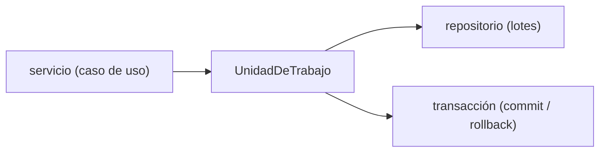
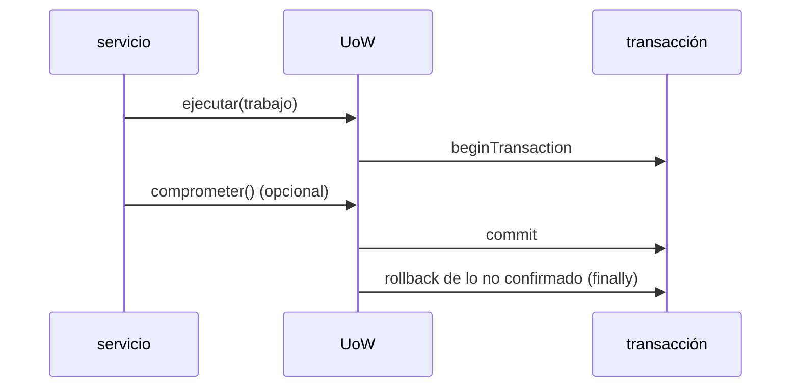
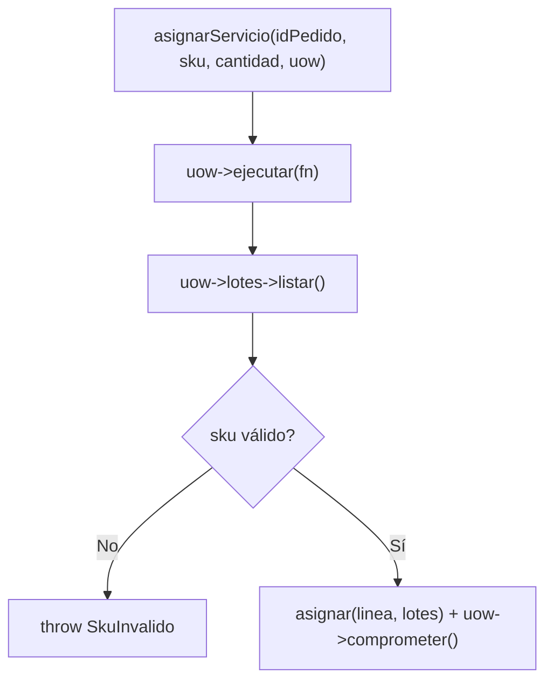

# Capítulo 6 — Unit of Work

> Fase 1 · el libro. Capítulo autocontenido: la clase (aquí), el código en [`proyecto/`](proyecto/)
> y los ejercicios en [`ejercicios/`](ejercicios/).

⬅️ [Capítulo 5 · TDD en marchas](../05-tdd-marchas/) · 🏠 [Índice de capítulos](../README.md) · ➡️ [Capítulo 7 · Aggregates](../07-aggregates/)

Correr las pruebas del capítulo:
```bash
vendor/bin/phpunit fase-1/capitulos/06-unit-of-work/proyecto
```

> 🌍 **Nota (§3.10).** Usamos **Eloquent** (Active Record): el modelo de dominio y el de
> persistencia son el mismo objeto (hereda de `Model`). El libro usa Data Mapper (clase pura).
> Además, las asignaciones del `Lote` las guardamos **en memoria** para que el dominio se pueda
> probar sin base de datos; la UoW se ocupa de persistir el lote dentro de una **transacción**.

---

## Micro-paso 1 — El dolor: el servicio maneja repositorio y sesión sueltos

### 0. 🧭 La pregunta
> *"Mi servicio recibe el repositorio y la 'sesión' por separado y tiene que acordarse de
> confirmar. Si algo falla a la mitad, ¿cómo garantizo que **todo** se guarde o **nada**?"*

### 1. Objetivo
Entender por qué hace falta una frontera **atómica** (todo o nada) alrededor de un caso de uso.

### 2. Cita de la fuente
> *"the Unit of Work (UoW) pattern is our abstraction over the idea of atomic operations.
> It will allow us to finally and fully decouple our service layer from the data layer."* — Cap. 6.

### 3. El dolor / necesidad
Pasar repositorio + sesión al servicio lo obliga a orquestar la transacción a mano y repetir ese
`commit`/`rollback` en cada caso de uso.

### 4. Explicación paso a paso
1. El servicio del cap. 4 recibía el repositorio y confirmaba suelto.
2. Lo envolvemos en una **Unidad de Trabajo** que agrupa el repositorio y la transacción.

### 5. Diagrama (Mermaid)

El servicio habla con **una** UoW; la UoW coordina el repositorio y la transacción.

### 6. Árbol de archivos
```
proyecto/
├── modelo.php · repositorio.php
└── unidad-de-trabajo.php   # (se añade en el micro-paso 2)
```

### 7. Tu turno
Enumera qué pasos tendría que repetir el servicio si NO existiera la UoW.

### 8. Comprobación
```bash
vendor/bin/phpunit fase-1/capitulos/06-unit-of-work/proyecto
```

### 9. Preguntas de recuerdo
1. ¿Qué significa "atómico" (todo o nada)?
2. ¿Qué agrupa la UoW?

---

## Micro-paso 2 — La UoW con `ejecutar(callable)` (el `with` de Python no existe en PHP)

### 0. 🧭 La pregunta
> *"En el libro la UoW es un `with uow:` que al salir deshace lo no confirmado. PHP no tiene
> `with`. ¿Cómo logro la misma frontera automática?"*

### 1. Objetivo
Implementar `UnidadDeTrabajo` con `UnidadDeTrabajoFalsa` (tests) y `UnidadDeTrabajoEloquent` (real).

### 2. Cita de la fuente
> *"class SqlAlchemyUnitOfWork(AbstractUnitOfWork): ... def __enter__(self): ... def __exit__(self,
> *args): ... def commit(self): self.session.commit() def rollback(self): self.session.rollback()"* — Cap. 6.
>
> *"with uow:"* — Cap. 6.

**Equivalente en PHP (§3.10):** el context manager `with uow:` se traduce a un método
`ejecutar(callable $trabajo)`: abre el ámbito, corre el trabajo y en el `finally` **deshace lo no
confirmado**. Dentro del trabajo se llama `comprometer()` para confirmar.
```php
public function ejecutar(callable $trabajo): mixed {
    Capsule::connection()->beginTransaction();
    try { return $trabajo(); }
    finally { $this->deshacer(); }   // rollback de lo no confirmado (como el __exit__ de Python)
}
public function comprometer(): void { Capsule::connection()->commit(); Capsule::connection()->beginTransaction(); }
public function deshacer(): void { if (Capsule::connection()->transactionLevel() > 0) Capsule::connection()->rollBack(); }
```

### 3. El dolor / necesidad
Sin `with`, necesitamos una forma de garantizar que, pase lo que pase, al terminar el caso de uso
se confirme (si se llamó `comprometer`) o se deshaga (si no).

### 4. Explicación paso a paso (TDD)
1. Test: la UoW real **confirma y persiste** un lote → rojo.
2. Test: la UoW real **deshace** si no se confirma → rojo.
3. Implemento `ejecutar/comprometer/deshacer` con `beginTransaction`/`commit`/`rollBack`.
4. Verde.

### 5. Diagrama (Mermaid)


### 6. Árbol de archivos
```
proyecto/
├── modelo.php · repositorio.php
├── unidad-de-trabajo.php   # UnidadDeTrabajo (abstracta) + Falsa + Eloquent
├── servicios.php           # usan la UoW
├── BaseDeDatosTestCase.php
└── UowTest.php · ServiciosTest.php · ModeloTest.php
```

### 7. Tu turno
Test: si dentro de `ejecutar` lanzas una excepción antes de `comprometer`, nada se persiste.

### 8. Comprobación
```bash
vendor/bin/phpunit fase-1/capitulos/06-unit-of-work/proyecto   # OK (10 tests)
```

### 9. Preguntas de recuerdo
1. ¿Por qué `ejecutar(callable)` reemplaza al `with uow:` de Python?
2. ¿Qué hace el `finally` de `ejecutar`?
3. ¿Qué diferencia hay entre la UoW falsa y la real?

---

## Micro-paso 3 — El servicio usa la UoW

### 0. 🧭 La pregunta
> *"Ahora que tengo la UoW, ¿cómo queda el servicio de asignar?"*

### 1. Objetivo
Reescribir `agregarLote` y `asignarServicio` para que trabajen **dentro** de `uow->ejecutar(...)`.

### 2. Cita de la fuente
> *"with uow: ... uow.commit()"* — Cap. 6 (los servicios usan la UoW).

**Equivalente en PHP:**
```php
function asignarServicio(string $idPedido, string $sku, int $cantidad, UnidadDeTrabajo $uow): string {
    $linea = new LineaPedido($idPedido, $sku, $cantidad);
    return $uow->ejecutar(function () use ($linea, $uow): string {
        $lotes = $uow->lotes->listar();
        if (!skuValido($linea->sku, $lotes)) throw new SkuInvalido("Sku inválido {$linea->sku}");
        $referencia = asignar($linea, $lotes);
        $uow->comprometer();
        return $referencia;
    });
}
```

### 3. El dolor / necesidad
El servicio ya no toca transacciones a mano: pide la lista de lotes a la UoW, asigna y confirma.

### 4. Explicación paso a paso (TDD)
1. Tests de servicio con `UnidadDeTrabajoFalsa` (en memoria): agregar lote confirma, asignar
   devuelve referencia, sku inválido lanza `SkuInvalido` → rojo.
2. Implemento los servicios con `uow->ejecutar(...)`. Verde.

### 5. Diagrama (Mermaid)


### 6. Árbol de archivos
```
proyecto/
└── servicios.php   # agregarLote, asignarServicio, SkuInvalido (usan la UoW)
```

### 7. Tu turno
Test: asignar un sku que no existe lanza `SkuInvalido` y no confirma.

### 8. Comprobación
```bash
vendor/bin/phpunit fase-1/capitulos/06-unit-of-work/proyecto   # OK (10 tests)
```

### 9. Preguntas de recuerdo
1. ¿Por qué el servicio ya no maneja la transacción a mano?
2. ¿Qué repositorio usa la UoW falsa?
3. ¿Dónde se valida el sku?

---

> **Capítulo 6 completo.** El caso de uso quedó **atómico** gracias a la Unidad de Trabajo, con el
> `with uow:` del libro traducido a `ejecutar(callable)`. Siguiente: **Capítulo 7 — Aggregates**.

⬅️ [Capítulo 5 · TDD en marchas](../05-tdd-marchas/) · 🏠 [Índice de capítulos](../README.md) · ➡️ [Capítulo 7 · Aggregates](../07-aggregates/)
