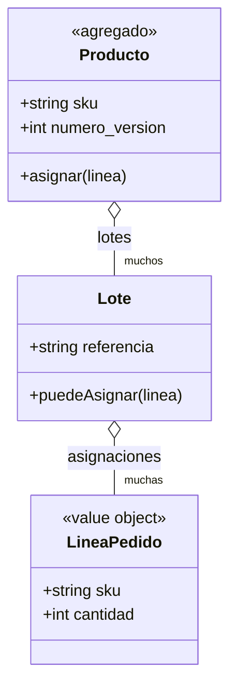
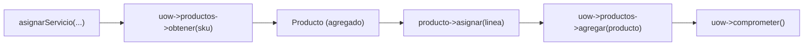

# Capítulo 7 — Aggregates and Consistency Boundaries

> Fase 1 · el libro (cierra la Parte I). Capítulo autocontenido: la clase (aquí), el código en
> [`proyecto/`](proyecto/) y los ejercicios en [`ejercicios/`](ejercicios/).

⬅️ [Capítulo 6 · Unit of Work](../06-unit-of-work/) · 🏠 [Índice de capítulos](../README.md) · ➡️ [Capítulo 8 · Events and the Message Bus](../08-events-message-bus/)

Correr las pruebas del capítulo:
```bash
vendor/bin/phpunit fase-1/capitulos/07-aggregates/proyecto
```

> 🌍 **Nota (§3.10).** Seguimos con **Eloquent** (Active Record): el agregado `Producto` **hereda
> de `Model`**. El libro usa Data Mapper (clase pura). El `numero_version` del agregado SÍ se
> persiste (columna `numero_version`); las asignaciones de cada `Lote` siguen **en memoria** (como
> en el cap. 6), para probar el dominio sin base de datos.

---

## Micro-paso 1 — El agregado `Producto`

### 0. 🧭 La pregunta
> *"Dos pedidos a la vez para el mismo producto pueden sobrevender. ¿Cómo defino una frontera
> donde las reglas se cumplen siempre?"*

### 1. Objetivo
Un agregado `Producto` que agrupa los lotes de un sku y es la **única** puerta para asignar.

### 2. Cita de la fuente
> *"An AGGREGATE is a cluster of associated objects that we treat as a unit for the purpose of
> data changes."* — Cap. 7.
>
> *"def __init__(self, sku: str, batches: List[Batch], version_number: int = 0): ... def allocate(self, line): ... self.version_number += 1"* — Cap. 7.

**Equivalente en PHP (§3.10):** `Producto` es un modelo Eloquent con clave primaria `sku` (texto)
y una relación `hasMany` a sus lotes. El `self.version_number += 1` de Python se traduce a
`$this->numero_version = (int) $this->numero_version + 1;` dentro del método `asignar`.
```php
public function asignar(LineaPedido $linea): string {
    $lotes = $this->lotes->all();
    usort($lotes, 'compararLotes');
    foreach ($lotes as $lote) {
        if ($lote->puedeAsignar($linea)) {
            $lote->asignar($linea);
            $this->numero_version = (int) $this->numero_version + 1;  // concurrencia optimista
            return $lote->referencia;
        }
    }
    throw new SinStock("Sin stock para el sku {$linea->sku}");
}
```

### 3. El dolor / necesidad
Sin una frontera, cambios concurrentes rompen invariantes (sobreventa). El agregado concentra
todas las reglas de un sku en un solo objeto.

### 4. Explicación paso a paso (TDD)
1. Test de dominio: `producto->asignar(...)` sube `numero_version` → rojo.
2. Test: el producto elige el lote en almacén antes que el de envío → rojo.
3. Test: sin stock lanza `SinStock` → rojo.
4. Implemento `Producto::crear(sku, lotes)` y `asignar(linea)`. Verde.

### 5. Diagrama (Mermaid — Figura 7-1)

El agregado `Producto` es la raíz: se accede a los `Lote` **a través** de él, nunca sueltos.

### 6. Árbol de archivos
```
proyecto/
├── modelo.php        # SinStock, LineaPedido, Lote, compararLotes, asignar(), Producto (agregado)
├── repositorio.php   # RepositorioDeProductos (+ Falso + Eloquent)
├── unidad-de-trabajo.php
├── servicios.php
├── BaseDeDatosTestCase.php
└── ModeloTest.php · PersistenciaTest.php · RepositorioTest.php · UowTest.php · ServiciosTest.php
```

### 7. Tu turno
Test: asignar dos líneas seguidas al mismo producto deja `numero_version` en 2.

### 8. Comprobación
```bash
vendor/bin/phpunit fase-1/capitulos/07-aggregates/proyecto   # OK (18 tests)
```

### 9. Preguntas de recuerdo
1. ¿Qué agrupa el agregado `Producto`?
2. ¿Qué hace `numero_version` y para qué sirve?
3. ¿Por qué se asigna **a través** del producto y no a un lote suelto?

---

## Micro-paso 2 — Un agregado = un repositorio

### 0. 🧭 La pregunta
> *"¿Cómo persisto el agregado y lo cargo como una unidad?"*

### 1. Objetivo
Que el repositorio guarde y obtenga **productos** (por `sku`), no lotes sueltos; que la UoW exponga
`uow->productos` y el servicio solo orqueste.

### 2. Cita de la fuente
> *"One Aggregate = One Repository."* — Cap. 7.
>
> *"we can move the allocate() domain service to be a method on the Product aggregate."* — Cap. 7.

**Equivalente en PHP:**
```php
function asignarServicio(string $idPedido, string $sku, int $cantidad, UnidadDeTrabajo $uow): string {
    $linea = new LineaPedido($idPedido, $sku, $cantidad);
    return $uow->ejecutar(function () use ($linea, $sku, $uow): string {
        $producto = $uow->productos->obtener($sku);
        if ($producto === null) throw new SkuInvalido("Sku inválido {$sku}");
        $referencia = $producto->asignar($linea);   // el agregado hace el trabajo
        $uow->productos->agregar($producto);         // persiste el nuevo numero_version
        $uow->comprometer();
        return $referencia;
    });
}
```

### 3. El dolor / necesidad
Si el repositorio devolviera lotes sueltos, las reglas del sku quedarían repartidas. Cargando el
**producto completo** (con sus lotes) se respeta la frontera de consistencia.

### 4. Explicación paso a paso (TDD)
1. `RepositorioDeProductos` con `agregar(Producto)` y `obtener(string $sku)`.
2. `RepositorioEloquent::obtener` carga el producto **con** sus lotes (`with('lotes')`).
3. La UoW expone `productos`; el servicio hace `obtener → asignar → agregar → comprometer`.
4. Verde (18 tests).

### 5. Diagrama (Mermaid)

El servicio habla con **un** agregado a través de **un** repositorio.

### 6. Árbol de archivos
```
proyecto/
├── repositorio.php        # RepositorioDeProductos: agregar(Producto) / obtener(sku)
├── unidad-de-trabajo.php  # UnidadDeTrabajo con $productos
└── servicios.php          # obtener → asignar → agregar → comprometer
```

### 7. Tu turno
Test: guardar un producto con dos lotes y volver a cargarlo devuelve los dos lotes.

### 8. Comprobación
```bash
vendor/bin/phpunit fase-1/capitulos/07-aggregates/proyecto   # OK (18 tests)
```

### 9. Preguntas de recuerdo
1. ¿Por qué "un agregado = un repositorio"?
2. ¿Qué carga/guarda el repositorio: productos o lotes sueltos?
3. ¿Dónde vive ahora la lógica de elegir el lote?

---

> **Capítulo 7 completo. ¡Parte I terminada!** (Dominio, Repository, Abstracciones, Service Layer,
> TDD, Unit of Work y Aggregates.) El `with uow:` del libro quedó como `ejecutar(callable)` y el
> servicio de dominio `allocate()` pasó a ser el método `asignar` del agregado `Producto`.
> Siguiente: **Parte II — Capítulo 8: Events and the Message Bus**.

⬅️ [Capítulo 6 · Unit of Work](../06-unit-of-work/) · 🏠 [Índice de capítulos](../README.md) · ➡️ [Capítulo 8 · Events and the Message Bus](../08-events-message-bus/)
