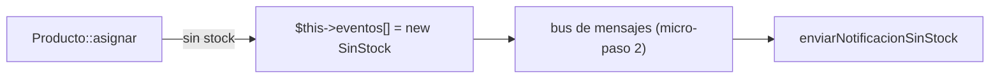
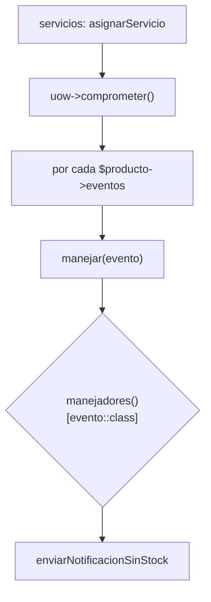

# Capítulo 8 — Events and the Message Bus

> Fase 1 · el libro (Parte II). Capítulo autocontenido: la clase (aquí), el código en
> [`proyecto/`](proyecto/) y los ejercicios en [`ejercicios/`](ejercicios/).

⬅️ [Capítulo 7 · Aggregates](../07-aggregates/) · 🏠 [Índice de capítulos](../README.md) · ➡️ [Capítulo 9 · Message Bus a fondo](../09-message-bus-a-fondo/)

Correr las pruebas: `vendor/bin/phpunit fase-1/capitulos/08-events-message-bus/proyecto`.

> 🌍 **Traducción (§3.10).** El `HANDLERS` del libro es un diccionario cuya clave es una **clase**.
> En PHP la clave de un array debe ser texto, así que se usa `Evento::class` (el nombre de la clase
> como string, como viste en la Lección 05). Además, **Eloquent es Active Record**: la lógica de
> dominio vive en el modelo y los tests usan SQLite en memoria (el modo idiomático en Laravel).

---

## Micro-paso 1 — Eventos de dominio

### 0. 🧭 La pregunta
> *"Al quedarse sin stock, me piden avisar (un email), pero sin meter el envío de correos dentro
> de la regla de asignar. ¿Cómo registro 'esto pasó' sin acoplar?"*

### 1. Objetivo
Que el modelo **acumule eventos** (`SinStock`) en vez de hacer el trabajo secundario él mismo.

### 2. Cita de la fuente
> *"if we ask Product to allocate but it can't, it should raise an event"*
> / *"Events are simple dataclasses that define the data structures for inputs and internal
> messages within our system."* — Cap. 8.

**Equivalente en PHP:**
```php
abstract class Evento {}
final class SinStock extends Evento {
    public function __construct(public readonly string $sku) {}
}
// El agregado acumula el evento en vez de enviar el email:
$this->eventos[] = new SinStock($linea->sku);
```

### 3. El dolor / necesidad
Si `Producto::asignar` manda el email directamente, mezcla la regla del negocio con una
preocupación aparte (notificar). El modelo solo debe **registrar** que se quedó sin stock.

### 4. Explicación paso a paso (TDD)
1. Test: al pedir más de lo que hay, `Producto::asignar` devuelve `null` y deja un `SinStock` en
   `$producto->eventos` → 🔴.
2. Creo `eventos.php` (`Evento`, `SinStock`) y en `Producto` una propiedad PHP `$eventos = []`
   (no es columna; Eloquent no la persiste). En `asignar`, si ningún lote sirve, `$this->eventos[] = new SinStock(...)`.
3. Verde 🟢.

### 5. Diagrama (Mermaid — Figura 8-1)

El modelo solo **registra** el evento; quién reacciona se decide fuera (el bus).

### 6. Árbol de archivos
```
proyecto/
├── eventos.php         # Evento, SinStock
├── modelo.php          # Producto acumula $eventos
└── ModeloTest.php
```

### 7. Tu turno
Añade un evento `Asignado(idPedido, sku, referencia)` y acumúlalo cuando la asignación tiene éxito.

### 8. Comprobación
```bash
vendor/bin/phpunit fase-1/capitulos/08-events-message-bus/proyecto
```

### 9. Preguntas de recuerdo
1. ¿Por qué el modelo **registra** el evento en vez de enviar el email?
2. ¿Por qué `$eventos` es una propiedad PHP normal y no una columna?
3. ¿Qué datos lleva el evento `SinStock`?

---

## Micro-paso 2 — El bus de mensajes

### 0. 🧭 La pregunta
> *"Ya tengo el evento registrado. ¿Cómo despacho cada evento a quien debe reaccionar, sin que el
> servicio conozca a los manejadores uno por uno?"*

### 1. Objetivo
Un **bus de mensajes**: un mapa de tipo-de-evento → lista de manejadores, y una función `manejar`.

### 2. Cita de la fuente
> *"HANDLERS = { events.OutOfStock: [send_out_of_stock_notification], }"* / *"def handle(event:
> events.Event): for handler in HANDLERS[type(event)]: handler(event)"* — Cap. 8.

**Equivalente en PHP (§3.10):** la clave del diccionario es una **clase**; en PHP se usa
`Evento::class` (string) y se busca con `$evento::class`:
```php
function manejadores(): array {
    return [SinStock::class => ['enviarNotificacionSinStock']];
}
function manejar(Evento $evento): void {
    foreach (manejadores()[$evento::class] ?? [] as $manejador) {
        $manejador($evento);
    }
}
```

### 3. El dolor / necesidad
El servicio no debe tener un `if` por cada tipo de evento. El bus centraliza "qué handler atiende
qué evento" y lo hace extensible (añadir un handler no toca el servicio).

### 4. Explicación paso a paso (TDD)
1. Test (PHP puro, sin BD): `manejar(new SinStock('MESA'))` deja `'MESA'` en el registro → 🔴.
2. Creo `mensajeria.php`: el array `manejadores()` (clave `SinStock::class`) y `manejar()`.
3. La capa de servicio, tras `comprometer()`, recorre `$producto->eventos` y llama `manejar($evento)`.
4. Verde 🟢.

### 5. Diagrama (Mermaid)


### 6. Árbol de archivos
```
proyecto/
├── eventos.php            # Evento, SinStock
├── mensajeria.php         # manejadores(), manejar()
├── modelo.php             # Producto, Lote, LineaPedido (Eloquent)
├── repositorio.php        # interfaz + RepositorioFalso + RepositorioEloquent
├── unidad-de-trabajo.php  # interfaz + UnidadDeTrabajoFalsa + UnidadDeTrabajoEloquent
├── servicios.php          # agregarLote, asignarServicio, SkuInvalido
└── *Test.php              # MensajeriaTest (puro) + ModeloTest/ServiciosTest/RepositorioTest (BD)
```

### 7. Tu turno
Registra un segundo manejador para `SinStock` (por ejemplo, que lo apunte en un log) y comprueba
que el bus llama a los dos.

### 8. Comprobación
```bash
vendor/bin/phpunit fase-1/capitulos/08-events-message-bus/proyecto   # OK (11 tests)
```

### 9. Preguntas de recuerdo
1. ¿Por qué la clave del array de manejadores es `Evento::class` y no el objeto?
2. ¿Quién llama a `manejar()` y cuándo?
3. ¿Cómo añades una reacción nueva sin tocar el servicio?

---

> **Capítulo 8 completo.** El modelo registra eventos y un bus de mensajes los despacha a sus
> manejadores. Siguiente: **Capítulo 9 — Going to Town on the Message Bus** (el bus como entrypoint).

⬅️ [Capítulo 7 · Aggregates](../07-aggregates/) · 🏠 [Índice de capítulos](../README.md) · ➡️ [Capítulo 9 · Message Bus a fondo](../09-message-bus-a-fondo/)
