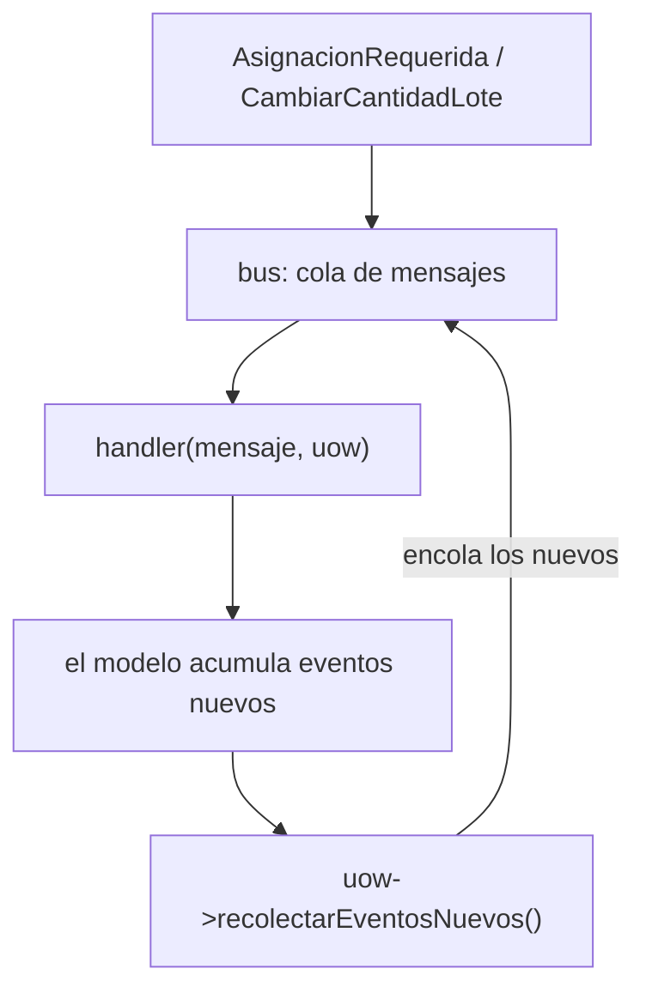
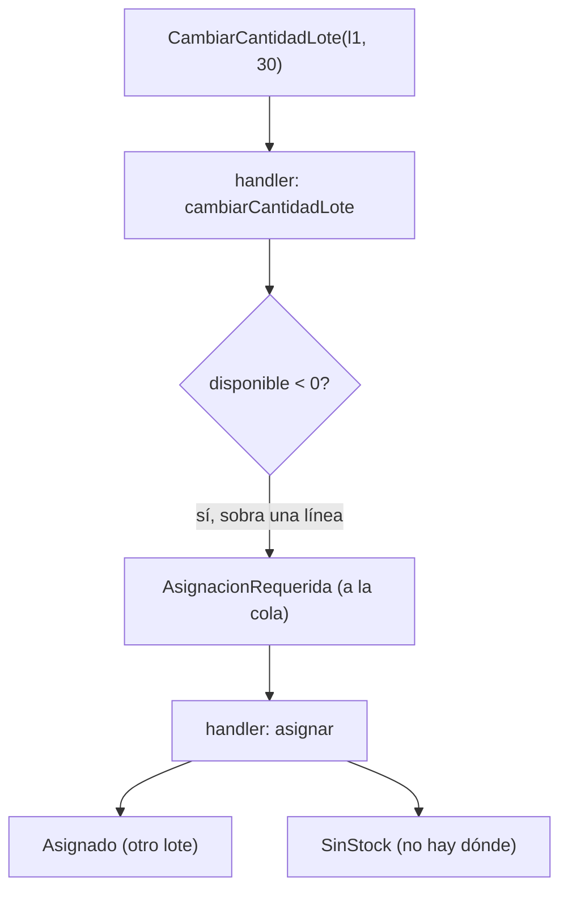

# Capítulo 9 — Going to Town on the Message Bus

> Fase 1 · el libro (Parte II). Capítulo autocontenido: la clase (aquí), el código en
> [`proyecto/`](proyecto/) y los ejercicios en [`ejercicios/`](ejercicios/).

⬅️ [Capítulo 8 · Events and the Message Bus](../08-events-message-bus/) · 🏠 [Índice de capítulos](../README.md) · ➡️ [Capítulo 10 · Commands](../10-commands/)

Correr las pruebas: `vendor/bin/phpunit fase-1/capitulos/09-message-bus-a-fondo/proyecto`.

> 🌍 **Traducción (§3.10).** El libro está en Python. Donde el libro usa `MANEJADORES[type(evento)]`
> (clave = clase), en PHP la clave del array es texto, así que usamos `Evento::class` y buscamos
> con `$mensaje::class`. Y como **Eloquent es Active Record**, la lógica vive en el modelo y los
> tests usan SQLite en memoria.

---

## Micro-paso 1 — El bus es el punto de entrada (y recolecta eventos de la UoW)

### 0. 🧭 La pregunta
> *"En el cap. 8 el servicio llamaba al bus al final. ¿Y si una reacción provoca otra, y esa otra?
> ¿Cómo encadeno reacciones (cascada) sin enredar el código?"*

### 1. Objetivo
Convertir el **bus en el punto de entrada**: recibe un mensaje, procesa una **cola** y, tras cada
manejador, recoge los **eventos nuevos** que la UoW haya acumulado y los encola.

### 2. Cita de la fuente
> *"A New Requirement Leads Us to a New Architecture."* / *"The message bus is now the main
> entrypoint to the service layer"* / *"The message bus passes the UoW down to each handler.
> After each handler finishes, we collect any new events that have been generated and add them
> to the queue."* — Cap. 9.

**Equivalente en PHP:**
```php
function manejar(Evento $mensaje, UnidadDeTrabajo $uow): array {
    $cola = [$mensaje];
    while ($cola !== []) {
        $m = array_shift($cola);
        foreach (manejadores()[$m::class] ?? [] as $manejador) {
            $manejador($m, $uow);
            foreach ($uow->recolectarEventosNuevos() as $nuevo) { $cola[] = $nuevo; } // cascada
        }
    }
    // ...
}
```

### 3. El dolor / necesidad
En el cap. 8 el servicio recorría `$producto->eventos` a mano tras `comprometer()`. Pero si un
manejador genera un evento que a su vez debe dispararse, el servicio tendría que volver a mirar.
La **cola** hace eso automático: todo evento nuevo vuelve a la cola.

### 4. Explicación paso a paso (TDD)
1. El repositorio rastrea los productos **vistos** (`vistos()`), los que cargó o agregó.
2. La UoW gana `recolectarEventosNuevos()`: vacía los `$eventos` de cada producto visto.
3. Las funciones de servicio se vuelven **handlers** con la firma `(mensaje, uow)`.
4. El bus procesa una cola; tras cada handler encola lo recolectado.

### 5. Diagrama (Mermaid — Figura 9-2)

El bus es la puerta de entrada; la cola convierte una reacción en la siguiente (cascada).

### 6. Árbol de archivos
```
proyecto/
├── eventos.php              # AsignacionRequerida, CambiarCantidadLote, Asignado, SinStock
├── modelo.php               # Producto acumula eventos; cambiarCantidadLote reasigna
├── repositorio.php          # + vistos()
├── unidad-de-trabajo.php    # + recolectarEventosNuevos()
├── mensajeria.php           # el bus (cola) + handlers
└── *Test.php
```

### 7. Tu turno
Añade un contador que registre cuántos mensajes procesó el bus en total (incluidos los de la cascada).

### 8. Comprobación
```bash
vendor/bin/phpunit fase-1/capitulos/09-message-bus-a-fondo/proyecto
```

### 9. Preguntas de recuerdo
1. ¿Qué recolecta el bus tras cada handler?
2. ¿Para qué sirve `vistos()` en el repositorio?
3. ¿Por qué una **cola** y no una simple lista recorrida una vez?

---

## Micro-paso 2 — Nuevo requisito: cambiar la cantidad de un lote (reasignar)

### 0. 🧭 La pregunta
> *"El almacén baja la cantidad comprada de un lote por debajo de lo ya asignado. ¿Cómo reasigno
> automáticamente lo que ya no cabe?"*

### 1. Objetivo
Implementar `CambiarCantidadLote` y que la cascada reasigne (o avise `SinStock`) sola.

### 2. Cita de la fuente
> *"Example 2: Change Batch Quantity"* / *"Refactoring Service Functions to Message Handlers"*
> — Cap. 9 (y Cap. 8 de la UoW).

**Equivalente en PHP:**
```php
public function cambiarCantidadLote(string $referencia, int $cantidadNueva): void {
    $lote = $this->lotes->firstWhere('referencia', $referencia);
    $lote->cantidad_comprada = $cantidadNueva;
    $lote->save();
    $lote->load('asignaciones');
    while ($lote->cantidadDisponible() < 0) {          // sobra stock asignado
        $linea = $lote->asignaciones()->first();
        $lote->asignaciones()->detach($linea->id);     // desasigna
        $this->eventos[] = new AsignacionRequerida($linea->id_pedido, $linea->sku, $linea->cantidad);
    }
}
```

### 3. El dolor / necesidad
Si el lote queda con disponible **negativo**, hay líneas asignadas que ya no caben. No podemos
dejarlas "fantasma": hay que desasignarlas y **volver a intentar** asignarlas (quizá en otro lote).

### 4. Explicación paso a paso (TDD)
1. `Producto::cambiarCantidadLote(ref, cantidad)` ajusta la compra y, por cada línea que sobra,
   la desasigna y registra `AsignacionRequerida`.
2. El handler `cambiarCantidadLote` dispara la cascada: el bus toma cada `AsignacionRequerida`
   y la reasigna con el handler `asignar` (o registra `SinStock` si no hay stock).

### 5. Diagrama (Mermaid)


### 6. Árbol de archivos
```
proyecto/
├── eventos.php · modelo.php (cambiarCantidadLote) · repositorio.php · unidad-de-trabajo.php
├── mensajeria.php (handlers: asignar, cambiarCantidadLote, notificarSinStock, registrarAsignacion)
└── MensajeriaTest · ModeloTest · RepositorioTest · UnidadDeTrabajoTest
```

### 7. Tu turno
Añade un segundo lote al producto y comprueba que, al bajar el primero, la línea se reasigna al
segundo (en vez de quedar `SinStock`).

### 8. Comprobación
```bash
vendor/bin/phpunit fase-1/capitulos/09-message-bus-a-fondo/proyecto   # OK (12 tests)
```

### 9. Preguntas de recuerdo
1. ¿Qué evento registra `cambiarCantidadLote` por cada línea que sobra?
2. ¿Quién reasigna esas líneas?
3. ¿Qué pasa si no hay otro lote con stock?

---

> **Capítulo 9 completo.** El bus es ahora el punto de entrada y encadena reacciones en cascada
> recolectando los eventos de la UoW. Siguiente: **Capítulo 10 — Commands and Command Handler**
> (separar comandos de eventos y tratar sus errores distinto).

⬅️ [Capítulo 8 · Events and the Message Bus](../08-events-message-bus/) · 🏠 [Índice de capítulos](../README.md) · ➡️ [Capítulo 10 · Commands](../10-commands/)
