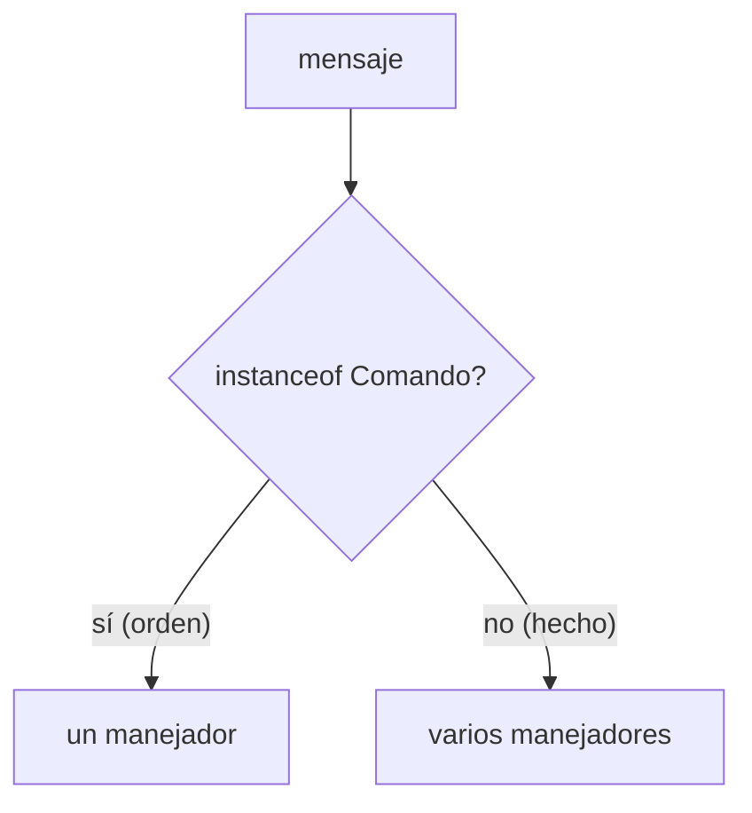
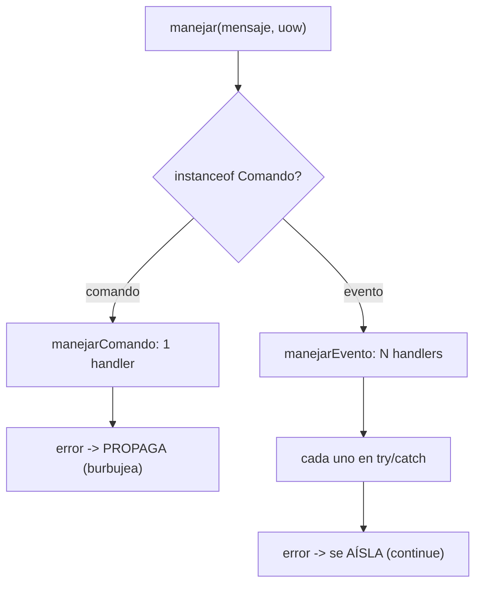

# Capítulo 10 — Commands and Command Handler

> Fase 1 · el libro (Parte II). Capítulo autocontenido: la clase (aquí), el código en
> [`proyecto/`](proyecto/) y los ejercicios en [`ejercicios/`](ejercicios/).

⬅️ [Capítulo 9 · Message Bus a fondo](../09-message-bus-a-fondo/) · 🏠 [Índice de capítulos](../README.md) · ➡️ [Capítulo 11 · Microservicios con eventos](../11-microservicios-eventos/)

Correr las pruebas: `vendor/bin/phpunit fase-1/capitulos/10-commands/proyecto`.

> 🌍 **Traducción (§3.10).** El libro está en Python (`isinstance(m, commands.Command)`,
> `COMMAND_HANDLERS`/`EVENT_HANDLERS`). En PHP usamos `$m instanceof Comando` y dos arrays con
> clave `Clase::class`. Como **Eloquent es Active Record**, la lógica vive en el modelo y los
> tests usan SQLite en memoria.

---

## Micro-paso 1 — Separar comandos de eventos

### 0. 🧭 La pregunta
> *"En el cap. 9 TODO era un evento, hasta 'quiero asignar'. Pero una orden ('haz esto') no es
> lo mismo que un hecho ('esto pasó'). ¿Cómo los distingo?"*

### 1. Objetivo
Crear una jerarquía `Comando` aparte de `Evento`. Los **comandos** se nombran en imperativo
(`Asignar`, `CrearLote`); los **eventos** en pasado (`Asignado`, `Desasignado`).

### 2. Cita de la fuente
> *"Commands capture intent."* / *"They express our wish for the system to do something."* /
> *"We name commands with imperative mood verb phrases"* — Cap. 10.

**Equivalente en PHP:**
```php
abstract class Comando {}                       // órdenes: "haz esto"
final class Asignar extends Comando {
    public function __construct(
        public readonly string $idPedido,
        public readonly string $sku,
        public readonly int $cantidad,
    ) {}
}
abstract class Evento {}                         // hechos: "esto pasó"
final class Asignado extends Evento { /* ... */ }
```

### 3. El dolor / necesidad
Mezclar órdenes y hechos en un solo tipo esconde una diferencia importante: una orden tiene un
único responsable y su fallo importa; un hecho puede tener cero, uno o muchos interesados.

### 4. Explicación paso a paso (TDD)
1. Test puro: `new Asignar(...)` es `Comando` y NO `Evento`; `new Asignado(...)` al revés → 🔴.
2. Creo `comandos.php` (`Comando`, `Asignar`, `CrearLote`, `CambiarCantidadLote`) y dejo en
   `eventos.php` solo hechos (`Asignado`, `SinStock`, `Desasignado`).
3. Verde 🟢.

### 5. Diagrama (Mermaid)


### 6. Árbol de archivos
```
proyecto/
├── comandos.php    # Comando, Asignar, CrearLote, CambiarCantidadLote
├── eventos.php     # Evento, Asignado, SinStock, Desasignado
├── modelo.php · repositorio.php · unidad-de-trabajo.php · mensajeria.php
└── ComandosTest.php (puro) + *Test.php (BD)
```

### 7. Tu turno
Añade un comando `Desasignar(idPedido, sku)` y comprueba que es `Comando` y no `Evento`.

### 8. Comprobación
```bash
vendor/bin/phpunit fase-1/capitulos/10-commands/proyecto
```

### 9. Preguntas de recuerdo
1. ¿En qué tiempo verbal se nombra un comando? ¿Y un evento?
2. ¿Por qué `Comando` y `Evento` son jerarquías separadas?
3. ¿`CrearLote` es comando o evento?

---

## Micro-paso 2 — Errores: el comando PROPAGA, el evento se AÍSLA

### 0. 🧭 La pregunta
> *"Si una orden falla, quien la dio debe enterarse. Pero si una reacción secundaria falla, no
> quiero que tumbe todo. ¿Cómo trato los errores distinto según el tipo?"*

### 1. Objetivo
El bus reparte por `instanceof Comando`: un comando tiene **un** manejador y su error **propaga**;
un evento tiene **varios** y cada uno va en `try/catch` (error **aislado**).

### 2. Cita de la fuente
> *"The command dispatcher expects just one handler per command."* / *"If any errors are raised,
> they fail fast and will bubble up."* / *"Events cannot interrupt the flow"* / *"It catches and
> logs errors but doesn't let them interrupt message processing."* — Cap. 10.

**Equivalente en PHP:**
```php
function manejarComando(Comando $c, array &$cola, UnidadDeTrabajo $uow): mixed {
    $manejador = Bus::$comando[$c::class];
    return $manejador($c, $uow);          // si falla, PROPAGA (no hay try/catch)
}
function manejarEvento(Evento $e, array &$cola, UnidadDeTrabajo $uow): void {
    foreach (Bus::$evento[$e::class] ?? [] as $manejador) {
        try { $manejador($e, $uow); }
        catch (\Throwable) { continue; }  // AISLADO: no rompe el flujo
    }
}
```

### 3. El dolor / necesidad
Si un handler de notificación (secundario) revienta, no debe cancelar la asignación ya hecha.
Pero si la orden de asignar falla, el que la pidió necesita el error para reaccionar.

### 4. Explicación paso a paso (TDD)
1. Test: un `Asignar` con sku inexistente lanza `SkuInvalido` **hacia fuera** (propaga) → 🟢.
2. Test: si un manejador de `Asignado` revienta, el comando igual termina y el buen manejador
   corre (aislado) → 🟢.
3. El bus usa dos mapas: `Bus::$comando` (clase → UN callable) y `Bus::$evento` (clase → lista).

### 5. Diagrama (Mermaid — Figura 10-x)


### 6. Árbol de archivos
```
proyecto/
├── comandos.php · eventos.php · modelo.php · repositorio.php · unidad-de-trabajo.php
├── mensajeria.php   # Bus::$comando (1 handler, propaga) + Bus::$evento (N, aislado)
└── MensajeriaTest · ModeloTest · ComandosTest · RepositorioTest · UnidadDeTrabajoTest
```

### 7. Tu turno
Registra un segundo manejador de `SinStock` que escriba en un log y comprueba que, si el primero
revienta, el segundo igual corre.

### 8. Comprobación
```bash
vendor/bin/phpunit fase-1/capitulos/10-commands/proyecto   # OK (15 tests)
```

### 9. Preguntas de recuerdo
1. ¿Cuántos manejadores tiene un comando? ¿Y un evento?
2. ¿Qué pasa con el error de un comando? ¿Y con el de un evento?
3. ¿Por qué un fallo en una notificación no debe cancelar la asignación?

---

> **Capítulo 10 completo.** Comandos y eventos son tipos distintos y el bus los trata distinto:
> el comando con un manejador y error que propaga; el evento con varios y error aislado.
> Siguiente: **Capítulo 11 — Event-Driven Architecture (microservicios con eventos)**.

⬅️ [Capítulo 9 · Message Bus a fondo](../09-message-bus-a-fondo/) · 🏠 [Índice de capítulos](../README.md) · ➡️ [Capítulo 11 · Microservicios con eventos](../11-microservicios-eventos/)
