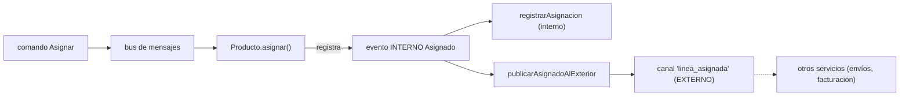

# Capítulo 11 — Event-Driven Architecture: Microservicios

> Fase 1 · el libro (Parte II). Capítulo autocontenido: la clase (aquí), el código en
> [`proyecto/`](proyecto/) y los ejercicios en [`ejercicios/`](ejercicios/).

⬅️ [Capítulo 10 · Commands](../10-comandos/) · 🏠 [Índice de capítulos](../README.md) · ➡️ [Capítulo 12 · CQRS](../12-cqrs/)

Avanza en **micro-pasos** (estructura 0–9). Correr las pruebas del capítulo:
```bash
vendor/bin/phpunit fase-1/capitulos/11-microservicios-eventos/proyecto
```

> 🌍 **Traducción (§3.10).** El libro usa **Redis** real como canal pub/sub. Aquí lo **simulamos**
> con un broker en memoria (`cola-externa.php`), porque este entorno no tiene servidor Redis. El
> concepto (eventos internos vs externos, Redis como adaptador fino) es idéntico; solo cambia el
> transporte. En producción, `ColaExterna::publicar()` sería `Redis::publish()` (Laravel trae
> `illuminate/redis`), y `consumirExterno()` sería un worker que escucha el canal.

---

## Micro-paso 1 — Eventos internos vs externos

### 0. 🧭 La pregunta
> *"Me piden integrar con otros servicios sin llamarlos directamente (para no acoplarnos).
> Cuando asigno una línea, otro servicio (envíos, facturación) necesita enterarse. ¿Cómo aviso
> 'hacia afuera' sin que mi código dependa de ellos?"*

### 1. Objetivo
Distinguir el **evento interno** (viaja por el bus dentro de mi servicio) del **evento externo**
(se publica a un canal para que lo oigan otros servicios).

### 2. Cita de la fuente
> *"Temporal Decoupling Using Asynchronous Messaging."* — Cap. 11.

**Equivalente en PHP.** El evento interno `Asignado` ya existe (cap. 8). Añadimos un handler que,
al oírlo, publica un evento EXTERNO al canal:
```php
public static function publicarAsignadoAlExterior(Asignado $evento, UnidadDeTrabajo $uow): void
{
    ColaExterna::publicar('linea_asignada', [
        'id_pedido' => $evento->idPedido,
        'sku' => $evento->sku,
        'ref' => $evento->referencia,
    ]);
}
```

### 3. El dolor / necesidad
Si al asignar llamara directo a `ServicioDeEnvios::crear(...)`, mi servicio dependería del de
envíos: un cambio allá rompe acá, y no puedo desplegarlos por separado. El acoplamiento temporal
("tú tienes que estar vivo justo ahora") es el problema.

### 4. Explicación paso a paso
1. Los eventos **internos** (`Asignado`, `EventoSinStock`, `Desasignado`) viajan por el bus
   (`mensajeria.php`) y los manejan handlers de mi propio servicio.
2. Añadimos un handler más a `Asignado`: `publicarAsignadoAlExterior`, que **publica** un evento
   externo. Mi servicio no sabe ni le importa quién escucha.
3. El evento externo es un simple array (JSON en producción): datos planos, sin objetos de mi
   dominio. Así otros servicios (en otro lenguaje incluso) pueden entenderlo.

### 5. Diagrama (Mermaid)

**Explicación:** un mismo evento interno dispara varios handlers. Uno de ellos cruza la frontera
del servicio publicando un evento externo al canal. La flecha punteada sale de mi servicio.

### 9. Preguntas de recuerdo
1. ¿Qué diferencia hay entre un evento interno y uno externo?
2. ¿Por qué el evento externo es un array plano y no un objeto `Asignado`?

---

## Micro-paso 2 — Redis (aquí, `ColaExterna`) como adaptador fino

### 0. 🧭 La pregunta
> *"Ya publico hacia afuera. Pero también me llegan mensajes de otros servicios (p. ej. 'el lote
> cambió de cantidad'). ¿Cómo los recibo y los convierto en algo que mi dominio entienda?"*

### 1. Objetivo
Ver el canal como **dos adaptadores finos**: uno de **salida** (publicar) y uno de **entrada**
(consumir), ambos alrededor del mismo bus.

### 2. Cita de la fuente
> *"Redis Is Another Thin Adapter Around Our Message Bus."* — Cap. 11.

**Equivalente en PHP.** Aquí Redis es `ColaExterna` (simulado). Salida y entrada:
```php
// SALIDA: publicar (en producción: Redis::publish)
ColaExterna::publicar('linea_asignada', $datos);

// ENTRADA: traducir un mensaje externo a un comando interno
public static function consumirExterno(array $mensaje, UnidadDeTrabajo $uow): array
{
    $comando = new CambiarCantidadLote($mensaje['referencia'], $mensaje['cantidad']);
    return self::manejar($comando, $uow);
}
```

### 3. El dolor / necesidad
Si el código que escucha Redis metiera lógica de negocio, estaría mezclando transporte con
dominio. El adaptador debe ser **fino**: solo traduce (array externo → comando interno) y delega
en el bus. Toda la lógica sigue en el dominio y los handlers.

### 4. Explicación paso a paso
1. **Salida:** `ColaExterna::publicar($canal, $datos)`. En real sería `redis.publish`.
2. **Entrada:** `consumirExterno($mensaje, $uow)` toma el array externo y crea el **comando**
   `CambiarCantidadLote`, luego llama a `Bus::manejar(...)`. No tiene reglas: solo traduce.
3. **Tests con el broker simulado:** al asignar se publica un externo (lo vemos en
   `ColaExterna::$mensajesPublicados`); un mensaje externo entrante se consume como comando y
   cambia el stock. Ver [`proyecto/IntegracionExternaTest.php`](proyecto/IntegracionExternaTest.php).

### 5. Diagrama (Mermaid — Figura 11-1/11-2)

**Explicación:** el bus está en el centro. A la izquierda, el adaptador de entrada traduce lo que
llega. A la derecha, el de salida publica lo que sale. Ambos son finos: no tienen reglas.

### 6. Árbol de archivos
```
fase-1/capitulos/11-microservicios-eventos/proyecto/
├── eventos.php               (Asignado, EventoSinStock, Desasignado)
├── comandos.php              (Asignar, CrearLote, CambiarCantidadLote)
├── cola-externa.php          (NUEVO: broker simulado — "Redis")
├── modelo.php                (Producto agregado + reglas)
├── repositorio.php           (RepositorioDeProductos + Falso)
├── unidad-de-trabajo.php     (UnidadDeTrabajo + Falsa)
├── mensajeria.php            (+ publicarAsignadoAlExterior · consumirExterno)
├── ModeloTest.php
├── MensajeriaTest.php
└── IntegracionExternaTest.php  (NUEVO: publica y consume por el canal)
```

### 8. Comprobación
```bash
vendor/bin/phpunit fase-1/capitulos/11-microservicios-eventos/proyecto   # OK (8 tests)
```

### 9. Preguntas de recuerdo
1. ¿Qué hace el adaptador de entrada y qué hace el de salida?
2. ¿Por qué decimos que Redis (aquí `ColaExterna`) es un adaptador "fino"?
3. ¿Dónde está la lógica de negocio: en el adaptador o en el dominio/handlers?

---

⬅️ [Capítulo 10 · Commands](../10-comandos/) · 🏠 [Índice de capítulos](../README.md) · ➡️ [Capítulo 12 · CQRS](../12-cqrs/)

> **Capítulo 11 completo.** Siguiente: **Capítulo 12 — CQRS**.
