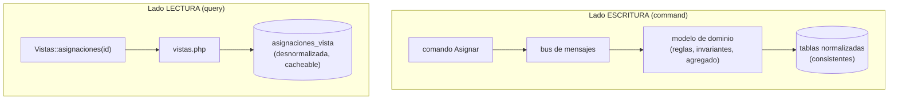
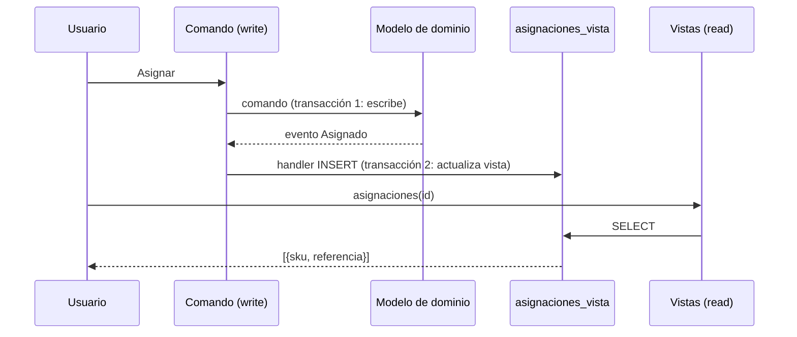

# Capítulo 12 — CQRS (Command-Query Responsibility Segregation)

> Fase 1 · el libro (Parte II). Capítulo autocontenido: la clase (aquí), el código en
> [`proyecto/`](proyecto/) y los ejercicios en [`ejercicios/`](ejercicios/).

⬅️ [Capítulo 11 · Microservicios](../11-microservicios-eventos/) · 🏠 [Índice de capítulos](../README.md) · ➡️ [Capítulo 13 · Dependency Injection](../13-dependency-injection/)

Avanza en **micro-pasos** (estructura 0–9). Correr las pruebas del capítulo:
```bash
vendor/bin/phpunit fase-1/capitulos/12-cqrs/proyecto
```

> 🌍 **Traducción (§3.10).** Idea central del capítulo: *"reads (queries) and writes (commands)
> are different, so they should be treated differently (or have their responsibilities
> segregated)."* — Cap. 12. El libro usa SQLAlchemy Core para la tabla de lectura; aquí usamos el
> **query builder de Eloquent** (`Capsule::table('asignaciones_vista')`), que es el SELECT/INSERT
> plano equivalente.

---

## Micro-paso 1 — CQS: leer y escribir son cosas distintas

### 0. 🧭 La pregunta
> *"Mi endpoint de asignar MODIFICA el stock y además me DEVUELVE datos para mostrar. Cuando el
> usuario recarga la página, ¡asigna dos veces! ¿Cómo separo leer de escribir?"*

### 1. Objetivo
Aplicar **CQS**: una función **o** cambia estado **o** responde preguntas, nunca las dos.

### 2. Cita de la fuente
> *"In CQS we follow one simple rule: functions should either modify state or answer questions,
> but never both."* — Cap. 12, *Post/Redirect/Get and CQS*.

**Equivalente en PHP.** El lado de lectura se separa en `vistas.php`, que **solo** consulta:
```php
final class Vistas
{
    /** @return array<int, array{sku: string, referencia: string}> */
    public static function asignaciones(string $idPedido): array
    {
        return Capsule::table('asignaciones_vista')
            ->where('id_pedido', $idPedido)
            ->get(['sku', 'referencia'])
            ->map(fn ($f) => (array) $f)
            ->all();
    }
}
```

### 3. El dolor / necesidad
El POST `/asignar` devolvía la referencia del lote. Eso mezcla escribir con leer: al recargar, el
navegador reenvía el POST y se asigna de nuevo (el usuario compra dos sofás). Separar permite el
patrón *Post/Redirect/Get*: el POST solo escribe (responde 202 OK), y un GET aparte lee.

### 4. Explicación paso a paso
1. **Separamos.** El comando (lado escritura) solo ESCRIBE y responde un OK simple.
2. **Creamos un lado de lectura.** `Vistas::asignaciones($idPedido)` solo LEE.
3. **`vistas.php`** reúne el código de solo-lectura, aparte de los handlers que cambian estado.
   > *"Splitting out your read-only views from your state-modifying command and event handlers is
   > probably a good idea, even if you don't want to go to full-blown CQRS."* — Cap. 12.

### 5. Figura del libro + diagrama Mermaid (Figura 12-1 — *Separating reads from writes*)

**Explicación:** escribir es complejo (pasa por el dominio y el bus) y debe ser consistente. Leer
es un SELECT simple contra una tabla preparada para leer; puede estar un poco vieja sin causar daño.

### 9. Preguntas de recuerdo
1. ¿Qué regla define CQS?
2. ¿Por qué el POST ya no devuelve la referencia?

---

## Micro-paso 2 — CQRS: un modelo de lectura mantenido por eventos

### 0. 🧭 La pregunta
> *"El modelo de dominio está hecho para escribir (métodos que cambian estado). Para leer rápido
> me estorba. ¿Y si tuviera una copia aparte, solo para leer?"*

### 1. Objetivo
Mantener una **tabla desnormalizada** de lectura, actualizada por los eventos del dominio.

### 2. Cita de la fuente
> *"Updating a Read Model Table Using an Event Handler."* — Cap. 12.

**Equivalente en PHP.** Al evento `Asignado` le añadimos un handler que hace un `INSERT` en la
vista:
```php
public static function agregarAsignacionAVista(Asignado $evento, UnidadDeTrabajo $uow): void
{
    Capsule::table('asignaciones_vista')->insert([
        'id_pedido' => $evento->idPedido,
        'sku' => $evento->sku,
        'referencia' => $evento->referencia,
    ]);
}
```

### 3. El dolor / necesidad
Leer reusando el repositorio o las relaciones de Eloquent obliga a cargar el agregado entero y
puede caer en el problema `SELECT N+1`. La consulta más rápida siempre es
`SELECT * FROM tabla WHERE clave = :valor`.

### 4. Explicación paso a paso
1. **Tabla desnormalizada** `asignaciones_vista` (`id_pedido`, `sku`, `referencia`): sin claves
   foráneas, solo strings.
   > *"Hee hee hee, no foreign keys, just strings, YOLO."* — Cap. 12, *Time to Completely Jump the Shark*.
2. **Se mantiene con eventos.** Al evento `Asignado` le añadimos el handler que hace el `INSERT`.
3. **`Vistas::asignaciones($idPedido)`** hace solo un `SELECT` sobre esa tabla.
4. **Cambiar el motor del modelo de lectura es fácil** (p. ej. a Redis) sin tocar el dominio.

### 5. Figura del libro + diagrama Mermaid (Figura 12-2 — *Sequence diagram for read model*)

**Explicación:** en la escritura hay **dos transacciones**: una actualiza el modelo de escritura y
otra, disparada por el evento, actualiza el de lectura. La lectura después solo consulta esa vista.

### 6. Árbol de archivos
```
fase-1/capitulos/12-cqrs/proyecto/
├── vistas.php                (NUEVO: lado de lectura, CQS)
├── mensajeria.php            (+ handler agregarAsignacionAVista)
├── modelo.php · eventos.php · comandos.php · cola-externa.php
├── repositorio.php · unidad-de-trabajo.php
├── VistasTest.php            (NUEVO: integración del read model con Capsule real)
├── ModeloTest.php · MensajeriaTest.php · IntegracionExternaTest.php
```

### 8. Comprobación
```bash
vendor/bin/phpunit fase-1/capitulos/12-cqrs/proyecto   # OK (10 tests)
```

### 9. Preguntas de recuerdo
1. ¿Por qué el modelo de lectura es una tabla desnormalizada y no el dominio?
2. ¿Quién mantiene esa tabla al día?
3. Si el handler de la vista falla, ¿se rompe la asignación?

---

> 🛠️ **Nota de diseño (para que no te confunda al estudiar):** el handler que llena el modelo de
> lectura (`agregarAsignacionAVista`) escribe con `Capsule::table(...)`, es decir, con la **conexión
> global** de Eloquent, **no** a través de la UoW. Por eso la vista **se llena aunque uses la UoW
> falsa**, siempre que Capsule esté arrancado y la tabla creada — que es justo lo que hace el
> `setUp` de [`proyecto/VistasTest.php`](proyecto/VistasTest.php) (por eso ese test pasa con la UoW
> falsa). Lo que decide si la vista se llena no es el tipo de UoW, sino si la base de datos está
> montada.
>
> 🌍 **Traducción (§3.10):** en el libro (Python) este handler usa `uow.session`, así que con la UoW
> falsa (sin `.session`) no escribe; en PHP lo desacoplamos de la UoW usando la conexión global de
> Eloquent. En ambos casos los handlers de evento están **aislados** con `try/catch` (cap. 10): si
> el read model falla, la asignación **no** se rompe.

⬅️ [Capítulo 11 · Microservicios](../11-microservicios-eventos/) · 🏠 [Índice de capítulos](../README.md) · ➡️ [Capítulo 13 · Dependency Injection](../13-dependency-injection/)

> **Capítulo 12 completo.** Siguiente: **Capítulo 13 — Dependency Injection (and Bootstrapping)**.
