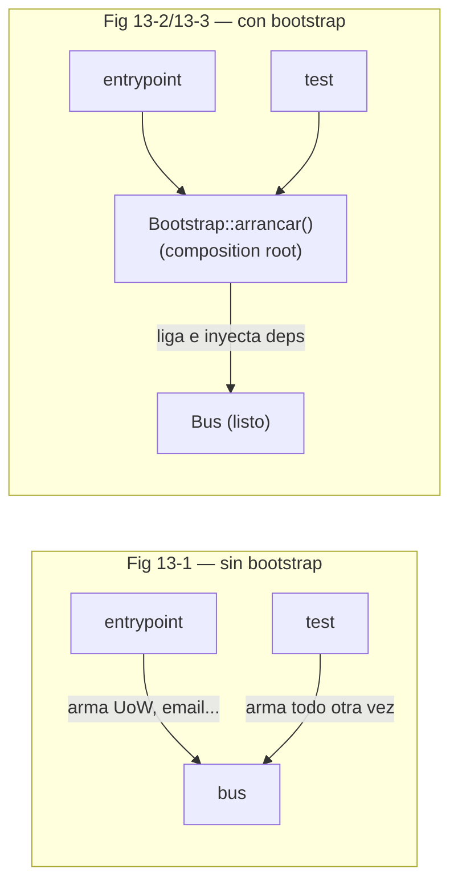
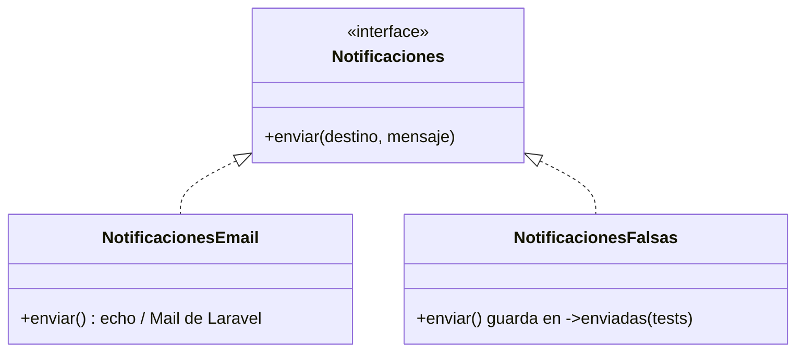

# Capítulo 13 — Dependency Injection (and Bootstrapping)

> Fase 1 · el libro (Parte II, **cierre**). Capítulo autocontenido: la clase (aquí), el código en
> [`proyecto/`](proyecto/) y los ejercicios en [`ejercicios/`](ejercicios/).

⬅️ [Capítulo 12 · CQRS](../12-cqrs/) · 🏠 [Índice de capítulos](../README.md) · 🎉 Fin de los 13 capítulos

Avanza en **micro-pasos** (estructura 0–9). Correr las pruebas del capítulo:
```bash
vendor/bin/phpunit fase-1/capitulos/13-dependency-injection/proyecto
```

> 🌍 **Traducción (§3.10).** El libro inyecta dependencias a mano, inspeccionando la firma de cada
> handler con `inspect.signature`. En PHP/Laravel eso lo hace el **contenedor de servicios**
> (`illuminate/container`, el mismo núcleo que usa Laravel): ligas una interfaz a una
> implementación y el contenedor la resuelve. Es el ejemplo perfecto del DIP (Lección 17) con una
> herramienta idiomática del framework.

---

## Micro-paso 1 — Dependencias explícitas y el bootstrap (composition root)

### 0. 🧭 La pregunta
> *"Mis handlers usan directamente el email, la UoW, el canal externo… Para testear tengo que
> sustituir cada cosa en cada prueba. ¿Cómo hago las dependencias fáciles de cambiar?"*

### 1. Objetivo
Declarar **dependencias explícitas** (una abstracción, no un detalle) y montarlas en un único
**bootstrap** (composition root).

### 2. Cita de la fuente
> *"Explicit is better than implicit. —The Zen of Python … declaring an explicit dependency is an
> example of the dependency inversion principle—rather than having an (implicit) dependency on a
> specific detail, we have an (explicit) dependency on an abstraction."* — Cap. 13.

**Equivalente en PHP.** El handler ya no llama a un email concreto: usa la abstracción
`Notificaciones` que el bootstrap le inyecta:
```php
public static function notificarSinStock(EventoSinStock $evento, UnidadDeTrabajo $uow): void
{
    self::$notificacionesSinStock[] = $evento->sku;
    self::$notificaciones?->enviar('stock@ejemplo.com', "Sin stock para {$evento->sku}");
}
```

### 3. El dolor / necesidad
Llamar algo directo (`(new NotificacionesEmail())->enviar(...)`) ata el código a ese detalle:
para los tests habría que interceptarlo en cada prueba, y un refactor trivial lo rompe todo.

### 4. Explicación paso a paso
1. **Handler con dependencia explícita:** `notificarSinStock` usa `Bus::$notificaciones` (la
   abstracción), no crea un email concreto.
2. **Bootstrap** declara los defaults de producción y permite sobreescribirlos:
   > *"We want our bootstrap script to do the following: 1. Declare default dependencies but allow
   > us to override them …"* — Cap. 13.
3. **El contenedor liga e inyecta:** `$contenedor->instance(Notificaciones::class, ...)` liga la
   interfaz a una implementación; `$contenedor->make(Notificaciones::class)` la resuelve.
4. En **tests** llamamos a `Bootstrap::arrancar(new NotificacionesFalsas())`; en **producción**,
   `Bootstrap::arrancar()` usa el default `NotificacionesEmail`.

### 5. Figura del libro + diagrama Mermaid (Figuras 13-1 → 13-3)

**Explicación:** sin bootstrap, cada entrypoint (y cada test) arma y pasa las dependencias
(duplicación). Con bootstrap, hay **un solo lugar** que las declara, inyecta y entrega el bus listo.

### 9. Preguntas de recuerdo
1. ¿Por qué una dependencia explícita es un ejemplo del DIP?
2. ¿Qué hace el bootstrap (composition root)?

---

## Micro-paso 2 — El adaptador "de verdad": interfaz + real + falso

### 0. 🧭 La pregunta
> *"¿Cómo convierto una dependencia simple (mandar un email) en un adaptador que pueda
> intercambiar (email → SMS → Slack) sin tocar los handlers?"*

### 1. Objetivo
Construir un **adaptador** siguiendo la receta del libro: una interfaz (la API), la implementación
real y una falsa para los tests.

### 2. Cita de la fuente
> *"Our message bus will no longer be static; it needs to have the already-injected handlers given
> to it. So we turn it from being a module into a configurable class."* — Cap. 13.
>
> Receta: *"1. Define your API using an ABC. 2. Implement the real thing. 3. Build a fake and use
> it for … tests…"* — Cap. 13, *DI and Bootstrap recap*.

**Equivalente en PHP.** En PHP la "ABC" es una `interface`:
```php
interface Notificaciones { public function enviar(string $destino, string $mensaje): void; }

final class NotificacionesEmail implements Notificaciones {        // real
    public function enviar(string $destino, string $mensaje): void { echo "[EMAIL] para {$destino}: {$mensaje}\n"; }
}
final class NotificacionesFalsas implements Notificaciones {       // falsa (tests)
    public array $enviadas = [];
    public function enviar(string $destino, string $mensaje): void { $this->enviadas[$destino][] = $mensaje; }
}
```

### 3. El dolor / necesidad
Si los handlers dependieran de `NotificacionesEmail` concreto, no podrías cambiar a SMS sin tocar
cada handler ni testear sin enviar correos reales. Dependiendo de la **interfaz**, cambias de
implementación en **una línea del bootstrap**.

### 4. Explicación paso a paso
1. **La interfaz `Notificaciones`** es el contrato (la "ABC" del libro, punto 1 de la receta).
2. **`NotificacionesEmail`** es la implementación real (punto 2).
3. **`NotificacionesFalsas`** guarda lo enviado en `->enviadas` para que el test lo compruebe sin
   efectos reales (punto 3).
4. **El bootstrap elige** cuál se inyecta. En los tests,
   `Bootstrap::arrancar(new NotificacionesFalsas())`; luego el test lee `$falsas->enviadas`.

### 5. Diagrama (Mermaid — el adaptador y su falso)

**Explicación:** los handlers dependen de la **interfaz** `Notificaciones`. En producción el
bootstrap inyecta `NotificacionesEmail`; en tests, `NotificacionesFalsas`. Ningún handler cambia.

### 6. Árbol de archivos
```
fase-1/capitulos/13-dependency-injection/proyecto/
├── bootstrap.php             (NUEVO: composition root con illuminate/container)
├── notificaciones.php        (NUEVO: interfaz + adaptador real + falso)
├── mensajeria.php            (Bus::$notificaciones inyectado · notificarSinStock usa la abstracción)
├── vistas.php · modelo.php · eventos.php · comandos.php · cola-externa.php
├── repositorio.php · unidad-de-trabajo.php
├── BootstrapTest.php         (NUEVO: prueba la DI por el contenedor)
├── MensajeriaTest.php        (inyecta NotificacionesFalsas y lee ->enviadas)
├── ModeloTest.php · VistasTest.php · IntegracionExternaTest.php
```

### 8. Comprobación
```bash
vendor/bin/phpunit fase-1/capitulos/13-dependency-injection/proyecto   # OK (14 tests)
```

### 9. Preguntas de recuerdo
1. ¿Cuáles son los 3 pasos de la receta para un adaptador?
2. ¿Cuál es la ventaja de que los handlers dependan de la interfaz y no de `NotificacionesEmail`?
3. ¿Dónde cambiarías email por SMS?

---

> 🛠️ **Nota de diseño (sigue valiendo lo del cap. 12):** el handler que escribe el modelo de
> lectura sigue necesitando base de datos (`Capsule::table`). En los tests con **UoW falsa** falla
> en silencio (el bus aísla los eventos con `try/catch`), así que el read model **solo se llena con
> la base real** (ver [`proyecto/VistasTest.php`](proyecto/VistasTest.php)).

⬅️ [Capítulo 12 · CQRS](../12-cqrs/) · 🏠 [Índice de capítulos](../README.md)

> **Capítulo 13 completo.** 🎉 **¡Fin de los 13 capítulos del libro!**
