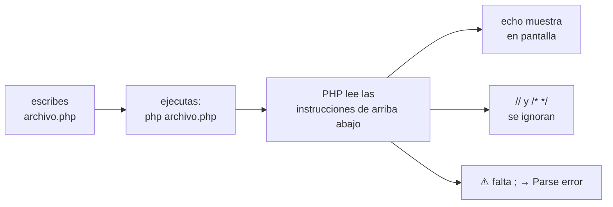

# Lección 00 — ¿Qué es ejecutar un programa?

> Fase 0 · Formulario · Familia de concepto: **ejecutar código** · Orden de estudio: **1 de 18**

⬅️ [Cómo estudiar](../../COMO-ESTUDIAR.md) · 🏠 [Índice de lecciones](../README.md) · ➡️ [Lección 01 · Variables y tipos](../01-variables-y-tipos/)

---

## 🧭 Ruta de estudio · Lección 00 (≈ 45 min)

**Antes necesitas:** nada. Es la primera lección.

| Paso | Qué haces | Dónde | ⏱ |
|:-:|---|---|:-:|
| **0** | Lee la teoría, las tablas y los errores | este README §0–§8 | 15 min |
| **1** | Ejecuta las fórmulas y compara con la tabla | [`paso1-formulas.php`](paso1-formulas.php) | 5 min |
| **2** | Sigue los ejemplos resueltos | §9 + [`paso2-ejemplos-resueltos.php`](paso2-ejemplos-resueltos.php) | 5 min |
| **3** | Completa los `// TODO` | [`paso3-tu-turno.php`](paso3-tu-turno.php) | 8 min |
| **4** | Compara con la solución | [`paso4-tu-turno-solucion.php`](paso4-tu-turno-solucion.php) | 2 min |
| **5** | Resuelve los 12 problemas y revisa claves | §10–§11 + [`paso5-solucionario/`](paso5-solucionario/) | 7 min |
| **6** | Compara mala vs buena | [`paso6-ejercicios/`](paso6-ejercicios/) | 2 min |
| **7** | Responde las preguntas de recuerdo | §15 | 1 min |
| **🚦** | Evalúa si puedes pasar | §16 | 1 min |

---

## 0. 🧭 La pregunta
> *"No tengo nada: ni sé programar, ni tengo nada instalado. **Me piden** que la computadora
> **muestre un mensaje por mí**. ¿Qué hago? ¡Estoy perdido!"*

## 1. Objetivos (al terminar podrás…)
1. Explicar con tus palabras qué es **un programa** y qué es **ejecutarlo**.
2. Instalar **PHP 8.3** y **Composer**, y comprobar sus versiones.
3. Ejecutar un archivo `.php` con `php`.
4. Mostrar textos y números con `echo`, y escribir **comentarios** que PHP ignora.
5. Reconocer el `Parse error`, el `Warning: Undefined variable` y el `Error: undefined function`.

## 2. Cita de la fuente
> *"the best way to learn about code is to code."* — Preface, *Example Code and Coding Along*

**Equivalente en PHP:** el libro está en Python; aquí **ejecutas código de verdad desde el primer
minuto**, pero en PHP. Lo que cambia es la herramienta: donde el libro corre `python`/`uv`,
nosotros corremos `php`.

**Por qué importa:** se aprende **escribiendo y ejecutando**, no solo leyendo. Esta lección no es
teoría: vas a correr código desde ya.

## 3. El dolor
Tienes una idea ("mostrar un mensaje") pero una computadora **no entiende ideas**: entiende
**instrucciones escritas** en un lenguaje y ejecutadas por un programa. Sin PHP instalado ni un
archivo que ejecutar, no hay forma de que "muestre algo por ti".

---

## 4. 📘 Teoría

> **📦 Definición — Programa**
> Un **programa** es un archivo de texto con **instrucciones** escritas en un lenguaje (aquí, PHP).
> **Ejecutar** un programa es pedirle a PHP que lea esas instrucciones y las haga, una por una, de
> arriba abajo.

> **📄 Definición — Archivo PHP**
> Un archivo `.php` empieza con la etiqueta **`<?php`**. Después vienen las instrucciones; cada una
> termina en **`;`** (punto y coma).

> **🔤 Vocabulario**
> - **`echo`:** la instrucción para **mostrar** algo en pantalla.
> - **`"texto"`:** un valor de texto (va entre comillas).
> - **`\n`:** un **salto de línea** (dentro de comillas dobles).
> - **Comentario:** texto que PHP **ignora**; empieza con `//` (una línea) o va entre `/* */`.
> - **Composer:** el instalador de librerías de PHP (como `npm` o `uv`). Lo usaremos desde la Lección 08.

> **🧠 Regla de oro**
> La computadora hace **exactamente** lo que dice el programa, en **orden** y **al pie de la letra**.
> Si algo sale raro, casi siempre es que el programa dice algo distinto de lo que pensabas.

---

## 5. 🧮 Formulario: instalar y ejecutar
| # | Qué | Comando | Resultado |
|---|---|---|---|
| K0 | Instalar PHP 8.3 | Linux: `sudo apt install php8.3-cli` · macOS: `brew install php` · Windows: desde [php.net](https://www.php.net/downloads) | PHP queda instalado |
| K1 | Instalar Composer | Linux/macOS: ver [getcomposer.org](https://getcomposer.org/download/) · Windows: el instalador oficial | Composer queda instalado |
| K2 | ¿Qué versión de PHP tengo? | `php -v` | `PHP 8.3.…` |
| K3 | ¿Qué versión de Composer tengo? | `composer --version` | `Composer version 2.…` |
| K4 | Ejecutar un archivo | `php archivo.php` | corre el programa y muestra su salida |

## 6. 🧮 Formulario: mostrar cosas con `echo`
| # | Operación | Sintaxis | Ejemplo | Resultado |
|---|---|---|---|---|
| P1 | Mostrar texto | `echo "...";` | `echo "Hola";` | `Hola` |
| P2 | Mostrar un número | `echo n;` | `echo 42;` | `42` |
| P3 | Varias cosas | `echo a, b, c;` | `echo "a", "b";` | `ab` |
| P4 | Unir texto (concatenar) | `"a" . "b"` | `"Hola" . " mundo"` | `Hola mundo` |
| P5 | Salto de línea | `"\n"` | `echo "a\n";` | `a` + nueva línea |
| P6 | Un cálculo | `echo 2 + 3;` | `echo 2 + 3;` | `5` |
| P7 | Comentario de una línea | `// ...` | `// nota` | (PHP lo ignora) |
| P8 | Comentario de varias líneas | `/* ... */` | `/* nota */` | (PHP lo ignora) |

> 💡 Todas están ejecutables en [`paso1-formulas.php`](paso1-formulas.php).

## 7. 📐 Propiedades
| # | Propiedad |
|---|---|
| **P1.** Todo archivo PHP empieza con `<?php`. |
| **P2.** Cada instrucción termina en `;`. Si falta, PHP da un `Parse error`. |
| **P3.** El programa se ejecuta **de arriba abajo**, en orden. |
| **P4.** PHP **no** usa la sangría (los espacios al inicio) para nada: es solo para que tú leas mejor. |

## 8. ⚠️ Errores frecuentes
| # | ❌ Así no | Qué pasa | ✅ Así sí |
|---|---|---|---|
| E1 | `echo "a"` (sin `;`) y otra línea | `Parse error: syntax error, unexpected token ... expecting ";"` | pon `;` al final: `echo "a";` |
| E2 | `echo "Hola` (sin cerrar la comilla) | `Parse error: syntax error, unexpected end of file` | cierra la comilla: `echo "Hola";` |
| E3 | `echo $x;` (nunca creaste `$x`) | `Warning: Undefined variable $x` (muestra vacío) | crea la variable antes (Lección 01) |
| E4 | `saludar();` (función que no existe) | `Fatal error: Uncaught Error: Call to undefined function saludar()` | define la función antes (Lección 04) |

> 🔬 Los mensajes son reales de PHP 8.3.

---

## 9. ✍️ Ejemplos resueltos (paso a paso)
> Todos están en [`paso2-ejemplos-resueltos.php`](paso2-ejemplos-resueltos.php).

**Ejemplo 1 — Saludar** *(fácil)*
```php
echo "Hola, mundo\n";   // un echo, su texto, y un salto de línea
```

**Ejemplo 2 — Varias líneas** *(fácil)*
```php
echo "Línea uno\n";
echo "Línea dos\n";
```

**Ejemplo 3 — Un cálculo** *(intermedio)*
```php
echo "2 + 3 = ", 2 + 3, "\n";   // PHP calcula 2+3 y muestra 5
```

**Ejemplo 4 — Comentarios** *(avanzado)*
```php
// Esta línea es un comentario: PHP la ignora.
echo "Esto sí se ve\n";
/* Un bloque de
   varias líneas tampoco se ejecuta. */
echo "Y esto también\n";
```

---

## 10. 📝 Problemas propuestos
> Resuélvelos **antes** de mirar las claves. Crea tu propio `mis-problemas.php` y córrelo con `php`.

**🟢 Nivel básico**
1. Muestra `Hola` seguido de un salto de línea.
2. Muestra el número `100`.
3. Muestra `a`, `b` y `c` juntos (sale `abc`).
4. Muestra el resultado de `10 - 4`.

**🟡 Nivel intermedio**

5. Une `"Hola"`, `" "` y `"mundo"` con el punto (`.`) y muéstralo.
6. Muestra el resultado de `2 * 3 * 4`.
7. Muestra `uno` y `dos` en dos líneas distintas.
8. Muestra un texto usando `print` en vez de `echo`.

**🔴 Nivel avanzado**

9. Muestra el resultado de `2 + 3 * 4` y observa el orden de las operaciones.
10. Muestra una "factura": `Mesa: 100`, `Silla: 50` y `Total: ` con la **suma** `100 + 50`.
11. Muestra cuántos segundos hay en una hora (`60 * 60`).
12. *(Puente al libro)* Muestra el mensaje de "sin stock" del libro: `Out of stock for MESA` (solo con `echo` y el texto tal cual; las variables llegan en la Lección 01).

## 11. 🔑 Claves (respuestas)
<details><summary>Ver claves (solo después de intentarlo)</summary>

| # | Salida esperada | Fórmula clave |
|---|---|---|
| 1 | `Hola` + salto | P1 + P5 |
| 2 | `100` | P2 |
| 3 | `abc` | P3 |
| 4 | `6` | P6 |
| 5 | `Hola mundo` | P4 |
| 6 | `24` | P6 |
| 7 | `uno` / `dos` (dos líneas) | P1 + P5 |
| 8 | el texto (con `print`) | P1 |
| 9 | `14` (primero `*`, luego `+`) | P6 |
| 10 | `Mesa: 100` / `Silla: 50` / `Total: 150` | P6 |
| 11 | `3600` | P6 |
| 12 | `Out of stock for MESA` | P1 (`echo` con el texto tal cual) |

Código completo en [`paso5-solucionario/`](paso5-solucionario/).
</details>

---

## 12. 🗺️ Mapa mental (Mermaid)

**Cómo leerlo:** escribes un archivo, lo ejecutas con `php`, y PHP corre sus instrucciones en
orden; `echo` muestra cosas, los comentarios se ignoran, y un `;` olvidado da un `Parse error`.

## 13. 🌳 Árbol de archivos
```
lecciones/00-que-es-ejecutar-un-programa/
├── README.md                    ← PASO 0 · EMPIEZA AQUÍ (este formulario)
├── paso1-formulas.php           ← PASO 1 · las fórmulas P1–P8, ejecutables
├── paso2-ejemplos-resueltos.php ← PASO 2 · los 4 ejemplos resueltos
├── paso3-tu-turno.php           ← PASO 3 · completa los // TODO
├── paso4-tu-turno-solucion.php  ← PASO 4 · solución de referencia
├── paso5-solucionario/          ← PASO 5 · soluciones de los 12 problemas
└── paso6-ejercicios/            ← PASO 6 · solución mala vs buena
```

## 14. 🤝 Tu turno y ✅ comprobación
PHPUnit llega en la [Lección 08](../08-modulos-y-phpunit/). Aquí se comprueba **ejecutando y
comparando** con la salida esperada:
```bash
php lecciones/00-que-es-ejecutar-un-programa/paso3-tu-turno.php
git diff --no-index lecciones/00-que-es-ejecutar-un-programa/paso3-tu-turno.php lecciones/00-que-es-ejecutar-un-programa/paso4-tu-turno-solucion.php
```

## 15. ❓ Preguntas de recuerdo
<details><summary>1. ¿Qué es "ejecutar" un programa?</summary>

Pedirle a PHP que lea las instrucciones del archivo y las haga, una por una, de arriba abajo.
</details>
<details><summary>2. ¿Con qué empieza todo archivo PHP y cómo termina cada instrucción?</summary>

Empieza con `<?php`; cada instrucción termina en `;`.
</details>
<details><summary>3. ¿Qué instrucción muestra algo en pantalla?</summary>

`echo` (también existe `print`).
</details>
<details><summary>4. ¿Qué pasa si olvidas el <code>;</code>?</summary>

PHP da un `Parse error` y no ejecuta el programa.
</details>
<details><summary>5. ¿PHP usa la sangría (los espacios al inicio) para algo?</summary>

No; es solo para que tú leas mejor. (En Python sí importa; en PHP no.)
</details>
<details><summary>6. ¿Cómo se dice <code>print("Hola")</code> de Python en PHP?</summary>

`echo "Hola";` (o `print "Hola";`).
</details>

---

## 16. 🚦 ¿Puedo pasar a la siguiente lección?
| Indicador | Criterio |
|:-:|---|
| 🟢 **Sí, sigue** | `paso3-tu-turno.php` da la salida esperada **y** aciertas **≥ 9 de 12** problemas **y** respondes las 6 preguntas sin mirar |
| 🟡 **Repasa** | aciertas **6 a 8** → vuelve a §8 (errores) y §9 (ejemplos) |
| 🔴 **Repite** | aciertas **menos de 6** → empieza otra vez desde el Paso 0 |

Cuando estés en 🟢, marca la lección en [`progreso/fase-0-php.md`](../../progreso/fase-0-php.md).

---

⬅️ [Cómo estudiar](../../COMO-ESTUDIAR.md) · 🏠 [Índice de lecciones](../README.md) · ➡️ [Lección 01 · Variables y tipos](../01-variables-y-tipos/)
