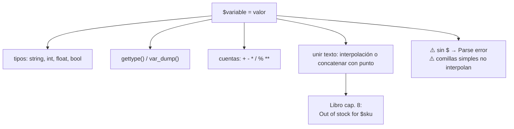

# Lección 01 — Variables y tipos

> Fase 0 · Formulario · Familia de concepto: **guardar datos** · Orden de estudio: **2 de 18**

⬅️ [Lección 00 · ¿Qué es ejecutar un programa?](../00-que-es-ejecutar-un-programa/) · 🏠 [Índice de lecciones](../README.md) · ➡️ [Lección 02 · Condicionales](../02-condicionales/)

---

## 🧭 Ruta de estudio · Lección 01 (≈ 1.5 h)

**Antes necesitas:** [Lección 00](../00-que-es-ejecutar-un-programa/) (ejecutar un `.php`, `echo`).

| Paso | Qué haces | Dónde | ⏱ |
|:-:|---|---|:-:|
| **0** | Lee la teoría, las tablas y los errores | este README §0–§8 | 20 min |
| **1** | Ejecuta las fórmulas y compara con la tabla | [`paso1-formulas.php`](paso1-formulas.php) | 10 min |
| **2** | Sigue los ejemplos resueltos | §9 + [`paso2-ejemplos-resueltos.php`](paso2-ejemplos-resueltos.php) | 15 min |
| **3** | Completa los `// TODO` | [`paso3-tu-turno.php`](paso3-tu-turno.php) | 15 min |
| **4** | Compara con la solución | [`paso4-tu-turno-solucion.php`](paso4-tu-turno-solucion.php) | 5 min |
| **5** | Resuelve los 12 problemas y revisa claves | §10–§11 + [`paso5-solucionario/`](paso5-solucionario/) | 20 min |
| **6** | Compara mala vs buena | [`paso6-ejercicios/`](paso6-ejercicios/) | 5 min |
| **7** | Responde las preguntas de recuerdo | §15 | 5 min |
| **🚦** | Evalúa si puedes pasar | §16 | 1 min |

---

## 0. 🧭 La pregunta
> *"Ya sé mostrar un texto fijo. Me piden saludar con un nombre que **puede cambiar**. Si lo
> escribo a mano en cada `echo`, tengo que editar todo cada vez. ¿Qué hago?"*

## 1. Objetivos (al terminar podrás…)
1. Crear una **variable** (`$nombre = ...`), usarla y cambiar su valor.
2. Distinguir los tipos **`string`**, **`int`**, **`float`** y **`bool`**, y comprobarlos con `gettype()`.
3. Hacer cuentas (`+ - * / % **`, `intdiv`) y guardar el resultado.
4. Unir texto con números con **interpolación** (`"Hola $nombre"`) o concatenación (`.`).
5. Reconocer el `Warning: Undefined variable` y el `TypeError`.

## 2. Cita de la fuente
> *"We have an initial conversation with our business experts and agree on a glossary and some
> rules for the first minimal version of the domain model."* — Cap. 1, *Exploring the Domain Language*

> *"batch = Batch("batch-001", "SMALL-TABLE", qty=20, eta=date.today())"* … *"assert
> batch.available_quantity == 18"* — Cap. 1

> *"f'Out of stock for {event.sku}'"* — Cap. 8

**Equivalente en PHP** (§3.10):
```php
$sku = "SMALL-TABLE";          // un texto (string), como en el glosario del libro
$qty = 20;                     // un número (int)
$disponible = $qty - 2;        // una cuenta -> 18
echo "Out of stock for $sku";  // la f-string de Python es interpolación en PHP
```
**Por qué importa:** el libro empieza **poniéndole nombre a las cosas** (un glosario): eso es una
variable. En su primer test guarda un texto y un número y hace una cuenta; y arma mensajes con una
f-string, que en PHP es la **interpolación** `"... $variable ..."`.

## 3. El dolor
```php
echo "Hola, Ada\n";
echo "Hola, Ada\n";   // si el nombre cambia, hay que editar CADA línea
```
Sin una variable, el dato "Ada" está repartido por todo el programa.

---

## 4. 📘 Teoría

> **📦 Definición — Variable**
> Una **variable** es un nombre (que empieza con `$`) que **guarda un valor**. Se crea con `=` y
> se puede cambiar cuando quieras.
> `$nombre = "Ada";`

> **🔢 Definición — Tipos básicos**
> - **`string`** (texto): `"MESA"` — entre comillas.
> - **`int`** (entero): `20`.
> - **`float`** (decimal): `19.9`.
> - **`bool`** (verdad): `true` o `false`.

> **🔤 Vocabulario**
> - **Interpolación:** dentro de `"comillas dobles"`, `$variable` se reemplaza por su valor.
> - **Concatenar:** unir textos con el punto `.` (`"a" . "b"`).
> - **`gettype()` / `var_dump()`:** dicen de qué **tipo** es un valor.
> - **`declare(strict_types=1)`:** hace que PHP sea **estricto** con los tipos (recomendado).

> **🧠 Regla de oro**
> Si un dato aparece **más de una vez** o **puede cambiar**, guárdalo en una **variable** y úsala.

---

## 5. 🧮 Formulario: variables y tipos
| # | Operación | Sintaxis | Ejemplo | Resultado |
|---|---|---|---|---|
| V1 | Crear variable | `$x = valor;` | `$nombre = "Ada";` | — |
| V2 | Cambiar el valor | `$x = otro;` | `$nombre = "Grace";` | — |
| V3 | Texto (string) | `"..."` | `$sku = "MESA";` | `MESA` |
| V4 | Entero (int) | `n` | `$cantidad = 20;` | `20` |
| V5 | Decimal (float) | `n.m` | `$precio = 19.9;` | `19.9` |
| V6 | Booleano (bool) | `true` / `false` | `$ok = true;` | `true` |
| V7 | ¿De qué tipo es? | `gettype($x)` | `gettype(20)` | `integer` |
| V8 | Ver tipo y valor | `var_dump($x)` | `var_dump(19.9)` | `float(19.9)` |

## 6. 🧮 Formulario: cuentas y texto
| # | Operación | Sintaxis | Ejemplo | Resultado |
|---|---|---|---|---|
| T1 | Suma | `a + b` | `2 + 3` | `5` |
| T2 | Resta | `a - b` | `10 - 4` | `6` |
| T3 | Multiplicación | `a * b` | `6 * 7` | `42` |
| T4 | División | `a / b` | `7 / 2` | `3.5` |
| T5 | División entera | `intdiv(a, b)` | `intdiv(7, 2)` | `3` |
| T6 | Resto (módulo) | `a % b` | `7 % 2` | `1` |
| T7 | Potencia | `a ** b` | `2 ** 10` | `1024` |
| T8 | Interpolar | `"... $x ..."` | `"Hola $nombre"` | `Hola Ada` |
| T9 | Interpolar con llaves | `"...{$x}..."` | `"{$nombre}123"` | `Ada123` |
| T10 | Concatenar | `"a" . $x` | `"total: " . $t` | `total: 300` |

> 💡 Todas están ejecutables en [`paso1-formulas.php`](paso1-formulas.php).

## 7. 📐 Propiedades
| # | Propiedad |
|---|---|
| **P1.** Toda variable empieza con `$` (`$nombre`, no `nombre`). |
| **P2.** Una variable se puede cambiar cuantas veces quieras. |
| **P3.** La interpolación `"$x"` solo funciona con **comillas dobles** (`"`), no simples (`'`). |
| **P4.** `7 / 2` da `3.5` (float); para la división entera usa `intdiv(7, 2)`. |

## 8. ⚠️ Errores frecuentes
| # | ❌ Así no | Qué pasa | ✅ Así sí |
|---|---|---|---|
| E1 | `nombre = "Ada";` (sin `$`) | `Parse error` | `$nombre = "Ada";` |
| E2 | `'Hola $nombre'` (comillas simples) | sale literal `Hola $nombre` (no interpola) | `"Hola $nombre"` (comillas dobles) |
| E3 | `"hola" + 3` (sumar texto con número) | `TypeError: Unsupported operand types: string + int` | une textos con `.`: `"hola" . 3` |
| E4 | `echo $noExiste;` | `Warning: Undefined variable $noExiste` (sale vacío) | crea la variable antes de usarla |

> 🔬 Mensajes reales de PHP 8.3. En PHP 8, `"hola" + 3` lanza `TypeError` **siempre** (con o sin
> `declare(strict_types=1)`): el `+` es solo para números. `strict_types` afecta a los **argumentos
> y retornos de funciones**, no a los operadores. Para unir textos se usa el punto: `"hola" . 3`.

---

## 9. ✍️ Ejemplos resueltos (paso a paso)
> Todos están en [`paso2-ejemplos-resueltos.php`](paso2-ejemplos-resueltos.php).

**Ejemplo 1 — Saludar con un nombre variable** *(fácil)*
```php
$nombre = "Ada";          // Paso 1: guardar el dato
echo "Hola, $nombre\n";   // Paso 2: interpolar  -> Hola, Ada
$nombre = "Grace";        // Paso 3: cambiar el dato...
echo "Hola, $nombre\n";   // Paso 4: ...y el mensaje cambia solo -> Hola, Grace
```

**Ejemplo 2 — El total de una compra** *(fácil)*
```php
$precio = 100;
$cantidad = 3;
$total = $precio * $cantidad;   // una cuenta guardada en otra variable
echo "Total: $total\n";          // -> 300
```

**Ejemplo 3 — Comprobar un tipo** *(intermedio)*
```php
$qty = 20;                                   // como el qty=20 del libro
echo gettype($qty) . "\n";                   // -> integer
echo gettype("SMALL-TABLE") . "\n";          // -> string
```

**Ejemplo 4 — Un mensaje como el del libro** *(avanzado)*
```php
$eventoSku = "SMALL-TABLE";
echo "Out of stock for $eventoSku\n";   // interpolación = la f-string del cap. 8
```

---

## 10. 📝 Problemas propuestos
**🟢 Nivel básico**
1. Crea `$ciudad = "Lima"` y muéstrala.
2. Cambia `$ciudad` a `"Cusco"` y vuelve a mostrarla.
3. Crea `$edad = 30` y muestra su tipo con `gettype()`.
4. Muestra el resultado de `8 + 5`.

**🟡 Nivel intermedio**

5. Con `$precio = 100`, calcula el IVA (`$precio * 0.18`) y muéstralo.
6. Muestra `7 / 2` y observa que da un decimal.
7. Muestra `intdiv(7, 2)` y `7 % 2` (división entera y resto).
8. Con `$nombre = "Ada"` y `$n = 42`, muestra `Ada42` usando llaves `{$...}`.

**🔴 Nivel avanzado**

9. Muestra `2 ** 8`.
10. Con `$a = 5` y `$b = 3`, muestra `5 + 3 = 8` usando interpolación.
11. Calcula los segundos de `3 minutos y 25 segundos` (`3 * 60 + 25`).
12. *(Puente al libro)* Con `$qty = 20` y `$asignado = 2`, calcula `$disponible` y muéstralo (debe dar `18`, como el primer test del cap. 1).

## 11. 🔑 Claves (respuestas)
<details><summary>Ver claves</summary>

| # | Salida esperada |
|---|---|
| 1 | `Lima` |
| 2 | `Cusco` |
| 3 | `integer` |
| 4 | `13` |
| 5 | `18` |
| 6 | `3.5` |
| 7 | `3` y `1` |
| 8 | `Ada42` |
| 9 | `256` |
| 10 | `5 + 3 = 8` |
| 11 | `205` |
| 12 | `18` |

Código en [`paso5-solucionario/`](paso5-solucionario/).
</details>

---

## 12. 🗺️ Mapa mental (Mermaid)

**Cómo leerlo:** una variable guarda un valor de algún tipo; con él haces cuentas y armas textos
(interpolando o concatenando). La interpolación es el equivalente de la f-string del libro.

## 13. 🌳 Árbol de archivos
```
lecciones/01-variables-y-tipos/
├── README.md                    ← PASO 0 · EMPIEZA AQUÍ
├── paso1-formulas.php           ← PASO 1 · fórmulas V1–V8 y T1–T10
├── paso2-ejemplos-resueltos.php ← PASO 2 · ejemplos resueltos
├── paso3-tu-turno.php           ← PASO 3 · // TODO
├── paso4-tu-turno-solucion.php  ← PASO 4 · solución
├── paso5-solucionario/          ← PASO 5 · soluciones de los 12 problemas
└── paso6-ejercicios/            ← PASO 6 · mala vs buena
```

## 14. 🤝 Tu turno y ✅ comprobación
```bash
php lecciones/01-variables-y-tipos/paso3-tu-turno.php
git diff --no-index lecciones/01-variables-y-tipos/paso3-tu-turno.php lecciones/01-variables-y-tipos/paso4-tu-turno-solucion.php
```

## 15. ❓ Preguntas de recuerdo
<details><summary>1. ¿Con qué empieza el nombre de una variable en PHP?</summary>

Con `$` (por ejemplo `$nombre`).
</details>
<details><summary>2. ¿Qué diferencia hay entre comillas dobles y simples?</summary>

Las dobles **interpolan** (`"$x"` muestra el valor); las simples no (`'$x'` muestra literal `$x`).
</details>
<details><summary>3. ¿Qué da <code>7 / 2</code> y cómo obtienes la división entera?</summary>

`7 / 2` da `3.5`; la entera es `intdiv(7, 2)` = `3`.
</details>
<details><summary>4. ¿Cómo compruebas el tipo de una variable?</summary>

Con `gettype($x)` o `var_dump($x)`.
</details>
<details><summary>5. ¿Cómo se dice la f-string <code>f'Hola {nombre}'</code> de Python en PHP?</summary>

Con interpolación: `"Hola $nombre"`.
</details>
<details><summary>6. ¿Por qué conviene guardar un dato en una variable?</summary>

Porque si cambia o se repite, lo cambias en un solo lugar y todo el programa se ajusta.
</details>

---

## 16. 🚦 ¿Puedo pasar a la siguiente lección?
| Indicador | Criterio |
|:-:|---|
| 🟢 **Sí, sigue** | `paso3-tu-turno.php` da la salida esperada **y** aciertas **≥ 9 de 12** problemas **y** respondes las 6 preguntas sin mirar |
| 🟡 **Repasa** | aciertas **6 a 8** → vuelve a §8 y §9 |
| 🔴 **Repite** | aciertas **menos de 6** → desde el Paso 0 |

Cuando estés en 🟢, marca la lección en [`progreso/fase-0-php.md`](../../progreso/fase-0-php.md).

---

⬅️ [Lección 00 · ¿Qué es ejecutar un programa?](../00-que-es-ejecutar-un-programa/) · 🏠 [Índice de lecciones](../README.md) · ➡️ [Lección 02 · Condicionales](../02-condicionales/)
