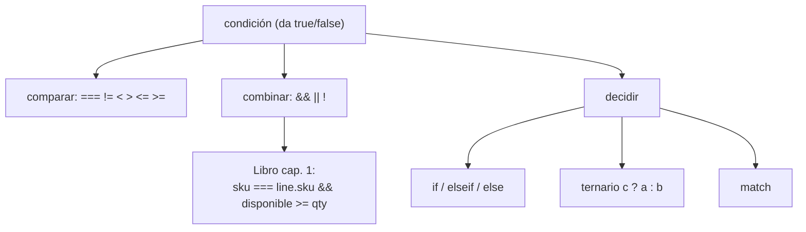

# Lección 02 — Condicionales

> Fase 0 · Formulario · Familia de concepto: **decidir** · Orden de estudio: **3 de 18**

⬅️ [Lección 01 · Variables y tipos](../01-variables-y-tipos/) · 🏠 [Índice de lecciones](../README.md) · ➡️ [Lección 03 · Bucles](../03-bucles/)

---

## 🧭 Ruta de estudio · Lección 02 (≈ 1.5 h)

**Antes necesitas:** [Lección 01](../01-variables-y-tipos/) (variables, tipos, booleanos).

| Paso | Qué haces | Dónde | ⏱ |
|:-:|---|---|:-:|
| **0** | Lee la teoría, las tablas y los errores | este README §0–§8 | 20 min |
| **1** | Ejecuta las fórmulas | [`paso1-formulas.php`](paso1-formulas.php) | 10 min |
| **2** | Sigue los ejemplos resueltos | §9 + [`paso2-ejemplos-resueltos.php`](paso2-ejemplos-resueltos.php) | 15 min |
| **3** | Completa los `// TODO` | [`paso3-tu-turno.php`](paso3-tu-turno.php) | 15 min |
| **4** | Compara con la solución | [`paso4-tu-turno-solucion.php`](paso4-tu-turno-solucion.php) | 5 min |
| **5** | Resuelve los 12 problemas y revisa claves | §10–§11 + [`paso5-solucionario/`](paso5-solucionario/) | 20 min |
| **6** | Compara mala vs buena | [`paso6-ejercicios/`](paso6-ejercicios/) | 5 min |
| **7** | Responde las preguntas de recuerdo | §15 | 5 min |
| **🚦** | Evalúa si puedes pasar | §16 | 1 min |

---

## 0. 🧭 La pregunta
> *"Me piden que el mensaje **cambie según una condición**: si es mayor de edad, uno; si no, otro.
> Hasta ahora mi programa hace siempre lo mismo. ¿Cómo le enseño a **decidir**?"*

## 1. Objetivos (al terminar podrás…)
1. Escribir **comparaciones** (`===`, `!=`, `<`, `>`, `<=`, `>=`) que dan `true` o `false`.
2. Combinar condiciones con **`&&`**, **`||`** y **`!`**.
3. Decidir con **`if`**, **`if/else`** e **`if/elseif/else`**.
4. Elegir el **orden** correcto de los `elseif` y usar el **ternario** y **`match`**.
5. Reconocer el error de usar `=` en vez de `===`, y el `UnhandledMatchError`.

## 2. Cita de la fuente
> *"When we allocate, if we have enough available quantity, we just add to the set."* — Cap. 1 (junto a *Figure 1-3*)

> *"return self.sku == line.sku and self.available_quantity >= line.qty"* — Cap. 1 (`can_allocate`)

**Equivalente en PHP** (§3.10): el `and` de Python es `&&`, y el `==` de Python (igualdad de valor)
se escribe `===` (igualdad de valor **y tipo**, la forma segura):
```php
$puedeAsignar = $loteSku === $lineaSku && $disponible >= $pedido;
```
**Por qué importa:** la regla del negocio se dice con un **"si"**: *si* hay cantidad suficiente, se
asigna. En código son **dos comparaciones unidas con `&&`**: el sku coincide (`===`) **y** la
cantidad alcanza (`>=`). Esa línea es exactamente lo que aprendes aquí.

## 3. El dolor
```php
echo "Puede pasar\n";   // siempre lo mismo, pase lo que pase
```
Sin condicionales, el programa no puede reaccionar a los datos: hace siempre lo mismo.

---

## 4. 📘 Teoría

> **📦 Definición — Comparación**
> Una **comparación** pregunta algo y responde `true` o `false`. `$edad >= 18` es `true` si la edad
> es 18 o más.

> **🔀 Definición — `if` / `elseif` / `else`**
> `if (condición) { ... }` ejecuta el bloque **solo si** la condición es `true`. `else` es "si no".
> `elseif` encadena varias condiciones; **gana la primera que se cumple**.

> **🔤 Vocabulario**
> - **`===`:** igual en **valor y tipo** (`5 === "5"` es `false`). Es la forma recomendada.
> - **`==`:** igual en valor, convirtiendo tipos (puede sorprender; evítalo).
> - **`&&` (y), `||` (o), `!` (no):** combinan condiciones.
> - **Ternario:** `condición ? siVerdadero : siFalso` — elige un valor en una línea.
> - **`match`:** compara un valor contra varios casos (con `===`).

> **🧮 Tabla de verdad**
>
> | `$a` | `$b` | `$a && $b` (y) | `$a \|\| $b` (o) | `!$a` (no) |
> |---|---|---|---|---|
> | `true` | `true` | `true` | `true` | `false` |
> | `true` | `false` | `false` | `true` | `false` |
> | `false` | `true` | `false` | `true` | `true` |
> | `false` | `false` | `false` | `false` | `true` |
>
> `&&` es `true` solo si **ambas**; `||` es `true` si **al menos una**; `!` **invierte**.

> **🧠 Regla de oro**
> Usa **`===`** (no `==`) para comparar, y pon los `elseif` **del caso más específico al más general**.

---

## 5. 🧮 Formulario: comparar y combinar
| # | Operación | Sintaxis | Ejemplo | Resultado |
|---|---|---|---|---|
| C1 | Igual (valor) | `a == b` | `5 == 5` | `true` |
| C2 | Igual (valor y tipo) | `a === b` | `5 === 5` | `true` |
| C3 | Igual estricto distinto tipo | `a === b` | `5 === "5"` | `false` |
| C4 | Distinto | `a != b` | `5 != 3` | `true` |
| C5 | Menor / mayor | `a < b`, `a > b` | `3 < 5` | `true` |
| C6 | Menor-igual / mayor-igual | `a <= b`, `a >= b` | `5 >= 5` | `true` |
| C7 | Y | `a && b` | `true && false` | `false` |
| C8 | O | `a \|\| b` | `true \|\| false` | `true` |
| C9 | No | `!a` | `!true` | `false` |

## 6. 🧮 Formulario: decidir
| # | Operación | Sintaxis | Ejemplo |
|---|---|---|---|
| F1 | if simple | `if (c) { }` | `if ($edad >= 18) { echo "mayor"; }` |
| F2 | if / else | `if (c) { } else { }` | `if ($stock > 0) {…} else {…}` |
| F3 | if / elseif / else | `if (c1) {} elseif (c2) {} else {}` | clasificar una nota |
| F4 | Ternario | `c ? a : b` | `$edad >= 18 ? "mayor" : "menor"` |
| F5 | match | `match($x) { v => r, default => r }` | `match($dia) { 1 => "lun", default => "?" }` |
| F6 | Regla del libro | `a === b && c >= d` | `$skuL === $skuP && $disp >= $qty` |

> 💡 Todas están ejecutables en [`paso1-formulas.php`](paso1-formulas.php).

## 7. 📐 Propiedades
| # | Propiedad |
|---|---|
| **P1.** Una comparación siempre da `true` o `false`. |
| **P2.** En `if/elseif/else` gana el **primer** bloque cuya condición se cumple; el resto se ignora. |
| **P3.** El orden de los `elseif` importa: del caso más específico al más general. |
| **P4.** `&&` solo es `true` si **ambas** condiciones lo son; `||` si **al menos una** lo es. |

## 8. ⚠️ Errores frecuentes
| # | ❌ Así no | Qué pasa | ✅ Así sí |
|---|---|---|---|
| E1 | `if ($x = 5) { }` | un solo `=` **asigna** (no compara); la condición es casi siempre "verdadera" | `if ($x === 5) { }` |
| E2 | `if (5 == "5")` | `true` (convierte tipos: puede engañar) | `if (5 === "5")` → `false` (seguro) |
| E3 | `elseif` en el orden equivocado (general primero) | nunca se llega al caso específico | pon lo específico primero |
| E4 | `match($x) { 1 => "uno" }` con `$x = 9` | `UnhandledMatchError: Unhandled match case 9` | añade `default => ...` |

> 🔬 Mensajes reales de PHP 8.3.

---

## 9. ✍️ Ejemplos resueltos (paso a paso)
> Todos están en [`paso2-ejemplos-resueltos.php`](paso2-ejemplos-resueltos.php).

**Ejemplo 1 — Mayor de edad** *(fácil)*
```php
$edad = 20;                  // Paso 1: el dato
if ($edad >= 18) {           // Paso 2: la comparación
    echo "Puede pasar\n";    // Paso 3: qué hacer si es verdadera
} else {
    echo "No puede pasar\n";
}
```

**Ejemplo 2 — Clasificar una nota** *(intermedio)*
```php
$nota = 15;
if ($nota >= 18) { echo "excelente\n"; }      // gana el PRIMERO que cumple
elseif ($nota >= 11) { echo "aprobado\n"; }
else { echo "desaprobado\n"; }
```

**Ejemplo 3 — Devolver un booleano** *(intermedio)*
```php
$edad = 15;
$esMayor = $edad >= 18;      // la comparación YA es true/false
var_export($esMayor);        // -> false
```

**Ejemplo 4 — La regla del libro (`puede_asignar`)** *(avanzado)*
```php
// return self.sku == line.sku and self.available_quantity >= line.qty  (Cap. 1)
$loteSku = "RELOJ"; $lineaSku = "RELOJ"; $disponible = 100; $cantidad = 10;
$puede = $loteSku === $lineaSku && $disponible >= $cantidad;   // dos comparaciones con &&
var_export($puede);          // -> true
```

---

## 10. 📝 Problemas propuestos
**🟢 Nivel básico**
1. Con `$x = 7`, muestra si `$x > 5` (con `var_export`).
2. Con `$y = 4`, imprime `par` si es par (`$y % 2 === 0`), si no `impar`.
3. Con `$edad = 16`, usa el ternario para imprimir `mayor` o `menor`.
4. Muestra el resultado de `5 === "5"`.

**🟡 Nivel intermedio**

5. Con `$nota = 13`, clasifícala en `excelente`/`aprobado`/`desaprobado` con `if/elseif/else`.
6. Con `$a = true`, `$b = false`, muestra `$a && $b` y `$a || $b`.
7. Con `$dia = 2`, usa `match` para imprimir `mar` (y `default => "?"`).
8. Con `$stock = 0`, usa el ternario para imprimir `hay` o `no hay`.

**🔴 Nivel avanzado**

9. Con `$edad = 40`, muestra si está en el rango 18–64 (con `&&`).
10. Con `$e = 70`, clasifícala en `menor`/`adulto`/`adulto mayor` con `elseif`.
11. Con `$hayStock = false`, usa `!` para imprimir `reponer` cuando NO hay stock.
12. *(Puente al libro)* Con `$loteSku = "SOFA"`, `$lineaSku = "TOSTADORA"`, `$disp = 100`, `$qty = 10`,
    muestra el resultado de `can_allocate` (`$loteSku === $lineaSku && $disp >= $qty`).

## 11. 🔑 Claves (respuestas)
<details><summary>Ver claves</summary>

| # | Salida esperada |
|---|---|
| 1 | `true` |
| 2 | `par` |
| 3 | `menor` |
| 4 | `false` |
| 5 | `aprobado` |
| 6 | `false true` |
| 7 | `mar` |
| 8 | `no hay` |
| 9 | `true` |
| 10 | `adulto mayor` |
| 11 | `reponer` |
| 12 | `false` (el sku no coincide) |

Código en [`paso5-solucionario/`](paso5-solucionario/).
</details>

---

## 12. 🗺️ Mapa mental (Mermaid)

**Cómo leerlo:** una condición da `true`/`false`; se arma comparando y combinando; con ella decides
con `if`, el ternario o `match`. La regla del libro es dos comparaciones unidas con `&&`.

## 13. 🌳 Árbol de archivos
```
lecciones/02-condicionales/
├── README.md · paso1-formulas.php · paso2-ejemplos-resueltos.php
├── paso3-tu-turno.php · paso4-tu-turno-solucion.php
├── paso5-solucionario/ (nivel-basico/intermedio/avanzado.php)
└── paso6-ejercicios/ (ejercicio-1…3 + ejercicio-4-reto)
```

## 14. 🤝 Tu turno y ✅ comprobación
```bash
php lecciones/02-condicionales/paso3-tu-turno.php
git diff --no-index lecciones/02-condicionales/paso3-tu-turno.php lecciones/02-condicionales/paso4-tu-turno-solucion.php
```

## 15. ❓ Preguntas de recuerdo
<details><summary>1. ¿Qué devuelve una comparación?</summary>

`true` o `false`.
</details>
<details><summary>2. ¿Por qué usar <code>===</code> en vez de <code>==</code>?</summary>

`===` compara valor **y tipo** (seguro); `==` convierte tipos y puede engañar (`5 == "5"` es `true`).
</details>
<details><summary>3. En <code>if/elseif/else</code>, ¿cuántos bloques se ejecutan?</summary>

Solo **uno**: el primero cuya condición se cumple.
</details>
<details><summary>4. ¿Qué pasa si usas <code>=</code> en vez de <code>===</code> en un <code>if</code>?</summary>

Asignas en vez de comparar: la condición casi siempre resulta "verdadera". Es un bug clásico.
</details>
<details><summary>5. ¿Qué hace falta en un <code>match</code> para no reventar si ningún caso coincide?</summary>

Un `default => ...` (si no, da `UnhandledMatchError`).
</details>
<details><summary>6. ¿Cómo se escribe <code>and</code> de Python en PHP?</summary>

`&&`.
</details>

---

## 16. 🚦 ¿Puedo pasar a la siguiente lección?
| Indicador | Criterio |
|:-:|---|
| 🟢 **Sí, sigue** | `paso3-tu-turno.php` da la salida esperada **y** aciertas **≥ 9 de 12** problemas **y** respondes las 6 preguntas sin mirar |
| 🟡 **Repasa** | aciertas **6 a 8** → vuelve a §8 y §9 |
| 🔴 **Repite** | aciertas **menos de 6** → desde el Paso 0 |

Cuando estés en 🟢, marca la lección en [`progreso/fase-0-php.md`](../../progreso/fase-0-php.md).

---

⬅️ [Lección 01 · Variables y tipos](../01-variables-y-tipos/) · 🏠 [Índice de lecciones](../README.md) · ➡️ [Lección 03 · Bucles](../03-bucles/)
