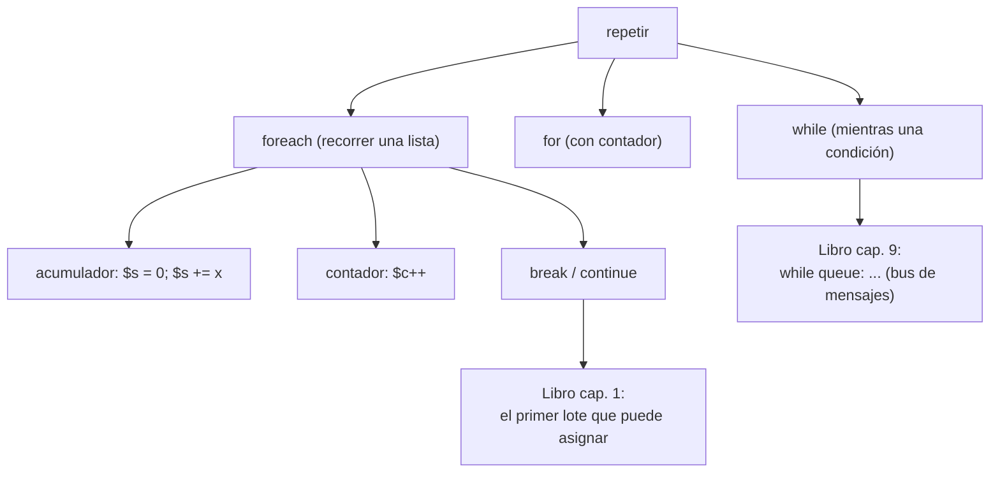

# Lección 03 — Bucles

> Fase 0 · Formulario · Familia de concepto: **repetir** · Orden de estudio: **4 de 18**

⬅️ [Lección 02 · Condicionales](../02-condicionales/) · 🏠 [Índice de lecciones](../README.md) · ➡️ [Lección 04 · Funciones](../04-funciones/)

---

## 🧭 Ruta de estudio · Lección 03 (≈ 2 h)

**Antes necesitas:** [Lección 02](../02-condicionales/) (`if`, comparaciones).

| Paso | Qué haces | Dónde | ⏱ |
|:-:|---|---|:-:|
| **0** | Lee la teoría, las tablas y los errores | este README §0–§8 | 25 min |
| **1** | Ejecuta las fórmulas | [`paso1-formulas.php`](paso1-formulas.php) | 10 min |
| **2** | Sigue los ejemplos resueltos | §9 + [`paso2-ejemplos-resueltos.php`](paso2-ejemplos-resueltos.php) | 20 min |
| **3** | Completa los `// TODO` | [`paso3-tu-turno.php`](paso3-tu-turno.php) | 20 min |
| **4** | Compara con la solución | [`paso4-tu-turno-solucion.php`](paso4-tu-turno-solucion.php) | 5 min |
| **5** | Resuelve los 12 problemas y revisa claves | §10–§11 + [`paso5-solucionario/`](paso5-solucionario/) | 30 min |
| **6** | Compara mala vs buena | [`paso6-ejercicios/`](paso6-ejercicios/) | 10 min |
| **7** | Responde las preguntas de recuerdo | §15 | 5 min |
| **🚦** | Evalúa si puedes pasar | §16 | 1 min |

---

## 0. 🧭 La pregunta
> *"Me piden saludar a **muchas** personas de una lista. Un `echo` por cada una no escala: ¿y si
> son 500? ¿Cómo **repito** una acción sin copiar y pegar?"*

## 1. Objetivos (al terminar podrás…)
1. Repetir con **`for`** y con **`foreach`** (una vez por cada elemento).
2. Usar **`range(a, b)`** para recorrer rangos de números.
3. Construir **acumuladores** (sumas, productos) y **contadores**.
4. Repetir con **`while`** sin caer en un bucle infinito.
5. Controlar un bucle con **`break`** y **`continue`**, y buscar "el primero que cumple".

## 2. Cita de la fuente
> *"batch = next( b for b in sorted(batches) if b.can_allocate(line) )"* — Cap. 1

> *"return sum(line.qty for line in self._allocations)"* — Cap. 1 (`allocated_quantity`)

> *"queue = [event] while queue: event = queue.pop(0) for handler in HANDLERS[type(event)]:"* — Cap. 9

**Equivalente en PHP** (§3.10): `for b in sorted(batches)` → `foreach ($lotes as $lote)`;
`sum(...)` → un acumulador con `foreach`; el `while queue:` → un `while` con una cola.
```php
foreach ($lotes as $lote) {                 // recorrer lotes ordenados
    if ($lote->puedeAsignar($linea)) { ... break; }  // el PRIMERO que puede
}
$suma = 0; foreach ($lineas as $l) { $suma += $l->cantidad; }  // acumulador (sum)
```
**Por qué importa:** el libro **recorre** lotes y se queda con **el primero** que puede asignar;
**suma** cantidades con un acumulador; y su bus de mensajes es un **`while`** que repite mientras
queden eventos. Los tres patrones están aquí.

## 3. El dolor
```php
echo "Hola, Ada\n";
echo "Hola, Grace\n";   // ¿y si son 500 personas? no se puede copiar y pegar 500 veces
```

---

## 4. 📘 Teoría

> **🔁 Definición — `foreach`**
> `foreach ($lista as $elemento) { ... }` ejecuta el bloque **una vez por cada elemento** de la
> lista. Es la forma normal de recorrer en PHP.

> **🔢 Definición — `for`**
> `for ($i = 0; $i < n; $i++) { ... }` repite controlando un **contador** `$i`: valor inicial,
> condición para seguir, y cómo avanza.

> **🔤 Vocabulario**
> - **`while (c) { }`:** repite **mientras** `c` sea `true` (cuando no sabes cuántas vueltas).
> - **Acumulador:** una variable que empieza en `0` (suma) o `1` (producto) y crece en cada vuelta.
> - **Contador:** una variable que cuenta cuántas veces pasa algo (`$i++`).
> - **`break`:** salir del bucle de inmediato. **`continue`:** saltar a la siguiente vuelta.
> - **`range(a, b)`:** genera la lista de números de `a` a `b`.

> **🧠 Regla de oro**
> Para recorrer una lista usa **`foreach`**. En un `while`, asegúrate de que **algo cambie** cada
> vuelta, o será **infinito**.

---

## 5. 🧮 Formulario: formas de repetir
| # | Operación | Sintaxis | Ejemplo | Resultado |
|---|---|---|---|---|
| R1 | for con contador | `for ($i=0; $i<n; $i++) { }` | `for ($i=0;$i<3;$i++) echo $i;` | `012` |
| R2 | for por índice | `for (...$i<count($a)...)` | `$a[$i]` | cada elemento |
| R3 | foreach (recorrer) | `foreach ($a as $x) { }` | `foreach ($p as $prod) …` | una vuelta por elemento |
| R4 | range | `range($a, $b)` | `range(1, 5)` | `1 2 3 4 5` |
| W1 | while | `while (c) { … }` | contar mientras `$i < 3` | `0 1 2` |

## 6. 🧮 Formulario: acumular y controlar
| # | Operación | Sintaxis | Ejemplo | Resultado |
|---|---|---|---|---|
| R5 | Acumulador (suma) | `$s = 0; … $s += $x;` | sumar `[12,15,9,18]` | `54` |
| R6 | Acumulador (producto) | `$p = 1; … $p *= $x;` | multiplicar `[1,2,3,4]` | `24` |
| R7 | Contador | `$c = 0; … $c++;` | contar pares del 1 al 10 | `5` |
| W2 | break (salir) | `if (...) break;` | primer `> 3` de `[1..5]` | `4` |
| W3 | continue (saltar) | `if (...) continue;` | imprimir solo impares | `1 3 5` |

> 💡 Todas están ejecutables en [`paso1-formulas.php`](paso1-formulas.php). (Las listas se ven a
> fondo en la [Lección 05](../05-arrays/); aquí solo las recorremos.)

## 7. 📐 Propiedades
| `foreach` y `for` | `while`, `break` y `continue` |
|---|---|
| **P1.** `foreach` da **una vuelta por elemento**, en orden; la variable toma el **siguiente** valor en cada vuelta. | **P5.** El `while` revisa la condición **antes** de cada vuelta: si al inicio ya es `false`, **no** da ninguna. |
| **P2.** El acumulador se crea **antes** del bucle. Si lo creas dentro, se **reinicia** en cada vuelta. | **P6.** Dentro del `while`, algo debe acercar la condición a `false`; si no, es un **bucle infinito**. |
| **P3.** Un acumulador de **suma** empieza en `0`; uno de **multiplicación**, en `1`. | **P7.** `break` sale del bucle **entero**; `continue` salta solo **esa** vuelta y sigue con la siguiente. |
| **P4.** `for ($i = 0; $i < $n; $i++)` tiene tres partes: inicio, condición y paso; recorre de `0` a `$n - 1`. | **P8.** `break` y `continue` solo tienen sentido **dentro** de un bucle; fuera dan `Fatal error`. |

## 8. ⚠️ Errores frecuentes
| # | ❌ Así no | Qué pasa | ✅ Así sí |
|---|---|---|---|
| E1 | `while (true) { }` sin salida | **sin mensaje:** bucle **infinito** (el programa nunca termina) | que algo cambie y se pueda salir (condición o `break`) |
| E2 | acumular sin inicializar (`$s = $s + $x`) | `Warning: Undefined variable $s` en la 1ª vuelta | inicializa antes: `$s = 0;` |
| E3 | `5 % 0` | `Fatal error: Uncaught DivisionByZeroError: Modulo by zero` | no saques módulo (ni dividas) por cero |
| E4 | leer `$a[5]` con `5` fuera de rango | `Warning: Undefined array key 5` | recorre con `foreach` o cuida el `count()` |
| E5 | `foreach (5 as $x) { }` | `Warning: foreach() argument must be of type array\|object, int given` | recorre un **array**: `foreach ([5] as $x)` |
| E6 | `break;` fuera de un bucle | `Fatal error: 'break' not in the 'loop' or 'switch' context` | `break` y `continue` solo van **dentro** de un bucle |
| E7 | `$total = 0;` **dentro** del `foreach` | **sin mensaje:** el total sale mal (se reinicia en cada vuelta) | crea `$total = 0;` **antes** del `foreach` (P2) |

> 🔬 Mensajes reales de PHP 8.3. **E1 y E7 son los más traicioneros:** no hay mensaje de error, pero
> el programa no termina (E1) o da un resultado equivocado (E7).

---

## 9. ✍️ Ejemplos resueltos (paso a paso)
> Todos están en [`paso2-ejemplos-resueltos.php`](paso2-ejemplos-resueltos.php).

**Ejemplo 1 — Saludar a muchos** *(fácil)*
> Enunciado: saluda a Ada, Grace y Linus, cada uno en su línea; al final escribe `Fin`.
```php
$personas = ["Ada", "Grace", "Linus"];   // Paso 1: los datos, en un array
foreach ($personas as $persona) {         // Paso 2: una vuelta por cada uno (P1)
    echo "Hola, $persona\n";              // Paso 3: lo que se repite (dentro de las llaves)
}
echo "Fin\n";                             // Paso 4: fuera del foreach -> corre UNA vez, al final
```
| vuelta | `$persona` | se muestra |
|---|---|---|
| 1 | `"Ada"` | `Hola, Ada` |
| 2 | `"Grace"` | `Hola, Grace` |
| 3 | `"Linus"` | `Hola, Linus` |
| (fin) | — | `Fin` |

Salida:
```
Hola, Ada
Hola, Grace
Hola, Linus
Fin
```

**Ejemplo 2 — Sumar con un acumulador** *(fácil)*
> Enunciado: suma los precios `[10, 20, 30]`.
```php
$suma = 0;                        // Paso 1: el acumulador empieza en 0 (P3), ANTES del bucle (P2)
foreach ([10, 20, 30] as $n) {    // Paso 2: recorrer
    $suma = $suma + $n;           // Paso 3: acumular
}
echo "Suma: $suma\n";              // -> 60
```
| vuelta | `$n` | `$suma` después |
|---|---|---|
| (inicio) | — | `0` |
| 1 | `10` | `10` |
| 2 | `20` | `30` |
| 3 | `30` | `60` |

Salida:
```
Suma: 60
```

**Ejemplo 3 — Contar con un contador** *(intermedio)*
> Enunciado: con el stock `[10, 0, 4, 0]`, cuenta cuántos productos están agotados (en 0).
```php
$agotados = 0;                            // Paso 1: el contador empieza en 0, ANTES del bucle (P2)
$stock = [10, 0, 4, 0];
foreach ($stock as $cantidad) {           // Paso 2: recorrer
    if ($cantidad === 0) {                // Paso 3: contar solo los que están en 0
        $agotados++;
    }
}
echo "Agotados: $agotados\n";              // -> 2
```
| vuelta | `$cantidad` | ¿`=== 0`? | `$agotados` después |
|---|---|---|---|
| 1 | `10` | no | `0` |
| 2 | `0` | sí | `1` |
| 3 | `4` | no | `1` |
| 4 | `0` | sí | `2` |

Salida:
```
Agotados: 2
```

**Ejemplo 4 — El primero que cumple, con `break`** *(avanzado)*
> Enunciado: tres lotes, ya ordenados por preferencia, tienen `5`, `100` y `50` unidades.
> Una línea pide `10`. Elige **el primer** lote que alcance y deja de buscar.
```php
// batch = next(b for b in sorted(batches) if b.can_allocate(line))  (Cap. 1)
$lotes = [["lote-a", 5], ["lote-b", 100], ["lote-c", 50]];  // Paso 1: lotes en orden de preferencia
$pedido = 10;                             // Paso 2: lo que pide la línea
$elegido = "ninguno";                     // Paso 3: aquí guardo el elegido (ninguno todavía)
foreach ($lotes as $lote) {               // Paso 4: recorrer en orden
    if ($lote[1] >= $pedido) {            // Paso 5: el PRIMERO que alcance...
        $elegido = $lote[0];
        break;                            // ...y dejo de buscar (P7)
    }
}
echo "Elegido: $elegido\n";                // -> lote-b
```
| vuelta | `$lote` | `$lote[1]` | ¿`>= 10`? | acción |
|---|---|---|---|---|
| 1 | `["lote-a", 5]` | `5` | no | sigue |
| 2 | `["lote-b", 100]` | `100` | sí | `$elegido = "lote-b"` y **`break`** |

`lote-c` **nunca** se visita: el `break` cortó el bucle en la vuelta 2. Es la misma idea que
`next(b for b in sorted(batches) if b.can_allocate(line))` del libro: recorrer **en orden** y
quedarse con **el primero** que cumple.
Salida:
```
Elegido: lote-b
```

---

## 10. 📝 Problemas propuestos
**🟢 Nivel básico**
1. Con `foreach`, imprime cada letra de `["a","b","c"]` en su línea.
2. Con `for`, imprime los números del 1 al 5 en una línea.
3. Suma `[1,2,3,4]` con un acumulador e imprime el total.
4. Cuenta cuántos elementos tiene `range(1,5)` con un contador.

**🟡 Nivel intermedio**

5. Multiplica `[2,3,4]` con un acumulador (empieza en 1) e imprime el resultado.
6. Cuenta cuántos números del 1 al 10 son pares.
7. Con `while`, imprime `0 1 2 3`.
8. Con `break`, imprime el primer número `> 5` de `range(1,10)`.

**🔴 Nivel avanzado**

9. Calcula el promedio de `[12,15,9,18]` (suma con acumulador / `count`).
10. Suma `[10,0,4,0,6]` **saltando los ceros** con `continue`.
11. Cuenta cuántas veces aparece cada palabra en `["mesa","silla","mesa"]` (adelanto de la 05).
12. *(Puente al libro)* Dado `[["temprano",100],["tarde",100]]` y un pedido de 10, encuentra con
    `break` la **primera** referencia con disponible suficiente.

## 11. 🔑 Claves (respuestas)
<details><summary>Ver claves</summary>

| # | Salida esperada |
|---|---|
| 1 | `a` / `b` / `c` (tres líneas) |
| 2 | `1 2 3 4 5` |
| 3 | `10` |
| 4 | `5` |
| 5 | `24` |
| 6 | `5` |
| 7 | `0 1 2 3` |
| 8 | `6` |
| 9 | `13.5` |
| 10 | `20` |
| 11 | `{"mesa":2,"silla":1}` |
| 12 | `temprano` |

Código en [`paso5-solucionario/`](paso5-solucionario/).
</details>

---

## 12. 🗺️ Mapa mental (Mermaid)

**Cómo leerlo:** repites con `foreach`, `for` o `while`. Con `foreach` acumulas, cuentas y cortas
con `break`. Esos patrones son los del libro: elegir el primer lote, sumar, y el bus `while`.

## 13. 🌳 Árbol de archivos
```
lecciones/03-bucles/
├── README.md · paso1-formulas.php · paso2-ejemplos-resueltos.php
├── paso3-tu-turno.php · paso4-tu-turno-solucion.php
├── paso5-solucionario/ (nivel-basico/intermedio/avanzado.php)
└── paso6-ejercicios/ (ejercicio-1…3 + ejercicio-4-reto)
```

## 14. 🤝 Tu turno y ✅ comprobación
```bash
php lecciones/03-bucles/paso3-tu-turno.php
git diff --no-index lecciones/03-bucles/paso3-tu-turno.php lecciones/03-bucles/paso4-tu-turno-solucion.php
```

## 15. ❓ Preguntas de recuerdo
<details><summary>1. ¿Qué bucle usas para recorrer una lista?</summary>

`foreach ($lista as $elemento) { … }`.
</details>
<details><summary>2. ¿En cuánto empieza un acumulador de suma? ¿Y uno de producto?</summary>

La suma en **0**; el producto en **1**.
</details>
<details><summary>3. ¿Qué diferencia hay entre <code>break</code> y <code>continue</code>?</summary>

`break` sale del bucle entero; `continue` salta solo la vuelta actual y sigue.
</details>
<details><summary>4. ¿Cuándo un <code>while</code> es infinito?</summary>

Cuando su condición nunca cambia a `false` (no hay forma de salir).
</details>
<details><summary>5. ¿Cómo se busca "el primero que cumple"?</summary>

Recorriendo con `foreach` y cortando con `break` en cuanto se cumple la condición.
</details>
<details><summary>6. ¿Cómo se dice <code>for b in sorted(batches)</code> de Python en PHP?</summary>

`foreach ($lotes as $lote)` (el `sorted` sería ordenar antes; se ve en el cap. 1).
</details>

---

## 16. 🚦 ¿Puedo pasar a la siguiente lección?
| Indicador | Criterio |
|:-:|---|
| 🟢 **Sí, sigue** | `paso3-tu-turno.php` da la salida esperada **y** aciertas **≥ 9 de 12** problemas **y** respondes las 6 preguntas sin mirar |
| 🟡 **Repasa** | aciertas **6 a 8** → vuelve a §8 y §9 |
| 🔴 **Repite** | aciertas **menos de 6** → desde el Paso 0 |

Cuando estés en 🟢, marca la lección en [`progreso/fase-0-php.md`](../../progreso/fase-0-php.md).

---

⬅️ [Lección 02 · Condicionales](../02-condicionales/) · 🏠 [Índice de lecciones](../README.md) · ➡️ [Lección 04 · Funciones](../04-funciones/)
