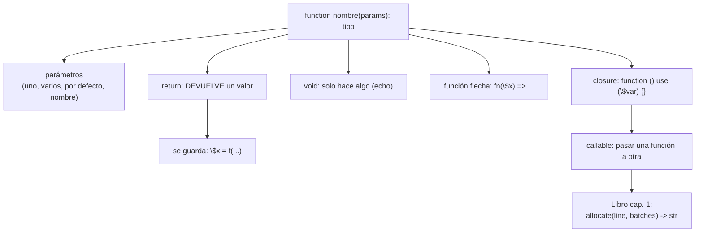

# Lección 04 — Funciones

> Fase 0 · Formulario · Familia de concepto: **funciones** · Orden de estudio: **5 de 18**

⬅️ [Lección 03 · Bucles](../03-bucles/) · 🏠 [Índice de lecciones](../README.md) · ➡️ [Lección 05 · Arrays](../05-arrays/)

---

## 🧭 Ruta de estudio · Lección 04 (≈ 2 h)

**Antes necesitas:** [Lección 03 · Bucles](../03-bucles/) (`foreach`, acumulador).

| Paso | Qué haces | Dónde | ⏱ |
|:-:|---|---|:-:|
| **0** | Lee la teoría, las fórmulas, las propiedades y los errores | este README §0–§8 | 25 min |
| **1** | Ejecuta las fórmulas y compara con la tabla | [`paso1-formulas.php`](paso1-formulas.php) | 15 min |
| **2** | Sigue los ejemplos resueltos | §9 + [`paso2-ejemplos-resueltos.php`](paso2-ejemplos-resueltos.php) | 20 min |
| **3** | Completa los `// TODO` | [`paso3-tu-turno.php`](paso3-tu-turno.php) | 20 min |
| **4** | Compara con la solución | [`paso4-tu-turno-solucion.php`](paso4-tu-turno-solucion.php) | 5 min |
| **5** | Resuelve los 12 problemas y revisa claves | §10–§11 + [`paso5-solucionario/`](paso5-solucionario/) | 30 min |
| **6** | Compara mala vs buena | [`paso6-ejercicios/`](paso6-ejercicios/) | 10 min |
| **7** | Responde las preguntas de recuerdo **sin mirar** | §15 | 5 min |
| **🚦** | Evalúa si puedes pasar | §16 | 1 min |

---

## 0. 🧭 La pregunta
> *"Repito el mismo bloque de código en varios lugares. Me piden cambiar cómo se calcula y
> tengo que editarlo en todos lados. ¿Cómo lo empaqueto con un nombre para reutilizarlo y
> cambiarlo en un solo sitio?"*

## 1. Objetivos (al terminar podrás…)
1. **Definir** una función con `function` y **llamarla** por su nombre.
2. Pasarle datos por **parámetros** (uno, varios, por defecto, opcionales, con nombre).
3. **Devolver** un resultado con `return` y guardarlo en una variable.
4. Distinguir **imprimir** (`echo`) de **devolver** (`return`).
5. Leer las **anotaciones de tipo** (`int $n`, `: string`) y qué hace `declare(strict_types=1)`.
6. Usar **funciones flecha** (`fn`) y **closures**, y pasar una función a otra (`callable`).

## 2. Cita de la fuente
> *"def allocate(line: OrderLine, batches: List[Batch]) -> str:"* — Cap. 1, *Not Everything Has to Be an Object: A Domain Service Function*

> *"Sometimes, it just isn’t a thing."* — Eric Evans, citado en el Cap. 1

**Equivalente en PHP** (§3.10):
```php
function asignar(LineaPedido $linea, array $lotes): string {   // : string = lo que DEVUELVE
    // ...
}
```
**Por qué importa:** el libro empaqueta su regla más importante, *asignar*, en una **función**.
Recibe dos **parámetros** (`line`, `batches`) y la anotación `-> str` dice qué **devuelve**. En
PHP es igual: `function nombre(tipo $param): tipoDeRetorno`. La frase de Evans justifica que no
todo tiene que ser una clase: a veces basta una función.

## 3. El dolor
```php
echo (4 * 3) . "\n";
echo (5 * 2) . "\n";
echo (10 * 6) . "\n";   // el mismo cálculo copiado 3 veces: si cambia, editas los 3
```
Sin una función, la misma lógica se repite y cambiarla obliga a tocar todos los sitios.

---

## 4. 📘 Teoría

> **📦 Definición — Función**
> Una **función** empaqueta un bloque de código bajo un **nombre** para reutilizarlo. Recibe
> **parámetros** (datos de entrada) y puede **devolver** (`return`) un resultado.
> `function doble(int $n): int { return $n * 2; }`

> **🔤 Vocabulario**
> - **Parámetro:** el nombre del dato en la definición (`$n`). **Argumento:** el valor que pasas al llamar (`5`).
> - **Tipo de retorno:** lo que escribes después de `)`, con `:` (`: int`). `void` = no devuelve nada.
> - **`declare(strict_types=1)`:** al inicio del archivo, obliga a que los tipos coincidan (sin él, PHP convierte).
> - **Función flecha (`fn`):** función corta de **una expresión**: `fn($x) => $x * 2`.
> - **Closure:** función guardada en una variable; con `use (...)` captura variables de afuera.
> - **`callable`:** el tipo de "una función" cuando la pasas como argumento.

> **🧠 Regla de oro**
> ¿Vas a **usar** el resultado? → `return`. ¿Solo quieres **mostrarlo**? → `echo` (y la función es `void`).

---

## 5. 🧮 Formulario: funciones

| # | Operación | Sintaxis | Ejemplo | Resultado |
|---|---|---|---|---|
| F1 | Definir | `function nombre(): tipo { }` | `function saludar(): string { return "hola"; }` | — |
| F2 | Llamar | `nombre()` | `saludar()` | `'hola'` |
| F3 | Parámetro tipado | `function f(int $n): int` | `doble(5)` | `10` |
| F4 | Varios parámetros | `function f($a, $b)` | `sumar(2, 3)` | `5` |
| F5 | Valor por defecto | `$p = valor` | `saludarA()` / `saludarA("Ana")` | `'hola, mundo'` / `'hola, Ana'` |
| F6 | Opcional (nullable) | `?tipo $p` | `precio(null)` | `100` |
| F7 | No devuelve nada | `: void` | `avisar("hola")` | imprime, devuelve `null` |
| F8 | Argumento con nombre | `nombre(param: valor)` | `saludarA(nombre: "Beto")` | `'hola, Beto'` |

## 6. 🧮 Formulario: funciones flecha, closures y callable

| # | Operación | Sintaxis | Ejemplo | Resultado |
|---|---|---|---|---|
| G1 | Función flecha | `fn($x) => expresión` | `$triple = fn(int $n): int => $n * 3; $triple(4)` | `12` |
| G2 | Closure | `function () { }` en variable | `$cuadrado = function (int $n): int { return $n * $n; }; $cuadrado(5)` | `25` |
| G3 | Recibir una función | `callable $f` | `aplicar(10, $triple)` | `30` |
| G4 | Capturar de afuera | `use ($var)` | `function ($n) use ($factor) {...}` | usa `$factor` |
| G5 | Array de funciones | `[$f1, $f2]` | `foreach ([$triple, $cuadrado] as $op) $op(2)` | `6 4` |

> 💡 Todas en [`paso1-formulas.php`](paso1-formulas.php).

## 7. 📐 Propiedades
| # | Propiedad |
|---|---|
| **P1** | Una función se **define una vez** y se **llama muchas**. Cambiarla cambia todos los usos. |
| **P2** | `echo` **muestra**; `return` **entrega** un valor que puedes guardar o seguir usando. |
| **P3** | Una función `void` (o sin `return`) **devuelve `null`**. |
| **P4** | Con `declare(strict_types=1)`, pasar un tipo equivocado lanza `TypeError`. |
| **P5** | Las variables creadas **dentro** de una función no existen fuera (ámbito local); por eso las closures usan `use`. |

## 8. ⚠️ Errores frecuentes
| # | ❌ Así no | Qué pasa | ✅ Así sí |
|---|---|---|---|
| E1 | `sumar(2)` (faltan args) | `ArgumentCountError: Too few arguments to function sumar(), 1 passed ... exactly 2 expected` | pasa todos: `sumar(2, 3)` |
| E2 | `doble("hola")` (con strict_types) | `TypeError: doble(): Argument #1 ($n) must be of type int, string given` | pasa el tipo correcto: `doble(5)` |
| E3 | `saludarr()` (nombre mal escrito) | `Error: Call to undefined function saludarr()` | revisa el nombre: `saludar()` |
| E4 | esperar que `echo f()` muestre lo devuelto cuando `f` es `void` | imprime nada útil (devuelve `null`) | usa `return` en `f` |
| E5 | usar una variable local fuera de la función | `Warning: Undefined variable` | devuélvela con `return` |
| E6 | usar `$factor` dentro de una closure sin `use` | `Undefined variable $factor` | `function () use ($factor) { ... }` |

> 🔬 Los mensajes son reales de PHP 8.3. Descomenta una línea del final de `paso1-formulas.php`.

---

## 9. ✍️ Ejemplos resueltos (paso a paso)
> Todos en [`paso2-ejemplos-resueltos.php`](paso2-ejemplos-resueltos.php).

**Ejemplo 1 — Empaquetar una regla** *(fácil)*
```php
function areaRectangulo(int $base, int $altura): int { // Paso 1: definir con parámetros
    return $base * $altura;                             // Paso 2: devolver
}
$area = areaRectangulo(4, 3);                           // Paso 3: llamar y GUARDAR
echo "área = $area\n";                                  // -> área = 12
```

**Ejemplo 2 — Imprimir NO es devolver** *(fácil)*
```php
function sumaDevuelve(int $a, int $b): int { return $a + $b; }
$r = sumaDevuelve(2, 3);
echo ($r * 10) . "\n";   // 50: puedo usar lo devuelto
```
Una función `void` que hace `echo` muestra el número, pero no te deja **usarlo** después.

**Ejemplo 3 — Valor por defecto** *(intermedio)*
```php
function precioFinal(int $precio, int $descuento = 0): int { // descuento es opcional
    return $precio - $descuento;
}
echo precioFinal(100) . "\n";       // 100
echo precioFinal(100, 20) . "\n";   // 80
```

**Ejemplo 4 — Una función que recibe otra función** *(avanzado)*
```php
function elegir(array $numeros, callable $criterio): int {
    foreach ($numeros as $n) {
        if ($criterio($n)) { return $n; }   // devuelve el PRIMERO que cumple
    }
    return -1;
}
$esPar = fn(int $n): bool => $n % 2 === 0;
echo elegir([3, 5, 8, 9], $esPar) . "\n";   // 8
```
Así el libro empaqueta *asignar* en una función: recibe la línea y los lotes y **elige** el
primero que puede. Pasar el criterio como `callable` es la misma idea.

---

## 10. 📝 Problemas propuestos

**🟢 Nivel básico**
1. Escribe `cuadrado(int $n): int` que devuelva `$n * $n`. Imprime `cuadrado(6)`.
2. Escribe `saludar(string $nombre): string` que devuelva `"Hola, $nombre"`. Imprime `saludar("Ana")`.
3. Escribe `esMayor(int $a, int $b): bool`. Imprime `esMayor(5, 3)`.
4. Escribe `conIva(float $precio): float` que multiplique por `1.18`. Imprime `conIva(100)`.

**🟡 Nivel intermedio**

5. Escribe `envio(int $peso, int $base = 10): int`. Imprime `envio(5)` y `envio(5, 20)`.
6. Escribe `clasificar(int $edad): string` con `return` temprano: `"menor"` si < 18, `"adulto"` si no.
7. Crea una función flecha `$doble` que multiplique por 2. Imprime `$doble(9)`.
8. Escribe `sumarLista(array $nums): int` que sume con un `foreach`.

**🔴 Nivel avanzado**

9. Escribe `contar(array $palabras, callable $cumple): int` que cuente cuántas cumplen. Pruébala con
   "¿tiene más de 4 letras?" (`strlen($p) > 4`).
10. Crea una closure `$escalar` que multiplique por un `$factor` capturado con `use`.
11. Escribe `aplicarTodas(int $x, array $funciones): array` que devuelva el resultado de cada función sobre `$x`.
12. *(Puente al libro)* Escribe `asignar(int $cantidad, array $lotes): string` (lotes = `[referencia => disponible]`)
    que devuelva la referencia del primer lote con stock suficiente, o `"sin-stock"`.

## 11. 🔑 Claves (respuestas)
<details><summary>Ver claves (solo después de intentarlo)</summary>

| # | Salida esperada |
|---|---|
| 1 | `36` |
| 2 | `Hola, Ana` |
| 3 | `true` |
| 4 | `118` |
| 5 | `15` y `25` |
| 6 | `menor` / `adulto` |
| 7 | `18` |
| 8 | `10` |
| 9 | `2` |
| 10 | `15` (con `$factor = 3`, `$escalar(5)`) |
| 11 | `[5,40]` (con `aplicarTodas(4, [+1, ×10])`) |
| 12 | `lote-b` |

Código completo en [`paso5-solucionario/`](paso5-solucionario/).
</details>

---

## 12. 🗺️ Mapa mental (Mermaid)

**Cómo leerlo:** de la función salen sus entradas (parámetros) y su salida (`return` o `void`).
Lo que devuelve se puede **guardar** y seguir usando. Una función puede recibir **otra** función
(`callable`), que es como el libro arma `allocate`.

## 13. 🌳 Árbol de archivos
```
lecciones/04-funciones/
├── README.md                    ← PASO 0 · EMPIEZA AQUÍ
├── paso1-formulas.php           ← PASO 1 · F1–F8, G1–G5
├── paso2-ejemplos-resueltos.php ← PASO 2 · los 4 ejemplos
├── paso3-tu-turno.php           ← PASO 3 · // TODO
├── paso4-tu-turno-solucion.php  ← PASO 4 · solución
├── paso5-solucionario/          ← PASO 5 · 12 problemas
└── paso6-ejercicios/            ← PASO 6 · mala vs buena
```

## 14. 🤝 Tu turno y ✅ comprobación
PHPUnit llega en la [Lección 08](../08-modulos-y-phpunit/); aquí se comprueba **ejecutando y
comparando** con la salida esperada:
```bash
php lecciones/04-funciones/paso3-tu-turno.php
git diff --no-index lecciones/04-funciones/paso3-tu-turno.php lecciones/04-funciones/paso4-tu-turno-solucion.php
```

## 15. ❓ Preguntas de recuerdo
<details><summary>1. ¿Diferencia entre un parámetro y un argumento?</summary>

El **parámetro** es el nombre en la definición (`$n`); el **argumento** es el valor que pasas al llamar (`5`).
</details>
<details><summary>2. ¿Qué diferencia hay entre <code>echo</code> y <code>return</code>?</summary>

`echo` **muestra** en pantalla; `return` **entrega** un valor que puedes guardar y reutilizar.
</details>
<details><summary>3. ¿Qué devuelve una función <code>void</code>?</summary>

`null` (no devuelve un valor útil; solo hace algo, como imprimir).
</details>
<details><summary>4. ¿Para qué sirve <code>declare(strict_types=1)</code>?</summary>

Para que PHP **no convierta** los tipos: si pasas un `string` donde se espera `int`, lanza `TypeError`.
</details>
<details><summary>5. ¿Qué es una función flecha (<code>fn</code>)?</summary>

Una función corta de **una sola expresión**: `fn($x) => $x * 2`. Captura las variables de afuera automáticamente.
</details>
<details><summary>6. ¿Cómo usa una closure una variable de afuera?</summary>

Con `use ($variable)` en su definición: `function () use ($factor) { ... }`.
</details>

---

## 16. 🚦 ¿Puedo pasar a la siguiente lección?
| Indicador | Criterio |
|:-:|---|
| 🟢 **Sí, sigue** | `paso3-tu-turno.php` da la salida esperada **y** aciertas **≥ 9 de 12** problemas **y** respondes las 6 preguntas sin mirar |
| 🟡 **Repasa** | aciertas **6 a 8** → vuelve a §8 (errores) y §9 (ejemplos) |
| 🔴 **Repite** | aciertas **menos de 6** → empieza otra vez desde el Paso 0 |

Cuando estés en 🟢, marca la lección en [`progreso/fase-0-php.md`](../../progreso/fase-0-php.md).

---

⬅️ [Lección 03 · Bucles](../03-bucles/) · 🏠 [Índice de lecciones](../README.md) · ➡️ [Lección 05 · Arrays](../05-arrays/)
