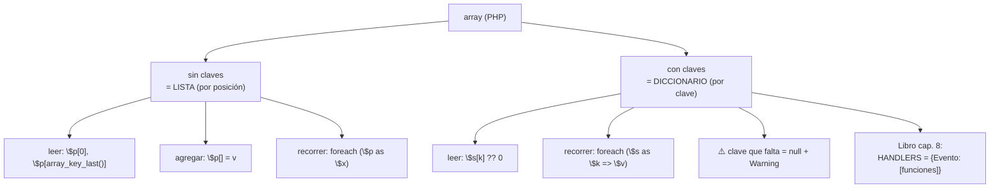

# Lección 05 — Arrays (listas y diccionarios)

> Fase 0 · Formulario · Familia de concepto: **colecciones** · Orden de estudio: **6 de 18**

⬅️ [Lección 04 · Funciones](../04-funciones/) · 🏠 [Índice de lecciones](../README.md) · ➡️ [Lección 06 · Clases y objetos](../06-clases-y-objetos/)

---

## 🧭 Ruta de estudio · Lección 05 (≈ 2.5 h)

**Antes necesitas:** [Lección 03 · Bucles](../03-bucles/) (`foreach`) y [Lección 04 · Funciones](../04-funciones/).

| Paso | Qué haces | Dónde | ⏱ |
|:-:|---|---|:-:|
| **0** | Lee la teoría, las tablas de fórmulas, las propiedades y los errores | este README §0–§8 | 30 min |
| **1** | Ejecuta las fórmulas y compara cada línea con la tabla | [`paso1-formulas.php`](paso1-formulas.php) | 15 min |
| **2** | Sigue los ejemplos resueltos línea por línea | §9 + [`paso2-ejemplos-resueltos.php`](paso2-ejemplos-resueltos.php) | 20 min |
| **3** | Completa los `// TODO` | [`paso3-tu-turno.php`](paso3-tu-turno.php) | 20 min |
| **4** | Compara con la solución de referencia | [`paso4-tu-turno-solucion.php`](paso4-tu-turno-solucion.php) | 5 min |
| **5** | Resuelve los 12 problemas **en papel o en un archivo tuyo**, luego revisa claves y solucionario | §10–§11 + [`paso5-solucionario/`](paso5-solucionario/) | 35 min |
| **6** | Compara solución mala vs buena | [`paso6-ejercicios/`](paso6-ejercicios/) | 10 min |
| **7** | Responde las preguntas de recuerdo **sin mirar** | §15 | 5 min |
| **🚦** | Evalúa si puedes pasar a la siguiente | §16 | 1 min |

---

## 0. 🧭 La pregunta
> *"Tengo **un** producto en una variable. Me piden manejar **muchos** productos y saber el
> stock de **cada uno**. ¿Cómo lo hago?"*

## 1. Objetivos (al terminar podrás…)
1. Crear, leer, cambiar y recorrer un **array indexado** (lista, por posición).
2. Crear, leer, cambiar y recorrer un **array asociativo** (diccionario, por clave).
3. Elegir entre uno y otro.
4. Reconocer el `Warning: Undefined array key`, `null` y el `TypeError` de `count()`.

## 2. Cita de la fuente
> *"allocation = allocate(line, [in_stock_batch, shipment_batch])"* — Cap. 1

> *"batch = next( b for b in sorted(batches) if b.can_allocate(line) )"* — Cap. 1

> *"HANDLERS = { events.OutOfStock: [send_out_of_stock_notification], }"* — Cap. 8

**Equivalente en PHP** (§3.10 de la metodología):
```php
$asignacion = asignar($linea, [$loteEnAlmacen, $loteEnCamino]); // un array indexado de lotes

$manejadores = [                                               // array asociativo: evento => [funciones]
    SinStock::class => [$enviarNotificacionSinStock],
];
```
**Por qué importa:** en el cap. 1 el libro le pasa a `allocate` una **lista** de lotes y la
**recorre ordenada**. En el cap. 8 usa un diccionario cuyos valores son **listas**. En PHP las
dos cosas son el **mismo tipo** (`array`): sin claves es una lista, con claves es un diccionario.

## 3. El dolor
```php
$producto1 = "mesa";
$producto2 = "silla";
$producto3 = "lámpara";   // ¿y si son 500? ¿500 variables?
```
Con variables sueltas **no puedes** recorrer los datos, contarlos, ni preguntar
"¿cuál es el stock de la silla?".

---

## 4. 📘 Teoría

> **📦 Definición — Array indexado (lista)**
> Un array **sin claves** es una colección **ordenada**; cada valor ocupa una **posición**
> (índice) que **empieza en 0**.
> `$productos = ["mesa", "silla", "lámpara"];`

> **🗂️ Definición — Array asociativo (diccionario)**
> Un array **con claves** guarda pares **clave => valor**; se busca por la **clave**.
> `$stock = ["mesa" => 10, "silla" => 25];`

> **🔤 Vocabulario**
> - **Elemento:** cada valor del array. **Índice:** la posición (0, 1, 2…).
> - **Clave / valor:** las dos mitades de cada par de un array asociativo.
> - **Función de array:** `count()`, `in_array()`, `array_keys()`… se llaman con el array como argumento.
> - **`$array[] = valor`:** agrega al final (solo en arrays indexados).
> - **`??`:** el operador "coalescente nulo": `$a ?? $b` usa `$b` si `$a` es `null` o no existe.

> **🧠 Regla de oro**
> ¿Te importa el **orden/posición**? → **array indexado**.
> ¿Buscas **por un nombre**? → **array asociativo**.
> (En PHP ambos son `array`; la diferencia es si pones claves o no.)

---

## 5. 🧮 Formulario: arrays indexados (listas)
Con `$p = ["mesa", "silla", "lámpara"]`:

| # | Operación | Sintaxis | Ejemplo | Resultado |
|---|---|---|---|---|
| A1 | Crear | `[a, b, c]` | `$p = ["mesa","silla","lámpara"]` | — |
| A2 | Vacío | `[]` | `$v = []` | `[]` |
| A3 | Acceder | `$a[$i]` | `$p[0]` | `'mesa'` |
| A4 | Último | `$a[array_key_last($a)]` | `$p[array_key_last($p)]` | `'lámpara'` |
| A5 | Cambiar | `$a[$i] = $v` | `$p[1] = "sofá"` | `['mesa','sofá','lámpara']` |
| A6 | Tamaño | `count($a)` | `count($p)` | `3` |
| A7 | Agregar al final | `$a[] = $v` | `$p[] = "cama"` | `[…,'cama']` |
| A8 | ¿Está? | `in_array($v, $a)` | `in_array("mesa", $p)` | `true` |
| A9 | Posición de | `array_search($v, $a)` | `array_search("silla", $p)` | `1` (o `false` si no está) |
| A10 | Sacar el último | `array_pop($a)` | `array_pop($p)` | devuelve `'lámpara'`, lo quita |
| A11 | Rebanar (copia) | `array_slice($a, $desde, $n)` | `array_slice($p, 0, 2)` | `['mesa','silla']` |
| A12 | Ordenar (en el sitio) | `sort($a)` | `sort($p)` | `$p` queda `['lámpara','mesa','silla']` |
| A13 | Ordenar números | `sort($a)` | `sort([10,9,100])` | `[9,10,100]` (¡bien, no como texto!) |
| A14 | Recorrer | `foreach ($a as $x) { }` | `foreach ($p as $prod) echo $prod;` | una línea por elemento |

## 6. 🧮 Formulario: arrays asociativos (diccionarios)
Con `$stock = ["mesa" => 10, "silla" => 25]`:

| # | Operación | Sintaxis | Ejemplo | Resultado |
|---|---|---|---|---|
| O1 | Crear | `[k => v, …]` | `$stock = ["mesa"=>10,"silla"=>25]` | — |
| O2 | Leer | `$a[$clave]` | `$stock["mesa"]` | `10` |
| O3 | Leer clave que no existe | `$a[$clave]` | `$stock["cama"]` | `null` + `Warning` |
| O4 | Leer seguro | `$a[$clave] ?? $defecto` | `$stock["cama"] ?? 0` | `0` (sin Warning) |
| O5 | Agregar / cambiar | `$a[$clave] = $v` | `$stock["cama"] = 4` | `[…,'cama'=>4]` |
| O6 | ¿Existe la clave? | `array_key_exists($clave, $a)` | `array_key_exists("mesa", $stock)` | `true` |
| O7 | Tamaño | `count($a)` | `count($stock)` | `2` |
| O8 | Borrar | `unset($a[$clave])` | `unset($stock["mesa"])` | `['silla'=>25]` |
| O9 | Claves | `array_keys($a)` | `array_keys($stock)` | `['mesa','silla']` |
| O10 | Valores | `array_values($a)` | `array_values($stock)` | `[10, 25]` |
| O11 | Recorrer pares | `foreach ($a as $k => $v) { }` | `foreach ($stock as $k => $v) …` | `mesa 10` / `silla 25` |

> 💡 Todas las fórmulas están ejecutables en [`paso1-formulas.php`](paso1-formulas.php).

## 7. 📐 Propiedades
| Array indexado | Array asociativo |
|---|---|
| **P1.** Ordenado: el índice empieza en **0**. | **P4.** La clave es **única**: si se repite, gana la última. |
| **P2.** Permite repetidos: `["mesa","mesa"]` es válido. | **P5.** Se busca **por clave**, no por posición. |
| **P3.** En PHP los arrays se **copian por valor** al asignarlos (`$b = $a` copia); por eso `sort($copia)` no toca el original. | **P6.** `array_key_exists` ve una clave con valor `null`; `isset` no (la trata como ausente). |

## 8. ⚠️ Errores frecuentes
| # | ❌ Así no | Qué pasa | ✅ Así sí |
|---|---|---|---|
| E1 | `$stock["cama"]` (la clave no existe) | `Warning: Undefined array key "cama"` y devuelve `null` | `$stock["cama"] ?? 0` |
| E2 | `$stock["cama"] + 1` sin comprobar | `null + 1` = `1`, pero con `Warning` previo | `($stock["cama"] ?? 0) + 1` |
| E3 | `count(5)` | `TypeError: count(): Argument #1 ($value) must be of type Countable\|array, int given` | `count($array)` |
| E4 | `$p[] ` para leer | `Fatal error: Cannot use [] for reading` | `$p[]` solo para **escribir**; para leer usa `$p[$i]` |
| E5 | `array_pop($p)` creyendo que devuelve el array | devuelve el **elemento**, y **modifica** `$p` | guarda el elemento: `$x = array_pop($p);` |
| E6 | `$resultado = sort($p)` creyendo que devuelve el ordenado | `sort` devuelve `true` y ordena `$p` **en el sitio** | `sort($p);` y usa `$p` |

> 🔬 Los mensajes son reales de PHP 8.3. Prueba E3 descomentando la última línea de `paso1-formulas.php`.

---

## 9. ✍️ Ejemplos resueltos (paso a paso)
> Todos están en [`paso2-ejemplos-resueltos.php`](paso2-ejemplos-resueltos.php).

**Ejemplo 1 — Inventario con array** *(fácil)*
```php
$productos = ["mesa", "silla", "lámpara"];          // Paso 1: crear (A1)
echo $productos[0] . "\n";                          // Paso 2: el primero (A3)  -> mesa
echo $productos[array_key_last($productos)] . "\n"; // Paso 3: el último (A4)   -> lámpara
$productos[1] = "sofá";                             // Paso 4: cambiar (A5)
foreach ($productos as $prod) {                     // Paso 5: recorrer (A14)
    echo "$prod\n";
}
```

**Ejemplo 2 — Registrar una venta** *(fácil)*
```php
$stock = ["mesa" => 10, "silla" => 25];             // Paso 1: crear (O1)
$vendidas = 3;                                      // Paso 2: el dato de la venta
$stock["mesa"] = $stock["mesa"] - $vendidas;        // Paso 3: leer (O2), restar y guardar (O5)
echo $stock["mesa"] . "\n";                          // -> 7
```

**Ejemplo 3 — Contar repeticiones** *(intermedio)*
```php
$pedidos = ["mesa", "silla", "mesa"];
$conteo = [];                                       // Paso 1: array vacío (A2)
foreach ($pedidos as $prod) {                       // Paso 2: recorrer (A14)
    $conteo[$prod] = ($conteo[$prod] ?? 0) + 1;     // Paso 3: leer seguro (O4) y sumar 1
}
echo json_encode($conteo) . "\n";                   // -> {"mesa":2,"silla":1}
```
Traza:

| vuelta | `$prod` | `$conteo[$prod] ?? 0` | `$conteo` después |
|---|---|---|---|
| 1 | `"mesa"` | `0` | `{"mesa":1}` |
| 2 | `"silla"` | `0` | `{"mesa":1,"silla":1}` |
| 3 | `"mesa"` | `1` | `{"mesa":2,"silla":1}` |

**Ejemplo 4 — Array de evento → funciones, como en el libro** *(avanzado)*
```php
$avisarEmail = function (string $sku): void { echo "EMAIL: sin stock de $sku\n"; };
$avisarSms = function (string $sku): void { echo "SMS: sin stock de $sku\n"; };

$manejadores = ["SinStock" => [$avisarEmail, $avisarSms]]; // clave => array de funciones
foreach ($manejadores["SinStock"] as $funcion) {           // leer (O2) y recorrer (A14)
    $funcion("MESA");                                      // llamar a cada una
}
```
Es la misma forma que `HANDLERS = { events.OutOfStock: [send_out_of_stock_notification] }`. En el
cap. 8 la clave será una **clase** (`SinStock::class`), que en PHP también sirve de clave de array.

---

## 10. 📝 Problemas propuestos
> Resuélvelos **antes** de mirar las claves. Crea tu propio `mis-problemas.php` y ejecútalo con `php`.

**🟢 Nivel básico**
1. Crea `$colores = ["rojo", "verde", "azul"]` e imprime el **segundo** color.
2. Imprime el **último** color (fórmula A4).
3. Agrega `"negro"` al array e imprime cuántos colores hay.
4. Crea `$precios = ["pan" => 1, "leche" => 4]` e imprime el precio de la leche.

**🟡 Nivel intermedio**

5. En `$precios`, cambia el precio del pan a `2` y agrega `"huevo" => 6`. Imprime el array como JSON.
6. Recorre `$precios` con `foreach` imprimiendo `pan cuesta 2`, etc.
7. Con `$notas = [12, 15, 9, 18]`, calcula la suma **con un `foreach`** y el promedio.
8. Si `"queso"` **no** está en `$precios`, imprime `no hay queso` *(usa el `if` de la Lección 02)*.

**🔴 Nivel avanzado**

9. Cuenta cuántas veces aparece cada palabra en `["mesa","silla","mesa","cama","mesa"]`.
10. Con `$stock = ["mesa"=>10,"silla"=>0,"cama"=>4]`, arma un **array** con los productos agotados.
11. Muestra el stock de `"sofá"`. Si no existe, debe salir `0` (no un Warning).
12. *(Puente al libro)* Arma `$manejadores = ["Asignado" => [...]]` con **dos funciones** que impriman
    algo, y llámalas recorriendo ese array.

## 11. 🔑 Claves (respuestas)
<details><summary>Ver claves (solo después de intentarlo)</summary>

| # | Salida esperada | Fórmula clave |
|---|---|---|
| 1 | `verde` | A3 |
| 2 | `azul` | A4 |
| 3 | `4` | A7 + A6 |
| 4 | `4` | O2 |
| 5 | `{"pan":2,"leche":4,"huevo":6}` | O5 |
| 6 | `pan cuesta 2` / `leche cuesta 4` | O11 |
| 7 | suma `54`, promedio `13.5` | A14 + acumulador |
| 8 | `no hay queso` | O6 |
| 9 | `{"mesa":3,"silla":1,"cama":1}` | patrón contador (Ejemplo 3) |
| 10 | `["silla"]` | O11 + A7 |
| 11 | `0` | O4 |
| 12 | dos líneas impresas | Ejemplo 4 |

Código completo en [`paso5-solucionario/`](paso5-solucionario/).
</details>

---

## 12. 🗺️ Mapa mental (Mermaid)

**Cómo leerlo:** en PHP el **mismo tipo** `array` hace de lista (sin claves) o de diccionario (con
claves). La hoja final conecta con la línea real del libro.

## 13. 🌳 Árbol de archivos
```
lecciones/05-arrays/
├── README.md                    ← PASO 0 · EMPIEZA AQUÍ (este formulario)
├── paso1-formulas.php           ← PASO 1 · las fórmulas A1–A14 y O1–O11, ejecutables
├── paso2-ejemplos-resueltos.php ← PASO 2 · los 4 ejemplos resueltos
├── paso3-tu-turno.php           ← PASO 3 · completa los // TODO
├── paso4-tu-turno-solucion.php  ← PASO 4 · solución de referencia
├── paso5-solucionario/          ← PASO 5 · soluciones de los 12 problemas
│   ├── nivel-basico.php
│   ├── nivel-intermedio.php
│   └── nivel-avanzado.php
└── paso6-ejercicios/            ← PASO 6 · solución mala vs buena
    ├── ejercicio-1/ … ejercicio-3/
    └── ejercicio-4-reto/
```

## 14. 🤝 Tu turno y ✅ comprobación
PHPUnit llega en la [Lección 08](../08-modulos-y-phpunit/), así que aquí se comprueba
**ejecutando y comparando** con la salida esperada:
```bash
php lecciones/05-arrays/paso3-tu-turno.php
# compara con la "Salida esperada" del final de ese archivo
git diff --no-index lecciones/05-arrays/paso3-tu-turno.php lecciones/05-arrays/paso4-tu-turno-solucion.php
```

## 15. ❓ Preguntas de recuerdo
<details><summary>1. ¿Qué diferencia una lista de un diccionario en PHP?</summary>

Son el **mismo tipo** `array`: sin claves (índices 0,1,2…) es una lista; con claves de texto es un diccionario.
</details>
<details><summary>2. ¿Qué pasa al leer una clave que no existe?</summary>

Devuelve `null` y lanza un `Warning: Undefined array key`. Para evitarlo: `$a[$clave] ?? valorPorDefecto`.
</details>
<details><summary>3. ¿Cómo agregas un elemento al final de un array indexado?</summary>

`$a[] = valor`.
</details>
<details><summary>4. ¿Qué devuelve <code>sort($a)</code>?</summary>

`true`, y ordena `$a` **en el sitio** (no devuelve un array nuevo). A diferencia de JavaScript, ordena los números correctamente.
</details>
<details><summary>5. ¿Cómo recorres pares clave/valor?</summary>

`foreach ($a as $clave => $valor) { … }`.
</details>
<details><summary>6. En <code>["Asignado" => [f1, f2]]</code>, ¿qué tipo es el valor?</summary>

Un **array** (de funciones). Es un array asociativo cuyos valores son arrays.
</details>

---

## 16. 🚦 ¿Puedo pasar a la siguiente lección?
| Indicador | Criterio |
|:-:|---|
| 🟢 **Sí, sigue** | `paso3-tu-turno.php` da la salida esperada **y** aciertas **≥ 9 de 12** problemas **y** respondes las 6 preguntas sin mirar |
| 🟡 **Repasa** | aciertas **6 a 8** → vuelve a §8 (errores) y §9 (ejemplos) |
| 🔴 **Repite** | aciertas **menos de 6** → empieza otra vez desde el Paso 0 |

Cuando estés en 🟢, marca la lección en [`progreso/fase-0-php.md`](../../progreso/fase-0-php.md)
(sección *"Mi avance"*) y haz commit.

---

⬅️ [Lección 04 · Funciones](../04-funciones/) · 🏠 [Índice de lecciones](../README.md) · ➡️ [Lección 06 · Clases y objetos](../06-clases-y-objetos/)
