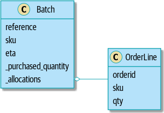
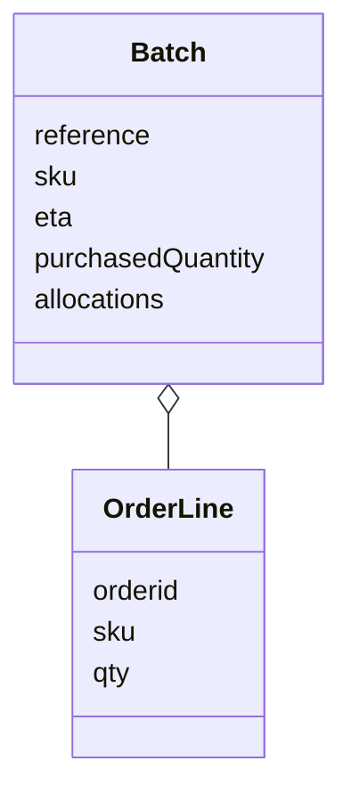
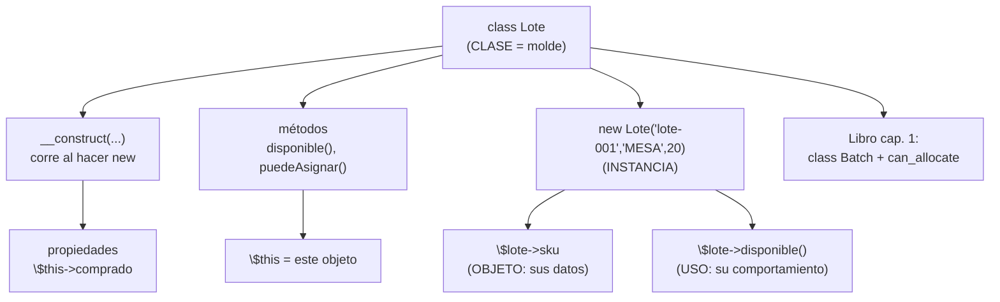

# Lección 06 — Clases y objetos

> Fase 0 · Formulario · Familia de concepto: **la clase** (datos + comportamiento juntos) · Orden de estudio: **7 de 18**
> Usa la **Figura 1-3** del libro (§12).

⬅️ [Lección 05 · Arrays](../05-arrays/) · 🏠 [Índice de lecciones](../README.md) · ➡️ [Lección 07 · Excepciones](../07-excepciones/)

---

## 🧭 Ruta de estudio · Lección 06 (≈ 2.5 h)

**Antes necesitas:** [Lección 04 · Funciones](../04-funciones/) (`function`, `return`) y [Lección 05 · Arrays](../05-arrays/).

| Paso | Qué haces | Dónde | ⏱ |
|:-:|---|---|:-:|
| **0** | Lee la teoría, las fórmulas, las propiedades y los errores | este README §0–§8 | 35 min |
| **1** | Ejecuta las fórmulas y compara con la tabla | [`paso1-formulas.php`](paso1-formulas.php) | 10 min |
| **2** | Sigue los ejemplos resueltos | §9 + [`paso2-ejemplos-resueltos.php`](paso2-ejemplos-resueltos.php) | 25 min |
| **3** | Completa los `// TODO` dentro de la clase | [`paso3-tu-turno.php`](paso3-tu-turno.php) | 25 min |
| **4** | Compara con la solución | [`paso4-tu-turno-solucion.php`](paso4-tu-turno-solucion.php) | 5 min |
| **5** | Resuelve los 12 problemas y revisa claves | §10–§11 + [`paso5-solucionario/`](paso5-solucionario/) | 35 min |
| **6** | Compara mala vs buena | [`paso6-ejercicios/`](paso6-ejercicios/) | 10 min |
| **7** | Mira la Figura 1-3 y responde las preguntas **sin mirar** | §12 + §15 | 10 min |
| **🚦** | Evalúa si puedes pasar | §16 | 1 min |

---

## 0. 🧭 La pregunta
> *"Tengo un lote como datos sueltos (referencia, sku, cantidad). Me piden que el lote sepa
> decir si **puede asignar** un pedido. Con datos sueltos y funciones aparte, la regla se
> desparrama. ¿Qué hago?"*

## 1. Objetivos (al terminar podrás…)
1. Definir una **clase** con `class` y su **constructor** (`__construct`), con promoción de propiedades.
2. Crear **instancias** (objetos) con `new` y leer/cambiar sus **atributos** con `->`.
3. Escribir **métodos** que usen `$this` y llamarlos con `$objeto->metodo()`.
4. Seguir la cadena completa **clase → instancia → objeto → uso** sin saltarte pasos.
5. Leer la **Figura 1-3** del libro (UML de `Batch` y `OrderLine`).
6. Reconocer los errores típicos: propiedad/método inexistente, clase no encontrada, método sobre `null`.

## 2. Cita de la fuente
> *"First cut of a domain model for batches (model.py)"* — Cap. 1

> *"def can_allocate(self, line: OrderLine) -> bool: … return self.sku == line.sku and self.available_quantity >= line.qty"* — Cap. 1

**Equivalente en PHP** (§3.10):
```php
class Lote {
    public function __construct(public string $sku, public int $comprado) {} // constructor
    public function puedeAsignar(string $sku, int $cantidad): bool {          // método con $this
        return $this->sku === $sku && $this->disponible() >= $cantidad;
    }
}
```
**Por qué importa:** el primer modelo de dominio del libro es una **clase** `Batch` (nuestro
`Lote`). Su constructor guarda los datos, y su **método** `can_allocate` usa esos datos para
decidir. En PHP la promoción de propiedades (`public` en el constructor) hace lo que `self.x = x`
hace en Python.

## 3. El dolor
```php
$referencia = "lote-001";
$sku = "MESA";
$comprado = 20;   // datos sueltos; la regla "¿puede asignar?" vive en otra parte, desparramada
```
Con datos sueltos, los datos y la regla que los usa quedan separados; nadie garantiza que vayan juntos.

---

## 4. 📘 Teoría

> **📦 Definición — Clase, instancia, objeto**
> Una **clase** es un **molde**. Una **instancia** es lo que creas con `new`. El **objeto** es esa
> instancia con sus datos. La secuencia es **clase → instancia → objeto → uso**.
> ```php
> class Lote { /* molde */ }
> $lote = new Lote(...);   // instancia -> objeto
> $lote->disponible();     // uso
> ```

> **🔤 Vocabulario**
> - **Propiedad (atributo):** un dato que vive dentro del objeto (`$this->sku`).
> - **Constructor (`__construct`):** método especial que corre al hacer `new`; prepara el objeto.
> - **Promoción de propiedades:** poner `public` en un parámetro del constructor crea y asigna la propiedad.
> - **Método:** una función que pertenece a la clase; usa `$this` para ver los datos del objeto.
> - **`$this`:** "este objeto". **`->`:** el operador para leer propiedades y llamar métodos.
> - **`instanceof`:** pregunta si un objeto es de cierta clase.

> **🧠 Regla de oro**
> Los **datos** que van juntos y las **reglas** que los usan viven en la **misma clase**.

---

## 5. 🧮 Formulario: definir la clase
| # | Operación | Sintaxis | Ejemplo |
|---|---|---|---|
| C1 | Definir clase | `class Nombre { }` | `class Lote { }` |
| C2 | Propiedad tipada | `public int $x = 0;` | `public array $asignaciones = [];` |
| C3 | Constructor | `public function __construct(...) { }` | prepara el objeto al hacer `new` |
| C4 | Promoción de propiedades | `__construct(public string $ref)` | crea y asigna `$this->ref` de una vez |
| C8 | Método | `public function m(): tipo { }` | `public function disponible(): int { ... }` |

## 6. 🧮 Formulario: usar el objeto
Con `$lote = new Lote("lote-001", "MESA", 20)`:

| # | Operación | Sintaxis | Ejemplo | Resultado |
|---|---|---|---|---|
| C5 | Crear instancia | `new Clase(args)` | `new Lote("lote-001","MESA",20)` | un objeto Lote |
| C6 | Leer atributo | `$obj->prop` | `$lote->referencia` | `'lote-001'` |
| C7 | Cambiar estado | `$obj->metodo()` | `$lote->asignar(2)` | baja lo disponible |
| M1 | Dentro del método | `$this->prop` | `$this->comprado - $this->asignado` | — |
| M2 | Llamar método | `$obj->metodo(args)` | `$lote->puedeAsignar("MESA", 5)` | `true` |
| M3 | ¿Es de la clase? | `$obj instanceof Clase` | `$lote instanceof Lote` | `true` |
| M4 | Objetos independientes | `new Clase(...)` otra vez | `$otro = new Lote(...)` | tiene su propio estado |

> 💡 Todas en [`paso1-formulas.php`](paso1-formulas.php).

## 7. 📐 Propiedades
| # | Propiedad |
|---|---|
| **P1** | La **clase** se escribe una vez; puedes crear **muchos objetos** con `new`. |
| **P2** | Cada objeto tiene su **propio estado**: cambiar uno no afecta a los demás. |
| **P3** | Un **método** accede a los datos del objeto con `$this->`. Sin `$this`, no los ve. |
| **P4** | La **promoción de propiedades** (`public` en el constructor) ahorra escribir `$this->x = $x`. |
| **P5** | Un **dato calculado** (como `disponible()`) es mejor como **método**: nunca queda desactualizado. |

## 8. ⚠️ Errores frecuentes
| # | ❌ Así no | Qué pasa | ✅ Así sí |
|---|---|---|---|
| E1 | `$lote->precio` (no existe) | `Warning: Undefined property: Lote::$precio` | declara la propiedad, o usa una que exista |
| E2 | `$lote->metodoQueNoExiste()` | `Error: Call to undefined method Lote::metodoQueNoExiste()` | revisa el nombre del método |
| E3 | `new LoteX()` (clase mal escrita) | `Error: Class "LoteX" not found` | usa el nombre correcto: `new Lote(...)` |
| E4 | `$n = null; $n->asignar(1);` | `Error: Call to a member function asignar() on null` | asegúrate de que `$n` es un objeto |
| E5 | olvidar `$this->` dentro de un método | usa una variable local vacía (o `Undefined variable`) | siempre `$this->propiedad` |
| E6 | leer una propiedad calculada como si fuera dato (`$lote->disponible`) | `Warning` (no existe) | llámala como método: `$lote->disponible()` |

> 🔬 Mensajes reales de PHP 8.3. Descomenta una línea del final de `paso1-formulas.php`.

---

## 9. ✍️ Ejemplos resueltos (paso a paso)
> Todos en [`paso2-ejemplos-resueltos.php`](paso2-ejemplos-resueltos.php).

**Ejemplo 1 — Datos sueltos → una clase** *(fácil)*
```php
class Producto {
    public function __construct(public string $sku, public int $stock) {} // Paso 1: la CLASE
}
$p = new Producto("MESA", 20);        // Paso 2: la INSTANCIA
echo "sku: {$p->sku}, stock: {$p->stock}\n"; // Paso 3: el OBJETO (leer datos)
```

**Ejemplo 2 — Un método que decide** *(fácil)*
```php
class Cuenta {
    public function __construct(public int $saldo) {}
    public function puedeRetirar(int $monto): bool {   // usa $this->saldo
        return $this->saldo >= $monto;
    }
}
echo var_export((new Cuenta(100))->puedeRetirar(50), true) . "\n"; // true
```

**Ejemplo 3 — Un método que CAMBIA el estado** *(intermedio)*
```php
class Contador {
    public int $valor = 0;
    public function incrementar(): void { $this->valor = $this->valor + 1; }
}
$k = new Contador();
$k->incrementar();
$k->incrementar();
echo "{$k->valor}\n";   // 2
```

**Ejemplo 4 — El Lote del libro** *(avanzado)*
```php
class Lote {
    public int $asignado = 0;
    public function __construct(public string $referencia, public string $sku, public int $comprado) {}
    public function disponible(): int { return $this->comprado - $this->asignado; }
    public function puedeAsignar(string $sku, int $cantidad): bool {
        return $this->sku === $sku && $this->disponible() >= $cantidad;
    }
    public function asignar(int $cantidad): void { $this->asignado += $cantidad; }
}
$lote = new Lote("lote-001", "MESA", 20);
echo $lote->disponible() . "\n";   // 20
$lote->asignar(2);
echo $lote->disponible() . "\n";   // 18
```
Es, tal cual, el primer modelo de dominio del libro: una clase que **guarda datos** y **tiene las
reglas** que los usan.

---

## 10. 📝 Problemas propuestos

**🟢 Nivel básico**
1. Clase `Punto` con `$x` y `$y` (promovidos). Crea `new Punto(3, 4)` e imprime `"3,4"`.
2. Clase `Perro` con `$nombre` y método `ladrar()` que devuelva `"{nombre} dice guau"`.
3. Clase `Caja` con `$items = 0` y método `agregar()` que sume 1. Agrega dos veces e imprime `$items`.
4. Comprueba con `instanceof` que un `new Punto(1,1)` es un `Punto`.

**🟡 Nivel intermedio**

5. Clase `CuentaBancaria` con `$saldo`, método `depositar(int)` y `retirar(int): bool`. Deposita 50 sobre 100.
6. Con esa cuenta, `retirar(200)` debe devolver `false` (no alcanza).
7. `retirar(100)` debe devolver `true` y dejar el saldo en 50.
8. Crea **dos** cuentas y comprueba que depositar en una no cambia la otra.

**🔴 Nivel avanzado** — el Lote del libro
9. Clase `Lote` (referencia, sku, comprado, asignado=0) con `disponible(): int`.
10. Método `puedeAsignar(sku, cantidad): bool` (sku igual **y** disponible suficiente). Pide 30 de 20 → `false`.
11. `puedeAsignar("SILLA", 5)` sobre un lote de `"MESA"` → `false`.
12. `asignar(5)` (solo si `puedeAsignar`) y comprueba que `disponible()` baja a 15.

## 11. 🔑 Claves (respuestas)
<details><summary>Ver claves</summary>

| # | Salida esperada |
|---|---|
| 1 | `3,4` |
| 2 | `Fido dice guau` |
| 3 | `2` |
| 4 | `true` |
| 5 | saldo `150` |
| 6 | `false` |
| 7 | `true`, saldo `50` |
| 8 | `15` y `20` |
| 9 | `20` |
| 10 | `false` |
| 11 | `false` |
| 12 | `15` |

Código completo en [`paso5-solucionario/`](paso5-solucionario/).
</details>

---

## 12. 🖼️ Figura del libro + 🗺️ mapa mental

### 12.a Figura 1-3 del libro — *"Our model in UML"*


> *"Figure 1-3. Our model in UML"* — Cap. 1

Reproducción fiel en Mermaid (mismas clases, mismos atributos, mismo rombo de agregación):

**Cómo leerla:**
1. Cada **caja** es una **clase**; dentro están sus **atributos** (las propiedades del constructor).
2. `Batch` es nuestro `Lote` y `OrderLine` es nuestra `LineaPedido`.
3. El **rombo vacío** del lado de `Batch` es una **agregación**: un `Batch` **contiene** líneas de
   pedido (las guarda en `allocations`). Es lo que hace el Ejemplo 4 con `$this->asignaciones`.

### 12.b Mapa mental

**Cómo leerlo:** de la clase salen sus dos partes (propiedades vía constructor y métodos). Al hacer
`new` obtienes un objeto con datos propios que puedes **usar** llamando a sus métodos.

## 13. 🌳 Árbol de archivos
```
lecciones/06-clases-y-objetos/
├── README.md                    ← PASO 0 · EMPIEZA AQUÍ
├── paso1-formulas.php           ← PASO 1 · C1–C8, M1–M4
├── paso2-ejemplos-resueltos.php ← PASO 2 · los 4 ejemplos
├── paso3-tu-turno.php           ← PASO 3 · completa la clase (// TODO)
├── paso4-tu-turno-solucion.php  ← PASO 4 · solución
├── paso5-solucionario/          ← PASO 5 · 12 problemas
└── paso6-ejercicios/            ← PASO 6 · mala vs buena
```

## 14. 🤝 Tu turno y ✅ comprobación
PHPUnit llega en la [Lección 08](../08-modulos-y-phpunit/); aquí se comprueba **ejecutando y
comparando** con la salida esperada:
```bash
php lecciones/06-clases-y-objetos/paso3-tu-turno.php
git diff --no-index lecciones/06-clases-y-objetos/paso3-tu-turno.php lecciones/06-clases-y-objetos/paso4-tu-turno-solucion.php
```

## 15. ❓ Preguntas de recuerdo
<details><summary>1. ¿Diferencia entre clase, instancia y objeto?</summary>

La **clase** es el molde; la **instancia** es lo que creas con `new`; el **objeto** es esa instancia con sus datos.
</details>
<details><summary>2. ¿Qué hace la promoción de propiedades?</summary>

Poner `public` en un parámetro del constructor **crea y asigna** esa propiedad: ahorra escribir `$this->x = $x`.
</details>
<details><summary>3. ¿Qué es <code>$this</code>?</summary>

"Este objeto": dentro de un método, da acceso a las propiedades y métodos del objeto sobre el que se llamó.
</details>
<details><summary>4. ¿Cómo lees un atributo y cómo llamas un método?</summary>

Con `->`: `$obj->propiedad` (atributo) y `$obj->metodo()` (método).
</details>
<details><summary>5. ¿Por qué <code>disponible()</code> es mejor como método que como dato suelto?</summary>

Porque se **calcula** (comprado − asignado) cada vez; nunca queda desactualizado como un dato que hay que recordar cambiar.
</details>
<details><summary>6. Si creo dos lotes, ¿comparten estado?</summary>

No. Cada objeto es **independiente**: cambiar uno no afecta al otro.
</details>

---

## 16. 🚦 ¿Puedo pasar a la siguiente lección?
| Indicador | Criterio |
|:-:|---|
| 🟢 **Sí, sigue** | `paso3-tu-turno.php` da la salida esperada **y** aciertas **≥ 9 de 12** problemas **y** respondes las 6 preguntas sin mirar |
| 🟡 **Repasa** | aciertas **6 a 8** → vuelve a §8 y §9 |
| 🔴 **Repite** | aciertas **menos de 6** → empieza desde el Paso 0 |

Cuando estés en 🟢, marca la lección en [`progreso/fase-0-php.md`](../../progreso/fase-0-php.md).

---

⬅️ [Lección 05 · Arrays](../05-arrays/) · 🏠 [Índice de lecciones](../README.md) · ➡️ [Lección 07 · Excepciones](../07-excepciones/)
