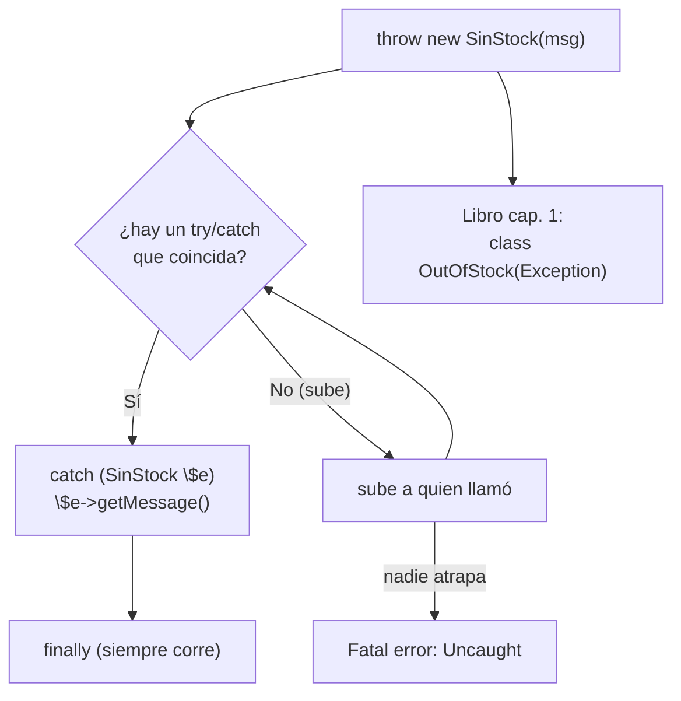

# Lección 07 — Excepciones

> Fase 0 · Formulario · Familia de concepto: **errores con nombre** · Orden de estudio: **8 de 18**

⬅️ [Lección 06 · Clases y objetos](../06-clases-y-objetos/) · 🏠 [Índice de lecciones](../README.md) · ➡️ [Lección 08 · Módulos, Composer y primer PHPUnit](../08-modulos-y-phpunit/)

---

## 🧭 Ruta de estudio · Lección 07 (≈ 2 h)

**Antes necesitas:** [Lección 02 · Condicionales](../02-condicionales/) (`if`) y [Lección 06 · Clases y objetos](../06-clases-y-objetos/).

| Paso | Qué haces | Dónde | ⏱ |
|:-:|---|---|:-:|
| **0** | Lee la teoría, las fórmulas, las propiedades y los errores | este README §0–§8 | 25 min |
| **1** | Ejecuta las fórmulas y compara con la tabla | [`paso1-formulas.php`](paso1-formulas.php) | 10 min |
| **2** | Sigue los ejemplos resueltos | §9 + [`paso2-ejemplos-resueltos.php`](paso2-ejemplos-resueltos.php) | 20 min |
| **3** | Completa los `// TODO` | [`paso3-tu-turno.php`](paso3-tu-turno.php) | 20 min |
| **4** | Compara con la solución | [`paso4-tu-turno-solucion.php`](paso4-tu-turno-solucion.php) | 5 min |
| **5** | Resuelve los 12 problemas y revisa claves | §10–§11 + [`paso5-solucionario/`](paso5-solucionario/) | 30 min |
| **6** | Compara mala vs buena | [`paso6-ejercicios/`](paso6-ejercicios/) | 10 min |
| **7** | Responde las preguntas de recuerdo **sin mirar** | §15 | 5 min |
| **🚦** | Evalúa si puedes pasar | §16 | 1 min |

---

## 0. 🧭 La pregunta
> *"Mi función resta stock. Me piden que, si piden más de lo que hay, avise un error **claro** en
> vez de devolver un número raro (como `-15`). ¿Cómo señalo un error y cómo hago que el programa
> reaccione sin caerse?"*

## 1. Objetivos (al terminar podrás…)
1. **Lanzar** un error con `throw new ...`.
2. **Atraparlo** con `try` / `catch` y leer su mensaje con `$e->getMessage()`.
3. Crear **tus propios errores** con nombre del negocio (`SinStock extends \Exception`).
4. Usar **varios `catch`** y `finally`.
5. Reconocer errores incorporados comunes (`InvalidArgumentException`, `DivisionByZeroError`, `TypeError`…).
6. Entender cómo un error **sube** (se propaga) desde una función hasta quien la llamó.

## 2. Cita de la fuente
> *"class OutOfStock(Exception): pass"* — Cap. 1, *Exceptions Can Express Domain Concepts Too*

> *"raise OutOfStock(f'Out of stock for sku {line.sku}')"* — Cap. 1

**Equivalente en PHP** (§3.10): `raise` → `throw`; heredar de `Exception` es igual.
```php
class SinStock extends \Exception {}                 // nuestra OutOfStock
throw new SinStock("Sin stock para el sku {$linea->sku}");
```
**Por qué importa:** el libro no devuelve un valor raro cuando no hay stock: **lanza** un error con
**nombre del dominio**, `OutOfStock` (nuestro `SinStock`). El título de la sección lo dice todo:
*las excepciones también pueden expresar conceptos del negocio*.

## 3. El dolor
```php
function asignar(int $cantidad, int $disponible): int {
    return $disponible - $cantidad;   // si piden 99 de 20, devuelve -79: ¿stock negativo?
}
```
Devolver un número raro obliga a que **todos** los que llaman se acuerden de comprobarlo. Un error
con nombre no se puede ignorar sin que se note.

---

## 4. 📘 Teoría

> **📦 Definición — Excepción**
> Una **excepción** es un objeto que representa "algo salió mal". Se **lanza** con `throw` y se
> **atrapa** con `try`/`catch`. Si nadie la atrapa, el programa se detiene con un *Fatal error*.

> **🔤 Vocabulario**
> - **`throw`:** lanza la excepción (corta la ejecución normal).
> - **`try { } catch (Tipo $e) { }`:** intenta un bloque; si lanza, salta al `catch` que coincida.
> - **`finally`:** bloque que **siempre** corre (haya error o no), para limpiar.
> - **`$e->getMessage()`:** el texto que le pasaste al crear la excepción.
> - **Propagar / subir:** si una función no atrapa el error, pasa a quien la llamó.
> - **`\Throwable`:** la raíz de todo lo que se puede lanzar (excepciones y errores).

> **🧠 Regla de oro**
> Lanza un error con **nombre del negocio** cuando una regla no se cumple; atrápalo **donde puedas
> decidir qué hacer**, no antes.

---

## 5. 🧮 Formulario: lanzar y atrapar
| # | Operación | Sintaxis | Ejemplo |
|---|---|---|---|
| X1 | Lanzar | `throw new Clase($msg)` | `throw new \InvalidArgumentException("vacío")` |
| X2 | Atrapar | `try { } catch (Clase $e) { }` | protege el bloque que puede fallar |
| X3 | Leer el mensaje | `$e->getMessage()` | `"vacío"` |
| X4 | Excepción propia | `class X extends \Exception {}` | `class SinStock extends \Exception {}` |
| X5 | Varios catch | `catch (A) {} catch (B) {}` | el primero que coincide por tipo |
| X6 | finally | `finally { }` | corre siempre (limpieza) |
| X7 | Propagar | no atrapar | el error sube a quien llamó |

## 6. 🧮 Errores incorporados comunes (del propio PHP)
| Error | Cuándo aparece |
|---|---|
| `InvalidArgumentException` | un argumento no tiene un valor válido (lo lanzas tú) |
| `RuntimeException` | algo falla en tiempo de ejecución (lo lanzas tú) |
| `TypeError` | pasas un tipo equivocado (con `strict_types`) |
| `DivisionByZeroError` | `intdiv($x, 0)` o `$x % 0` |
| `\Exception` / `\Error` | las dos ramas de `\Throwable` |

> 💡 Todo en [`paso1-formulas.php`](paso1-formulas.php).

## 7. 📐 Propiedades
| # | Propiedad |
|---|---|
| **P1** | Una excepción no atrapada **detiene** el programa (`Fatal error: Uncaught ...`). |
| **P2** | Tu excepción propia **hereda** de `\Exception`: un `catch (\Exception $e)` también la atrapa. |
| **P3** | `finally` corre **siempre**, incluso si hay un `return` o un `throw` dentro del `try`. |
| **P4** | El error **sube** por la cadena de llamadas hasta el primer `catch` que coincida. |
| **P5** | Atrapar `\Throwable` "por si acaso" **esconde** errores reales: atrapa solo lo que sabes manejar. |

## 8. ⚠️ Errores frecuentes
| # | ❌ Así no | Qué pasa | ✅ Así sí |
|---|---|---|---|
| E1 | `throw new SinStock("x")` sin `try` | `Fatal error: Uncaught SinStock: x` | envuélvelo en `try/catch` donde puedas manejarlo |
| E2 | `intdiv(1, 0)` | `DivisionByZeroError: Division by zero` | comprueba el divisor antes, o atrapa el error |
| E3 | devolver `-1` como "error" | nadie obliga a comprobarlo; se cuela | `throw` una excepción con nombre |
| E4 | `catch (\Throwable $e) { }` vacío | **silencia** el error; el bug se oculta | atrapa el tipo concreto y reporta o relanza |
| E5 | `class SinStock {}` (sin `extends \Exception`) | `catch (SinStock)` nunca atrapa un `throw` suyo (no es lanzable) | `class SinStock extends \Exception {}` |
| E6 | leer `$e->getMessage` sin `()` | `Warning: Undefined property` | es un método: `$e->getMessage()` |

> 🔬 Mensajes reales de PHP 8.3. Descomenta una línea del final de `paso1-formulas.php`.

---

## 9. ✍️ Ejemplos resueltos (paso a paso)
> Todos en [`paso2-ejemplos-resueltos.php`](paso2-ejemplos-resueltos.php).

**Ejemplo 1 — Lanzar en vez de devolver un valor raro** *(fácil)*
```php
function raizCuadrada(int $n): float {
    if ($n < 0) { throw new \InvalidArgumentException("no hay raíz real de un negativo"); }
    return sqrt($n);
}
try {
    echo raizCuadrada(-4) . "\n";
} catch (\InvalidArgumentException $e) {
    echo "error: " . $e->getMessage() . "\n";
}
```

**Ejemplo 2 — Tu propia excepción con nombre del negocio** *(fácil)*
```php
class SaldoInsuficiente extends \Exception {}
function retirar(int $saldo, int $monto): int {
    if ($monto > $saldo) { throw new SaldoInsuficiente("faltan " . ($monto - $saldo)); }
    return $saldo - $monto;
}
```

**Ejemplo 3 — `finally` siempre corre** *(intermedio)*
```php
try {
    throw new \RuntimeException("algo salió mal");
} catch (\RuntimeException $e) {
    echo "atrapo: " . $e->getMessage() . "\n";
} finally {
    echo "cierro el recurso (finally)\n";   // corre pase lo que pase
}
```

**Ejemplo 4 — El error sube hasta quien puede manejarlo** *(avanzado)*
```php
class SinStock extends \Exception {}
function asignarLinea(int $cantidad, int $disponible): int {
    if ($cantidad > $disponible) { throw new SinStock("sin stock"); }  // no lo atrapa aquí
    return $disponible - $cantidad;
}
function procesarPedido(int $cantidad, int $disponible): void {
    asignarLinea($cantidad, $disponible);   // deja que el error SUBA
}
try {
    procesarPedido(99, 20);
} catch (SinStock $e) {
    echo "arriba decidimos qué hacer: " . $e->getMessage() . "\n";
}
```
Es la forma del libro: la regla lanza `OutOfStock`, y quien orquesta el pedido decide qué hacer.

---

## 10. 📝 Problemas propuestos

**🟢 Nivel básico**
1. `edadValida(int): int` que lance `\InvalidArgumentException` si la edad es negativa. Atrápala e imprime su mensaje.
2. La misma función con `edadValida(30)` debe devolver `30`.
3. Crea `class MiError extends \Exception {}`, lánzala con un mensaje y atrápala.
4. Atrapa el `\DivisionByZeroError` de `intdiv(1, 0)` e imprime su mensaje.

**🟡 Nivel intermedio**

5. `retirar(saldo, monto)` que lance `SaldoInsuficiente` si no alcanza; atrápala (faltan 50 de 100→150).
6. La misma con `retirar(100, 40)` devuelve `60`.
7. Una función con `finally` que imprima "finally corre" aunque falle.
8. Una función con **dos** `catch` (`InvalidArgumentException` y `RuntimeException`) que devuelva "argumento" o "ejecución".

**🔴 Nivel avanzado** — como en el libro
9. `asignarLinea(cantidad, disponible)` que lance `SinStock` si no alcanza; con `(2, 20)` devuelve `18`.
10. Con `(99, 20)` atrapa `SinStock` e imprime su mensaje.
11. Llama `asignarLinea` desde otra función `procesar()` que **no** la atrapa, y atrápala arriba.
12. Comprueba que `SinStock` se puede atrapar también con `catch (\Exception $e)` (jerarquía).

## 11. 🔑 Claves (respuestas)
<details><summary>Ver claves</summary>

| # | Salida esperada |
|---|---|
| 1 | `edad negativa` |
| 2 | `30` |
| 3 | `hola` |
| 4 | `Division by zero` |
| 5 | `faltan 50` |
| 6 | `60` |
| 7 | `finally corre` + `error` |
| 8 | `argumento` / `ejecución` |
| 9 | `18` |
| 10 | `sin stock para 99` |
| 11 | `subió hasta aquí` |
| 12 | `atrapado como \Exception (SinStock)` |

Código completo en [`paso5-solucionario/`](paso5-solucionario/).
</details>

---

## 12. 🗺️ Mapa mental (Mermaid)

**Cómo leerlo:** al lanzar, PHP busca un `catch` que coincida por tipo; si no hay en esta función,
el error **sube**. Si nadie lo atrapa, el programa se detiene. `finally` corre siempre.

## 13. 🌳 Árbol de archivos
```
lecciones/07-excepciones/
├── README.md                    ← PASO 0 · EMPIEZA AQUÍ
├── paso1-formulas.php           ← PASO 1 · X1–X7
├── paso2-ejemplos-resueltos.php ← PASO 2 · los 4 ejemplos
├── paso3-tu-turno.php           ← PASO 3 · // TODO
├── paso4-tu-turno-solucion.php  ← PASO 4 · solución
├── paso5-solucionario/          ← PASO 5 · 12 problemas
└── paso6-ejercicios/            ← PASO 6 · mala vs buena
```

## 14. 🤝 Tu turno y ✅ comprobación
PHPUnit llega en la [Lección 08](../08-modulos-y-phpunit/); aquí se comprueba **ejecutando y
comparando** con la salida esperada:
```bash
php lecciones/07-excepciones/paso3-tu-turno.php
git diff --no-index lecciones/07-excepciones/paso3-tu-turno.php lecciones/07-excepciones/paso4-tu-turno-solucion.php
```

## 15. ❓ Preguntas de recuerdo
<details><summary>1. ¿Cómo lanzas y cómo atrapas una excepción?</summary>

Lanzas con `throw new Clase($mensaje)`; atrapas con `try { ... } catch (Clase $e) { ... }`.
</details>
<details><summary>2. ¿Cómo creas tu propia excepción con nombre del negocio?</summary>

`class SinStock extends \Exception {}` y luego `throw new SinStock("...")`.
</details>
<details><summary>3. ¿Qué pasa si nadie atrapa una excepción?</summary>

El programa se detiene con `Fatal error: Uncaught ...`.
</details>
<details><summary>4. ¿Cuándo corre el bloque <code>finally</code>?</summary>

**Siempre**: haya error o no, e incluso si hay un `return` dentro del `try`.
</details>
<details><summary>5. ¿Por qué es mejor lanzar una excepción que devolver <code>-1</code>?</summary>

Porque la excepción **no se puede ignorar** sin que se note; el `-1` obliga a que todos recuerden comprobarlo.
</details>
<details><summary>6. ¿Qué significa que un error "sube"?</summary>

Si una función no lo atrapa, pasa a quien la llamó, y así hasta el primer `catch` que coincida.
</details>

---

## 16. 🚦 ¿Puedo pasar a la siguiente lección?
| Indicador | Criterio |
|:-:|---|
| 🟢 **Sí, sigue** | `paso3-tu-turno.php` da la salida esperada **y** aciertas **≥ 9 de 12** problemas **y** respondes las 6 preguntas sin mirar |
| 🟡 **Repasa** | aciertas **6 a 8** → vuelve a §8 y §9 |
| 🔴 **Repite** | aciertas **menos de 6** → empieza desde el Paso 0 |

Cuando estés en 🟢, marca la lección en [`progreso/fase-0-php.md`](../../progreso/fase-0-php.md).

---

⬅️ [Lección 06 · Clases y objetos](../06-clases-y-objetos/) · 🏠 [Índice de lecciones](../README.md) · ➡️ [Lección 08 · Módulos, Composer y primer PHPUnit](../08-modulos-y-phpunit/)
