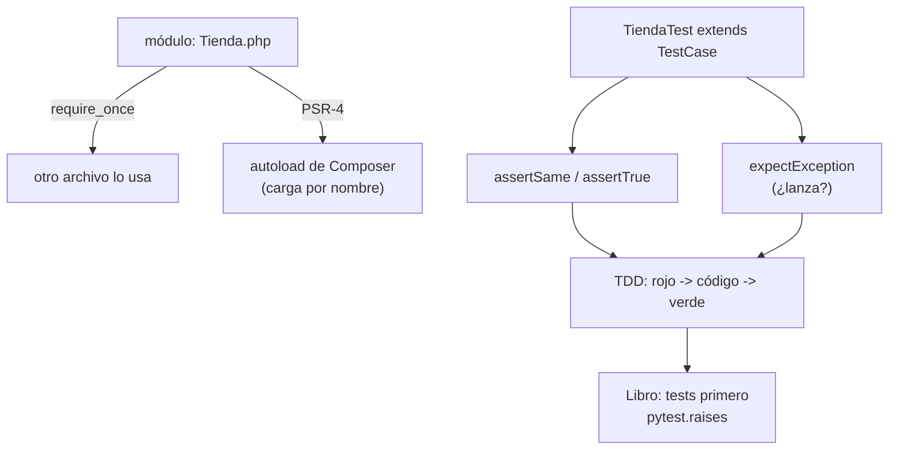

# Lección 08 — Módulos, Composer y primer PHPUnit

> Fase 0 · Formulario · Familia de concepto: **reutilizar y comprobar** · Orden de estudio: **9 de 18**

⬅️ [Lección 07 · Excepciones](../07-excepciones/) · 🏠 [Índice de lecciones](../README.md) · ➡️ [Lección 09 · Encapsulación](../09-encapsulacion/)

---

## 🧭 Ruta de estudio · Lección 08 (≈ 2.5 h)

**Antes necesitas:** [Lección 04 · Funciones](../04-funciones/) y [Lección 07 · Excepciones](../07-excepciones/).

| Paso | Qué haces | Dónde | ⏱ |
|:-:|---|---|:-:|
| **0** | Lee la teoría, las fórmulas y los errores | este README §0–§8 | 30 min |
| **1** | Ejecuta las fórmulas (importar un módulo) | [`paso1-formulas.php`](paso1-formulas.php) | 10 min |
| **2** | Sigue los ejemplos resueltos | §9 + [`paso2-ejemplos-resueltos.php`](paso2-ejemplos-resueltos.php) | 20 min |
| **3** | Completa los `// TODO` y pon el test en **verde** | [`paso3-tu-turno.php`](paso3-tu-turno.php) + [`Paso3TuTurnoTest.php`](Paso3TuTurnoTest.php) | 30 min |
| **4** | Compara con la solución | [`paso4-tu-turno-solucion.php`](paso4-tu-turno-solucion.php) | 5 min |
| **5** | Resuelve los 12 problemas (como tests) y revisa claves | §10–§11 + [`paso5-solucionario/`](paso5-solucionario/) | 35 min |
| **6** | Compara mala vs buena | [`paso6-ejercicios/`](paso6-ejercicios/) | 10 min |
| **7** | Responde las preguntas de recuerdo **sin mirar** | §15 | 5 min |
| **🚦** | Evalúa si puedes pasar | §16 | 1 min |

---

## 0. 🧭 La pregunta
> *"Me piden reutilizar una función desde **otro archivo** y comprobar **automáticamente** que
> funciona, sin revisar la salida a ojo cada vez que cambio algo. ¿Cómo lo hago?"*

## 1. Objetivos (al terminar podrás…)
1. Explicar qué es un **módulo** y usarlo con `require_once`.
2. Entender el **autoload de Composer** (cargar clases por su nombre, sin `require` a mano).
3. Escribir **pruebas** con **PHPUnit** (`extends TestCase`, métodos `test_...`, `assertSame`).
4. Probar que un código **lanza** un error con `expectException` (como `pytest.raises`, Lección 07).
5. Hacer tu primer ciclo **TDD**: prueba en **rojo** → código → prueba en **verde**.

## 2. Cita de la fuente
> *"We use TDD at work, so we tend to show listings of tests first, followed by implementation."* — Preface, *Who Should Read This Book*

> *"with pytest.raises(OutOfStock, match='SMALL-FORK'):"* — Cap. 1

**Equivalente en PHP** (§3.10): `pytest` → **PHPUnit**; `assert x == y` → `$this->assertSame($y, $x)`;
`pytest.raises(...)` → `$this->expectException(...)`.
```php
public function test_asignar_de_mas_lanza_SinStock(): void {
    $this->expectException(SinStockTienda::class);   // como pytest.raises
    (new Tienda(["MESA" => 1]))->asignar("MESA", 99);
}
```
**Por qué importa:** el libro muestra **primero la prueba** y después el código (TDD). Para
comprobar que se lanza `OutOfStock` usa `pytest.raises`; en PHP es `expectException`. Desde esta
lección **todo** lo comprobarás así.

## 3. El dolor
```php
function doble(int $n): int { return $n * 2; }
echo doble(5) . "\n";   // ¿salió 10? hay que MIRARLO a ojo cada vez que cambias algo
```
Comprobar a ojo es lento y se equivoca. Un **test** comprueba solo y avisa si algo se rompió.

---

## 4. 📘 Teoría

> **📦 Definición — Módulo**
> Un **módulo** es un archivo con código reutilizable (clases, funciones). Otro archivo lo
> **importa** con `require_once` para usar lo que define.

> **📦 Definición — Composer y autoload**
> **Composer** es el gestor de paquetes de PHP. Su **autoload** carga una clase por su nombre
> automáticamente (con el estándar **PSR-4**: el nombre de la clase ↔ la ruta del archivo), así no
> escribes `require` a mano. Se configura en `composer.json` y se activa con `composer dump-autoload`.

> **📦 Definición — PHPUnit y aserción**
> **PHPUnit** corre tus **tests**. Una clase de test **extiende `TestCase`** y cada método `test_...`
> hace **aserciones**: `assertSame($esperado, $real)` (compara con `===`), `assertTrue`, `assertFalse`,
> `expectException`. Se corre con `vendor/bin/phpunit <ruta>`.

> **🧠 Regla de oro (TDD)**
> Escribe la prueba **primero** (sale en **rojo**), luego el código que la pone en **verde**.

---

## 5. 🧮 Formulario: módulos
| # | Operación | Sintaxis | Qué hace |
|---|---|---|---|
| M1 | Importar | `require_once __DIR__ . '/Archivo.php'` | trae clases/funciones de otro archivo |
| M2 | Usar lo importado | `new Clase(...)` | ya está disponible |
| M3 | `require` vs `require_once` | `require_once` | no recarga si ya se cargó (evita redeclaraciones) |
| M4 | Ruta estable | `__DIR__` | la carpeta de ESTE archivo, pase lo que pase |
| M5 | Autoload | `composer.json → autoload.psr-4` | Composer carga clases por su nombre |

## 6. 🧮 Formulario: PHPUnit
| # | Operación | Sintaxis | Qué comprueba |
|---|---|---|---|
| T1 | Clase de test | `final class XTest extends TestCase` | agrupa pruebas |
| T2 | Un test | `public function test_algo(): void` | una comprobación |
| T3 | Igualdad estricta | `$this->assertSame($esperado, $real)` | `===` (tipo y valor) |
| T4 | Igualdad débil | `$this->assertEquals($esperado, $real)` | `==` (solo valor) |
| T5 | Booleanos | `$this->assertTrue(...)` / `assertFalse(...)` | verdadero / falso |
| T6 | ¿Lanza? | `$this->expectException(Clase::class)` | que el código lance esa excepción |
| T7 | Correr | `vendor/bin/phpunit lecciones/08-modulos-y-phpunit` | una lección a la vez |

> 💡 El módulo `Tienda.php` y su `TiendaTest.php` (en verde) muestran todo junto.

## 7. 📐 Propiedades
| # | Propiedad |
|---|---|
| **P1** | Un test **comprueba solo**: no hay que mirar la salida a ojo. |
| **P2** | `assertSame` usa `===` (recomendado); `assertEquals` usa `==` (puede ocultar bugs de tipo). |
| **P3** | Los tests de `paso3` empiezan en **rojo** a propósito: TDD (rojo → verde). |
| **P4** | Cada lección se corre **por separado**: muchos archivos repiten el nombre `Paso3TuTurnoTest`. |
| **P5** | `expectException` reemplaza al `try/catch` cuando lo que quieres es **comprobar** que algo lanza. |

## 8. ⚠️ Errores frecuentes
| # | ❌ Así no | Qué pasa | ✅ Así sí |
|---|---|---|---|
| E1 | `require 'Tienda.php'` (ruta relativa a dónde ejecutas) | `Failed opening required 'Tienda.php'` | `require_once __DIR__ . '/Tienda.php'` |
| E2 | `require` dos veces el mismo archivo | `Fatal error: Cannot redeclare class/function` | `require_once` (no recarga) |
| E3 | correr `vendor/bin/phpunit` (sin ruta) sobre todo el repo | choca por `Paso3TuTurnoTest` repetido en cada lección | corre **una lección**: `... phpunit lecciones/08-modulos-y-phpunit` |
| E4 | `assertEquals(5, "5")` creyendo que es estricto | pasa (compara con `==`), oculta el tipo | `assertSame(5, $real)` (usa `===`) |
| E5 | esperar que `php Paso3TuTurnoTest.php` corra el test | no hace nada útil (los tests los corre PHPUnit) | `vendor/bin/phpunit <ruta>` |
| E6 | método de test sin empezar por `test` ni `#[Test]` | PHPUnit lo ignora | nómbralo `test_...` |

---

## 9. ✍️ Ejemplos resueltos (paso a paso)
> En [`paso2-ejemplos-resueltos.php`](paso2-ejemplos-resueltos.php) (ejecutables) y en [`TiendaTest.php`](TiendaTest.php) (PHPUnit).

**Ejemplo 1 — Importar un módulo** *(fácil)*
```php
require_once __DIR__ . '/Tienda.php';   // trae la clase Tienda
$tienda = new Tienda(["MESA" => 20]);
echo $tienda->disponible("MESA") . "\n"; // 20
```

**Ejemplo 2 — `require_once` no recarga** *(fácil)*
```php
require_once __DIR__ . '/Tienda.php';
require_once __DIR__ . '/Tienda.php';   // segunda vez: 'once' la ignora (sin error)
```

**Ejemplo 3 — Un test de PHPUnit** *(intermedio)*
```php
final class TiendaTest extends TestCase {
    public function test_asignar_reduce_el_stock(): void {
        $tienda = new Tienda(["MESA" => 20]);
        $this->assertSame(18, $tienda->asignar("MESA", 2));  // esperado, real
    }
}
```

**Ejemplo 4 — Probar que algo LANZA** *(avanzado)*
```php
public function test_asignar_de_mas_lanza_SinStock(): void {
    $this->expectException(SinStockTienda::class);   // como pytest.raises
    (new Tienda(["MESA" => 1]))->asignar("MESA", 99);
}
```

---

## 10. 📝 Problemas propuestos
> Resuélvelos **como tests** (en un archivo `MisTestsTest.php`) o ejecutando a mano. Las claves son
> la salida esperada de cada aserción.

**🟢 Nivel básico**
1. Crea un módulo `Calculos.php` con `sumar(int, int): int`. Un test: `assertSame(5, sumar(2, 3))`.
2. Agrega `esPar(int): bool`. Test: `assertTrue(esPar(4))`.
3. Test: `assertFalse(esPar(7))`.
4. Agrega `mayor(int, int): int`. Test: `assertSame(9, mayor(9, 3))`.

**🟡 Nivel intermedio**

5. Test con negativos: `assertSame(-1, sumar(-3, 2))`.
6. Diferencia `assertEquals("5", 5)` (pasa con `==`) de lo que haría `assertSame`.
7. Prueba que `(new Tienda(["X"=>1]))->asignar("X", 5)` lanza `SinStockTienda` con `expectException`.
8. Test de un array: `assertSame([1, 2], [1, 2])`.

**🔴 Nivel avanzado** — TDD
9. Escribe PRIMERO un test que diga que `restarStock(20, 2)` es `18` (sale en rojo).
10. Escribe `restarStock` para que pase (verde).
11. Test que `alcanza(18, 5)` es `true` y `alcanza(3, 5)` es `false`.
12. Escribe `alcanza` para que ambos pasen.

## 11. 🔑 Claves (respuestas)
<details><summary>Ver claves</summary>

| # | Resultado |
|---|---|
| 1–4 | tests en **verde** (ver `paso5-solucionario/CalculosTest.php`) |
| 5 | verde (`-1`) |
| 6 | `assertEquals` pasa (compara `==`); `assertSame` fallaría (tipos distintos) |
| 7 | verde (lanza `SinStockTienda`) |
| 8 | verde |
| 9–12 | `restarStock(20,2)=18`; `alcanza(18,5)=true`, `alcanza(3,5)=false` (ver `paso4-tu-turno-solucion.php`) |

Solucionario: [`paso5-solucionario/CalculosTest.php`](paso5-solucionario/CalculosTest.php) → corre con
`vendor/bin/phpunit lecciones/08-modulos-y-phpunit/paso5-solucionario/CalculosTest.php` (8 verdes).
</details>

---

## 12. 🗺️ Mapa mental (Mermaid)

**Cómo leerlo:** un módulo se importa (o lo carga el autoload); un test extiende `TestCase` y hace
aserciones; el ciclo TDD va de rojo a verde, como el libro (que muestra los tests primero).

## 13. 🌳 Árbol de archivos
```
lecciones/08-modulos-y-phpunit/
├── README.md                    ← PASO 0 · EMPIEZA AQUÍ
├── paso1-formulas.php           ← PASO 1 · require, autoload, la idea de aserción
├── paso2-ejemplos-resueltos.php ← PASO 2 · los 4 ejemplos
├── paso3-tu-turno.php           ← PASO 3 · // TODO (funciones a completar)
├── Paso3TuTurnoTest.php         ← 🧪 el test de paso3: ROJO hasta que lo completes
├── paso4-tu-turno-solucion.php  ← PASO 4 · solución
├── Tienda.php                   ← módulo de apoyo (clase que se importa)
├── TiendaTest.php               ← test del módulo (VERDE)
├── paso5-solucionario/          ← PASO 5 · Calculos.php + CalculosTest.php (12 problemas)
└── paso6-ejercicios/            ← PASO 6 · mala vs buena
```

## 14. 🤝 Tu turno y ✅ comprobación
Desde esta lección **todo** se comprueba con PHPUnit. Tu `paso3` empieza en **rojo**; complétalo
hasta ponerlo en **verde**:
```bash
# rojo (antes de completar los TODO):
vendor/bin/phpunit lecciones/08-modulos-y-phpunit/Paso3TuTurnoTest.php
# el módulo de apoyo ya está en verde:
vendor/bin/phpunit lecciones/08-modulos-y-phpunit/TiendaTest.php
# toda la lección (rojo solo en paso3 hasta que la completes):
vendor/bin/phpunit lecciones/08-modulos-y-phpunit
```
> Para ver la **referencia** en verde, en `Paso3TuTurnoTest.php` cambia el `require` a
> `paso4-tu-turno-solucion.php`.

## 15. ❓ Preguntas de recuerdo
<details><summary>1. ¿Qué es un módulo y cómo lo importas?</summary>

Un archivo con código reutilizable; se importa con `require_once __DIR__ . '/Archivo.php'`.
</details>
<details><summary>2. ¿Qué hace el autoload de Composer?</summary>

Carga una clase por su nombre automáticamente (PSR-4), sin que escribas `require` a mano.
</details>
<details><summary>3. ¿Qué diferencia hay entre <code>assertSame</code> y <code>assertEquals</code>?</summary>

`assertSame` compara con `===` (tipo y valor); `assertEquals` con `==` (solo valor), que puede ocultar bugs de tipo.
</details>
<details><summary>4. ¿Cómo pruebas que un código lanza una excepción?</summary>

Con `$this->expectException(Clase::class)` antes de llamar al código que debe lanzarla.
</details>
<details><summary>5. ¿Qué es el ciclo rojo → verde de TDD?</summary>

Escribes la prueba primero (falla, **rojo**), luego el código que la hace pasar (**verde**).
</details>
<details><summary>6. ¿Por qué se corre PHPUnit una lección a la vez?</summary>

Porque muchas lecciones repiten el nombre `Paso3TuTurnoTest`; correr todo junto choca.
</details>

---

## 16. 🚦 ¿Puedo pasar a la siguiente lección?
| Indicador | Criterio |
|:-:|---|
| 🟢 **Sí, sigue** | `Paso3TuTurnoTest.php` en **verde** **y** aciertas **≥ 9 de 12** problemas **y** respondes las 6 preguntas sin mirar |
| 🟡 **Repasa** | aciertas **6 a 8** → vuelve a §8 y §9 |
| 🔴 **Repite** | aciertas **menos de 6** → empieza desde el Paso 0 |

Cuando estés en 🟢, marca la lección en [`progreso/fase-0-php.md`](../../progreso/fase-0-php.md).

---

⬅️ [Lección 07 · Excepciones](../07-excepciones/) · 🏠 [Índice de lecciones](../README.md) · ➡️ [Lección 09 · Encapsulación](../09-encapsulacion/)
