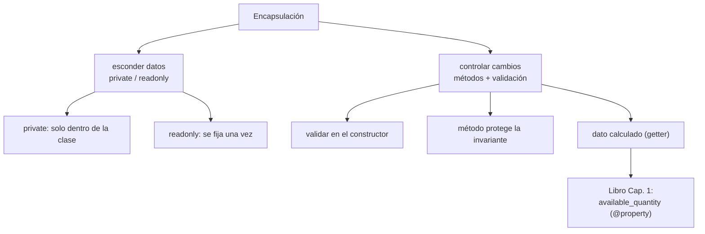

# Lección 09 — Encapsulación

> Fase 0 · Formulario · Familia de concepto: **proteger el estado del objeto** · Orden de estudio: **10 de 18**

⬅️ [Lección 08 · Módulos, Composer y PHPUnit](../08-modulos-y-phpunit/) · 🏠 [Índice de lecciones](../README.md) · ➡️ [Lección 10 · Herencia](../10-herencia/)

---

## 🧭 Ruta de estudio · Lección 09 (≈ 2 h)

**Antes necesitas:** [Lección 06 · Clases y objetos](../06-clases-y-objetos/) y [Lección 08 · PHPUnit](../08-modulos-y-phpunit/).

| Paso | Qué haces | Dónde | ⏱ |
|:-:|---|---|:-:|
| **0** | Lee la teoría, las fórmulas, las propiedades y los errores | este README §0–§8 | 25 min |
| **1** | Ejecuta las fórmulas y compara con la tabla | [`paso1-formulas.php`](paso1-formulas.php) | 10 min |
| **2** | Sigue los ejemplos resueltos | §9 + [`paso2-ejemplos-resueltos.php`](paso2-ejemplos-resueltos.php) | 20 min |
| **3** | Completa los `// TODO` | [`paso3-tu-turno.php`](paso3-tu-turno.php) | 20 min |
| **🧪** | Pon en **verde** el test | [`Paso3TuTurnoTest.php`](Paso3TuTurnoTest.php) · `vendor/bin/phpunit lecciones/09-encapsulacion` | 10 min |
| **4** | Compara con la solución de referencia | [`paso4-tu-turno-solucion.php`](paso4-tu-turno-solucion.php) | 5 min |
| **5** | Resuelve los 12 problemas, luego revisa claves | §10–§11 + [`paso5-solucionario/`](paso5-solucionario/) | 30 min |
| **6** | Compara solución mala vs buena | [`paso6-ejercicios/`](paso6-ejercicios/) | 10 min |
| **7** | Responde las preguntas de recuerdo **sin mirar** | §15 | 5 min |
| **🚦** | Evalúa si puedes pasar | §16 | 1 min |

---

## 0. 🧭 La pregunta
> *"Mi `Lote` tiene `cantidad` a la vista. Me piden que **nunca** quede en un valor imposible,
> pero cualquiera puede escribir `$lote->cantidad = -999`. ¿Cómo protejo el estado?"*

## 1. Objetivos (al terminar podrás…)
1. Esconder un dato con `private` y exponerlo con un **getter**.
2. Fijar un dato una sola vez con `readonly`.
3. **Validar** en el constructor para que no exista un estado imposible.
4. Proteger una **invariante** con un método, y calcular datos derivados.

## 2. Cita de la fuente
> *"The term encapsulation covers two closely related ideas: simplifying behavior and hiding
> data."* — Introducción

> *"self._purchased_quantity = qty"* · *"@property def available_quantity(self) -> int: return
> self._purchased_quantity - self.allocated_quantity"* — Cap. 1

**Equivalente en PHP** (§3.10 de la metodología):
```php
class Lote {
    public function __construct(private int $purchasedQuantity, private int $allocatedQuantity = 0) {}
    // disponible NO se guarda: se calcula (como @property available_quantity del libro)
    public function availableQuantity(): int {
        return $this->purchasedQuantity - $this->allocatedQuantity;
    }
}
```
**Por qué importa:** el libro **esconde** `_purchased_quantity` (el `_` de Python es una
convención) y **calcula** `available_quantity` con un `@property`. En PHP escondemos con `private`
y calculamos con un **método**; así el estado del objeto no puede quedar inconsistente.

## 3. El dolor
```php
class Lote { public int $cantidad; }
$lote = new Lote();
$lote->cantidad = -999;   // nada lo impide: estado imposible
```
Si el dato está expuesto, cualquiera lo deja en un valor que el negocio no permite.

---

## 4. 📘 Teoría

> **🔒 Visibilidad**
> - `public`: accesible desde cualquier lado.
> - `private`: solo **dentro** de la misma clase.
> - `protected`: la clase y sus **hijas** (Lección 10).

> **🧊 `readonly`** (PHP 8.1+)
> Una propiedad `readonly` se fija **una sola vez** (en el constructor) y ya no se puede cambiar.
> Perfecta para la **identidad** de una entidad (su referencia).

> **🔤 Vocabulario**
> - **Encapsular:** esconder los datos y exponer solo lo necesario mediante métodos.
> - **Getter:** un método que devuelve un dato (`cantidad(): int`).
> - **Invariante:** una regla que el objeto debe cumplir **siempre** (p. ej. "la cantidad ≥ 0").
> - **Propiedad calculada:** un dato que no se guarda, se **calcula** con un método.

> **🧠 Regla de oro**
> No expongas datos que puedan quedar mal. **Esconde** (`private`/`readonly`) y da **métodos**
> que garanticen las reglas del negocio.

---

## 5. 🧮 Formulario: visibilidad y readonly

| # | Operación | Sintaxis | Ejemplo |
|---|---|---|---|
| V1 | Propiedad pública | `public int $x;` | `public int $publico = 1;` |
| V2 | Propiedad privada | `private int $x;` | `private int $privado = 2;` |
| V3 | Propiedad protegida | `protected int $x;` | `protected int $protegido = 3;` |
| V4 | readonly | `public readonly string $x;` | se fija en el constructor, no cambia más |
| V5 | Acceder (pública) | `$obj->x` | `$c->publico` → `1` |
| V6 | Acceder a privada desde fuera | `$obj->privado` | `Error: Cannot access private property …` |
| V7 | Modificar readonly | `$obj->ref = "x"` | `Error: Cannot modify readonly property …` |

## 6. 🧮 Formulario: getters y validación

| # | Operación | Sintaxis | Qué logra |
|---|---|---|---|
| G1 | Getter | `public function x(): int { return $this->x; }` | expone el dato de solo lectura |
| G2 | Validar en el constructor | `if ($x < 0) throw new \InvalidArgumentException(...)` | nunca un estado imposible |
| G3 | Proteger invariante | método con `if (...) throw ...; $this->x -= $n;` | la regla se cumple siempre |
| G4 | Propiedad calculada | `public function disponible(): int { return $this->a - $this->b; }` | el dato no se guarda, se calcula |

> 💡 Todas están ejecutables en [`paso1-formulas.php`](paso1-formulas.php).

## 7. 📐 Propiedades
| # | Regla |
|---|---|
| P1 | `private` solo se ve **dentro** de la clase; desde fuera, `Error`. |
| P2 | `readonly` se asigna **una vez** (en el constructor) y nunca más. |
| P3 | La **promoción de propiedades** (`public function __construct(private int $x)`) declara y asigna en una línea. |
| P4 | Un dato **calculado** nunca queda descuadrado: se recalcula cada vez que se pide. |
| P5 | `private` es **por clase**, no por objeto: un método **sí** puede leer la propiedad privada de **otra instancia** de su misma clase (`$otro->x`). |
| P6 | **Validar antes de cambiar**: si la regla lanza una excepción, el objeto queda **igual que antes**, no a medias (el `throw` corta el método). |
| P7 | Una propiedad **tipada** sin valor inicial **no se puede leer** hasta asignarla: PHP da `Error: Typed property … must not be accessed before initialization`. |
| P8 | `readonly` protege la **propiedad**: si guarda un **array**, su contenido tampoco cambia (`$c->a[] = 3` → `Error`); si guarda un **objeto**, no puedes **reemplazarlo**, pero sí mutar el objeto por dentro. |

## 8. ⚠️ Errores frecuentes
| # | ❌ Así no | Qué pasa (mensaje real de PHP 8.3) | ✅ Así sí |
|---|---|---|---|
| E1 | `$c->privado` desde fuera | `Error: Cannot access private property Caja::$privado` | usa un getter: `$c->verPrivado()` |
| E2 | `$l->referencia = "x"` (readonly) | `Error: Cannot modify readonly property Lote::$referencia` | fíjala en el constructor y no la cambies |
| E3 | `new LoteStock(-5)` sin validar | el estado queda imposible (no hay error, pero el objeto es inválido) | valida en el constructor: `throw new \InvalidArgumentException(...)` |
| E4 | exponer `public int $cantidad` | cualquiera la deja en `-999` | `private` + método `asignar()` que cuida la regla |
| E5 | leer una propiedad **tipada sin inicializar**: `echo $l->cantidad` | `Error: Typed property Lote::$cantidad must not be accessed before initialization` | dale valor en el constructor (o un valor por defecto) |
| E6 | asignar **otro tipo** a una propiedad tipada: `$c->cantidad = "diez"` sobre `int` | `TypeError: Cannot assign string to property Caja::$cantidad of type int` | asigna el tipo correcto: `$c->cantidad = 10` |
| E7 | cambiar **y después** validar: `$this->saldo -= $n;` y luego `if ($this->saldo < 0) throw …` | no hay error de tipos, pero el objeto queda **a medias** (saldo negativo) aunque se lance la excepción | valida **primero**: `if ($n > $this->saldo) throw …;` y recién después resta |

---

## 9. ✍️ Ejemplos resueltos (paso a paso)
> Todos en [`paso2-ejemplos-resueltos.php`](paso2-ejemplos-resueltos.php).

**Ejemplo 1 — Proteger un dato con `private`** *(fácil)*
```php
class Termostato {
    private int $grados;                        // dato PRIVADO
    public function __construct(int $grados) { $this->grados = $grados; }
    public function grados(): int { return $this->grados; } // getter de lectura
}
echo (new Termostato(21))->grados();            // 21 (no se puede escribir $t->grados = 999)
```

**Ejemplo 2 — Validar en el constructor** *(fácil)*
```php
class Edad {
    public function __construct(private int $valor) {
        if ($valor < 0) { throw new \InvalidArgumentException("Edad negativa"); }
    }
    public function valor(): int { return $this->valor; }
}
echo (new Edad(30))->valor();                   // 30; new Edad(-1) lanza la excepción
```

**Ejemplo 3 — Proteger una invariante** *(intermedio)*
```php
class Cuenta {
    public function __construct(private int $saldo = 0) {}
    public function saldo(): int { return $this->saldo; }
    public function retirar(int $n): void {
        if ($n > $this->saldo) { throw new \DomainException("Saldo insuficiente"); }
        $this->saldo -= $n;
    }
}
$c = new Cuenta(100); $c->retirar(30); echo $c->saldo();  // 70
```

**Ejemplo 4 — Propiedad calculada, como en el libro** *(avanzado)*
```php
class LoteAsign {
    public function __construct(private int $comprada, private int $asignada = 0) {}
    public function disponible(): int { return $this->comprada - $this->asignada; } // se CALCULA
    public function asignar(int $n): void { $this->asignada += $n; }
}
$lote = new LoteAsign(20); $lote->asignar(2); echo $lote->disponible();  // 18
```
Es el `available_quantity` del libro: nunca es un dato suelto que pueda quedar mal.

---

## 10. 📝 Problemas propuestos
**🟢 Nivel básico**
1. Clase `Producto` con `sku` privado y un getter `sku()`. Crea uno con `"MESA"` y muéstralo.
2. Clase `Pedido` con `id` `readonly`. Crea uno con `"o1"` y muestra el id.
3. Clase `Precio` que **valide** en el constructor que el valor no sea negativo; muestra `100`.
4. Clase `Rect` con `a` y `b` privados y un método **calculado** `area()`. Con `3` y `4`, muestra `12`.

**🟡 Nivel intermedio**

5. Clase `Cuenta` con saldo privado y `depositar(int)`. Deposita 100 sobre 50 y muestra el saldo.
6. Agrega `retirar(int)` y retira 30; muestra el saldo.
7. Haz que `retirar` lance `DomainException` si no alcanza; atrápala y muestra el mensaje.
8. Haz que `depositar` lance `InvalidArgumentException` con monto ≤ 0; atrápala y muestra el mensaje.

**🔴 Nivel avanzado**

9. Clase `Lote` con `disponible()` calculado a partir de sus asignaciones; asigna 2 y 3, muestra `15`.
10. Haz que `asignar` lance `DomainException` si no hay stock; pruébalo con `asignar(10)` sobre 5.
11. Clase `Entidad` con `ref` `readonly`; crea `"lote-001"` y muéstrala.
12. *(Puente al libro)* Clase `LoteLibro` con `availableQuantity()` = `purchasedQuantity − allocatedQuantity`
    (como el Cap. 1). Con `20` comprada y `2` asignada, muestra `18`.

## 11. 🔑 Claves (respuestas)
<details><summary>Ver claves (solo después de intentarlo)</summary>

| # | Salida | # | Salida | # | Salida |
|---|---|---|---|---|---|
| 1 | `MESA` | 5 | `150` | 9 | `15` |
| 2 | `o1` | 6 | `120` | 10 | `sin stock` |
| 3 | `100` | 7 | `saldo insuficiente` | 11 | `lote-001` |
| 4 | `12` | 8 | `monto inválido` | 12 | `18` |

Código completo en [`paso5-solucionario/`](paso5-solucionario/).
</details>

---

## 12. 🗺️ Mapa mental (Mermaid)

**Cómo leerlo:** encapsular es **esconder** el dato y **controlar** cómo cambia. El dato calculado
conecta con el `available_quantity` del libro.

## 13. 🌳 Árbol de archivos
```
lecciones/09-encapsulacion/
├── README.md                    ← PASO 0 · EMPIEZA AQUÍ
├── paso1-formulas.php           ← PASO 1 · V1–V7, G1–G4
├── paso2-ejemplos-resueltos.php ← PASO 2 · los 4 ejemplos
├── paso3-tu-turno.php           ← PASO 3 · completa los // TODO
├── Paso3TuTurnoTest.php         ← 🧪 el test (rojo → verde)
├── paso4-tu-turno-solucion.php  ← PASO 4 · solución de referencia
├── paso5-solucionario/          ← PASO 5 · soluciones de los 12 problemas
└── paso6-ejercicios/            ← PASO 6 · solución mala vs buena
```

## 14. 🤝 Tu turno y ✅ comprobación
Completa los `// TODO` de [`paso3-tu-turno.php`](paso3-tu-turno.php) y pon el test en **verde**:
```bash
vendor/bin/phpunit lecciones/09-encapsulacion
```
El test empieza en **rojo a propósito** (los `// TODO` lanzan una excepción); al completar la clase
`LoteSeguro`, pasa a verde. *(Para ver la referencia en verde, el test indica cómo cambiar el `require`
a `paso4-tu-turno-solucion.php`.)*

## 15. ❓ Preguntas de recuerdo
<details><summary>1. ¿Qué diferencia hay entre <code>private</code> y <code>public</code>?</summary>

`private` solo es accesible **dentro** de la clase; `public`, desde cualquier lado.
</details>
<details><summary>2. ¿Para qué sirve <code>readonly</code>?</summary>

Para fijar un dato **una sola vez** (en el constructor); después no se puede cambiar. Ideal para la identidad de una entidad.
</details>
<details><summary>3. ¿Dónde se valida que un dato no sea imposible?</summary>

En el **constructor** (y en los métodos que lo cambian), lanzando una excepción si la regla no se cumple.
</details>
<details><summary>4. ¿Qué es una propiedad calculada?</summary>

Un dato que **no se guarda**: se calcula con un método cada vez que se pide (como `available_quantity`). Así nunca queda descuadrado.
</details>
<details><summary>5. ¿Qué mensaje da PHP si accedes a una propiedad privada desde fuera?</summary>

`Error: Cannot access private property Clase::$propiedad`.
</details>
<details><summary>6. ¿Qué es la promoción de propiedades?</summary>

Declarar y asignar una propiedad en el propio constructor: `public function __construct(private int $x) {}`.
</details>

---

## 16. 🚦 ¿Puedo pasar a la siguiente lección?
| Indicador | Criterio |
|:-:|---|
| 🟢 **Sí, sigue** | el test de `paso3` en **verde** **y** aciertas **≥ 9 de 12** problemas **y** respondes las 6 preguntas sin mirar |
| 🟡 **Repasa** | aciertas **6 a 8** → vuelve a §8 (errores) y §9 (ejemplos) |
| 🔴 **Repite** | aciertas **menos de 6** → empieza otra vez desde el Paso 0 |

Cuando estés en 🟢, marca la lección en [`progreso/fase-0-php.md`](../../progreso/fase-0-php.md)
(sección *"Mi avance"*) y haz commit.

---

⬅️ [Lección 08 · Módulos, Composer y PHPUnit](../08-modulos-y-phpunit/) · 🏠 [Índice de lecciones](../README.md) · ➡️ [Lección 10 · Herencia](../10-herencia/)
