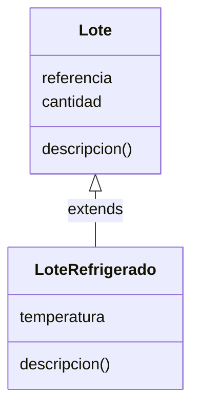

# Lección 10 — Herencia

> Fase 0 · Formulario · Familia de concepto: **reutilizar y extender una clase** · Orden de estudio: **11 de 18**

⬅️ [Lección 09 · Encapsulación](../09-encapsulacion/) · 🏠 [Índice de lecciones](../README.md) · ➡️ [Lección 11 · Polimorfismo](../11-polimorfismo/)

---

## 🧭 Ruta de estudio · Lección 10 (≈ 2 h)

**Antes necesitas:** [Lección 09 · Encapsulación](../09-encapsulacion/).

| Paso | Qué haces | Dónde | ⏱ |
|:-:|---|---|:-:|
| **0** | Lee la teoría, las fórmulas, las propiedades y los errores | este README §0–§8 | 25 min |
| **1** | Ejecuta las fórmulas | [`paso1-formulas.php`](paso1-formulas.php) | 10 min |
| **2** | Sigue los ejemplos resueltos | §9 + [`paso2-ejemplos-resueltos.php`](paso2-ejemplos-resueltos.php) | 20 min |
| **3** | Completa los `// TODO` | [`paso3-tu-turno.php`](paso3-tu-turno.php) | 20 min |
| **🧪** | Pon en **verde** el test | `vendor/bin/phpunit lecciones/10-herencia` | 10 min |
| **4** | Compara con la solución | [`paso4-tu-turno-solucion.php`](paso4-tu-turno-solucion.php) | 5 min |
| **5** | Resuelve los 12 problemas, revisa claves | §10–§11 + [`paso5-solucionario/`](paso5-solucionario/) | 30 min |
| **6** | Compara mala vs buena | [`paso6-ejercicios/`](paso6-ejercicios/) | 10 min |
| **7** | Preguntas de recuerdo **sin mirar** | §15 | 5 min |
| **🚦** | Evalúa si puedes pasar | §16 | 1 min |

---

## 0. 🧭 La pregunta
> *"Tengo `Lote`. Me piden un `LoteRefrigerado` casi igual, pero con temperatura. Copiar toda la
> clase es duplicar código. ¿Cómo reutilizo lo que ya existe y solo agrego lo nuevo?"*

## 1. Objetivos (al terminar podrás…)
1. Crear una clase hija con `extends` que **hereda** todo lo de la madre.
2. Llamar al constructor y a los métodos de la madre con `parent::`.
3. **Sobrescribir** un método (mismo nombre, comportamiento distinto).
4. Distinguir tipos con `instanceof` y usar `protected`.

## 2. Cita de la fuente
> *"class FakeRepository(AbstractRepository):"* — Cap. 2

> *"if not isinstance(other, Batch): return False"* — Cap. 1

**Equivalente en PHP** (§3.10 de la metodología):
```php
class RepositorioFalso extends RepositorioAbstracto { /* ... */ }  // class FakeRepository(AbstractRepository)

if (!($otro instanceof Lote)) { return false; }                   // if not isinstance(other, Batch)
```
**Por qué importa:** el libro **hereda** (`FakeRepository(AbstractRepository)`) para reutilizar un
contrato, y usa `isinstance` para comprobar el tipo. En PHP eso es `extends` e `instanceof`.

## 3. El dolor
```php
// Para un LoteRefrigerado copiamos TODA la clase Lote y le agregamos temperatura:
class LoteRefrigerado {
    public function __construct(public string $referencia, public int $cantidad, public int $temperatura) {}
    public function descripcion(): string { return "Lote {$this->referencia} ({$this->cantidad})"; }
}
```
Duplicar la clase significa mantener la misma lógica en dos sitios: si cambia una, hay que
acordarse de cambiar la otra.

---

## 4. 📘 Teoría

> **🌳 Definición — Herencia**
> `class Hija extends Madre` hace que `Hija` **herede** todas las propiedades y métodos de `Madre`,
> y pueda **agregar** los suyos o **cambiar** (sobrescribir) los heredados.

> **🔑 `parent::`**
> Dentro de la hija, `parent::__construct(...)` llama al constructor de la madre y
> `parent::metodo()` llama a su versión del método (para reutilizarla y añadirle algo).

> **🔤 Vocabulario**
> - **Clase madre / base:** la que se hereda. **Clase hija / derivada:** la que hereda.
> - **Sobrescribir (override):** definir en la hija un método con el **mismo nombre** que la madre.
> - **`protected`:** visible en la clase **y en sus hijas** (a diferencia de `private`).
> - **`instanceof`:** `$obj instanceof Clase` dice si `$obj` es de esa clase (o de una hija).

> **🧠 Regla de oro**
> Hereda cuando la hija **es un** tipo de la madre ("un `LoteRefrigerado` **es un** `Lote`").
> Reutiliza con `parent::` en vez de copiar.

---

## 5. 🧮 Formulario: herencia

| # | Operación | Sintaxis | Qué hace |
|---|---|---|---|
| H1 | Heredar | `class Hija extends Madre {}` | la hija tiene todo lo de la madre |
| H2 | Constructor de la madre | `parent::__construct($a, $b);` | inicializa las propiedades heredadas |
| H3 | Sobrescribir | `public function m(): T { ... }` (mismo nombre) | comportamiento distinto en la hija |
| H4 | Reutilizar el de la madre | `parent::m()` | usa la versión de la madre y añade algo |
| H5 | ¿De qué tipo es? | `$obj instanceof Clase` | `true` si es de esa clase o una hija |
| H6 | Visible en la hija | `protected` | la hija puede usar la propiedad; desde fuera no |

> 💡 Ejecutables en [`paso1-formulas.php`](paso1-formulas.php).

## 6. 🧮 Formulario: cuándo heredar vs. no
| Situación | Decisión |
|---|---|
| La hija **es un** tipo de la madre (Gerente **es un** Empleado) | **hereda** |
| Solo compartes algo de código pero no hay relación "es un" | **no** heredes; compón (usa un objeto dentro) |
| Quieres impedir que una clase se herede | `final class X {}` |
| Quieres impedir que un método se sobrescriba | `final public function m() {}` |

## 7. 📐 Propiedades
| # | Regla |
|---|---|
| P1 | La hija hereda lo `public` y lo `protected` de la madre, **no** lo `private`. |
| P2 | Si la hija define un constructor, **debe** llamar a `parent::__construct(...)` para inicializar lo de la madre. |
| P3 | `instanceof` es `true` para la clase **y todas sus madres** (`$gerente instanceof Empleado` → `true`). |
| P4 | Una `final class` no se puede extender. |

## 8. ⚠️ Errores frecuentes
| # | ❌ Así no | Qué pasa | ✅ Así sí |
|---|---|---|---|
| E1 | Hija con constructor pero sin `parent::__construct` | las propiedades de la madre quedan sin inicializar | llama a `parent::__construct(...)` |
| E2 | `class B extends A` con `final class A` | `Fatal error: Class B cannot extend final class A` | no marques `final` lo que quieras heredar |
| E3 | Acceder a una propiedad `private` de la madre desde la hija | `Error: Cannot access private property` | usa `protected` para lo que la hija deba ver |
| E4 | Copiar la clase entera en vez de heredar | código duplicado | `extends` + `parent::` |

---

## 9. ✍️ Ejemplos resueltos (paso a paso)
> Todos en [`paso2-ejemplos-resueltos.php`](paso2-ejemplos-resueltos.php).

**Ejemplo 1 — Una hija hereda todo** *(fácil)*
```php
class Animal { public function __construct(protected string $nombre) {} public function nombre(): string { return $this->nombre; } }
class Perro extends Animal {}               // hereda nombre() sin escribir nada
echo (new Perro("Fido"))->nombre();         // Fido
```

**Ejemplo 2 — `parent::__construct`** *(fácil)*
```php
class Empleado {
    public function __construct(protected int $salarioBase) {}
    public function salario(): int { return $this->salarioBase; }
}
class Gerente extends Empleado {
    public function __construct(int $salarioBase, private int $bono) {
        parent::__construct($salarioBase);  // inicializa lo de la madre
    }
    public function salario(): int { return parent::salario() + $this->bono; }
}
echo (new Gerente(1000, 500))->salario();   // 1500
```

**Ejemplo 3 — Sobrescribir con `parent::`** *(intermedio)*
```php
class Saludo { public function texto(): string { return "Hola"; } }
class SaludoFormal extends Saludo {
    public function texto(): string { return parent::texto() . ", estimado cliente"; }
}
echo (new SaludoFormal())->texto();         // Hola, estimado cliente
```

**Ejemplo 4 — `instanceof` para distinguir tipos** *(avanzado)*
```php
class Lote { public function __construct(public string $ref) {} }
class LoteRefrigerado extends Lote {}
foreach ([new Lote("l1"), new LoteRefrigerado("l2")] as $lote) {
    echo $lote->ref . ": " . ($lote instanceof LoteRefrigerado ? "refrigerado" : "normal") . "\n";
}
```

---

## 10. 📝 Problemas propuestos
**🟢 Nivel básico**
1. Clase `Vehiculo` con `marca` protegida y getter `marca()`. `Coche extends Vehiculo`. Crea un coche "Toyota" y muestra la marca.
2. Clase `Base` con `saludo()` que devuelve `"hola"`; `Hija` que lo **sobrescribe** por `"HOLA"`. Muéstralo.
3. Comprueba con `instanceof` que una `Hija` **es una** `Base`.
4. Clase `A` con `n()` = 1; `B extends A` con `n()` = `parent::n() + 10`. Muestra `11`.

**🟡 Nivel intermedio**

5. Clase `Producto` (nombre, precio) y `ProductoRebajado` que resta un descuento usando `parent::precio()`. Con 100 y 30, muestra `70`.
6. Comprueba que el `ProductoRebajado` es un `Producto`.
7. Sobrescribe `etiqueta()` en la hija para añadir `" (rebajado)"` usando `parent::etiqueta()`.
8. Muestra la etiqueta de un `Producto` normal (la madre sin tocar).

**🔴 Nivel avanzado**

9. `Lote` (referencia, cantidad) y `LoteRefrigerado` con temperatura. Crea uno y muestra la referencia **heredada**.
10. Muestra la temperatura (propia de la hija).
11. Comprueba que el `LoteRefrigerado` es un `Lote`.
12. *(Puente al libro)* `RepositorioFalso extends RepositorioAbstracto` (como `FakeRepository(AbstractRepository)` del Cap. 2):
    agrega un lote y muestra el total.

## 11. 🔑 Claves (respuestas)
<details><summary>Ver claves (solo después de intentarlo)</summary>

| # | Salida | # | Salida | # | Salida |
|---|---|---|---|---|---|
| 1 | `Toyota` | 5 | `70` | 9 | `lote-002` |
| 2 | `HOLA` | 6 | `true` | 10 | `4` |
| 3 | `true` | 7 | `Mesa: 100 (rebajado)` | 11 | `true` |
| 4 | `11` | 8 | `Silla: 50` | 12 | `1` |

Código completo en [`paso5-solucionario/`](paso5-solucionario/).
</details>

---

## 12. 🗺️ Mapa mental (Mermaid)

**Cómo leerlo:** la flecha `Lote <|-- LoteRefrigerado` significa "`LoteRefrigerado` **hereda de**
`Lote`". La hija tiene todo lo de la madre (`referencia`, `cantidad`) más lo suyo (`temperatura`),
y puede **sobrescribir** `descripcion()` reutilizando `parent::descripcion()`.

## 13. 🌳 Árbol de archivos
```
lecciones/10-herencia/
├── README.md
├── paso1-formulas.php           ← H1–H6
├── paso2-ejemplos-resueltos.php
├── paso3-tu-turno.php           ← // TODO
├── Paso3TuTurnoTest.php         ← 🧪 rojo → verde
├── paso4-tu-turno-solucion.php
├── paso5-solucionario/
└── paso6-ejercicios/
```

## 14. 🤝 Tu turno y ✅ comprobación
Completa `Gerente` en [`paso3-tu-turno.php`](paso3-tu-turno.php) y pon el test en **verde**:
```bash
vendor/bin/phpunit lecciones/10-herencia
```
Empieza en **rojo a propósito**. *(El test indica cómo apuntar el `require` a `paso4-tu-turno-solucion.php`
para ver la referencia en verde.)*

## 15. ❓ Preguntas de recuerdo
<details><summary>1. ¿Qué hace <code>class Hija extends Madre</code>?</summary>

La hija **hereda** todas las propiedades y métodos `public`/`protected` de la madre.
</details>
<details><summary>2. ¿Para qué sirve <code>parent::__construct(...)</code>?</summary>

Para inicializar, desde la hija, las propiedades que define el constructor de la madre.
</details>
<details><summary>3. ¿Qué es sobrescribir un método?</summary>

Definir en la hija un método con el **mismo nombre** que la madre, con otro comportamiento. Puedes reutilizar el de la madre con `parent::metodo()`.
</details>
<details><summary>4. ¿Qué dice <code>$gerente instanceof Empleado</code> si Gerente extiende Empleado?</summary>

`true`: `instanceof` es cierto para la clase y todas sus madres.
</details>
<details><summary>5. ¿La hija ve las propiedades <code>private</code> de la madre?</summary>

No. Solo ve las `public` y `protected`. Para que la hija lo vea, usa `protected`.
</details>
<details><summary>6. ¿Cuándo conviene heredar?</summary>

Cuando la hija **es un** tipo de la madre ("Gerente es un Empleado"). Si no hay esa relación, mejor componer.
</details>

---

## 16. 🚦 ¿Puedo pasar a la siguiente lección?
| Indicador | Criterio |
|:-:|---|
| 🟢 **Sí, sigue** | el test de `paso3` en **verde** **y** ≥ 9/12 problemas **y** las 6 preguntas sin mirar |
| 🟡 **Repasa** | 6–8 problemas → §8 y §9 |
| 🔴 **Repite** | menos de 6 |

Cuando estés en 🟢, marca la lección en [`progreso/fase-0-php.md`](../../progreso/fase-0-php.md) y haz commit.

---

⬅️ [Lección 09 · Encapsulación](../09-encapsulacion/) · 🏠 [Índice de lecciones](../README.md) · ➡️ [Lección 11 · Polimorfismo](../11-polimorfismo/)
