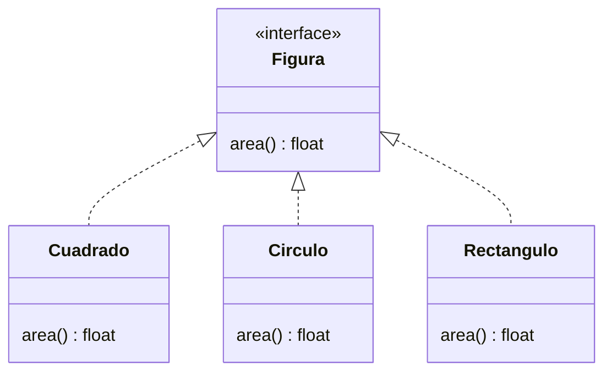

# Lección 11 — Polimorfismo

> Fase 0 · Formulario · Familia de concepto: **misma interfaz, distintos comportamientos** · Orden de estudio: **12 de 18**

⬅️ [Lección 10 · Herencia](../10-herencia/) · 🏠 [Índice de lecciones](../README.md) · ➡️ [Lección 12 · Abstracción](../12-abstraccion/)

---

## 🧭 Ruta de estudio · Lección 11 (≈ 2 h)

**Antes necesitas:** [Lección 10 · Herencia](../10-herencia/).

| Paso | Qué haces | Dónde | ⏱ |
|:-:|---|---|:-:|
| **0** | Lee la teoría, las fórmulas, las propiedades y los errores | este README §0–§8 | 25 min |
| **1** | Ejecuta las fórmulas | [`paso1-formulas.php`](paso1-formulas.php) | 10 min |
| **2** | Sigue los ejemplos resueltos | §9 + [`paso2-ejemplos-resueltos.php`](paso2-ejemplos-resueltos.php) | 20 min |
| **3** | Completa los `// TODO` | [`paso3-tu-turno.php`](paso3-tu-turno.php) | 20 min |
| **🧪** | Pon en **verde** el test | `vendor/bin/phpunit lecciones/11-polimorfismo` | 10 min |
| **4** | Compara con la solución | [`paso4-tu-turno-solucion.php`](paso4-tu-turno-solucion.php) | 5 min |
| **5** | Resuelve los 12 problemas, revisa claves | §10–§11 + [`paso5-solucionario/`](paso5-solucionario/) | 30 min |
| **6** | Compara mala vs buena | [`paso6-ejercicios/`](paso6-ejercicios/) | 10 min |
| **7** | Preguntas de recuerdo **sin mirar** | §15 | 5 min |
| **🚦** | Evalúa si puedes pasar | §16 | 1 min |

---

## 0. 🧭 La pregunta
> *"Tengo figuras distintas (cuadrado, círculo…). Me piden mostrar el área de **todas** con un
> mismo código, **sin** un `if` por cada tipo. Y mañana llegará el rectángulo. ¿Cómo las trato de
> forma uniforme?"*

## 1. Objetivos (al terminar podrás…)
1. Definir un **contrato** con `interface`.
2. Que varias clases lo cumplan con `implements`.
3. Tratar objetos distintos de forma **uniforme** por su interfaz.
4. Recorrer una lista llamando al **mismo método** sin un `if` por tipo.

## 2. Cita de la fuente
> *"In practice we often just rely on Python's duck typing to enable abstractions. To a Pythonista,
> a repository is any object that has add(thing) and get(id) methods."* — Cap. 2

> *"In Python you can (and we sometimes do) use ABCs, but you can also happily rely on duck typing."* — Introducción

**Equivalente en PHP** (§3.10 de la metodología):
```php
interface RepositorioDeLotes {           // en PHP el "contrato" es EXPLÍCITO (interface)
    public function agregar(Lote $lote): void;
    public function obtener(string $ref): Lote;
}
class RepositorioFalso implements RepositorioDeLotes { /* ... */ }  // "implements" lo cumple
```
**Por qué importa:** en Python, por *duck typing*, "un repositorio es cualquier objeto con
`add()` y `get()`" — **nadie te avisa** si falta un método hasta que falla. PHP **no** tiene duck
typing estructural: el contrato se escribe con `interface` y PHP **obliga** a cumplirlo con
`implements`. Eso es más seguro (lo veremos a fondo en la Lección 12).

## 3. El dolor
```php
function area(string $tipo, float $x): float {
    if ($tipo === "cuadrado") { return $x * $x; }
    if ($tipo === "circulo") { return 3.14 * $x * $x; }
    return 0.0; // ¿y el rectángulo de mañana? hay que volver a tocar esta función
}
```
Un `if` por tipo crece sin parar y hay que modificarlo cada vez que llega una figura nueva.

---

## 4. 📘 Teoría

> **📜 Definición — Interface (contrato)**
> Una `interface` dice **qué** métodos debe tener algo, sin decir **cómo**.
> `interface Figura { public function area(): float; }`

> **✅ `implements`**
> `class Cuadrado implements Figura` promete tener todos los métodos de `Figura`. Si falta alguno,
> PHP da un **Fatal error** (no te deja ejecutar).

> **🦆 Polimorfismo**
> "Muchas formas": distintos objetos responden al **mismo** método (`area()`) de su propia manera.
> El código que los usa habla con la **interfaz**, no con la clase concreta.

> **🔤 Vocabulario**
> - **Contrato:** la lista de métodos que una interfaz exige.
> - **Tipar por la interfaz:** declarar un parámetro como `Figura` (acepta cualquier clase que la implemente).
> - **Duck typing:** "si camina como pato y hace cuac, es un pato" — Python lo usa; PHP prefiere interfaces.

> **🧠 Regla de oro**
> Cuando varias clases hacen "lo mismo" de forma distinta, dales una **interfaz común** y trátalas
> por ella. Así agregar una clase nueva **no** toca el código que ya existe.

---

## 5. 🧮 Formulario: interfaces y polimorfismo

| # | Operación | Sintaxis | Qué hace |
|---|---|---|---|
| PO1 | Definir contrato | `interface Figura { public function area(): float; }` | exige un método, sin implementarlo |
| PO2 | Cumplir contrato | `class Cuadrado implements Figura { public function area(): float { ... } }` | la clase promete tener `area()` |
| PO3 | Tipar por la interfaz | `function describir(Figura $f): string` | acepta **cualquier** clase que implemente `Figura` |
| PO4 | Array de la interfaz | `$figuras = [new Cuadrado(1), new Circulo(1)];` | distintas clases, mismo contrato |
| PO5 | Recorrer llamando el mismo método | `foreach ($figuras as $f) { $f->area(); }` | sin un `if` por tipo |
| PO6 | Función uniforme | `function areaTotal(array $figuras): float { ... }` | el mismo código sirve para figuras futuras |

> 💡 Ejecutables en [`paso1-formulas.php`](paso1-formulas.php).

## 6. 🧮 Formulario: cuándo usar una interfaz
| Situación | Decisión |
|---|---|
| Varias clases hacen "lo mismo" de forma distinta | dales una **interfaz común** |
| Tienes un `if ($tipo === ...)` que crece con cada tipo nuevo | cámbialo por polimorfismo |
| Quieres poder cambiar la implementación (memoria → BD) sin tocar quien la usa | tipa por la **interfaz** (Lección 17, DIP) |

## 7. 📐 Propiedades
| # | Regla |
|---|---|
| P1 | Una clase puede implementar **varias** interfaces: `implements A, B`. |
| P2 | Si una clase dice `implements Figura` pero le falta `area()`, PHP da `Fatal error` al cargarla. |
| P3 | `instanceof` también funciona con interfaces: `$cuadrado instanceof Figura` → `true`. |
| P4 | A diferencia de Python, PHP **no** acepta un objeto "parecido": tiene que declarar `implements` (no hay *duck typing* estructural). |
| P5 | Quien **usa** el contrato (`areaTotal`) **no cambia** cuando aparece un tipo nuevo: solo se **agrega** una clase. |
| P6 | Cada clase guarda **su propia** fórmula: el conocimiento vive **dentro** de la clase, no en un `if` lejano. |
| P7 | El polimorfismo funciona **con** herencia (`extends` + sobrescribir, Lección 10) y **sin** herencia (clases distintas que implementan la misma interface). |
| P8 | PHP también es polimórfico, pero con matices: `+` **suma** números y `.` **concatena** textos (a diferencia de Python/JS, donde `+` hace ambas); `count()` sirve para **arrays** y para objetos **`Countable`**. |

## 8. ⚠️ Errores frecuentes
| # | ❌ Así no | Qué pasa (mensaje real de PHP 8.3) | ✅ Así sí |
|---|---|---|---|
| E1 | Pasar algo que no implementa `Figura` a una función que pide `Figura`: `area("hola")` | `TypeError: area(): Argument #1 ($f) must be of type Figura, string given` | pasa una clase que haga `implements Figura` |
| E2 | `class X implements Figura {}` sin `area()` | `Fatal error: Class X contains 1 abstract method and must therefore be declared abstract or implement the remaining methods (Figura::area)` | implementa todos los métodos del contrato |
| E3 | Clase `Q` con `area()` pero **sin** `implements Figura`, pasada a una función que pide `Figura` | `TypeError: f(): Argument #1 ($f) must be of type Figura, Q given` (tener el método no basta: PHP exige `implements`) | declara `class Q implements Figura` |
| E4 | Implementar con **otra firma**: `public function area(): string` en vez de `: float` | `Fatal error: Declaration of C::area(): string must be compatible with Figura::area(): float` | respeta la **firma** del contrato: `area(): float` |
| E5 | Llamar a un método con el **nombre mal escrito**: `$c->areaa()` | `Error: Call to undefined method C::areaa()` | usa el nombre exacto: `$c->area()` |
| E6 | Instanciar la interface: `new Figura()` | `Error: Cannot instantiate interface Figura` | instancia una clase que la implemente: `new Cuadrado(2)` |
| E7 | Un `if ($tipo === ...)` por cada clase | crece y hay que tocarlo con cada tipo nuevo (y un tipo olvidado suma mal en silencio) | polimorfismo: cada clase sabe lo suyo |

---

## 9. ✍️ Ejemplos resueltos (paso a paso)
> Todos en [`paso2-ejemplos-resueltos.php`](paso2-ejemplos-resueltos.php).

**Ejemplo 1 — Dos clases, el mismo contrato** *(fácil)*
```php
interface Animal { public function sonido(): string; }
class Perro implements Animal { public function sonido(): string { return "guau"; } }
class Gato implements Animal { public function sonido(): string { return "miau"; } }
echo (new Perro())->sonido() . " / " . (new Gato())->sonido();   // guau / miau
```

**Ejemplo 2 — Una función acepta cualquier Animal** *(fácil)*
```php
function hacerSonar(Animal $a): string { return "hace " . $a->sonido(); }  // no le importa cuál
echo hacerSonar(new Perro());                                             // hace guau
```

**Ejemplo 3 — Recorrer sin un `if` por tipo** *(intermedio)*
```php
foreach ([new Perro(), new Gato(), new Perro()] as $animal) {
    echo $animal->sonido() . "\n";      // el mismo método para todos
}
```

**Ejemplo 4 — Polimorfismo con repositorios, como en el libro** *(avanzado)*
```php
interface Repositorio { public function agregar(string $x): void; public function total(): int; }
class RepoMemoria implements Repositorio {
    private array $items = [];
    public function agregar(string $x): void { $this->items[] = $x; }
    public function total(): int { return count($this->items); }
}
function guardarDos(Repositorio $repo): int { $repo->agregar("a"); $repo->agregar("b"); return $repo->total(); }
echo guardarDos(new RepoMemoria());     // 2 (y mañana un RepoBaseDeDatos sin tocar guardarDos)
```

---

## 10. 📝 Problemas propuestos
**🟢 Nivel básico**
1. `interface Animal { public function sonido(): string; }` con `Perro` (`"Guau"`) y `Gato` (`"Miau"`), **sin herencia entre ellas**. Ponlos en un array y recórrelo imprimiendo cada sonido con un `foreach`.
2. Agrega `Vaca` (`"Muu"`) que implemente `Animal`, agrégala al **mismo** array y repite el `foreach` **sin cambiarlo**.
3. Comprueba con `instanceof` que un `Perro` **es un** `Animal` (y que un `Gato` también).
4. El lenguaje también es polimórfico: muestra `10 + 5`, `"ab" . "cd"`, `count([1, 2, 3])` y `strlen("mesa")`. (OJO: en PHP `+` suma y `.` concatena.)

**🟡 Nivel intermedio**

5. Escribe `hacerSonar(array $animales): array` que devuelva un array con el sonido de cada animal. Pruébala con `Perro`, `Gato` y `Vaca`.
6. `interface MedioPago { public function pagar(int $monto): string; }` con `Efectivo`, `Tarjeta` (agrega 3 % de comisión) y `Transferencia`, cada una con su mensaje. Recórrelas pagando `100`.
7. `interface Describible { public function describir(): string; }` con `Libro` (`"Libro: …"`) y `Pelicula` (`"Película: …"`), **sin parentesco entre sí**. Escribe `describirTodo(array $items)` que imprima cada descripción. Pruébala con `"Rayuela"` y `"Up"`.
8. Recorre un array **mixto** `[new Libro("Rayuela"), 42, new Pelicula("Up")]`: si el elemento es `instanceof Describible`, llama `describir()`; si no, imprime `"<valor> no sabe describirse"`.

**🔴 Nivel avanzado**

9. Polimorfismo **con herencia**: `Empleado(sueldo)->pago()` devuelve el sueldo; `Freelance(horas, tarifa)` es **hija** y paga `horas × tarifa`. Suma el `pago()` de `[Empleado(2000), Freelance(10, 50)]`.
10. `interface Notificador { public function enviar(string $m): string; }` con `Email`, `Sms` y `Chat`. Escribe `notificarATodos(array $canales, string $m): array` e imprime el resultado con `"hola"`.
11. Escribe `totalConIfs(array $figuras)` (con `instanceof Cuadrado` / `instanceof Circulo`) y `totalPolimorfico(array $figuras)` (con `area()`). Pruébalas con `[Cuadrado(2), Rectangulo(2, 3)]` **sin** agregar el rectángulo a los `if`. ¿Qué da cada una?
12. *(Puente al libro)* `interface Repositorio` con `agregar(string $ref)` y `obtener(string $ref)`, y **dos** clases sin parentesco: `RepositorioEnMemoria` y `RepositorioQueRegistra` (que además anota cada referencia en un array `registro`). Escribe `guardarTodos(Repositorio $repo, array $refs)`, úsala con las dos para `["L1", "L2"]`, e imprime `obtener("L2")` de cada una y el registro.

## 11. 🔑 Claves (respuestas)
<details><summary>Ver claves (solo después de intentarlo)</summary>

| # | Salida esperada | Fórmula clave |
|---|---|---|
| 1 | `Guau` / `Miau` | PO4 + PO5 |
| 2 | `Guau` / `Miau` / `Muu` (el `foreach` no cambió) | P5 |
| 3 | `true` / `true` | PO3 + P3 |
| 4 | `15 abcd 3 4` | P8 |
| 5 | `Guau, Miau, Muu` | PO6 |
| 6 | `Pagaste 100 en efectivo` / `… con tarjeta (comisión 3)` / `… por transferencia` | PO5 |
| 7 | `Libro: Rayuela` / `Película: Up` | P7 (sin parentesco) |
| 8 | `Libro: Rayuela` / `42 no sabe describirse` / `Película: Up` | E3 (PHP pregunta con `instanceof`) |
| 9 | `2500` (2000 + 10 × 50) | P7 (con herencia) |
| 10 | `Email: hola / SMS: hola / Chat: hola` | PO6 |
| 11 | con ifs = `4` (¡el rectángulo no se sumó!) · polimórfico = `10` | E7 + P6 |
| 12 | `L2 L2 [L1, L2]` | PO3 + P4 |

Código completo en [`paso5-solucionario/`](paso5-solucionario/):
[`nivel-basico.php`](paso5-solucionario/nivel-basico.php) ·
[`nivel-intermedio.php`](paso5-solucionario/nivel-intermedio.php) ·
[`nivel-avanzado.php`](paso5-solucionario/nivel-avanzado.php).
</details>

---

## 12. 🗺️ Mapa mental (Mermaid)

**Cómo leerlo:** la flecha punteada `Figura <|.. Cuadrado` significa "`Cuadrado` **implementa**
`Figura`". Todas prometen `area()`; el código que las usa habla con `Figura`, así que agregar
`Rectangulo` no obliga a tocar nada.

## 13. 🌳 Árbol de archivos
```
lecciones/11-polimorfismo/
├── README.md
├── paso1-formulas.php           ← PO1–PO6
├── paso2-ejemplos-resueltos.php
├── paso3-tu-turno.php           ← // TODO
├── Paso3TuTurnoTest.php         ← 🧪 rojo → verde
├── paso4-tu-turno-solucion.php
├── paso5-solucionario/
└── paso6-ejercicios/
```

## 14. 🤝 Tu turno y ✅ comprobación
Implementa `Rectangulo`, `Triangulo` y `areaTotal()` en [`paso3-tu-turno.php`](paso3-tu-turno.php) y
pon el test en **verde**:
```bash
vendor/bin/phpunit lecciones/11-polimorfismo
```
Empieza en **rojo a propósito**. *(El test indica cómo apuntar el `require` a `paso4-tu-turno-solucion.php`.)*

## 15. ❓ Preguntas de recuerdo
<details><summary>1. ¿Qué es una <code>interface</code>?</summary>

Un **contrato**: dice qué métodos debe tener algo, sin implementarlos.
</details>
<details><summary>2. ¿Qué hace <code>implements Figura</code>?</summary>

Obliga a la clase a tener todos los métodos de `Figura`; si falta alguno, PHP da un `Fatal error`.
</details>
<details><summary>3. ¿Qué es el polimorfismo?</summary>

Que distintos objetos respondan al **mismo** método a su manera, y poder tratarlos de forma uniforme por su interfaz.
</details>
<details><summary>4. ¿Por qué es mejor que un <code>if</code> por tipo?</summary>

Porque agregar una clase nueva **no** obliga a tocar el código que ya existe (basta con que implemente la interfaz).
</details>
<details><summary>5. ¿En qué se diferencia PHP de Python aquí?</summary>

Python usa *duck typing* (acepta cualquier objeto "parecido"); PHP exige `implements` explícito, así PHP te avisa si falta un método.
</details>
<details><summary>6. ¿Una clase puede implementar varias interfaces?</summary>

Sí: `class X implements A, B { ... }`.
</details>

---

## 16. 🚦 ¿Puedo pasar a la siguiente lección?
| Indicador | Criterio |
|:-:|---|
| 🟢 **Sí, sigue** | el test de `paso3` en **verde** **y** ≥ 9/12 problemas **y** las 6 preguntas sin mirar |
| 🟡 **Repasa** | 6–8 problemas → §8 y §9 |
| 🔴 **Repite** | menos de 6 |

Cuando estés en 🟢, marca la lección en [`progreso/fase-0-php.md`](../../progreso/fase-0-php.md) y haz commit.

---

⬅️ [Lección 10 · Herencia](../10-herencia/) · 🏠 [Índice de lecciones](../README.md) · ➡️ [Lección 12 · Abstracción](../12-abstraccion/)
