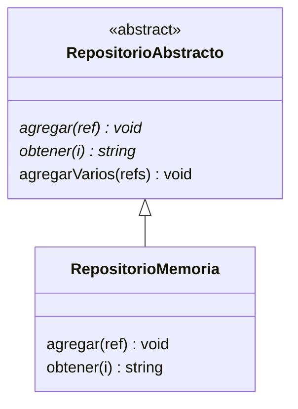

# Lección 12 — Abstracción

> Fase 0 · Formulario · Familia de concepto: **contratos que el lenguaje hace cumplir** · Orden de estudio: **13 de 18**

⬅️ [Lección 11 · Polimorfismo](../11-polimorfismo/) · 🏠 [Índice de lecciones](../README.md) · ➡️ [Lección 13 · SRP](../13-srp/)

---

## 🧭 Ruta de estudio · Lección 12 (≈ 2 h)

**Antes necesitas:** [Lección 11 · Polimorfismo](../11-polimorfismo/).

| Paso | Qué haces | Dónde | ⏱ |
|:-:|---|---|:-:|
| **0** | Lee la teoría, las fórmulas, las propiedades y los errores | este README §0–§8 | 25 min |
| **1** | Ejecuta las fórmulas | [`paso1-formulas.php`](paso1-formulas.php) | 10 min |
| **2** | Sigue los ejemplos resueltos | §9 + [`paso2-ejemplos-resueltos.php`](paso2-ejemplos-resueltos.php) | 20 min |
| **3** | Completa los `// TODO` | [`paso3-tu-turno.php`](paso3-tu-turno.php) | 20 min |
| **🧪** | Pon en **verde** el test | `vendor/bin/phpunit lecciones/12-abstraccion` | 10 min |
| **4** | Compara con la solución | [`paso4-tu-turno-solucion.php`](paso4-tu-turno-solucion.php) | 5 min |
| **5** | Resuelve los 12 problemas, revisa claves | §10–§11 + [`paso5-solucionario/`](paso5-solucionario/) | 30 min |
| **6** | Compara mala vs buena | [`paso6-ejercicios/`](paso6-ejercicios/) | 10 min |
| **7** | Preguntas de recuerdo **sin mirar** | §15 | 5 min |
| **🚦** | Evalúa si puedes pasar | §16 | 1 min |

---

## 0. 🧭 La pregunta
> *"Hoy guardo los lotes en memoria y mañana en una base de datos. Me piden que quien los use
> **no** tenga que reescribirse. Si uso una clase base con métodos **vacíos**, una versión puede
> 'olvidar' implementar uno y nadie avisa. ¿Cómo escribo un **contrato** que el lenguaje **obligue**
> a cumplir?"*

## 1. Objetivos (al terminar podrás…)
1. Definir una `abstract class` con métodos `abstract` (huecos obligatorios).
2. Entender por qué una clase abstracta **no se puede instanciar**.
3. Implementar una clase **concreta** que extienda la abstracta.
4. Elegir entre `abstract class` (con código compartido) e `interface` (contrato puro).

## 2. Cita de la fuente
> *"class AbstractRepository(abc.ABC):"* · *"@abc.abstractmethod def add(self, batch: model.Batch):
> raise NotImplementedError"* — Cap. 2

> *"Python will refuse to let you instantiate a class that does not implement all the abstractmethods
> defined in its parent class."* — Cap. 2

**Equivalente en PHP** (§3.10 de la metodología):
```php
abstract class RepositorioAbstracto {          // class AbstractRepository(abc.ABC)
    abstract public function agregar(Lote $lote): void;   // @abc.abstractmethod def add(...)
    abstract public function obtener(string $ref): Lote;
}
```
**Por qué importa:** el libro escribe el **contrato** del repositorio con `abc.ABC` y
`@abc.abstractmethod`. En PHP es una `abstract class` con métodos `abstract`. PHP, igual que
Python, **se niega** a instanciar una clase que no implemente todos los métodos abstractos: así el
contrato se hace cumplir solo.

## 3. El dolor
```php
// En la Lección 11 una interface obligaba a implementar sus métodos; pero si una clase base tiene
// métodos VACÍOS (no abstractos), la hija puede "olvidar" sobrescribirlos y nadie avisa:
class RepositorioBase {
    public function agregar(string $ref): void {}       // vacío
    public function obtener(int $i): string { return ""; }
}
class RepoMemoria extends RepositorioBase {}            // ¡no implementó nada!
echo (new RepoMemoria())->obtener(0);                   // '' (silenciosamente mal)
```
Necesitamos que el lenguaje **obligue** a implementar el contrato.

---

## 4. 📘 Teoría

> **🏗️ Definición — Clase abstracta**
> Una `abstract class` es un **molde incompleto**: define parte del comportamiento y deja **huecos
> obligatorios** (`abstract public function ...;`, sin cuerpo). No se puede instanciar directamente.

> **📜 Definición — Interface**
> Una `interface` es un **contrato puro**: solo nombres de métodos, sin nada de código.

> **🧩 Abstracta vs. interface**
> - `abstract class`: puede traer **código compartido** + huecos. Una clase extiende **una sola**.
> - `interface`: **solo** el contrato. Una clase puede implementar **varias**.

> **🔤 Vocabulario**
> - **Método abstracto:** declarado sin cuerpo; la hija concreta **debe** implementarlo.
> - **Clase concreta:** la que implementa todos los huecos y **sí** se puede instanciar.
> - **Contrato:** lo que una abstracta o interface exige.

> **🧠 Regla de oro**
> Usa una **interface** para un contrato puro (lo más común para el Repository del libro). Usa una
> **abstract class** cuando además quieras **compartir código** entre las implementaciones.

---

## 5. 🧮 Formulario: abstracción

| # | Operación | Sintaxis | Qué hace |
|---|---|---|---|
| A1 | Clase abstracta | `abstract class Repo { }` | molde incompleto; no se instancia |
| A2 | Método abstracto | `abstract public function agregar(string $r): void;` | hueco obligatorio (sin cuerpo) |
| A3 | Instanciar una abstracta | `new Repo()` | `Error: Cannot instantiate abstract class Repo` |
| A4 | Clase concreta | `class RepoMemoria extends Repo { public function agregar(...) {...} }` | implementa los huecos; sí se instancia |
| A5 | Interface | `interface Notificador { public function enviar(string $m): void; }` | contrato puro |
| A6 | Implementar interface | `class Email implements Notificador { ... }` | cumple el contrato |
| A7 | Código compartido en la abstracta | método normal que usa los abstractos | se hereda por todas las hijas |

> 💡 Ejecutables en [`paso1-formulas.php`](paso1-formulas.php).

## 6. 🧮 Formulario: ¿abstract class o interface?
| Necesitas… | Usa |
|---|---|
| Solo un contrato (nombres de métodos) | `interface` |
| Un contrato **y** código compartido entre implementaciones | `abstract class` |
| Que una clase cumpla **varios** contratos | `interface` (varias con `implements A, B`) |
| Impedir que se cree el "molde" directamente | `abstract class` (o `interface`, que tampoco se instancia) |

## 7. 📐 Propiedades
| # | Regla |
|---|---|
| P1 | Una clase con **algún** método abstracto debe declararse `abstract` (o PHP da Fatal error). |
| P2 | Una abstracta **no** se instancia; sí sus hijas concretas. |
| P3 | Una abstracta puede mezclar métodos abstractos (huecos) y métodos normales (código compartido). |
| P4 | `instanceof` funciona con la abstracta: `$repoMemoria instanceof RepositorioAbstracto` → `true`. |

## 8. ⚠️ Errores frecuentes
| # | ❌ Así no | Qué pasa | ✅ Así sí |
|---|---|---|---|
| E1 | `new RepositorioAbstracto()` | `Error: Cannot instantiate abstract class RepositorioAbstracto` | instancia una clase **concreta** que la extienda |
| E2 | `class X extends Repo {}` sin implementar `agregar` | `Fatal error: Class X contains 1 abstract method and must … implement the remaining methods` | implementa todos los métodos abstractos |
| E3 | Clase base con métodos **vacíos** en vez de abstractos | la hija puede olvidarlos y nadie avisa | usa `abstract` para que PHP obligue |

---

## 9. ✍️ Ejemplos resueltos (paso a paso)
> Todos en [`paso2-ejemplos-resueltos.php`](paso2-ejemplos-resueltos.php).

**Ejemplo 1 — Una abstracta obliga a implementar** *(fácil)*
```php
abstract class Forma { abstract public function area(): float; }  // hueco obligatorio
class Cuadrado extends Forma {
    public function __construct(private float $lado) {}
    public function area(): float { return $this->lado * $this->lado; }
}
echo (new Cuadrado(4))->area();   // 16
```

**Ejemplo 2 — La abstracta trae código compartido** *(fácil)*
```php
abstract class Figura {
    abstract public function area(): float;
    public function describir(): string { return "área = " . $this->area(); } // ya hecho
}
class Circulo extends Figura {
    public function __construct(private float $r) {}
    public function area(): float { return 3.14 * $this->r * $this->r; }
}
echo (new Circulo(2))->describir();   // área = 12.56
```

**Ejemplo 3 — Interface = contrato puro** *(intermedio)*
```php
interface Notificador { public function enviar(string $m): void; }
class Email implements Notificador { public function enviar(string $m): void { echo "EMAIL: $m\n"; } }
(new Email())->enviar("hola");        // EMAIL: hola
```

**Ejemplo 4 — `AbstractRepository` como en el libro** *(avanzado)*
```php
abstract class RepositorioAbstracto {
    abstract public function agregar(string $ref): void;   // como @abc.abstractmethod def add(...)
    abstract public function obtener(int $i): string;
}
class RepositorioFalso extends RepositorioAbstracto {
    private array $lotes = [];
    public function agregar(string $ref): void { $this->lotes[] = $ref; }
    public function obtener(int $i): string { return $this->lotes[$i]; }
}
$repo = new RepositorioFalso(); $repo->agregar("lote-001"); echo $repo->obtener(0);  // lote-001
```

---

## 10. 📝 Problemas propuestos
**🟢 Nivel básico**
1. `abstract class Forma` con `area()` abstracto; `Cuadrado` que lo implemente. Área de `Cuadrado(4)`.
2. `interface Saludo` con `texto()`; `Es` que devuelva `"hola"`. Muéstralo.
3. Comprueba que un `Cuadrado` **es una** `Forma` con `instanceof`.
4. Comprueba que un `Es` **es un** `Saludo`.

**🟡 Nivel intermedio**

5. `abstract class Figura` con `area()` abstracto y `describir()` compartido; `Rectangulo`. Área de `Rectangulo(2,3)`.
6. Agrega `Triangulo` (área = base·altura/2). Área de `Triangulo(4,3)`.
7. Usa `describir()` (heredado) en un `Rectangulo(2,3)`.
8. Suma las áreas de `[Rectangulo(2,3), Triangulo(4,3)]`.

**🔴 Nivel avanzado**

9. `abstract class RepositorioAbstracto` con `agregar`/`obtener`; `RepositorioFalso` que lo implemente. Agrega `"lote-001"` y obténlo.
10. Agrega un método compartido `agregarVarios(array)` a la abstracta; úsalo y muestra el total.
11. Comprueba que el `RepositorioFalso` **es un** `RepositorioAbstracto`.
12. *(Puente al libro)* Una función `guardar(RepositorioAbstracto $r, string $ref)` que no sabe si el
    repo es falso o real (solo que cumple el contrato). Pásale un `RepositorioFalso`.

## 11. 🔑 Claves (respuestas)
<details><summary>Ver claves (solo después de intentarlo)</summary>

| # | Salida | # | Salida | # | Salida |
|---|---|---|---|---|---|
| 1 | `16` | 5 | `6` | 9 | `lote-001` |
| 2 | `hola` | 6 | `6` | 10 | `3` |
| 3 | `true` | 7 | `área = 6` | 11 | `true` |
| 4 | `true` | 8 | `12` | 12 | `1` |

Código completo en [`paso5-solucionario/`](paso5-solucionario/).
</details>

---

## 12. 🗺️ Mapa mental (Mermaid)

**Cómo leerlo:** la abstracta `RepositorioAbstracto` define **huecos** (`agregar`, `obtener`, con `*`
de abstracto) y un método ya hecho (`agregarVarios`). `RepositorioMemoria` **extiende** la abstracta
e implementa los huecos. No se puede crear un `RepositorioAbstracto` suelto: es un molde.

## 13. 🌳 Árbol de archivos
```
lecciones/12-abstraccion/
├── README.md
├── paso1-formulas.php           ← A1–A7
├── paso2-ejemplos-resueltos.php
├── paso3-tu-turno.php           ← // TODO
├── Paso3TuTurnoTest.php         ← 🧪 rojo → verde
├── paso4-tu-turno-solucion.php
├── paso5-solucionario/
└── paso6-ejercicios/
```

## 14. 🤝 Tu turno y ✅ comprobación
Implementa `RepositorioMemoria` en [`paso3-tu-turno.php`](paso3-tu-turno.php) y pon el test en **verde**:
```bash
vendor/bin/phpunit lecciones/12-abstraccion
```
Empieza en **rojo a propósito**. *(El test indica cómo apuntar el `require` a `paso4-tu-turno-solucion.php`.)*

## 15. ❓ Preguntas de recuerdo
<details><summary>1. ¿Qué es una clase abstracta?</summary>

Un molde incompleto: define parte del comportamiento y deja **huecos obligatorios** (`abstract`). No se puede instanciar.
</details>
<details><summary>2. ¿Qué pasa si intentas instanciar una abstracta?</summary>

`Error: Cannot instantiate abstract class`.
</details>
<details><summary>3. ¿Qué pasa si una hija no implementa un método abstracto?</summary>

PHP da `Fatal error`: la clase debe implementar los métodos restantes (o declararse abstracta).
</details>
<details><summary>4. ¿Cuándo usas <code>abstract class</code> y cuándo <code>interface</code>?</summary>

`interface` para un contrato puro; `abstract class` cuando además quieres compartir código entre las implementaciones.
</details>
<details><summary>5. ¿Cómo escribe el libro el contrato del repositorio?</summary>

Con `class AbstractRepository(abc.ABC)` y `@abc.abstractmethod`. En PHP es una `abstract class` con métodos `abstract`.
</details>
<details><summary>6. ¿Una clase puede implementar varias interfaces y extender varias abstractas?</summary>

Puede implementar **varias** interfaces (`implements A, B`), pero extender **una sola** clase (abstracta o no).
</details>

---

## 16. 🚦 ¿Puedo pasar a la siguiente lección?
| Indicador | Criterio |
|:-:|---|
| 🟢 **Sí, sigue** | el test de `paso3` en **verde** **y** ≥ 9/12 problemas **y** las 6 preguntas sin mirar |
| 🟡 **Repasa** | 6–8 problemas → §8 y §9 |
| 🔴 **Repite** | menos de 6 |

Cuando estés en 🟢, marca la lección en [`progreso/fase-0-php.md`](../../progreso/fase-0-php.md) y haz commit.

---

⬅️ [Lección 11 · Polimorfismo](../11-polimorfismo/) · 🏠 [Índice de lecciones](../README.md) · ➡️ [Lección 13 · SRP](../13-srp/)
