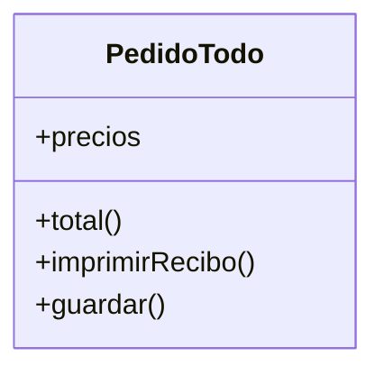
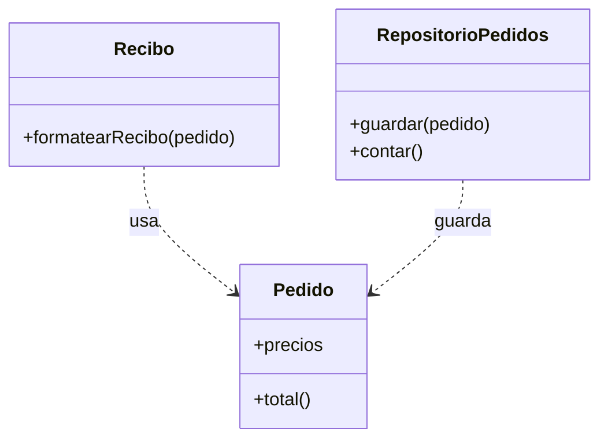

# Lección 13 — SRP (Single Responsibility Principle)

> Fase 0 · Formulario · SOLID · Familia de concepto: **una sola razón para cambiar** · Orden de estudio: **14 de 18**

⬅️ [Lección 12 · Abstracción](../12-abstraccion/) · 🏠 [Índice de lecciones](../README.md) · ➡️ [Lección 14 · OCP](../14-ocp/)

---

## 🧭 Ruta de estudio · Lección 13 (≈ 1.5 h)

**Antes necesitas:** [Lección 06 · Clases y objetos](../06-clases-y-objetos/) y [Lección 08 · Módulos y PHPUnit](../08-modulos-y-phpunit/).

| Paso | Qué haces | Dónde | ⏱ |
|:-:|---|---|:-:|
| **0** | Lee la teoría, las recetas, el diagnóstico y los errores | este README §0–§8 | 20 min |
| **1** | Ejecuta las recetas y mira el "antes → después" | [`paso1-formulas.php`](paso1-formulas.php) | 10 min |
| **2** | Sigue los ejemplos resueltos (violación → refactor) | §9 + [`paso2-ejemplos-resueltos.php`](paso2-ejemplos-resueltos.php) | 15 min |
| **3** | Corre los tests (salen en **rojo**) y completa los `// TODO` hasta verlos en **verde** | [`paso3-tu-turno.php`](paso3-tu-turno.php) + [`Paso3TuTurnoTest.php`](Paso3TuTurnoTest.php) | 20 min |
| **4** | Compara con la solución de referencia | [`paso4-tu-turno-solucion.php`](paso4-tu-turno-solucion.php) | 5 min |
| **5** | Resuelve los 12 problemas, luego revisa claves y solucionario | §10–§11 + [`paso5-solucionario/`](paso5-solucionario/) | 20 min |
| **6** | Compara solución mala vs buena | [`paso6-ejercicios/`](paso6-ejercicios/) | 10 min |
| **7** | Responde las preguntas de recuerdo **sin mirar** | §15 | 5 min |
| **🚦** | Evalúa si puedes pasar a la siguiente | §16 | 1 min |

---

## 0. 🧭 La pregunta
> *"Mi clase hace de todo (calcular, mostrar, guardar). Cada cambio toca la misma clase y rompe
> lo demás. ¿Cómo la ordeno?"*

## 1. Objetivos (al terminar podrás…)
1. Explicar el SRP con la frase **"una sola razón para cambiar"**.
2. Detectar una violación con la **regla del "y"** y el diagnóstico (§6).
3. Separar **regla de negocio**, **presentación** y **persistencia** en piezas distintas.
4. Escribir una función que **orquesta** piezas pequeñas (la idea del *service layer* del libro).

## 2. Cita de la fuente
> *"SOLID is an acronym for Robert C. Martin's five principles of object-oriented design:
> single responsibility, open for extension but closed for modification, Liskov substitution,
> interface segregation, and dependency inversion."* — Introducción (nota 2)

> *"Rule of thumb: if you can't describe what your function does without using words like "then"
> or "and," you might be violating the SRP."* — Cap. 8

> *"One formulation of the SRP is that each class should have only a single reason to change.
> When we switch from email to SMS, we shouldn't have to update our allocate() function,
> because that's clearly a separate responsibility."* — Cap. 8

**Equivalente en PHP** (§3.10): una clase por motivo de cambio; una función que **orquesta**.
```php
final class Pedido { public function total(): int { return array_sum($this->precios); } } // regla
function formatearRecibo(Pedido $p): string { return "Total: " . $p->total(); }            // presentación
final class RepositorioPedidos { public function guardar(Pedido $p): void { /* ... */ } }  // persistencia
```
**Por qué importa:** el SRP es la **S** de SOLID y el argumento central del cap. 8: la regla de
**asignar** stock no debe **también** mandar emails. De ahí nacen los eventos y el *message bus*.

## 3. El dolor
```php
final class Pedido {
    public function total(): int { /* cambia si cambia la REGLA del negocio */ }
    public function imprimirRecibo(): void { /* cambia si cambia el FORMATO */ }
    public function guardar(): void { /* cambia si cambia la BASE DE DATOS */ }
}
```
Tres motivos distintos tocan **la misma clase**. Si piden otro formato de recibo, editas `Pedido`…
y puedes romper el cálculo del total, que no tenía nada que ver.

---

## 4. 📘 Teoría

> **🎯 Definición — SRP**
> Cada clase (o función) debe tener **una sola responsabilidad**: **una sola razón para cambiar**
> (un motivo o un área que pediría modificarla: negocio, diseño, base de datos, notificaciones…).

> **🧩 Las tres responsabilidades más comunes**
> | Responsabilidad | ¿Qué responde? | Ejemplo |
> |---|---|---|
> | **Regla de negocio** | ¿qué se calcula/decide? | `Pedido->total()` |
> | **Presentación** | ¿cómo se muestra? | `formatearRecibo($pedido)` |
> | **Persistencia** | ¿dónde se guarda? | `RepositorioPedidos->guardar($pedido)` |
>
> Y una cuarta que las une: **orquestar** (llamar a las piezas en orden), como la *service layer*.

> **🔤 Vocabulario**
> - **Responsabilidad:** un motivo por el que el código podría cambiar.
> - **Cohesión** (alta, queremos) · **Acoplamiento** (bajo, queremos).
> - **Orquestar:** coordinar piezas sin hacer su trabajo. · **Clase "Dios":** hace de todo.

> **🧠 Regla de oro** (del libro)
> Si no puedes describir lo que hace tu función **sin usar "y" o "luego"**, probablemente viola el SRP.

---

## 5. 🧮 Formulario: recetas SRP
| # | Síntoma / olor | Regla | Plantilla PHP | Qué logra |
|---|---|---|---|---|
| S1 | La clase **calcula y muestra** | Separa regla de presentación | `class Pedido { total() }` + `function formatearRecibo($p)` | Cambiar el formato no toca el cálculo |
| S2 | La clase **calcula y se guarda** | Separa la persistencia | `class RepositorioPedidos { guardar($p) }` | Cambiar la BD no toca la regla |
| S3 | Función con **"y"** en el nombre | Divide + una que **orquesta** | `$p = promedio($notas); mostrar($p);` | Cada parte se reusa por separado |
| S4 | **Pide datos, calcula e imprime** | **Núcleo puro** + **borde** (`echo`) | `function conIgv($m): float { return $m*118/100; }` | El núcleo se prueba sin pantalla |
| S5 | La regla **envía avisos** | La regla devuelve; otro decide avisar | `if (!asignar(...)) $avisar(...);` | Pasar de email a SMS sin tocar la regla (cap. 8) |
| S6 | **Clase "Dios"** | Una clase por motivo de cambio | `Carrito` · `formatearTicket` · `RepositorioCarritos` | Cambios localizados |

> 💡 Ejecutables en [`paso1-formulas.php`](paso1-formulas.php).

## 6. 🔍 Diagnóstico: ¿esta pieza viola el SRP?
| # | Pregunta | Si… | …entonces |
|---|---|---|---|
| G1 | ¿Puedo describirla **sin "y" ni "luego"**? | No | Más de una responsabilidad → S3 |
| G2 | ¿**Cuántas áreas** pedirían cambiarla? | Más de una | Sepárala por área → S1, S2, S5 |
| G3 | Si cambio el **formato** de salida, ¿toco esta clase? | Sí, y además calcula | Mezcla regla y presentación → S1 |
| G4 | ¿Tiene `echo`/`readline`/archivos **mezclados** con cálculos? | Sí | Saca el borde → S4 |
| G5 | ¿Su nombre es genérico (`Manager`, `Utils`, `procesarTodo`)? | Sí | Probable clase "Dios" → S6 |
| G6 | Para **probarla**, ¿tengo que preparar cosas ajenas? | Sí | Responsabilidades de más → S2, S4, S5 |

## 7. 📐 Propiedades y consecuencias
| # | Propiedad |
|---|---|
| **P1** | Cada pieza cambia por **un solo motivo**: cambios **localizados**. |
| **P2** | Piezas pequeñas = **más fáciles de probar** (el núcleo no imprime ni guarda). |
| **P3** | SRP **no** es "un método por clase": una clase puede tener varios métodos si **todos cambian por el mismo motivo**. |
| **P4** | **Orquestar** también es una responsabilidad (la *service layer* del libro). |
| **P5** | Sube la **cohesión** y baja el **acoplamiento**. |
| **P6** | Base de los demás patrones: Repository (persistencia aparte) y eventos (avisos aparte). |

## 8. ⚠️ Errores frecuentes
| # | ❌ Así no | Qué pasa | ✅ Así sí |
|---|---|---|---|
| E1 | "SRP = **un método por clase**" | Decenas de clases diminutas sin sentido | Agrupa lo que **cambia junto** (P3) |
| E2 | Separar en otro archivo pero dejar el `echo` **dentro** de la regla | Sigue mezclado | La regla **devuelve** datos; otra pieza los muestra |
| E3 | Partir la clase "por si acaso", sin dolor real | Sobreingeniería | Separa cuando aparece la **segunda razón** |
| E4 | Esconder la otra responsabilidad en un método "privado" (`guardarInterno`) | Siguen dos razones para cambiar | **Muévela fuera** de la clase |
| E5 | Mandar el email **dentro** de la regla de dominio | Pasar a SMS obliga a editar `asignar` (cap. 8) | La regla devuelve; el aviso va aparte |
| E6 | Nombres como `procesarTodo` o `Utils` | Invita a meter más cosas | Nombres que digan **una** cosa |

---

## 9. ✍️ Ejemplos resueltos (violación → refactor)
> Todos están en [`paso2-ejemplos-resueltos.php`](paso2-ejemplos-resueltos.php).

**Ejemplo 1 — Pedido que calcula y arma el recibo** *(fácil · receta S1)*
```php
final class Pedido { public function __construct(public array $precios) {} public function total(): int { return array_sum($this->precios); } }
function formatearRecibo(Pedido $p): string { return "Total a pagar: " . $p->total(); }
echo formatearRecibo(new Pedido([10, 20, 30]));   // -> Total a pagar: 60
```

**Ejemplo 2 — Función con "y" en el nombre** *(fácil · receta S3)*
```php
function promedio(array $notas): float { return array_sum($notas) / count($notas); }
$p = promedio([12, 15, 18]);                 // el promedio ahora sirve también para DECIDIR
echo "Promedio: $p\n";                       // -> Promedio: 15
echo "¿Aprobado? " . var_export($p >= 11, true);  // -> ¿Aprobado? true
```

**Ejemplo 3 — Pedido que además se guarda** *(intermedio · receta S2)*
```php
final class RepositorioPedidos { private array $pedidos = []; public function guardar(Pedido $p): void { $this->pedidos[] = $p; } public function contar(): int { return count($this->pedidos); } }
$repo = new RepositorioPedidos();
$repo->guardar(new Pedido([5, 5]));
echo $repo->contar();                                         // -> 1
echo var_export(method_exists(Pedido::class, "guardar"), true); // -> false (Pedido NO sabe guardarse)
```

**Ejemplo 4 — Asignar que también manda email, como el cap. 8** *(avanzado · receta S5)*
```php
function asignar(array &$stock, string $sku, int $cantidad): bool {
    if (($stock[$sku] ?? 0) >= $cantidad) { $stock[$sku] -= $cantidad; return true; }
    return false;
}
function servicioAsignar(array &$stock, string $sku, int $cantidad, callable $avisar): string {
    if (asignar($stock, $sku, $cantidad)) { return "asignado"; }
    $avisar("sin stock de $sku");
    return "sin stock";
}
$avisarSms = fn(string $m) => print("SMS: $m\n");
$s = ["MESA" => 2];
echo servicioAsignar($s, "MESA", 5, $avisarSms);   // SMS: sin stock de MESA / "sin stock"
```
Cambiamos email por SMS **sin tocar `asignar`**: exactamente lo que pide la cita del cap. 8.

---

## 10. 📝 Problemas propuestos
**🟢 Nivel básico**
1. `class Reporte` tiene `calcular()` e `imprimir()`. ¿Cuántas razones para cambiar tiene?
2. Regla del "y": ¿viola el SRP una función `validarYGuardarUsuario`?
3. Separa `saludarYContar($nombres)` en `saludar($nombres)` y `contar($nombres)`. Prueba con `["Ana","Luis"]`.
4. ¿Qué responsabilidad tiene `formatearRecibo($pedido)`?

**🟡 Nivel intermedio**

5. `class Alumno` tiene `promedio()` e `imprimirBoletin()`. Deja `promedio()` en la clase y crea `imprimirBoletin($alumno)` fuera. Prueba con Ana, notas `[14,16,18]`.
6. `class Inventario` guarda productos **y** escribe un log con `echo`. Crea `class Registro` (`anotar($texto)`) y haz que `Inventario` la **use**.
7. `procesarPedido($precios)` suma, aplica IGV 18 % e imprime. Divídela en `total`, `conIgv` y `mostrar`. Para `[50,50]` debe mostrar `Total con IGV: 118`.
8. Tras el refactor del 7, ¿qué pieza tocarías para: a) el formato, b) IGV a 19 %, c) guardar en archivo?

**🔴 Nivel avanzado**

9. La clase "Dios" `Tienda` tiene `agregarProducto`, `calcularTotal`, `imprimirTicket` y `guardar`. Divídela en `Carrito`, `formatearTicket` y `RepositorioCarritos`. Prueba con mesa (100) y lámpara (30).
10. Escribe 2 asserts que prueben `Carrito->total()`. ¿Por qué es fácil probarlo ahora?
11. `registrarVenta($ventas, $monto)` llama adentro a `enviarEmail`. Haz que reciba **cómo avisar** como parámetro, y úsala con email y con SMS **sin editarla**.
12. *(Puente al libro)* Escribe `asignar($lotes, $sku, $cantidad)` (elige el primer lote con stock y devuelve su referencia o `null`) y `servicioAsignar(...)` (avisa si no hubo). Usa `["lote-1"=>["sku"=>"MESA","disponible"=>10], "lote-2"=>["sku"=>"SILLA","disponible"=>3]]`.

## 11. 🔑 Claves (respuestas)
<details><summary>Ver claves (solo después de intentarlo)</summary>

| # | Respuesta / salida | Idea |
|---|---|---|
| 1 | **2 razones**: la regla y el formato → viola SRP | G2 |
| 2 | **Sí**: valida **y** guarda | regla del "y" |
| 3 | `Hola, Ana` / `Hola, Luis` y `2` | S3 |
| 4 | **Presentación** | §4 |
| 5 | `Ana -> promedio 16` | S1 |
| 6 | `["mesa","silla"]` y log `["agregado mesa","agregado silla"]` | S2 |
| 7 | `Total con IGV: 118` | S4 |
| 8 | a) `mostrar` · b) `conIgv` · c) pieza **nueva** (repositorio) | P1 |
| 9 | `2 productos \| total 130 \| guardados: 1` | S6 |
| 10 | `$c->total() === 130` y `(new Carrito())->total() === 0`; fácil porque no imprime ni guarda | P2 |
| 11 | `EMAIL -> venta registrada: 50` y `SMS -> venta registrada: 70` | S5 |
| 12 | `lote-1` para MESA×4; `null` + aviso para SILLA×5 | S5 + cap. 8 |

Código completo en [`paso5-solucionario/`](paso5-solucionario/).
</details>

---

## 12. 🗺️ Diagrama antes / después (Mermaid)
**Antes** — una clase con tres razones para cambiar:

**Después** — una pieza por responsabilidad:

**Cómo leerlo:** antes, `PedidoTodo` mezcla regla, presentación y persistencia. Después, `Pedido`
solo conoce la regla; las otras piezas lo **usan** desde afuera (flecha punteada = "depende de").

## 13. 🌳 Árbol de archivos
```
lecciones/13-srp/
├── README.md                    ← PASO 0 · EMPIEZA AQUÍ (este formulario)
├── paso1-formulas.php           ← PASO 1 · las recetas S1–S6, ejecutables
├── paso2-ejemplos-resueltos.php ← PASO 2 · los 4 ejemplos (violación → refactor)
├── paso3-tu-turno.php           ← PASO 3 · completa los // TODO
├── Paso3TuTurnoTest.php         ← PASO 3 · los tests (rojo → verde)
├── paso4-tu-turno-solucion.php  ← PASO 4 · solución de referencia
├── paso5-solucionario/          ← PASO 5 · soluciones de los 12 problemas
└── paso6-ejercicios/            ← PASO 6 · solución mala vs buena
```

## 14. 🤝 Tu turno y ✅ comprobación con PHPUnit
Desde la Lección 08 la comprobación es con **PHPUnit**, al estilo **TDD**: los tests ya están
escritos y **empiezan en rojo a propósito**. Completa los `// TODO` de
[`paso3-tu-turno.php`](paso3-tu-turno.php) hasta que pasen a **verde**.
```bash
vendor/bin/phpunit lecciones/13-srp
# al empezar: Tests: 4, Errors: 3   (rojo: falta tu código)
# al terminar: OK (4 tests)         (verde)
```
El último test comprueba que `Factura` **no** tenga métodos `guardar`, `imprimir` ni `formatear`:
es el SRP convertido en test.

Para comparar con la referencia:
```bash
git diff --no-index lecciones/13-srp/paso3-tu-turno.php lecciones/13-srp/paso4-tu-turno-solucion.php
```

## 15. ❓ Preguntas de recuerdo
<details><summary>1. ¿Qué dice el SRP en una frase?</summary>Una clase debe tener **una sola razón para cambiar**.</details>
<details><summary>2. ¿Cuál es la "regla del y"?</summary>Si no puedes describir una función **sin "y" o "luego"**, probablemente viola el SRP.</details>
<details><summary>3. ¿SRP significa un método por clase?</summary>No. Una clase puede tener varios métodos si **todos cambian por el mismo motivo**.</details>
<details><summary>4. ¿Dónde pone el libro la responsabilidad de "orquestar"?</summary>En la *service layer* (capa de servicios).</details>
<details><summary>5. ¿Por qué sacar el email de la regla de asignar (cap. 8)?</summary>Para poder cambiar de email a SMS **sin tocar** la regla de negocio.</details>
<details><summary>6. ¿Qué gana la testabilidad con el SRP?</summary>El núcleo (que solo calcula) se prueba sin pantalla, archivos ni base de datos.</details>

---

## 16. 🚦 ¿Puedo pasar a la siguiente lección?
| Indicador | Criterio |
|:-:|---|
| 🟢 **Sí, sigue** | `vendor/bin/phpunit lecciones/13-srp` en **verde** **y** aciertas **≥ 9 de 12** problemas **y** respondes las 6 preguntas sin mirar |
| 🟡 **Repasa** | aciertas **6 a 8** → vuelve a §8 y §9 |
| 🔴 **Repite** | aciertas **menos de 6** → desde el Paso 0 |

Cuando estés en 🟢, marca la lección en [`progreso/fase-0-php.md`](../../progreso/fase-0-php.md).

---

⬅️ [Lección 12 · Abstracción](../12-abstraccion/) · 🏠 [Índice de lecciones](../README.md) · ➡️ [Lección 14 · OCP](../14-ocp/)
