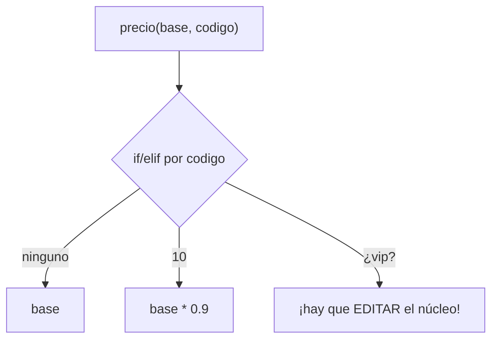
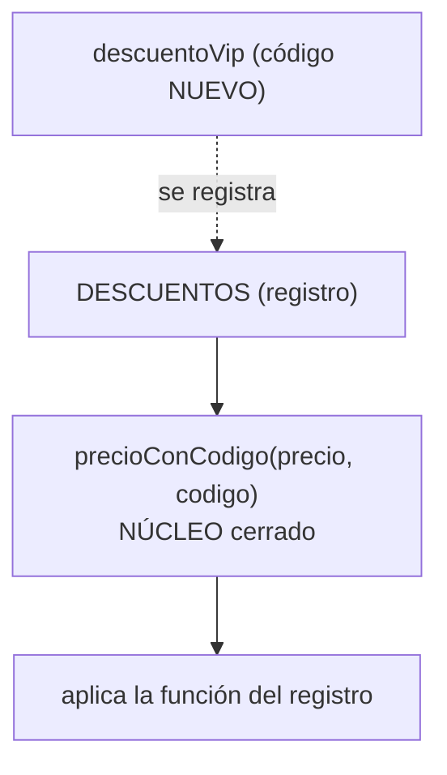

# Lección 14 — OCP (Open/Closed Principle)

> Fase 0 · Formulario · SOLID · Familia de concepto: **abierto a extensión, cerrado a modificación** · Orden de estudio: **15 de 18**

⬅️ [Lección 13 · SRP](../13-srp/) · 🏠 [Índice de lecciones](../README.md) · ➡️ [Lección 15 · LSP](../15-lsp/)

---

## 🧭 Ruta de estudio · Lección 14 (≈ 1.5 h)

**Antes necesitas:** [Lección 11 · Polimorfismo](../11-polimorfismo/) y [Lección 13 · SRP](../13-srp/).

| Paso | Qué haces | Dónde | ⏱ |
|:-:|---|---|:-:|
| **0** | Lee la teoría, las recetas y el diagnóstico | este README §0–§8 | 20 min |
| **1** | Ejecuta las recetas | [`paso1-formulas.php`](paso1-formulas.php) | 10 min |
| **2** | Sigue los ejemplos (if/elif → extensión) | §9 + [`paso2-ejemplos-resueltos.php`](paso2-ejemplos-resueltos.php) | 15 min |
| **3** | Corre los tests (**rojo**) y completa los `// TODO` hasta **verde** | [`paso3-tu-turno.php`](paso3-tu-turno.php) + [`Paso3TuTurnoTest.php`](Paso3TuTurnoTest.php) | 20 min |
| **4** | Compara con la solución de referencia | [`paso4-tu-turno-solucion.php`](paso4-tu-turno-solucion.php) | 5 min |
| **5** | Resuelve los 12 problemas | §10–§11 + [`paso5-solucionario/`](paso5-solucionario/) | 20 min |
| **6** | Compara mala vs buena | [`paso6-ejercicios/`](paso6-ejercicios/) | 10 min |
| **7** | Preguntas de recuerdo | §15 | 5 min |
| **🚦** | Semáforo | §16 | 1 min |

---

## 0. 🧭 La pregunta
> *"Cada vez que aparece un caso nuevo (otro descuento, otro tipo de envío) tengo que **editar**
> una función que ya funcionaba, y rezar por no romperla. ¿Cómo lo evito?"*

## 1. Objetivos
1. Explicar el OCP: **abierto a extensión, cerrado a modificación**.
2. Reconocer el `if/elif` que crece como el olor principal.
3. Extender con **función nueva**, **clase nueva** o **entrada nueva** en un registro, sin tocar el núcleo.
4. Ver que el *message bus* del cap. 8 es OCP puro.

## 2. Cita de la fuente
> *"SOLID is an acronym for Robert C. Martin's five principles of object-oriented design:
> single responsibility, open for extension but closed for modification, Liskov substitution,
> interface segregation, and dependency inversion."* — Introducción (nota 2)

> *"A message bus basically says, "When I see this event, I should invoke the following handler
> function." … we usually implement it with a dict"* — Cap. 8

> *"def handle(event: events.Event): for handler in HANDLERS[type(event)]: handler(event)"* — Cap. 8

**Equivalente en PHP** (§3.10): el núcleo recibe la regla/clase; lo nuevo se **agrega**.
```php
$descuentos["vip"] = fn(float $p) => $p * 0.7;   // caso nuevo = entrada nueva, sin tocar el núcleo
// el núcleo recibe el mapa como parámetro (en PHP una función NO ve las variables de fuera):
function precioConCodigo(array $descuentos, string $codigo, float $precio): float {
    return ($descuentos[$codigo])($precio);
}
```
**Por qué importa:** el *message bus* del cap. 8 es OCP puro. `handle()` **nunca cambia**: para
reaccionar a un evento nuevo solo se **agrega una entrada** al diccionario `HANDLERS`.

## 3. El dolor
```php
function precio(float $base, string $codigo): float {
    if ($codigo === "ninguno") return $base;
    elseif ($codigo === "10") return $base * 0.9;   // cada descuento nuevo -> otro elseif aquí
    return $base;
}
```
Agregar "vip" obliga a **editar** `precio` (y re-probar los casos viejos). Eso es lo que el OCP evita.

---

## 4. 📘 Teoría

> **🎯 Definición — OCP**
> El código debe estar **abierto a la extensión** (puedo agregar comportamiento) pero **cerrado a
> la modificación** (sin editar lo que ya funciona). Se logra dejando un **punto de extensión**:
> una función que se recibe, una clase que se hereda, o una entrada en un registro.

> **🔤 Vocabulario**
> - **Núcleo cerrado:** la función/clase que **no** cambia al agregar casos.
> - **Punto de extensión:** el hueco por donde entra lo nuevo (parámetro `callable`, subclase, clave del array).
> - **Registro:** un array asociativo `código => función`.
> - **Message bus:** un registro `evento => [manejadores]` (cap. 8).

> **🧠 Regla de oro**
> Si puedes agregar el caso nuevo escribiendo **solo código nuevo** (sin editar el viejo), cumples el OCP.

---

## 5. 🧮 Formulario: recetas OCP
| # | Síntoma / olor | Regla | Plantilla PHP | Qué logra |
|---|---|---|---|---|
| O1 | `if/elif` por **regla** | Cada regla es una **función** que el núcleo recibe | `function precioFinal($p, callable $regla) { return $regla($p); }` | Regla nueva = función nueva |
| O2 | `if/elif` por **tipo** | **Polimorfismo**: una subclase por caso | `class EnvioExpress extends Envio { costo() { return 20; } }` | Tipo nuevo = clase nueva |
| O3 | `if/elif` por **texto/código** | Un **registro** `[código => función]` | `$descuentos["vip"] = $f;` | Caso nuevo = entrada nueva |
| O4 | Reglas **en serie** | Una **lista** de funciones que se recorre | `$validaciones[] = $sinEspacios;` | Regla nueva = append |
| O5 | Extensiones que "olvidan" un método | Una **interface** que obliga al contrato | `interface Descuento { aplicar($p); }` | No deja extensiones incompletas |
| O6 | Reaccionar a **eventos** | Dict de **listas** de manejadores (message bus) | `$manejadores["SinStock"][] = $avisarSms;` | Evento/aviso nuevo sin tocar `manejar` |

> 💡 Ejecutables en [`paso1-formulas.php`](paso1-formulas.php).

## 6. 🔍 Diagnóstico: ¿viola el OCP?
| # | Pregunta | Si… | …entonces |
|---|---|---|---|
| G1 | Para un caso nuevo, ¿**edito** una función que ya funcionaba? | Sí | Falta un punto de extensión → O1, O2, O3 |
| G2 | ¿Hay un `if/elif` que **crece**? | Sí | Registro o polimorfismo → O2, O3 |
| G3 | ¿El **mismo** `if/elif` se repite en varios lugares? | Sí | Polimorfismo → O2 |
| G4 | Al agregar, ¿tengo que **re-probar** todos los viejos? | Sí | El núcleo no está cerrado |
| G5 | ¿Puedo agregarlo con **solo** código nuevo? | No | No cumple OCP |
| G6 | ¿El cambio es **real** o "por si acaso"? | "por si acaso" | No abras todavía (E1) |

## 7. 📐 Propiedades
| # | Propiedad |
|---|---|
| **P1** | El **núcleo cerrado** no se vuelve a tocar: así no se rompe lo que ya andaba. |
| **P2** | Cada caso nuevo es **código nuevo**: se prueba solo, sin re-probar todos los viejos. |
| **P3** | Se apoya en lo que ya sabes: **funciones como valores** (`callable`, Lección 04) y **polimorfismo** (Lección 11); el registro y el message bus usan **arrays** (Lección 05). |
| **P4** | No abras **todo** por si acaso: abre el punto de extensión cuando el dolor aparece (YAGNI). |
| **P5** | Un `if` pequeño y **estable** (que no crece) está bien; el problema es el que **crece** con cada caso. |
| **P6** | "Cerrado" es para **agregar comportamiento**; los **bugs** sí se corrigen editando. |

## 8. ⚠️ Errores frecuentes
| # | ❌ Así no | Qué pasa (mensaje real de PHP 8.3) | ✅ Así sí |
|---|---|---|---|
| E1 | Abrir puntos de extensión "por si acaso" | Código abstracto sin necesidad (sobreingeniería) | Abre cuando llega el **segundo** caso real |
| E2 | Dejar el `if/elif` y "además" un registro | Dos caminos que se contradicen | Un solo mecanismo de extensión |
| E3 | Que cada subclase reimplemente el núcleo | Se pierde el "cerrado" | El núcleo llama al método polimórfico |
| E4 | `$mapa["NO-EXISTE"]` revienta | `Warning: Undefined array key "NO-EXISTE"` (y al llamarlo: `Error: Value of type null is not callable`) | `$mapa[$c] ?? $porDefecto` |
| E5 | Pasar el **resultado** en vez de la **función**: `precioFinal(100, descuento10(100))` | `TypeError: precioFinal(): Argument #2 ($regla) must be of type callable, float given` | pasa la función sin llamarla: `precioFinal(100, 'descuento10')` |
| E6 | Extender una clase abstracta y **olvidar** el método: `class EnvioRoto extends Envio {}` | `Fatal error: Class EnvioRoto contains 1 abstract method and must therefore be declared abstract or implement the remaining methods (Envio::costo)` | implementa el método en la extensión: `public function costo(): int { … }` |

---

## 9. ✍️ Ejemplos resueltos (if/elif → extensión)
> Todos están en [`paso2-ejemplos-resueltos.php`](paso2-ejemplos-resueltos.php).

**Ejemplo 1 — Descuentos con registro (O3)**
```php
$descuentos = ["ninguno" => fn(float $p) => $p, "10" => fn(float $p) => $p * 0.9];
$descuentos["vip"] = fn(float $p) => $p * 0.7;   // agregado SIN tocar precioCon
function precioCon(array $d, float $precio, string $codigo): float { return $d[$codigo]($precio); }
echo precioCon($descuentos, 100, "vip");          // -> 70
```

**Ejemplo 2 — Tipos de envío con polimorfismo (O2)**
```php
abstract class Envio { abstract public function costo(): int; }
class EnvioNormal extends Envio { public function costo(): int { return 10; } }
class EnvioExpress extends Envio { public function costo(): int { return 20; } }
function totalConEnvio(int $precio, Envio $e): int { return $precio + $e->costo(); }  // NÚCLEO cerrado
echo totalConEnvio(100, new EnvioExpress());      // -> 120
```

**Ejemplo 3 — Validaciones en serie (O4)**
```php
$validaciones = [fn(string $t) => $t !== "", fn(string $t) => strlen($t) <= 10];
$validaciones[] = fn(string $t) => !str_contains($t, " ");   // regla nueva = append
function esValido(array $vs, string $t): bool { foreach ($vs as $v) { if (!$v($t)) return false; } return true; }
echo var_export(esValido($validaciones, "ana lopez"), true);  // -> false
```

**Ejemplo 4 — Message bus: evento nuevo sin tocar `manejar` (O6, cap. 8)**
```php
$manejadores = ["SinStock" => [fn(string $d) => print("EMAIL: $d\n")]];
function manejar(array $m, string $evento, string $dato): void { foreach ($m[$evento] ?? [] as $h) $h($dato); }
$manejadores["Asignado"] = [fn($d) => print("REGISTRO: $d\n"), fn($d) => print("ALMACÉN: $d\n")];  // evento NUEVO
manejar($manejadores, "Asignado", "pedido-1");
```

---

## 10. 📝 Problemas propuestos
**🟢 Nivel básico**
1. Explica con tus palabras "abierto a extensión, cerrado a modificación".
2. Escribe `$descuento20` (paga 80 %) y úsala con `precioFinal($precio, $regla)` **sin tocar** `precioFinal`. ¿Cuánto da para 100?
3. ¿Viola el OCP una función que calcula el área con `if ($figura === "rectangulo") … elseif ("cuadrado")`? ¿Por qué?
4. Con `$saludos = ["es" => …, "en" => …]` y `saludar($idioma, $nombre)`, agrega el portugués (`"Olá, Ana"`) **sin tocar** `saludar`.

**🟡 Nivel intermedio**

5. Convierte un impuesto por país con `if/elif` en un registro (Perú 18 %, México 16 %). Agrega Chile 19 % sin tocar `impuesto(...)`. Prueba con 100.
6. Con `Figura`, `Rectangulo`, `Cuadrado` y `areaTotal($figuras)`, agrega `Triangulo($base, $altura)` sin tocar `areaTotal`. ¿Cuánto da `[Rectangulo(2,3), Cuadrado(4), Triangulo(6,2)]`?
7. Con `$validaciones = [noVacio, max10]` y `esValido($texto)`, agrega `sinEspacios`. ¿Qué da para `"ana"` y `"ana lopez"`?
8. Encuentra y corrige el error de `precioFinal(100, descuento10(100))`.

**🔴 Nivel avanzado**

9. Crea una interface `Exportador` con `exportar($datos)`, y `ExportadorCsv` (`"mesa,silla"`), `ExportadorLineas` (`"mesa | silla"`). Con `exportarTodo($datos, $exportadores)`, agrega `ExportadorMayusculas` sin tocar `exportarTodo`.
10. Haz que `precioSeguro(..., "NO-EXISTE")` **no reviente** y cobre sin descuento.
11. Crea `registrar($nombre, $funcion)` como **único** punto de extensión y agrega `"cumple"` (resta 15). ¿Qué claves quedan y cuánto da para 100?
12. *(Puente al libro)* Con `$manejadores = ["SinStock" => [...]]` y `manejar($evento, $dato)`, agrega el evento `"Asignado"` con **dos** manejadores, sin tocar `manejar`.

## 11. 🔑 Claves (respuestas)
<details><summary>Ver claves (solo después de intentarlo)</summary>

| # | Salida / respuesta | Receta |
|---|---|---|
| 1 | Agregar comportamiento nuevo con código nuevo, sin editar el viejo | §4 |
| 2 | `80` | O1 |
| 3 | **Sí**: cada figura nueva obliga a otro `elseif` | G1, G2 |
| 4 | `Olá, Ana` | O3 |
| 5 | `18 16 19` | O3 |
| 6 | `28` | O2 |
| 7 | `true false` | O4 |
| 8 | `TypeError` (un número no es `callable`); corregido → `90` | E5 |
| 9 | `mesa,silla` / `mesa \| silla` / `MESA,SILLA` | O5 |
| 10 | `100 90` | E4 |
| 11 | claves `["10","cumple","ninguno"]` y `85` | O3 |
| 12 | `EMAIL -> MESA`, luego `REGISTRO -> asignado …` y `ALMACÉN -> preparar …` | O6 + cap. 8 |

Código completo en [`paso5-solucionario/`](paso5-solucionario/).
</details>

---

## 12. 🗺️ Diagrama antes / después (Mermaid)
**Antes** — un `if/elif` que crece dentro del núcleo:

**Después** — un registro; el núcleo queda cerrado:

**Cómo leerlo:** antes, cada caso nuevo entra editando el `if/elif`. Después, el caso nuevo se
**registra** desde afuera y `precioConCodigo` nunca cambia.

## 13. 🌳 Árbol de archivos
```
lecciones/14-ocp/
├── README.md
├── paso1-formulas.php            ← recetas O1–O6
├── paso2-ejemplos-resueltos.php
├── paso3-tu-turno.php            ← completa los // TODO
├── Paso3TuTurnoTest.php          ← tests (rojo → verde)
├── paso4-tu-turno-solucion.php
├── paso5-solucionario/
└── paso6-ejercicios/
```

## 14. 🤝 Tu turno y ✅ comprobación con PHPUnit
```bash
vendor/bin/phpunit lecciones/14-ocp
# al empezar: Tests: 5, Errors: 4   (rojo)
# al terminar: OK (5 tests)         (verde)
```
Fíjate: las funciones "NÚCLEO (cerrado)" son **idénticas** en `paso3` y `paso4`. Solo **agregas**
código nuevo (eso es el OCP).

## 15. ❓ Preguntas de recuerdo
<details><summary>1. ¿Qué significa "abierto a extensión, cerrado a modificación"?</summary>Puedo agregar comportamiento nuevo sin editar el código que ya funciona.</details>
<details><summary>2. ¿Cuál es el olor principal que delata una violación del OCP?</summary>Un `if/elif` que crece con cada caso nuevo.</details>
<details><summary>3. Tres formas de dejar un punto de extensión.</summary>Una función que se recibe (O1), una subclase (O2), o una entrada en un registro (O3).</details>
<details><summary>4. ¿Por qué el message bus del cap. 8 es OCP puro?</summary>`handle()` nunca cambia; un evento nuevo solo agrega una entrada al diccionario de manejadores.</details>
<details><summary>5. ¿Se deben abrir todos los puntos de extensión desde el principio?</summary>No: abre uno cuando aparece el segundo caso real (evita sobreingeniería).</details>
<details><summary>6. ¿En qué se apoya el OCP de la Lección 11?</summary>En el polimorfismo (misma interfaz, distintos comportamientos).</details>

---

## 16. 🚦 ¿Puedo pasar a la siguiente lección?
| Indicador | Criterio |
|:-:|---|
| 🟢 **Sí, sigue** | `vendor/bin/phpunit lecciones/14-ocp` en **verde** **y** ≥ 9/12 problemas **y** las 6 preguntas sin mirar |
| 🟡 **Repasa** | 6–8 → §8 y §9 |
| 🔴 **Repite** | < 6 → desde el Paso 0 |

Marca tu avance en [`progreso/fase-0-php.md`](../../progreso/fase-0-php.md).

---

⬅️ [Lección 13 · SRP](../13-srp/) · 🏠 [Índice de lecciones](../README.md) · ➡️ [Lección 15 · LSP](../15-lsp/)
