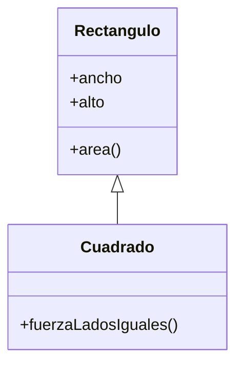
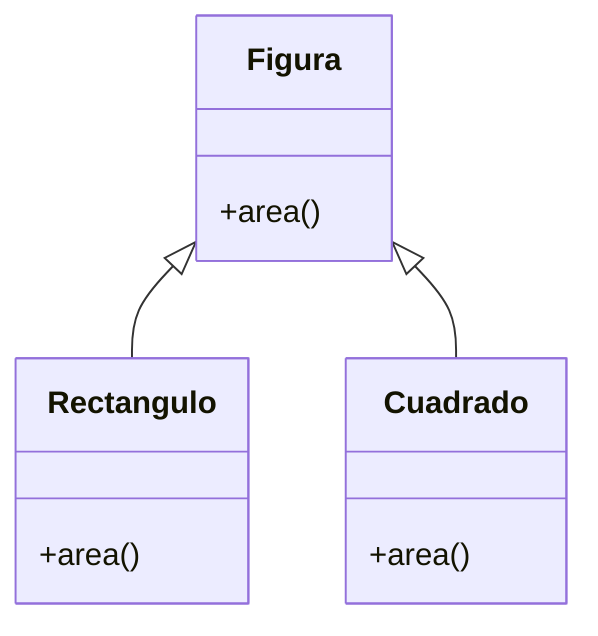

# Lección 15 — LSP (Liskov Substitution Principle)

> Fase 0 · Formulario · SOLID · Familia de concepto: **la hija sustituye a la madre sin sorpresas** · Orden de estudio: **16 de 18**

⬅️ [Lección 14 · OCP](../14-ocp/) · 🏠 [Índice de lecciones](../README.md) · ➡️ [Lección 16 · ISP](../16-isp/)

---

## 🧭 Ruta de estudio · Lección 15 (≈ 1.5 h)

**Antes necesitas:** [Lección 10 · Herencia](../10-herencia/) y [Lección 14 · OCP](../14-ocp/).

| Paso | Qué haces | Dónde | ⏱ |
|:-:|---|---|:-:|
| **0** | Teoría, reglas del contrato, diagnóstico | este README §0–§8 | 20 min |
| **1** | Ejecuta las reglas (verás `16` donde se esperaba `20`) | [`paso1-formulas.php`](paso1-formulas.php) | 10 min |
| **2** | Ejemplos (violación → arreglo) | §9 + [`paso2-ejemplos-resueltos.php`](paso2-ejemplos-resueltos.php) | 15 min |
| **3** | Tests en **rojo** → completa los `// TODO` → **verde** | [`paso3-tu-turno.php`](paso3-tu-turno.php) + [`Paso3TuTurnoTest.php`](Paso3TuTurnoTest.php) | 20 min |
| **4** | Compara con la referencia | [`paso4-tu-turno-solucion.php`](paso4-tu-turno-solucion.php) | 5 min |
| **5** | 12 problemas + claves | §10–§11 + [`paso5-solucionario/`](paso5-solucionario/) | 20 min |
| **6** | Mala vs buena | [`paso6-ejercicios/`](paso6-ejercicios/) | 10 min |
| **7** | Preguntas de recuerdo | §15 | 5 min |
| **🚦** | Semáforo | §16 | 1 min |

---

## 0. 🧭 La pregunta
> *"Reemplacé un objeto por uno de su subclase y el programa se comportó distinto (o reventó).
> ¿Cómo garantizo que una hija pueda sustituir a la madre sin sorpresas?"*

## 1. Objetivos
1. Explicar el LSP: si algo funciona con la madre, debe funcionar **igual** con cualquier hija.
2. Detectar violaciones (cambio de firma, de tipo, errores nuevos, invariantes rotas).
3. Escribir un **test de contrato** que valga para cualquier implementación.
4. Rediseñar jerarquías falsas (cuadrado-rectángulo) como **hermanas**.

## 2. Cita de la fuente
> *"SOLID is an acronym for Robert C. Martin's five principles of object-oriented design:
> single responsibility, open for extension but closed for modification, Liskov substitution,
> interface segregation, and dependency inversion."* — Introducción (nota 2)

> *"Here's one of the biggest benefits of the Repository pattern: A simple fake repository using
> a set (repository.py) class FakeRepository(AbstractRepository):"* — Cap. 2

> *"Python will refuse to let you instantiate a class that does not implement all the
> abstractmethods defined in its parent class."* — Cap. 2

**Equivalente en PHP** (§3.10): una clase `abstract` obliga a **tener** los métodos; que se
**comporten** igual lo garantizan tus tests. El falso debe cumplir el **mismo contrato** que el real.
```php
function guardarYLeer(RepositorioAbstracto $repo, string $ref): ?string { $repo->agregar($ref); return $repo->obtener($ref); }
// el mismo test vale para RepositorioEnMemoria (real) y RepositorioLista (otra implementación)
```
**Por qué importa:** todo el libro prueba la lógica con un `FakeRepository` **en lugar del** real.
Eso solo funciona si el falso **cumple el mismo contrato** que el real: eso es el LSP.

## 3. El dolor
```php
class Rectangulo { public int $ancho = 0; public int $alto = 0; public function area(): int { return $this->ancho * $this->alto; } }
class Cuadrado extends Rectangulo { /* fuerza ancho == alto */ }
```
Una función escrita para `Rectangulo` (agrandar solo el ancho) **se rompe** con un `Cuadrado`,
porque el cuadrado cambia una regla (invariante) que el rectángulo no tenía.

---

## 4. 📘 Teoría

> **🎯 Definición — LSP**
> Si el código funciona con un objeto de la clase madre, debe funcionar **igual de bien** con un
> objeto de cualquier hija, **sin tener que saber de qué hija se trata**.

> **🔤 Vocabulario**
> - **Sustituible:** la hija se puede usar donde se espera la madre, sin cambiar el código cliente.
> - **Contrato:** lo que la madre **promete** (firma, tipo de respuesta, comportamiento, errores).
> - **Invariante:** una regla que siempre se cumple (un rectángulo: ancho y alto son independientes).
> - **Test de contrato:** un mismo test que se pasa a cualquier implementación.

> **🧠 Regla de oro**
> Si una función necesita hacer `instanceof` para tratar distinto a una hija, esa hija **no** es sustituible.

---

## 5. 🧮 Formulario: reglas del contrato (LSP)
| # | Síntoma / olor | Regla | Plantilla PHP | Qué logra |
|---|---|---|---|---|
| LS1 | La hija cambia **nombre/parámetros** | **Misma firma** | `obtener(string $ref): ?string` en madre **y** hija | Se llama igual |
| LS2 | La hija devuelve **otro tipo** | **Mismo tipo** de respuesta | madre `?string`, hija `?string` | Quien usa el resultado no se rompe |
| LS3 | La hija **rechaza** entradas que la madre aceptaba | **No exigir más** | si la madre acepta cualquier `$ref`, la hija también | Mismos datos |
| LS4 | La hija **no cumple** lo prometido | **No prometer menos** | "lo agregado se obtiene; lo demás da `null`" | Resultados confiables |
| LS5 | La hija lanza un **error nuevo** | **No errores nuevos** | separar jerarquía: `Ave` → `AveVoladora` | Nadie se sorprende |
| LS6 | La hija rompe una **invariante** | **Respetar invariantes** | **hermanas**: `Figura` → `Rectangulo`, `Cuadrado` | La función de la madre sigue valiendo |

> 💡 Ejecutables en [`paso1-formulas.php`](paso1-formulas.php).

## 6. 🔍 Diagnóstico: ¿esta hija viola el LSP?
| # | Pregunta | Si… | …entonces |
|---|---|---|---|
| G1 | ¿Alguna función hace `instanceof` para tratar distinto a esta hija? | Sí | No es sustituible → regla de oro |
| G2 | ¿La hija lanza un error que la madre no lanzaba? | Sí | Viola LS5 → separa jerarquía |
| G3 | ¿Cambió parámetros, ignora alguno o devuelve otro tipo? | Sí | Viola LS1 / LS2 |
| G4 | Un test de la **madre**, ¿falla con la **hija**? | Sí | Viola LS4 o LS6 |
| G5 | ¿El **falso** de pruebas se comporta distinto que el **real**? | Sí | Tus tests mienten → test de contrato |
| G6 | ¿La hija "es un" la madre solo en el nombre, no en el comportamiento? | Sí | Probable LS6 → hermanas |

## 7. 📐 Propiedades
| # | Propiedad |
|---|---|
| **P1** | El polimorfismo (Lección 11) **solo es seguro** si se cumple el LSP. |
| **P2** | El patrón Repository del libro depende del LSP: el falso sustituye al real en los tests. |
| **P3** | Un **test de contrato** detecta las violaciones que `abstract` por sí solo no ve. |
| **P4** | A veces "A es un B" en la vida real **no** significa herencia en el código (cuadrado-rectángulo). |

## 8. ⚠️ Errores frecuentes
| # | ❌ Así no | Qué pasa | ✅ Así sí |
|---|---|---|---|
| E1 | Heredar porque "en la vida real A es un B" | La hija rompe invariantes (LS6) | Pregunta si se **comporta** igual; si no, hazlas **hermanas** |
| E2 | Lanzar `Exception` en un método heredado "que no aplica" | Sorpresa para quien usa la madre (LS5) | Separa la jerarquía: solo quien puede, hereda el método |
| E3 | La hija devuelve una lista donde la madre devolvía texto | El cliente se rompe (LS2) | Mismo tipo de respuesta |
| E4 | Creer que `abstract` garantiza el comportamiento | Solo obliga a **tener** el método, no a cumplirlo | Añade un **test de contrato** |
| E5 | Un falso de pruebas que se comporta distinto al real | Los tests pasan pero el real falla | El falso cumple el **mismo contrato** (cap. 2) |

---

## 9. ✍️ Ejemplos resueltos (violación → arreglo)
> Todos están en [`paso2-ejemplos-resueltos.php`](paso2-ejemplos-resueltos.php).

**Ejemplo 1 — Dos repositorios intercambiables (LS4)** *(fácil)*
> Enunciado: una función de alto nivel que funcione con **cualquier** repositorio que cumpla el
> contrato `agregar` / `obtener`.
```php
abstract class RepositorioAbstracto {
    abstract public function agregar(string $ref): void;
    abstract public function obtener(string $ref): ?string;
}
class RepositorioEnMemoria extends RepositorioAbstracto {
    private array $datos = [];
    public function agregar(string $ref): void { $this->datos[$ref] = $ref; }
    public function obtener(string $ref): ?string { return $this->datos[$ref] ?? null; }
}
class RepositorioFalso extends RepositorioAbstracto {
    private array $datos = [];
    public function agregar(string $ref): void { $this->datos[$ref] = true; }
    public function obtener(string $ref): ?string { return isset($this->datos[$ref]) ? $ref : null; }
}
// Escrita para la MADRE: funciona igual con las dos hijas.
function guardarYLeer(RepositorioAbstracto $repo, string $ref): ?string {
    $repo->agregar($ref);
    return $repo->obtener($ref);
}
echo guardarYLeer(new RepositorioEnMemoria(), "LOTE-001");   // -> LOTE-001
echo guardarYLeer(new RepositorioFalso(), "LOTE-001");       // -> LOTE-001
```

**Ejemplo 2 — El pingüino que no vuela (LS5)** *(fácil)*
> Enunciado: `PinguinoMalo extends AveMala` hereda `volar()` pero lanza un error. Arregla la jerarquía.
```php
// Paso 1 (violación): la hija lanza un error que la madre no lanzaba.
class AveMala { public function volar(): string { return "vuela"; } }
class PinguinoMalo extends AveMala {
    public function volar(): string { throw new \RuntimeException("los pingüinos no vuelan"); }
}
// (new PinguinoMalo())->volar()  ->  ROMPE: los pingüinos no vuelan

// Paso 2 (arreglo): la madre solo promete lo que TODAS cumplen (comer); volar baja a AveVoladora.
class Ave { public function comer(): string { return "come"; } }
class AveVoladora extends Ave { public function volar(): string { return "vuela"; } }
class Pato extends AveVoladora {}
class Pinguino extends Ave { public function nadar(): string { return "nada"; } }
foreach ([new Pato(), new Pinguino()] as $ave) { echo $ave->comer(); }   // -> come / come
```

**Ejemplo 3 — Rectángulo y Cuadrado (LS6)** *(intermedio)*
> Enunciado: `CuadradoMalo extends RectanguloMalo` rompe `agrandar`. Muestra el fallo y arréglalo.
```php
// Paso 1 (violación): Cuadrado fuerza lados iguales y rompe a quien confía en lados independientes.
class RectanguloMalo {
    protected int $ancho = 0; protected int $alto = 0;
    public function ponerAncho(int $a): void { $this->ancho = $a; }
    public function ponerAlto(int $a): void { $this->alto = $a; }
    public function area(): int { return $this->ancho * $this->alto; }
}
class CuadradoMalo extends RectanguloMalo {
    public function ponerAncho(int $a): void { $this->ancho = $a; $this->alto = $a; }
    public function ponerAlto(int $a): void { $this->ancho = $a; $this->alto = $a; }
}
function agrandar(RectanguloMalo $r): int { $r->ponerAncho(5); $r->ponerAlto(4); return $r->area(); }
// agrandar(new RectanguloMalo()) -> 20  ;  agrandar(new CuadradoMalo()) -> 16 (ROMPE)

// Paso 2 (arreglo): HERMANOS bajo Figura, no padre-hijo. Comparten solo area().
class Figura { public function area(): int { return 0; } }
class Rectangulo extends Figura {
    public function __construct(private int $a, private int $b) {}
    public function area(): int { return $this->a * $this->b; }
}
class Cuadrado extends Figura {
    public function __construct(private int $l) {}
    public function area(): int { return $this->l * $this->l; }
}
function areaTotal(array $figuras): int { $t = 0; foreach ($figuras as $f) { $t += $f->area(); } return $t; }
echo areaTotal([new Rectangulo(5, 4), new Cuadrado(3)]);   // -> 29
```

**Ejemplo 4 — Un test de contrato para el real y el falso (cap. 2)** *(avanzado)*
> Enunciado: **una sola** función de prueba que todo repositorio deba pasar, y úsala para descubrir
> un falso "con trampa".
```php
function probarContrato(RepositorioAbstracto $repo): string {
    $repo->agregar("L1");
    if ($repo->obtener("L1") !== "L1") { throw new \RuntimeException("lo agregado se debe poder obtener"); }
    if ($repo->obtener("NO-EXISTE") !== null) { throw new \RuntimeException("lo no agregado debe dar null"); }
    return "OK";
}
echo probarContrato(new RepositorioEnMemoria());   // -> OK
echo probarContrato(new RepositorioFalso());       // -> OK
// Un falso que guarda en minúsculas extiende la clase igual, pero NO cumple el contrato:
class RepositorioFalsoConTrampa extends RepositorioAbstracto {
    private array $datos = [];
    public function agregar(string $ref): void { $this->datos[strtolower($ref)] = strtolower($ref); }
    public function obtener(string $ref): ?string { return $this->datos[$ref] ?? null; }
}
// probarContrato(new RepositorioFalsoConTrampa()) -> FALLA: lo agregado se debe poder obtener
```
Solo el **test de contrato** descubre al falso con trampa; PHP lo deja extender la clase sin quejarse.

---

## 10. 📝 Problemas propuestos
**🟢 Nivel básico**
1. Explica el LSP en una frase.
2. Con `Animal->hablar()` y las hijas `Perro` (`"guau"`) y `Gato` (`"miau"`), escribe `describir($animal)` que devuelva `"dice …"`. ¿Funciona con ambas sin preguntar el tipo?
3. ¿Cumple el LSP una hija que lanza una excepción en un método heredado? ¿Por qué?
4. El repositorio real devuelve `null` si la referencia no existe. Escribe un falso que haga **lo mismo**.

**🟡 Nivel intermedio**

5. `CuentaSinRetiro` lanza un error en `retirar()`. Rediseña: `Cuenta` (depositar), `CuentaConRetiro`, `CuentaPlazoFijo`. Deposita 100 y retira 30 en una; deposita 500 en la otra.
6. Muestra con números el fallo de `Cuadrado extends Rectangulo` usando `agrandar` (ancho 5, alto 4).
7. La hija `RepoRaro` ignora `$ref` en `obtener`. ¿Qué devuelve? Corrígelo para respetar la firma y la promesa.
8. Escribe `contrato($repo)` y pásaselo a un repositorio con array asociativo y a otro con "set".

**🔴 Nivel avanzado**

9. Un repositorio "con trampa" guarda las referencias en minúsculas. Usa tu test de contrato (con `"Lote-A"`) para descubrirlo.
10. `Notificador->enviar()` promete devolver `true` si envió. Escribe un falso **malo** (devuelve `false`) y uno **bueno** (guarda y devuelve `true`). ¿Qué hace `avisar($notificador, $msg)` con cada uno?
11. Reemplaza una cadena de `instanceof` (`Gerente` cobra +500) por un método `pago()` en cada clase. Prueba con `Empleado(1000)` y `Gerente(2000)`.
12. *(Puente al libro)* Escribe `Repo` (`agregar`, `obtener`), un `RepoDict` y un `RepoSet` (como el `FakeRepository` del cap. 2). Comprueba que el test de contrato da lo mismo con los dos.

## 11. 🔑 Claves (respuestas)
<details><summary>Ver claves (solo después de intentarlo)</summary>

| # | Salida / respuesta | Idea |
|---|---|---|
| 1 | Si funciona con la madre, funciona **igual** con cualquier hija | §4 |
| 2 | `dice guau` / `dice miau`; **sí**, sin preguntar el tipo | P1 |
| 3 | **No**: lanza un error que la madre no lanzaba | LS5 |
| 4 | `null` | LS4 |
| 5 | saldos `70 500`; `CuentaPlazoFijo` no tiene `retirar` (`false`) | LS5 |
| 6 | esperado `20`; `Rectangulo: 20`, `CuadradoMalo: 25` | LS6 |
| 7 | ignora lo pedido; con la firma correcta `obtener(string $ref)` → confiable | LS1 |
| 8 | `OK OK` | test de contrato |
| 9 | `RepoBueno -> OK` / `RepoConTrampa -> FALLA: lo agregado se debe poder obtener` | E5 |
| 10 | real `avisado` · falso malo `NO avisado` · falso bueno `avisado ["hola"]` | LS4 |
| 11 | `3500` (sin `instanceof`) | regla de oro |
| 12 | `OK OK` (dict y set, mismo contrato) | P2 + cap. 2 |

Código completo en [`paso5-solucionario/`](paso5-solucionario/).
</details>

---

## 12. 🗺️ Diagrama antes / después (Mermaid)
**Antes** — jerarquía que rompe la invariante:

**Después** — hermanas bajo `Figura`:

**Cómo leerlo:** antes, `Cuadrado` hereda de `Rectangulo` y rompe su invariante (lados
independientes). Después, ambos heredan de `Figura`: comparten `area()` pero ninguno impone
reglas al otro. Cualquier función que use `Figura` funciona con los dos.

## 13. 🌳 Árbol de archivos
```
lecciones/15-lsp/
├── README.md
├── paso1-formulas.php            ← reglas LS1–LS6
├── paso2-ejemplos-resueltos.php
├── paso3-tu-turno.php
├── Paso3TuTurnoTest.php          ← tests (rojo → verde)
├── paso4-tu-turno-solucion.php
├── paso5-solucionario/
└── paso6-ejercicios/
```

## 14. 🤝 Tu turno y ✅ comprobación con PHPUnit
```bash
vendor/bin/phpunit lecciones/15-lsp
# al empezar: Tests: 5, Errors: 3   (rojo)
# al terminar: OK (5 tests)         (verde)
```
Los tests comprueban que `RepositorioLista` **sustituye** a `RepositorioEnMemoria` (mismo
contrato) y que `Cuadrado` es `Figura` pero **no** `Rectangulo`.

## 15. ❓ Preguntas de recuerdo
<details><summary>1. ¿Qué dice el LSP en una frase?</summary>Si el código funciona con la madre, debe funcionar igual con cualquier hija.</details>
<details><summary>2. Cuatro formas de romper el contrato.</summary>Cambiar la firma, cambiar el tipo de respuesta, lanzar errores nuevos, romper una invariante.</details>
<details><summary>3. ¿Garantiza <code>abstract</code> que la hija se comporte igual?</summary>No: solo obliga a **tener** los métodos. El comportamiento lo garantiza un **test de contrato**.</details>
<details><summary>4. ¿Por qué cuadrado no debería heredar de rectángulo?</summary>Rompe la invariante del rectángulo (lados independientes); una función del rectángulo falla.</details>
<details><summary>5. ¿Qué papel juega el LSP en el patrón Repository del libro?</summary>Permite usar un <code>FakeRepository</code> en lugar del real en los tests, con el mismo contrato.</details>
<details><summary>6. Si una función hace <code>instanceof</code> para tratar distinto a una hija, ¿qué indica?</summary>Que esa hija no es sustituible: viola el LSP.</details>

---

## 16. 🚦 ¿Puedo pasar a la siguiente lección?
| Indicador | Criterio |
|:-:|---|
| 🟢 **Sí, sigue** | `vendor/bin/phpunit lecciones/15-lsp` en **verde** **y** ≥ 9/12 problemas **y** las 6 preguntas sin mirar |
| 🟡 **Repasa** | 6–8 → §8 y §9 |
| 🔴 **Repite** | < 6 → desde el Paso 0 |

Marca tu avance en [`progreso/fase-0-php.md`](../../progreso/fase-0-php.md).

---

⬅️ [Lección 14 · OCP](../14-ocp/) · 🏠 [Índice de lecciones](../README.md) · ➡️ [Lección 16 · ISP](../16-isp/)
