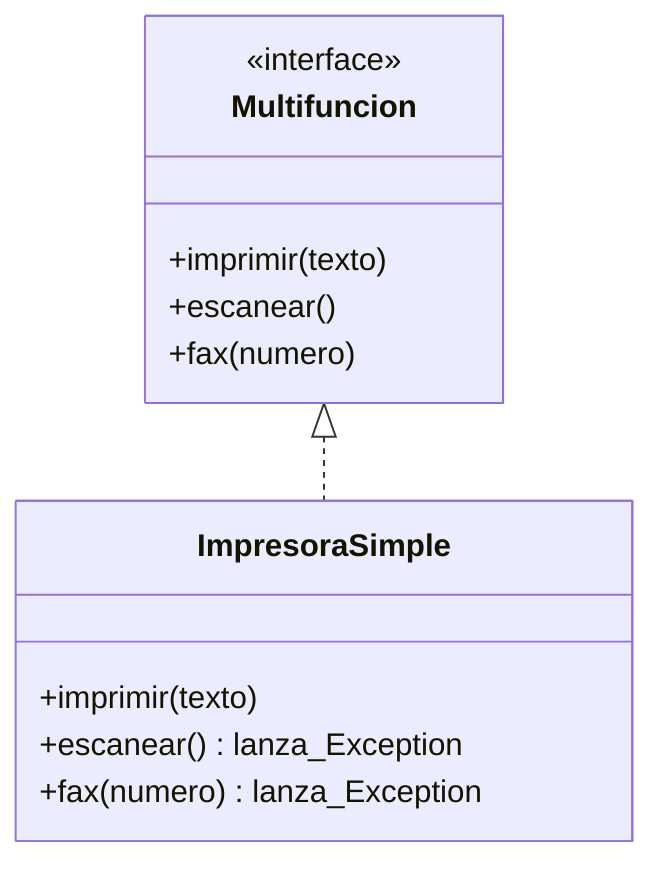
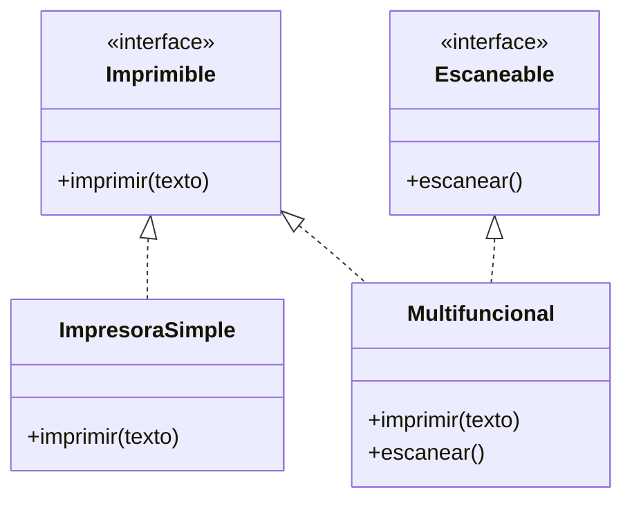

# Lección 16 — ISP (Interface Segregation Principle)

> Fase 0 · Formulario · SOLID · Familia de concepto: **interfaces pequeñas, por rol** · Orden de estudio: **17 de 18**

⬅️ [Lección 15 · LSP](../15-lsp/) · 🏠 [Índice de lecciones](../README.md) · ➡️ [Lección 17 · DIP](../17-dip/)

---

## 🧭 Ruta de estudio · Lección 16 (≈ 1.5 h)

**Antes necesitas:** [Lección 12 · Abstracción](../12-abstraccion/) (`interface`, `implements`) y [Lección 15 · LSP](../15-lsp/) (contratos e hijas intercambiables).

| Paso | Qué haces | Dónde | ⏱ |
|:-:|---|---|:-:|
| **0** | Lee la teoría, las recetas, el diagnóstico, las propiedades y los errores | este README §0–§8 | 20 min |
| **1** | Ejecuta las recetas: interfaz gorda → interfaces por rol | [`paso1-formulas.php`](paso1-formulas.php) | 10 min |
| **2** | Sigue los ejemplos resueltos (multifunción, falso mínimo, tipado por interfaz) | §9 + [`paso2-ejemplos-resueltos.php`](paso2-ejemplos-resueltos.php) | 15 min |
| **3** | Corre los tests (salen en **rojo**) y completa los `// TODO` hasta verlos en **verde** | [`paso3-tu-turno.php`](paso3-tu-turno.php) + [`Paso3TuTurnoTest.php`](Paso3TuTurnoTest.php) | 20 min |
| **4** | Compara con la solución de referencia | [`paso4-tu-turno-solucion.php`](paso4-tu-turno-solucion.php) | 5 min |
| **5** | Resuelve los 12 problemas, luego revisa claves y solucionario | §10–§11 + [`paso5-solucionario/`](paso5-solucionario/) | 20 min |
| **6** | Compara solución mala vs buena | [`paso6-ejercicios/`](paso6-ejercicios/) | 10 min |
| **7** | Responde las preguntas de recuerdo **sin mirar** | §15 | 5 min |
| **🚦** | Evalúa si puedes pasar a la siguiente | §16 | 1 min |

---

## 0. 🧭 La pregunta
> *"Mi reporte solo lee, pero depende de una interfaz gigante con métodos que no
> usa. ¿Cómo evito depender de lo que no necesito?"*

## 1. Objetivos (al terminar podrás…)
1. Explicar el ISP: **ningún cliente debe depender de métodos que no usa**.
2. Detectar una **interfaz gorda** por sus señales (métodos que lanzan una excepción "porque no aplica").
3. Partir una interfaz por **rol** y combinarlas en una clase que las necesite todas (`implements A, B`).
4. Entender el **tipado por interfaz** del libro: "un repositorio es cualquier objeto con `add` y `get`".

## 2. Cita de la fuente
> *"SOLID is an acronym for Robert C. Martin's five principles of object-oriented design:
> single responsibility, open for extension but closed for modification, Liskov
> substitution, interface segregation, and dependency inversion."* — Introducción (nota 2)

> *"In practice we often just rely on Python's duck typing to enable abstractions. To a
> Pythonista, a repository is any object that has add(thing) and get(id) methods."* — Cap. 2

**Equivalente en PHP (§3.10):** PHP **no** tiene *duck typing* como Python; en su lugar se usa
una **`interface`** pequeña. El `AbstractRepository` del libro tiene solo **dos** métodos (`add`
y `get`): es una interfaz **mínima**, justo lo que necesita quien la usa. Por eso escribir un
`RepositorioFalso` es trivial. Con una interfaz de 20 métodos, cada falso sería un infierno.
En PHP el equivalente del `AbstractRepository` es `interface Repositorio { add(); get(); }`.

## 3. El dolor
```php
interface Multifuncion {           // una interfaz para TODAS las impresoras
    public function imprimir(string $texto): string;
    public function escanear(): string;
    public function fax(string $numero): string;
}
final class ImpresoraSimple implements Multifuncion {
    public function imprimir(string $texto): string { return "imprime " . $texto; }
    public function escanear(): string { throw new \Exception("no escanea"); }   // ← obligada a mentir
    public function fax(string $numero): string { throw new \Exception("no tiene fax"); }
}
```
La impresora simple está **obligada** a tener métodos que no puede cumplir, y todo el que la use
puede llevarse una excepción inesperada. Además, si cambia la firma de `fax`, hay que tocar
**todas** las impresoras, aunque casi ninguna tenga fax.

---

## 4. 📘 Teoría

> **🎯 Definición — ISP (Principio de Segregación de Interfaces)**
> **Ningún cliente debe verse obligado a depender de métodos que no usa.** Mejor varias
> interfaces **pequeñas y específicas** (una por **rol**) que una grande para todo.

> **🧩 Interfaz, cliente y rol**
>
> | Palabra | Qué es | Ejemplo |
> |---|---|---|
> | **Interfaz** | el conjunto de métodos que se promete tener | `Lector` con `obtener()` |
> | **Cliente** | el código que **usa** esa interfaz | `reporte(Lector $lector, $ref)` |
> | **Rol** | lo que el cliente necesita que el objeto **haga** | "leer", "escribir", "imprimir" |
>
> El ISP mira desde el lado del **cliente**: ¿qué necesita **él**?

> **🔤 Vocabulario**
> - **Interfaz gorda:** una interfaz con muchos métodos de roles distintos.
> - **Segregar:** separar en partes.
> - **Implementar varias interfaces:** `class Repositorio implements Lector, Escritor` cumple las dos.
>   (En PHP una clase hereda de **una sola** clase con `extends`, pero puede **implementar varias
>   interfaces** con `implements A, B`. Por eso los roles se modelan como `interface`.)
> - **Tipado por interfaz:** el parámetro pide `Lector`; cualquier objeto que **implemente** `Lector` sirve.
> - **Falso mínimo:** un objeto de prueba con **solo** los métodos que el código probado usa.

> **🧠 Regla de oro**
> Pregunta qué necesita **el que USA** la interfaz, no qué **puede hacer** el que la implementa.

---

## 5. 🧮 Formulario: recetas ISP
| # | Síntoma / olor | Regla | Plantilla de código | Qué logra |
|---|---|---|---|---|
| I1 | Una interfaz **gorda** (muchos métodos, varios roles) | **Parte por rol** | `interface Lector { obtener }` · `interface Escritor { agregar }` | Cada cliente ve solo su parte |
| I2 | Implementaciones que lanzan una excepción "porque no aplica" | Es la **señal** de I1: separa | `class ImpresoraSimple implements Imprimible` | Nadie promete lo que no cumple |
| I3 | Una clase que **sí** necesita varios roles | **Implementa varias** interfaces | `class Repositorio implements Lector, Escritor` | Cumple solo lo que necesita |
| I4 | El cliente pide la interfaz **grande** aunque solo lee | El cliente declara la **mínima** | `function reporte(Lector $lector, $ref)` | Menos acoplamiento |
| I5 | Obligar a heredar solo para "entrar" | Basta con **implementar** la interfaz pequeña | cualquier objeto que `implements Lector` sirve | Flexibilidad (cap. 2) |
| I6 | Tests con falsos llenos de métodos que nunca se llaman | **Falso mínimo** por rol | `class LectorFalso implements Lector { obtener }` | Tests cortos y claros |

> 💡 Todas las recetas están ejecutables en [`paso1-formulas.php`](paso1-formulas.php), con su
> código (I1…I6) en cada línea de salida.

## 6. 🔍 Diagnóstico: ¿esta interfaz viola el ISP?
| # | Pregunta | Si respondes… | …entonces |
|---|---|---|---|
| G1 | ¿Alguna clase implementa un método lanzando un error porque "no aplica"? | Sí | Interfaz gorda → I1, I2 |
| G2 | ¿El cliente usa solo **1 o 2** de los muchos métodos de la interfaz? | Sí | Que pida una interfaz mínima → I4 |
| G3 | ¿Un cambio en un método que **no uso** me obliga a cambiar o re-probar mi código? | Sí | Acoplamiento innecesario → I1 |
| G4 | Para un test, ¿tengo que fabricar un falso con métodos que **nunca** se llaman? | Sí | → I6 |
| G5 | ¿La interfaz mezcla verbos de roles distintos (leer, imprimir, enviar)? | Sí | Parte por rol → I1 |
| G6 | ¿Partí tanto que cada interfaz tiene 1 método aunque **siempre** se usan juntos? | Sí | Te pasaste: agrupa (E2) |

## 7. 📐 Propiedades y consecuencias
| # | Propiedad |
|---|---|
| **P1** | Interfaces por **rol**: cada cliente depende solo de lo que usa. |
| **P2** | Los **falsos** para tests son pequeños y fáciles de escribir. |
| **P3** | Baja el **acoplamiento**: cambiar un rol no toca a los clientes de otro. |
| **P4** | Una clase puede **implementar varias** interfaces pequeñas a la vez (`implements A, B`). |
| **P5** | La `interface` **documenta** el rol y el compilador (`tsc` de PHP, el motor) avisa si falta un método. |
| **P6** | El ISP previene violaciones del **LSP**: sin métodos "que no aplican", no hay excepciones sorpresa. |

## 8. ⚠️ Errores frecuentes
| # | ❌ Así no | Qué pasa | ✅ Así sí |
|---|---|---|---|
| E1 | Una interfaz `Multifuncion` para una impresora simple | Métodos que lanzan `Exception: no tiene fax` | Una interfaz por capacidad: `Imprimible`, `Escaneable` |
| E2 | Partir en exceso: una interfaz por cada método, aunque siempre van juntos | Fragmentación: 10 interfaces para algo simple | Agrupa por **rol** (lo que un cliente usa junto) |
| E3 | `implements` dos interfaces y **olvidar** un método | `PHP Fatal error:  Class RepoIncompleto contains 1 abstract method and must therefore be declared abstract or implement the remaining methods (Escritor::agregar)` | Implementa los métodos de **todas** las interfaces |
| E4 | El cliente pide la interfaz **grande** aunque solo lee | Depende de cambios que no le importan | El parámetro pide la **mínima**: `Lector $lector` |
| E5 | Creer que todo objeto debe heredar de una clase base común | Burocracia innecesaria y herencia forzada | Usa `interface` pequeñas: una clase implementa solo las que cumple |
| E6 | Falsos de test con **todos** los métodos de la interfaz real | Ruido: no se sabe qué se está probando | Falso **mínimo**: solo lo que el código probado usa |

> 🔬 Pruébalo: crea una clase que diga `implements Lector, Escritor` pero sin el método
> `agregar`, ejecútala con `php` y lee el `Fatal error` de E3.

---

## 9. ✍️ Ejemplos resueltos
> Todos están en [`paso2-ejemplos-resueltos.php`](paso2-ejemplos-resueltos.php).

**Ejemplo 1 — Lector y Escritor** *(fácil)*
> Enunciado: el reporte solo lee. Haz que dependa solo de lo que usa.
```php
// Paso 1: dos interfaces pequeñas en vez de una grande (receta I1).
interface Lector { public function obtener(string $ref): ?string; }
interface Escritor { public function agregar(string $ref): void; }

// Paso 2: el repositorio cumple ambas porque necesita ambas (receta I3).
final class Repositorio implements Lector, Escritor {
    private array $datos = [];
    public function agregar(string $ref): void { $this->datos[$ref] = $ref; }
    public function obtener(string $ref): ?string { return $this->datos[$ref] ?? null; }
}

// Paso 3: el reporte solo pide un Lector (receta I4).
function reporte(Lector $lector, string $ref): string {
    return "Encontrado: " . $lector->obtener($ref);
}

$repo = new Repositorio();
$repo->agregar("LOTE-001");
echo reporte($repo, "LOTE-001");   // -> Encontrado: LOTE-001
```
`Lector $lector` **obliga por contrato**: solo entra un objeto que implemente `Lector` (a
diferencia de la *anotación* opcional de Python).

**Ejemplo 2 — La impresora multifunción** *(fácil)*
> Enunciado: separa la interfaz gorda de §3 para que la impresora simple no tenga que mentir.
```php
// Paso 1 (violación): ver §3. (new ImpresoraSimpleMala())->escanear() -> LANZA: no escanea

// Paso 2 (refactor): una interfaz por capacidad.
interface Imprimible { public function imprimir(string $texto): string; }
interface Escaneable { public function escanear(): string; }

final class ImpresoraSimple implements Imprimible {                 // solo lo que tiene
    public function imprimir(string $texto): string { return "imprime " . $texto; }
}
final class Multifuncional implements Imprimible, Escaneable {      // la que tiene más, cumple más
    public function imprimir(string $texto): string { return "imprime " . $texto; }
    public function escanear(): string { return "escanea"; }
}

// Paso 3 (uso): cada cliente pide solo la capacidad que necesita.
function imprimirTodo(array $impresoras, string $texto): void {
    foreach ($impresoras as $impresora) {
        echo get_class($impresora) . " -> " . $impresora->imprimir($texto) . "\n";
    }
}
imprimirTodo([new ImpresoraSimple(), new Multifuncional()], "hola");
// -> ImpresoraSimple -> imprime hola / Multifuncional -> imprime hola
```

**Ejemplo 3 — Un falso pequeño para probar el reporte** *(intermedio)*
> Enunciado: prueba `reporte` sin fabricar métodos que nunca se usan.
```php
// Paso 1: reporte depende solo de Lector, así que el falso solo necesita obtener() (receta I6).
final class LectorFalso implements Lector {
    public function __construct(private array $datos) {}
    public function obtener(string $ref): ?string { return $this->datos[$ref] ?? null; }
}

// Paso 2: el test es corto y claro.
$falso = new LectorFalso(["L1" => "mesa"]);
assert(reporte($falso, "L1") === "Encontrado: mesa");

// Paso 3: el falso tiene SOLO lo necesario.
echo var_export(method_exists($falso, "agregar"), true);   // -> false
```

**Ejemplo 4 — Tipado por interfaz, como dice el cap. 2** *(avanzado)*
> Enunciado: "a repository is any object that has `add(thing)` and `get(id)` methods". Escribe
> un repositorio que implemente **solo** una interfaz mínima de dos métodos y úsalo.
```php
// Paso 1: una interfaz MÍNIMA (solo add y get) y una clase que la cumple (receta I5).
interface RepositorioMinimo {
    public function add(string $lote): void;
    public function get(string $referencia): ?string;
}
final class AlmacenEnLista implements RepositorioMinimo {
    private array $lotes = [];
    public function add(string $lote): void { $this->lotes[] = $lote; }
    public function get(string $referencia): ?string {
        return in_array($referencia, $this->lotes, true) ? $referencia : null;
    }
}

// Paso 2: la función de alto nivel solo LLAMA add y get.
function guardarYConfirmar(RepositorioMinimo $repo, string $lote): bool {
    $repo->add($lote);
    return $repo->get($lote) === $lote;
}

// Paso 3: funciona con cualquier objeto que cumpla esa interfaz mínima.
echo var_export(guardarYConfirmar(new AlmacenEnLista(), "lote-9"), true);   // -> true
```
La interfaz real es "tener `add` y `get`", y eso es todo lo que el cliente necesita. En Python
esto se logra sin heredar de nada (*duck typing*); en PHP se escribe una `interface` pequeña.

---

## 10. 📝 Problemas propuestos
> Resuélvelos **antes** de mirar las claves. Puedes crear tu propio archivo
> (`mis-problemas.php`) en esta carpeta.

**🟢 Nivel básico**
1. Explica el ISP en una frase.
2. ¿Qué métodos usa `reporte(Lector $lector, $ref)` (Ejemplo 1)?
3. Una clase tiene `public function fax(): string { throw new \Exception(...); }`. ¿De qué es señal?
4. Crea la interfaz `Imprimible` con `imprimir(string $texto)` y una `ImpresoraSimple` que la cumpla.
   ¿Qué da `(new ImpresoraSimple())->imprimir("factura")`?

**🟡 Nivel intermedio**

5. `Trabajador(trabajar, comer)` obliga a un `Robot` a "comer". Pártela en `Trabajable` y
   `Alimentable`. `Humano` cumple las dos; `Robot` solo `Trabajable`. ¿El robot tiene `comer`?
6. Con `Repositorio implements Lector, Escritor`, muestra `$repo instanceof Lector` e
   `$repo instanceof Escritor`.
7. Di `implements Lector, Escritor` pero implementa **solo** `obtener`. ¿Qué pasa al ejecutar?
8. Escribe un `LectorFalso` mínimo (devuelve `"falso-" . $ref`) y pruébalo con `reporte` usando `assert`.

**🔴 Nivel avanzado**

9. `Almacen` tiene `agregar`, `obtener`, `listar`, `borrar` y `exportarCsv`. El `reporte` usa
   `obtener` y `listar`; el `importador` usa `agregar`. Diseña `Consulta` y `Carga`, haz que
   `Almacen` cumpla las dos, importa `["L1", "L2"]` y muestra el reporte.
10. Escribe `describir(SoloObtener $cualquiera, $ref)`, que solo llama a `obtener`, y úsala con una
    clase `Catalogo` que implemente solo `SoloObtener`. ¿Implementa `SoloObtener`?
11. Crea las interfaces `Correo` (`enviarCorreo`) y `Sms` (`enviarSms`) y una clase `Notificaciones`
    que cumpla las dos. Escribe `boletin(Correo $correo)` y `alerta(Sms $sms)`.
12. *(Puente al libro)* Escribe `RepositorioCasero` con **solo** `add` y `get` (interfaz mínima) y
    úsalo en `guardarLote(RepositorioMinimo $repo, $lote)`.

## 11. 🔑 Claves (respuestas)
<details><summary>Ver claves (solo después de intentarlo)</summary>

| # | Respuesta / salida esperada | Receta / idea |
|---|---|---|
| 1 | Ningún cliente debe depender de métodos que no usa: interfaces pequeñas, por rol | §4 |
| 2 | Solo `obtener()` | I4 |
| 3 | De una interfaz **gorda**: la obligan a tener un método que no puede cumplir | I2 |
| 4 | `imprime factura` | I1 |
| 5 | `trabaja come \| trabaja sin parar`; el robot **no** tiene `comer` (`false`) | I1, I2 |
| 6 | `true true` | I3 |
| 7 | `Fatal error: Class ... must ... implement the remaining methods (Escritor::agregar)` | E3 |
| 8 | `Encontrado: falso-L1` (el `assert` pasa) | I6 |
| 9 | `2 lotes: [L1, L2]` | I1 + I3 + I4 |
| 10 | `L1 es mesa`; implementa `SoloObtener` (`true`) y por eso entra en `describir` | I5 |
| 11 | `correo: ofertas \| sms: pedido listo` | I3 |
| 12 | `lote-7` | I5 + cap. 2 |

El código completo de cada solución está en [`paso5-solucionario/`](paso5-solucionario/):
[`nivel-basico.php`](paso5-solucionario/nivel-basico.php) ·
[`nivel-intermedio.php`](paso5-solucionario/nivel-intermedio.php) ·
[`nivel-avanzado.php`](paso5-solucionario/nivel-avanzado.php).
</details>

---

## 12. 🗺️ Diagrama antes / después (Mermaid)
**Antes** — una interfaz gorda para todos:

**Después** — una interfaz por rol; cada clase toma solo las que cumple:

**Cómo leerlo:** la flecha punteada `<|..` significa "**implementa** la interfaz". Antes,
`ImpresoraSimple` implementa **tres** obligaciones y dos las "cumple" lanzando excepciones.
Después, cada capacidad es una interfaz aparte: la impresora simple toma **una** flecha
(`Imprimible`) y la multifuncional toma **dos**. Nadie promete lo que no puede hacer.

## 13. 🌳 Árbol de archivos
```
lecciones/16-isp/
├── README.md                     ← PASO 0 · EMPIEZA AQUÍ (este formulario)
├── paso1-formulas.php            ← PASO 1 · las recetas I1–I6, ejecutables
├── paso2-ejemplos-resueltos.php  ← PASO 2 · los 4 ejemplos resueltos
├── paso3-tu-turno.php            ← PASO 3 · completa los // TODO
├── Paso3TuTurnoTest.php          ← PASO 3 · los tests (rojo → verde)
├── paso4-tu-turno-solucion.php   ← PASO 4 · solución de referencia
├── paso5-solucionario/           ← PASO 5 · soluciones de los 12 problemas
│   ├── nivel-basico.php
│   ├── nivel-intermedio.php
│   └── nivel-avanzado.php
└── paso6-ejercicios/             ← PASO 6 · solución mala vs buena
    ├── ejercicio-1/ … ejercicio-3/
    └── ejercicio-4-reto/
```

## 14. 🤝 Tu turno y ✅ comprobación con PHPUnit
La comprobación es con **PHPUnit**, al estilo **TDD**: los tests ya están escritos y
**empiezan en rojo a propósito**. Completa los `// TODO` de [`paso3-tu-turno.php`](paso3-tu-turno.php)
hasta que pasen a **verde**.
```bash
vendor/bin/phpunit lecciones/16-isp
# al empezar: Tests: 5, Errors: 3   (rojo: falta tu código)
# al terminar: OK (5 tests)         (verde)
```
Los 2 tests que pasan desde el inicio revisan el **diseño**: que `SoloLectura` sea `Lector` pero
**no** `Escritor`, y que `Repositorio` cumpla las dos. No los rompas al completar los TODO.

Para comparar con la referencia:
```bash
git diff --no-index lecciones/16-isp/paso3-tu-turno.php lecciones/16-isp/paso4-tu-turno-solucion.php
```

## 15. ❓ Preguntas de recuerdo
> Respóndelas **sin mirar**; luego abre cada una para comprobar.

<details><summary>1. ¿Qué dice el ISP?</summary>

Que ningún cliente debe depender de métodos que no usa: mejor varias interfaces pequeñas (por rol)
que una grande.
</details>
<details><summary>2. ¿Cuál es la señal más clara de una interfaz "gorda"?</summary>

Clases que implementan métodos lanzando una excepción "porque no aplica".
</details>
<details><summary>3. ¿Por qué separar <code>Lector</code> y <code>Escritor</code>?</summary>

Porque hay clientes que solo leen (el reporte) y otros que solo escriben (el respaldo); cada uno
depende solo de lo que usa.
</details>
<details><summary>4. ¿Puede una clase cumplir varias interfaces pequeñas?</summary>

**Sí**, implementando varias: `class Repositorio implements Lector, Escritor`. (En PHP se hereda
de una sola clase con `extends`, pero se implementan varias interfaces con `implements A, B`.)
</details>
<details><summary>5. ¿Qué dice el libro sobre un repositorio y cómo se expresa en PHP?</summary>

El libro: "a repository is any object that has add(thing) and get(id) methods". En Python es *duck
typing*; en PHP se escribe una `interface` pequeña con `add` y `get`.
</details>
<details><summary>6. ¿Cómo ayuda el ISP a los tests?</summary>

Los falsos son **mínimos**: solo tienen los métodos que el código probado usa.
</details>

---

## 16. 🚦 ¿Puedo pasar a la siguiente lección?
| Indicador | Criterio |
|:-:|---|
| 🟢 **Sí, sigue** | `vendor/bin/phpunit lecciones/16-isp` sale en **verde** (OK, 5 tests) **y** aciertas **≥ 9 de 12** problemas **y** respondes las 6 preguntas sin mirar |
| 🟡 **Repasa** | aciertas **6 a 8** → vuelve a §8 (errores frecuentes) y §9 (ejemplos resueltos) y reintenta los que fallaste |
| 🔴 **Repite la lección** | aciertas **menos de 6** → empieza otra vez desde el Paso 0 |

Cuando estés en 🟢, marca la lección en
[`progreso/fase-0-php.md`](../../progreso/fase-0-php.md) (sección *"Mi avance"*) y haz
commit; así también practicas Git.

---

⬅️ [Lección 15 · LSP](../15-lsp/) · 🏠 [Índice de lecciones](../README.md) · ➡️ [Lección 17 · DIP](../17-dip/)
