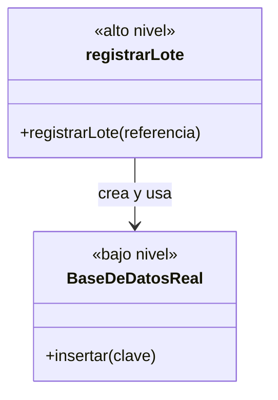
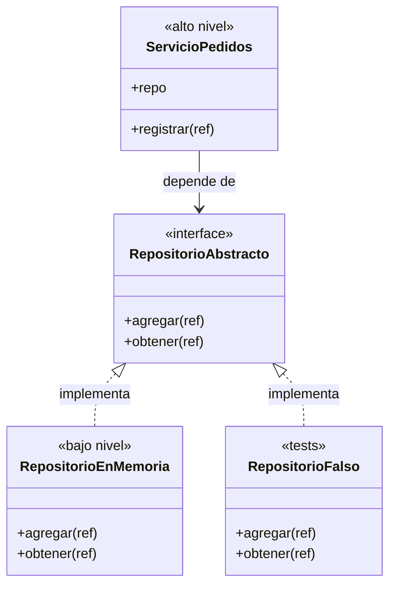

# Lección 17 — DIP (Dependency Inversion Principle) ⭐

> Fase 0 · Formulario · SOLID · Familia de concepto: **depender de abstracciones e inyectar los detalles** · Orden de estudio: **18 de 18**
> Es el principio clave para todo el libro: Repository (cap. 2), Service Layer (cap. 4) y Dependency Injection (cap. 13).

⬅️ [Lección 16 · ISP](../16-isp/) · 🏠 [Índice de lecciones](../README.md) · ➡️ [Fase 1 · Capítulos del libro](../../fase-1/capitulos/README.md)

---

## 🧭 Ruta de estudio · Lección 17 (≈ 2 h)

**Antes necesitas:** [Lección 12 · Abstracción](../12-abstraccion/) (`interface`) y [Lección 16 · ISP](../16-isp/) (interfaces pequeñas).

| Paso | Qué haces | Dónde | ⏱ |
|:-:|---|---|:-:|
| **0** | Lee la teoría, las recetas, el diagnóstico, las propiedades y los errores | este README §0–§8 | 25 min |
| **1** | Ejecuta las recetas: de "crear el detalle adentro" a "recibirlo" | [`paso1-formulas.php`](paso1-formulas.php) | 10 min |
| **2** | Sigue los ejemplos resueltos (hasta un mini *service layer* con `FakeRepository`) | §9 + [`paso2-ejemplos-resueltos.php`](paso2-ejemplos-resueltos.php) | 20 min |
| **3** | Corre los tests (salen en **rojo**) y completa los `// TODO` hasta verlos en **verde** | [`paso3-tu-turno.php`](paso3-tu-turno.php) + [`Paso3TuTurnoTest.php`](Paso3TuTurnoTest.php) | 25 min |
| **4** | Compara con la solución de referencia | [`paso4-tu-turno-solucion.php`](paso4-tu-turno-solucion.php) | 5 min |
| **5** | Resuelve los 12 problemas, luego revisa claves y solucionario | §10–§11 + [`paso5-solucionario/`](paso5-solucionario/) | 25 min |
| **6** | Compara solución mala vs buena | [`paso6-ejercicios/`](paso6-ejercicios/) | 10 min |
| **7** | Responde las preguntas de recuerdo **sin mirar** | §15 | 5 min |
| **🚦** | Evalúa si puedes pasar a la Fase 1 | §16 | 1 min |

---

## 0. 🧭 La pregunta
> *"Mi lógica crea la base de datos adentro, así que no puedo probarla sin una real
> ni cambiar de almacenamiento sin tocarla. ¿Cómo hago que no dependa del detalle?"*

## 1. Objetivos (al terminar podrás…)
1. Enunciar las **dos partes** del DIP tal como las da el libro.
2. Distinguir código de **alto nivel** (el negocio) de **bajo nivel** (detalles técnicos).
3. **Inyectar** dependencias: por parámetro, por constructor y como función (`callable`).
4. Probar la lógica con un **falso** (el `FakeRepository` del libro) en vez de una base de datos real.

## 2. Cita de la fuente
> *"You might be familiar with the dependency inversion principle (DIP) already, because it's
> the D in SOLID."* — Introducción, *The Dependency Inversion Principle*

> *"1. High-level modules should not depend on low-level modules. Both should depend on
> abstractions.
> 2. Abstractions should not depend on details. Instead, details should depend on
> abstractions."* — Introducción

> *"Depends on doesn't mean imports or calls, necessarily, but rather a more general idea that
> one module knows about or needs another module."* — Introducción

**Equivalente en PHP (§3.10):** el libro usa `AbstractRepository(abc.ABC)` con `add` y `get`. En
PHP la abstracción es una **`interface`** (`interface RepositorioAbstracto { agregar(); obtener(); }`)
y el detalle la **`implements`**. Según los propios autores, **toda la Parte I** del libro es un
ejemplo trabajado del DIP: el `AbstractRepository` del cap. 2 es la abstracción, el repositorio de
SQLAlchemy (en nuestro repo, **Eloquent**) es el detalle, y la *service layer* del cap. 4 recibe el
repositorio en vez de crearlo. Si entiendes esta lección, entiendes el esqueleto del libro.

## 3. El dolor
```php
function registrarLote(string $referencia): bool {
    $bd = new BaseDeDatosReal();        // ← la lógica CREA su detalle
    $bd->insertar($referencia);
    return isset($bd->filas[$referencia]);
}
```
- **No se puede probar** sin una base de datos de verdad encendida.
- **No se puede cambiar** de almacenamiento (memoria, archivo, otra base) sin **editar la lógica**.
- La regla de negocio (lo que le importa a la empresa) queda **atada** a un detalle técnico (lo que no le importa).

---

## 4. 📘 Teoría

> **🎯 Definición — DIP (Principio de Inversión de Dependencias)**
> 1. Los módulos de **alto nivel** no deben depender de los de **bajo nivel**. **Ambos** deben
>    depender de **abstracciones**.
> 2. Las **abstracciones** no deben depender de los **detalles**. Los **detalles** deben depender
>    de las **abstracciones**.

> **🧩 Alto nivel, bajo nivel y abstracción**
>
> | Pieza | Qué es | Ejemplo en el libro |
> |---|---|---|
> | **Alto nivel** | lo que le importa al **negocio**: reglas, casos de uso | `allocate` (asignar stock) |
> | **Bajo nivel** (detalle) | lo **técnico**: bases de datos, archivos, email, HTTP | el repositorio de Eloquent |
> | **Abstracción** | el contrato (`interface`) que **ambos** conocen | `RepositorioAbstracto` (`agregar`, `obtener`) |
>
> "Inversión": antes la flecha iba **lógica → base de datos**. Ahora **las dos** apuntan a la
> `interface`, y el detalle "sube" a implementarla.

> **💉 Inyección de dependencias (la técnica)**
> **Inyectar** = darle a una pieza sus dependencias **desde afuera** en lugar de que las cree
> adentro. Tres formas, de la más simple a la más estructurada:
> 1. por **parámetro**: `registrarLote($repo, $ref)`
> 2. por **constructor**: `new ServicioPedidos($repo)`
> 3. como **función** (`callable`): `avisarSinStock($sku, $enviar)` (para detalles simples, como `send_mail` en el cap. 13)
>
> En **Laravel** esto no se hace a mano: su **service container** (contenedor de servicios)
> **inyecta** las dependencias por el constructor automáticamente — tú declaras que un servicio
> necesita un `RepositorioAbstracto` y Laravel le entrega la implementación registrada. Es DIP
> industrializado, justo lo que el libro construye "a mano" como *bootstrap* en el **cap. 13**.

> **🔤 Vocabulario**
> - **Dependencia:** algo que una pieza **necesita** para funcionar (un repositorio, un notificador).
> - **Detalle:** una implementación concreta y técnica de una abstracción.
> - **Inyectar:** pasar la dependencia desde afuera.
> - **Componer / bootstrap:** el **único** lugar donde se decide qué detalle concreto se usa (cap. 13);
>   en Laravel, un *service provider*.
> - **Falso (*fake*):** un detalle de mentira, en memoria, para los tests.

> **🧠 Regla de oro**
> La lógica de negocio **no crea** sus detalles: **los recibe**.

---

## 5. 🧮 Formulario: recetas DIP
| # | Síntoma / olor | Regla | Plantilla de código | Qué logra |
|---|---|---|---|---|
| DIP1 | La lógica **crea** el detalle adentro (`new BaseDeDatosReal()`) | **Recibirlo** por parámetro | `function registrarLote(RepositorioAbstracto $repo, $ref)` | La lógica no sabe qué detalle usa |
| DIP2 | No hay contrato: la lógica conoce los métodos del detalle | Define la **abstracción** con lo que el **alto nivel** necesita | `interface RepositorioAbstracto { agregar; obtener }` | Un contrato estable para ambos lados |
| DIP3 | El detalle no "encaja" en ningún contrato | El **detalle implementa** la abstracción | `class RepositorioEnMemoria implements RepositorioAbstracto` | Detalles intercambiables |
| DIP4 | Una clase de servicio crea su repositorio en el constructor | Inyección por **constructor** | `public function __construct(private RepositorioAbstracto $repo) {}` | El servicio sirve con cualquier repo |
| DIP5 | Para probar hace falta la base de datos real | Inyecta un **falso** en los tests | `new ServicioLotes(new RepositorioFalso())` | Tests rápidos y sin infraestructura |
| DIP6 | La decisión "qué detalle usar" está regada por todas partes | **Componer** en **un** solo lugar | `function armarServicio(string $modo): ServicioLotes` | Cambiar de detalle = cambiar una línea |
| DIP7 | El detalle es solo **una acción** (enviar un mensaje) | Inyecta una **función** (`callable`) | `function avisarSinStock($sku, callable $enviar)` | Lo más simple que funciona |

> 💡 Todas las recetas están ejecutables en [`paso1-formulas.php`](paso1-formulas.php), con su
> código (DIP1…DIP7) en cada línea de salida.

## 6. 🔍 Diagnóstico: ¿esta lógica viola el DIP?
| # | Pregunta | Si respondes… | …entonces |
|---|---|---|---|
| G1 | ¿La lógica **crea** (`new X()`) o importa un detalle técnico adentro? | Sí | Inyéctalo → DIP1, DIP4 |
| G2 | ¿Puedo **probar** la lógica sin base de datos, internet ni email? | No | Falta una abstracción + falso → DIP2, DIP5 |
| G3 | Para **cambiar** de almacenamiento, ¿tengo que editar la lógica? | Sí | → DIP1, DIP3 |
| G4 | ¿La abstracción la define **quien la usa** (alto nivel) con palabras del negocio? | No (habla de SQL, tablas…) | La abstracción "filtra" el detalle (E2) |
| G5 | ¿En **cuántos** lugares se decide qué implementación usar? | Varios | Compón en uno → DIP6 (en Laravel, un *service provider*) |
| G6 | ¿Los tests usan un **falso** o tienen que parchear o *mockear*? | Parchear | La dependencia es implícita → inyéctala |

## 7. 📐 Propiedades y consecuencias
| # | Propiedad |
|---|---|
| **P1** | Alto nivel y bajo nivel dependen **los dos** de la abstracción, no uno del otro. |
| **P2** | Los detalles son **intercambiables** (memoria, archivo, Eloquent…) sin tocar la lógica. |
| **P3** | Los tests son **rápidos**: se inyecta un falso en memoria. |
| **P4** | "Depende de" significa "**sabe de** o **necesita**", no solo "importa" (cita del libro). |
| **P5** | La abstracción **no conoce** los detalles; habla el idioma del **negocio**. |
| **P6** | La implementación concreta se elige en **un solo lugar** (el *bootstrap* del cap. 13; en Laravel, el *service container*). |

## 8. ⚠️ Errores frecuentes
| # | ❌ Así no | Qué pasa | ✅ Así sí |
|---|---|---|---|
| E1 | Crear el detalle **adentro** de la lógica (`new X()`) | No se puede probar ni cambiar sin editarla | **Recíbelo** (DIP1, DIP4) |
| E2 | Una abstracción que "filtra" el detalle: `ejecutarSql($consulta)` | La lógica sigue escribiendo SQL: sigue atada | Métodos del **negocio**: `guardar($pedido)`, `buscar($id)` |
| E3 | Creer que DIP = "usar herencia" | Hay herencia, pero la lógica igual crea su detalle | Lo clave es **la dirección** de la dependencia **y** la **inyección** |
| E4 | Inyectar la **clase** en vez de un **objeto**: `registrarLote(RepositorioEnMemoria::class, "L1")` | `TypeError: registrarLote(): Argument #1 ($repo) must be of type RepositorioAbstracto, string given` | Con `new`: `registrarLote(new RepositorioEnMemoria(), "L1")` |
| E5 | Crear la abstracción: `new RepositorioAbstracto()` | `Fatal error: Uncaught Error: Cannot instantiate interface RepositorioAbstracto` | Se crea un **detalle**; la interface solo es el contrato |
| E6 | Un falso que **no cumple** el contrato | Los tests pasan y producción falla | Comprueba el falso con un **test de contrato** (Lección 15) |

> 🔬 Pruébalos: al final de [`paso1-formulas.php`](paso1-formulas.php) están E4 y E5 comentados.
> Quita el `//` de **una** línea, ejecuta, lee el mensaje y vuelve a ponerlo.

---

## 9. ✍️ Ejemplos resueltos
> Todos están en [`paso2-ejemplos-resueltos.php`](paso2-ejemplos-resueltos.php).

**Ejemplo 1 — Registrar un lote recibiendo el repositorio** *(fácil)*
> Enunciado: escribe `registrarLote` para que funcione con cualquier repositorio que cumpla el contrato.
```php
// Paso 1: la abstracción (lo que la lógica NECESITA).
interface RepositorioAbstracto {
    public function agregar(string $ref): void;
    public function obtener(string $ref): ?string;
}

// Paso 2: un detalle que la implementa.
final class RepositorioEnMemoria implements RepositorioAbstracto {
    private array $datos = [];
    public function agregar(string $ref): void { $this->datos[$ref] = $ref; }
    public function obtener(string $ref): ?string { return $this->datos[$ref] ?? null; }
}

// Paso 3: la lógica RECIBE el repositorio (inyección por parámetro).
function registrarLote(RepositorioAbstracto $repo, string $referencia): ?string {
    $repo->agregar($referencia);
    return $repo->obtener($referencia);
}

$repo = new RepositorioEnMemoria();             // decidimos AFUERA qué detalle usar
echo registrarLote($repo, "LOTE-001");          // -> LOTE-001
```

**Ejemplo 2 — Guardar notas sin atarse a un archivo** *(fácil)*
> Enunciado: `guardarNotaAtada` crea su `ArchivoTexto` adentro. Haz que lo reciba.
```php
final class ArchivoTexto {                      // el detalle (simula un archivo con una lista)
    public array $lineas = [];
    public function escribir(string $texto): void { $this->lineas[] = $texto; }
}

// Paso 1 (violación): la lógica crea su detalle.
function guardarNotaAtada(string $texto): int {
    $archivo = new ArchivoTexto();              // no lo puedo cambiar ni revisar desde afuera
    $archivo->escribir(strtoupper($texto));
    return count($archivo->lineas);
}

// Paso 2 (refactor, DIP1): la lógica recibe DÓNDE guardar.
function guardarNota(string $texto, ArchivoTexto $almacenamiento): void {
    $almacenamiento->escribir(strtoupper($texto));
}

// Paso 3 (uso): yo controlo el detalle y puedo revisar qué se guardó.
$archivo = new ArchivoTexto();
guardarNota("hola", $archivo);
guardarNota("chau", $archivo);
echo "[" . implode(", ", $archivo->lineas) . "]";   // -> [HOLA, CHAU]
```

**Ejemplo 3 — Servicio con inyección por constructor + test con falso** *(intermedio)*
> Enunciado: un `ServicioPedidos` que reciba su repositorio, y un test sin base de datos.
```php
// Paso 1 (DIP4): el servicio recibe el repositorio en el constructor.
final class ServicioPedidos {
    public function __construct(public readonly RepositorioAbstracto $repo) {}
    public function registrar(string $ref): ?string {
        $this->repo->agregar($ref);
        return $this->repo->obtener($ref);
    }
}

// Paso 2 (DIP5): un falso que cumple el contrato (LSP, Lección 15).
final class RepositorioFalso implements RepositorioAbstracto {
    private array $datos = [];
    public function agregar(string $ref): void { $this->datos[$ref] = $ref; }
    public function obtener(string $ref): ?string { return $this->datos[$ref] ?? null; }
}

// Paso 3: el test no necesita base de datos.
$falso = new RepositorioFalso();
$servicio = new ServicioPedidos($falso);
assert($servicio->registrar("P1") === "P1");
assert($servicio->repo === $falso);             // usa EXACTAMENTE el que le inyecté
```
`$a === $b` entre objetos responde si son **el mismo objeto** (la misma instancia), no solo
iguales. Aquí prueba que el servicio no creó otro repositorio por su cuenta.

**Ejemplo 4 — Un mini *service layer* con `FakeRepository`, como en los caps. 2 y 4** *(avanzado)*
> Enunciado: replica la abstracción `add`/`get` del libro, su `FakeRepository` en memoria, y un
> servicio `asignar` que recibe el repositorio.
```php
// Paso 1: la abstracción del libro (cap. 2), con un método extra para listar.
interface AbstractRepository {
    public function add(Lote $lote): void;
    public function get(string $referencia): ?Lote;
    public function list(): array;
}
final class Lote {
    public function __construct(
        public readonly string $referencia,
        public readonly string $sku,
        public int $cantidad,
    ) {}
}

// Paso 2: el FakeRepository del libro guarda en memoria.
final class FakeRepository implements AbstractRepository {
    private array $lotes = [];
    public function __construct(array $lotes) { foreach ($lotes as $l) { $this->lotes[$l->referencia] = $l; } }
    public function add(Lote $lote): void { $this->lotes[$lote->referencia] = $lote; }
    public function get(string $referencia): ?Lote { return $this->lotes[$referencia] ?? null; }
    public function list(): array { return array_values($this->lotes); }
}

// Paso 3: el servicio (alto nivel) RECIBE el repo. En producción sería el de Eloquent.
function asignar(string $sku, int $cantidad, AbstractRepository $repo): ?string {
    $referencias = [];
    foreach ($repo->list() as $lote) { $referencias[] = $lote->referencia; }
    sort($referencias);                          // ...y las recorremos en orden
    foreach ($referencias as $referencia) {
        $lote = $repo->get($referencia);
        if ($lote->sku === $sku && $lote->cantidad >= $cantidad) {
            $lote->cantidad = $lote->cantidad - $cantidad;
            return $lote->referencia;
        }
    }
    return null;
}

$repo = new FakeRepository([new Lote("lote-1", "MESA", 10), new Lote("lote-2", "MESA", 50)]);
echo asignar("MESA", 20, $repo);        // -> lote-2 (lote-1 solo tiene 10)
echo $repo->get("lote-2")->cantidad;    // -> 30
var_export(asignar("SILLA", 1, $repo)); // -> NULL
```
Este es, en pequeño, el esqueleto del cap. 4: un servicio que recibe un repositorio abstracto y se
prueba con un `FakeRepository`.

---

## 10. 📝 Problemas propuestos
> Resuélvelos **antes** de mirar las claves. Puedes crear tu propio archivo
> (`mis-problemas.php`) en esta carpeta.

**🟢 Nivel básico**
1. Clasifica en **alto nivel** o **bajo nivel**: `calcularDescuento`, `guardarEnMysql`,
   `enviarEmailSmtp`, `reglasDeStock`.
2. En `$repo = new RepositorioEnMemoria()` + `registrarLote($repo, "L1")`, ¿dónde está la inyección?
3. Esta función crea su repositorio adentro: `function registrarLote($referencia) { $repo = new RepositorioEnMemoria(); … }`.
   Corrígela para que lo **reciba** y pruébala con `"LOTE-001"`.
4. Escribe un `RepositorioFalso` e inyéctalo a la **misma** `registrarLote` sin cambiarla. Pruébala con `"LOTE-002"`.

**🟡 Nivel intermedio**

5. Escribe `class Tienda` que reciba su repositorio por el **constructor** y tenga
   `vender($producto)`, que lo guarda y devuelve `"vendido: …"`.
6. Escribe `registrarVenta($monto, callable $notificar)` que reciba una **función** para avisar.
   Úsala una vez con una lista (un *buzón falso*) y otra con una función que imprime.
7. ¿Qué error sale con `registrarLote(RepositorioEnMemoria::class, "L1")`? Corrígelo.
8. Una abstracción tiene `ejecutarSql($consulta)`. ¿Por qué sigue atando la lógica a SQL?
   Rediséñala con métodos del negocio (`guardar($pedido)`, `buscar($idPedido)`) y pruébala.

**🔴 Nivel avanzado**

9. Escribe un `RepositorioArchivo` (que guarde en una lista `$lineas`, simulando un archivo) y
   comprueba que `registrarLote` funciona **igual** con él y con `RepositorioEnMemoria`, sin tocarla.
10. Escribe **3** `assert` que prueben `ServicioPedidos` usando un falso, sin base de datos.
11. Escribe `armarApp($modo)` que devuelva un `ServicioPedidos` con un `RepositorioFalso` si
    `$modo === "test"` y con un `RepositorioEnMemoria` si no. ¿Qué repositorio tiene cada uno?
12. *(Puente al libro)* Escribe `AbstractRepository` (`add`, `get`), un `FakeRepository` en memoria
    y `reservar($referencia, $cantidad, $repo)`, que reste la cantidad si alcanza o devuelva
    `"no se pudo"`. Con `new Lote("lote-1", 10)`: reserva 4, luego 9, luego `"lote-X"`.

## 11. 🔑 Claves (respuestas)
<details><summary>Ver claves (solo después de intentarlo)</summary>

| # | Respuesta / salida esperada | Receta / idea |
|---|---|---|
| 1 | alto: `calcularDescuento`, `reglasDeStock` · bajo: `guardarEnMysql`, `enviarEmailSmtp` | §4 |
| 2 | El repositorio se **crea afuera** y se **pasa** como argumento a `registrarLote` | DIP1 |
| 3 | `LOTE-001` | DIP1 |
| 4 | `LOTE-002` | DIP5 |
| 5 | `vendido: mesa` | DIP4 |
| 6 | se imprime `venta de 200`; el buzón falso queda `[venta de 100]` | DIP7 |
| 7 | `registrarLote(): Argument #1 ($repo) must be of type RepositorioAbstracto, string given`; con `new RepositorioEnMemoria()` → `L1` | E4 |
| 8 | Porque la lógica tendría que **escribir SQL**: sigue conociendo el detalle. Con `buscar('o1')` → `{"id":"o1","total":50}` | E2 |
| 9 | `RepositorioEnMemoria -> LOTE-9` y `RepositorioArchivo -> LOTE-9` | P2 |
| 10 | `OK (3 asserts sin base de datos)` | DIP5 |
| 11 | `RepositorioFalso \| RepositorioEnMemoria` | DIP6 |
| 12 | `reservado; quedan 6` / `no se pudo` / `no se pudo` | caps. 2 y 4 |

El código completo de cada solución está en [`paso5-solucionario/`](paso5-solucionario/):
[`nivel-basico.php`](paso5-solucionario/nivel-basico.php) ·
[`nivel-intermedio.php`](paso5-solucionario/nivel-intermedio.php) ·
[`nivel-avanzado.php`](paso5-solucionario/nivel-avanzado.php).
</details>

---

## 12. 🗺️ Diagrama antes / después (Mermaid)
**Antes** — la lógica depende directamente del detalle:

**Después** — ambos dependen de la abstracción; el detalle se inyecta:

**Cómo leerlo:** antes, la flecha va de la lógica (**alto nivel**) al detalle (**bajo nivel**):
la lógica **crea y usa** la base de datos. Después, la lógica apunta a la **abstracción** (la
`interface`), y los detalles **también** apuntan a ella (flechas punteadas `<|..` = "implementa").
Esa es la **inversión**: el detalle ahora depende del contrato, no al revés. Es exactamente la
forma de la Parte I del libro (`AbstractRepository` ← repositorio de Eloquent / `FakeRepository`).

## 13. 🌳 Árbol de archivos
```
lecciones/17-dip/
├── README.md                     ← PASO 0 · EMPIEZA AQUÍ (este formulario)
├── paso1-formulas.php            ← PASO 1 · las recetas DIP1–DIP7, ejecutables
├── paso2-ejemplos-resueltos.php  ← PASO 2 · los 4 ejemplos resueltos
├── paso3-tu-turno.php            ← PASO 3 · completa los // TODO
├── Paso3TuTurnoTest.php          ← PASO 3 · los tests (rojo → verde)
├── paso4-tu-turno-solucion.php   ← PASO 4 · solución de referencia
├── paso5-solucionario/           ← PASO 5 · soluciones de los 12 problemas
│   ├── nivel-basico.php
│   ├── nivel-intermedio.php
│   └── nivel-avanzado.php
└── paso6-ejercicios/             ← PASO 6 · solución mala vs buena
    ├── ejercicio-1/ … ejercicio-3/
    └── ejercicio-4-reto/
```

## 14. 🤝 Tu turno y ✅ comprobación con PHPUnit
La comprobación es con **PHPUnit**, al estilo **TDD**: los tests ya están escritos y
**empiezan en rojo a propósito**. Completa los `// TODO` de [`paso3-tu-turno.php`](paso3-tu-turno.php)
hasta que pasen a **verde**.
```bash
vendor/bin/phpunit lecciones/17-dip
# al empezar: Tests: 4, Errors: 4   (rojo: falta tu código)
# al terminar: OK (4 tests)         (verde)
```
Fíjate en `$this->assertSame($repo, $servicio->repo)` dentro de [`Paso3TuTurnoTest.php`](Paso3TuTurnoTest.php):
el test **exige** que el servicio use el repositorio que **le inyectaste**, y no uno creado por su cuenta.

Para comparar con la referencia:
```bash
git diff --no-index lecciones/17-dip/paso3-tu-turno.php lecciones/17-dip/paso4-tu-turno-solucion.php
```

## 15. ❓ Preguntas de recuerdo
> Respóndelas **sin mirar**; luego abre cada una para comprobar.

<details><summary>1. ¿Cuáles son las dos partes del DIP?</summary>

1) Los módulos de alto nivel no deben depender de los de bajo nivel: **ambos** dependen de
abstracciones. 2) Las abstracciones no dependen de los detalles: los **detalles** dependen de las
abstracciones.
</details>
<details><summary>2. ¿Qué es "inyectar" una dependencia?</summary>

Dársela a una pieza **desde afuera** (por parámetro, por constructor o como función) en lugar de que la cree adentro.
</details>
<details><summary>3. ¿Por qué este principio es la base del Repository pattern del libro?</summary>

Porque la lógica depende de `RepositorioAbstracto` (la abstracción), y el repositorio de Eloquent y
el `FakeRepository` son detalles que se inyectan. Así la lógica se prueba sin base de datos.
</details>
<details><summary>4. Según el libro, ¿"depende de" significa "importa"?</summary>

**No necesariamente**: significa que un módulo **sabe de** o **necesita** a otro.
</details>
<details><summary>5. ¿Qué error ves si pasas <code>RepositorioEnMemoria::class</code> (el nombre) en vez de un objeto?</summary>

`TypeError: registrarLote(): Argument #1 ($repo) must be of type RepositorioAbstracto, string given`:
pasaste la **clase** (un string) en vez de un **objeto** (faltó `new`).
</details>
<details><summary>6. ¿Dónde se decide qué detalle concreto se usa?</summary>

En **un solo lugar** que compone la aplicación (el *bootstrap* del cap. 13; en Laravel, el *service
container*); en los tests, el test mismo inyecta el falso.
</details>

---

## 16. 🚦 ¿Puedo pasar a la Fase 1?
| Indicador | Criterio |
|:-:|---|
| 🟢 **Sí, sigue** | `vendor/bin/phpunit lecciones/17-dip` sale en **verde** (OK, 4 tests) **y** aciertas **≥ 9 de 12** problemas **y** respondes las 6 preguntas sin mirar |
| 🟡 **Repasa** | aciertas **6 a 8** → vuelve a §8 (errores frecuentes) y §9 (ejemplos resueltos) y reintenta los que fallaste |
| 🔴 **Repite la lección** | aciertas **menos de 6** → empieza otra vez desde el Paso 0 |

Cuando estés en 🟢, marca la lección en
[`progreso/fase-0-php.md`](../../progreso/fase-0-php.md) (sección *"Mi avance"*) y haz
commit; así también practicas Git. 🎉 Con esta lección **terminas la Fase 0**: lo siguiente es el
libro, empezando por los [Capítulos del libro](../../fase-1/capitulos/README.md).

---

⬅️ [Lección 16 · ISP](../16-isp/) · 🏠 [Índice de lecciones](../README.md) · ➡️ [Fase 1 · Capítulos del libro](../../fase-1/capitulos/README.md)
