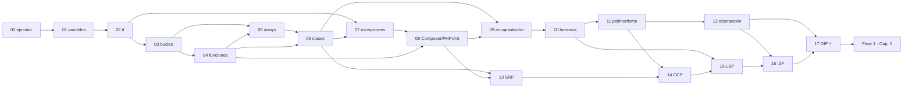

# Lecciones — Fase 0 (PHP, POO y SOLID)

🏠 [Inicio](../README.md) · 📖 [Cómo estudiar](../COMO-ESTUDIAR.md) · ➡️ [Fase 1 · Capítulos del libro](../fase-1/capitulos/README.md)

Estúdialas **en orden**. Cada lección es un **formulario**: empiezas por su `README.md` (paso 0)
y sigues los archivos `paso1-…` a `paso6-…`. Al final, su **semáforo 🚦** te dice si puedes pasar.

---

## ▶ Ruta de estudio

| Orden | Lección | Qué aprendes | Antes necesitas | ⏱ aprox. |
|:-:|---|---|---|:-:|
| **1** | [00 · ¿Qué es ejecutar un programa?](00-que-es-ejecutar-un-programa/) | instalar PHP y Composer, ejecutar un `.php`, `echo` | nada | 45 min |
| **2** | [01 · Variables y tipos](01-variables-y-tipos/) | `$variables`, `int`/`float`/`string`/`bool`, `var_dump` | 00 | 1.5 h |
| **3** | [02 · Condicionales](02-condicionales/) | `if` / `elseif` / `else`, `===`, `&&`, `\|\|` | 01 | 1.5 h |
| **4** | [03 · Bucles](03-bucles/) | `for`, `foreach`, `while`, acumular | 02 | 2 h |
| **5** | [04 · Funciones](04-funciones/) | `function`, parámetros y retorno tipados, funciones flecha | 03 | 2 h |
| **6** | [05 · Arrays](05-arrays/) | colecciones: por posición y por clave | 03, 04 | 2.5 h |
| **7** | [06 · Clases y objetos](06-clases-y-objetos/) | clase → instancia → objeto → uso | 04, 05 | 2.5 h |
| **8** | [07 · Excepciones](07-excepciones/) | errores con `throw` / `try` / `catch` | 02, 06 | 2 h |
| **9** | [08 · Módulos, Composer y primer PHPUnit](08-modulos-y-phpunit/) | `require`/autoload, Composer y tests | 04, 07 | 2.5 h |
| | **POO a fondo** | | | |
| **10** | [09 · Encapsulación](09-encapsulacion/) | `private`, `readonly`, getters | 06, 08 | 2 h |
| **11** | [10 · Herencia](10-herencia/) | `extends`, `parent::`, `override` | 09 | 2 h |
| **12** | [11 · Polimorfismo](11-polimorfismo/) | misma interfaz, distintos comportamientos | 10 | 2 h |
| **13** | [12 · Abstracción](12-abstraccion/) | `abstract class`, `interface` e `implements` | 11 | 2 h |
| | **SOLID** | | | |
| **14** | [13 · SRP](13-srp/) | una clase, una razón para cambiar | 06, 08 | 1.5 h |
| **15** | [14 · OCP](14-ocp/) | extender sin modificar | 11, 13 | 1.5 h |
| **16** | [15 · LSP](15-lsp/) | la hija puede sustituir a la madre | 10, 14 | 1.5 h |
| **17** | [16 · ISP](16-isp/) | interfaces pequeñas | 12, 15 | 1.5 h |
| **18** | [17 · DIP ⭐](17-dip/) | depender de abstracciones (clave para el libro) | 12, 16 | 2 h |

**Total Fase 0:** ≈ 33 h. Al terminar la 17 → [Fase 1 · Capítulos del libro](../fase-1/capitulos/README.md).

> 🔁 Las lecciones **00–17** tienen la misma numeración que en los repos de Python y TypeScript.
> PHP es síncrono, así que (a diferencia del repo de TypeScript) **no hay lección de asincronía**.

## 🗺️ Mapa de dependencias

**Cómo leerlo:** una flecha `A → B` significa "**B usa lo que aprendiste en A**".

---

🏠 [Inicio](../README.md) · 📖 [Cómo estudiar](../COMO-ESTUDIAR.md) · ➡️ [Fase 1 · Capítulos del libro](../fase-1/capitulos/README.md)
